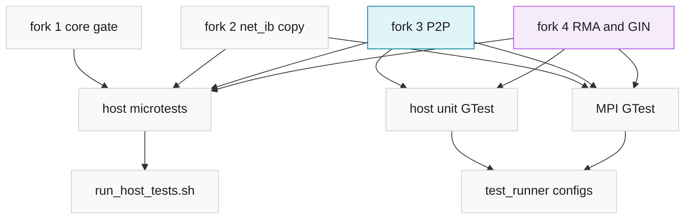

# Multi-segment validation plan

This plan lists every test the IB-MSEG fork stack adds (forks 1 to 4; forks 5 and 6 are planned), what each covers, its category, and the test_runner jobs and configs that run it. It also records the known gaps. The strategy, the runner job descriptions, how to run and the results are in [testing](multi_segment_testing.md). Terms follow the [overview](multi_segment_overview.md#terms).

Counts come from the `TEST`, `TEST_F` and `TEST_P` definitions under `projects/rccl/test` at fork 4. A test is counted in the first fork that defines it and only if it still exists at fork 4. Tests that already exist in develop are listed only where a job depends on them.

## Summary

The stack adds 327 tests: 112 host unit tests (GTest binaries that need no GPU), 145 host microtests (fake verbs and HIP, run by `test/host/run_host_tests.sh`) and 70 MPI tests (`rccl-UnitTestsMPI`, on GPUs and NICs). The four compile-twice IB-MSEG binaries also rerun the 180 tests of develop's `net_ib` host test files against the fork, minus the 14 they exclude; they are not counted because they are develop tests. The tests pull request on top of fork 4 adds 33 more MPI tests (25 in `UBR_MultiSegment`, 8 in `CeMPI_MultiSegment`) and moves the `UBR_MultiSegment` tests into `test/multisegment/`; the tables below stop at fork 4, and the tests pull request is described in [testing](multi_segment_testing.md#tests-pull-request).

| Fork | Host unit | Host microtest | MPI | Total |
|---|---|---|---|---|
| 1 core gate | 3 | 58 | 0 | 61 |
| 2 net_ib copy | 0 | 14 | 2 | 16 |
| 3 registration and P2P | 79 | 40 | 19 | 138 |
| 4 RMA and GIN | 30 | 33 | 49 | 112 |
| Total | 112 | 145 | 70 | 327 |

Only the fork-only tests in the `test/host/transport/net_ib_multiseg/` files are counted, including the fork's versions of the base tests it excludes as `replaced`; fork 4's compile-twice binaries replaced 167 copied test definitions there.

| Category | Fork 1 | Fork 2 | Fork 3 | Fork 4 | Total | Meaning |
|---|---|---|---|---|---|---|
| positive | 32 | 14 | 53 | 31 | 130 | a host-level unit or hook does the expected thing on valid input |
| negative | 12 | 0 | 36 | 30 | 78 | invalid input, a failed post or a missing MR is rejected or fails cleanly |
| corner case | 2 | 0 | 27 | 20 | 49 | boundaries, zero length, partial segments, offsets, wrap, mixed handles |
| compatibility | 15 | 1 | 11 | 6 | 33 | switch off, gates off, fallbacks, single-segment regressions |
| functional | 0 | 1 | 8 | 9 | 18 | MPI transfers on the multi-segment path with ordinary input |
| stress/scale | 0 | 0 | 3 | 12 | 15 | send-queue oversubscription, churn, sweeps, many pairs, many ranks |
| end-to-end | 0 | 0 | 0 | 4 | 4 | DeepEP windows and collectives through the full stack |

Each test has exactly one category. The first matching name rule wins, in the order compatibility, negative, stress/scale, corner case, end-to-end; the rest are positive at host level and functional at MPI level.

## Test tiers

Host microtests, and the host unit tests built into `rccl-HostUnitTests` (`test/RmaSegmentMathTests.cpp`), run only through `run_host_tests.sh` (CI's "Host unit tests (CPU-only)" stage), not through test_runner, so the Jobs column says "host tests" for them. Every other host unit suite the forks add is named by a test_runner job.

## Coverage by area

Counts give the categories in brackets.

### Fork 1: core gate

| Tests | File | Tier | Count | Covers | Jobs |
|---|---|---|---|---|---|
| `RmaSegmentMathTest.SegCountSupportedIsTheOnlyCap`, `SegTableFitsBoundsRanksTimesSegments`, `InflightCapAppliesOnlyToMultiSegmentChains` | `test/RmaSegmentMathTests.cpp` | host unit | 3 (2 positive, 1 corner) | the one count check `rcclIbSegCountSupported` against `RCCL_IB_REG_SEG_DEFAULT`, the segment-table bound, the in-flight cap | host tests (`rccl-HostUnitTests`) |
| `SymMemoryMapLsaTest` (14), `SymMemoryObtainRegisterTest` (5) | `test/host/dev-runtime-test.cc` | microtest | 19 (10 positive, 6 negative, 3 compatibility) | host owner fd: exactly one exporter publishes, importers fetch, several owners or a failed export import nothing; owner fd lifetime and agreement | host tests |
| `SymMemoryRegisterGinTest` (4), `SymMemoryRegisterGinElasticTest` (2), `SymMemoryRegisterRmaTest` (9), `SymMultiSegOnTest` (1) | `test/host/dev-runtime-test.cc` | microtest | 16 (10 positive, 4 compatibility, 2 negative) | window gates on the comm flag, DMA-BUF and backend; `rcclMultiSegOn` needs the plugin, the switch and DMA-BUF | host tests |
| `GinHostRegisterMicrotest` (4), `GinHostProxyRegMrMicrotest` (5), `GinHostProxyContextMicrotest` (1) | `test/host/gin/gin-host-test.cc`, `gin-host-proxy-test.cc` | microtest | 10 (6 positive, 4 compatibility) | the owner fd reaches `regMrSymDmaBuf`; with the flag on, fd -1 reaches a per-segment backend on every connection without an export; fallback without DMA-BUF, with the flag off or without the plugin entry; the queue size under the cap | host tests |
| `RmaProxyRegisterWindowTest` (3) | `test/host/rma/rma-proxy-test.cc` | microtest | 3 (1 positive, 2 compatibility) | an RMA window passes fd -1 to the per-segment backend without an export; the flag off, one segment or no DMA-BUF support keeps the plain registration | host tests |
| `NetProxyRegBufferMicrotest` (2), `NetProxyRegBufferCuMemMicrotest` (4) | `test/host/transport/net-test.cc` | microtest | 6 (3 negative, 2 positive, 1 compatibility) | the `fd = -1` call to a per-segment plugin and its declines | host tests |
| `ProxyServiceFixture`, `RmaProxyAllocGraphTest`, `RmaProxyDescriptorTest`, `HierCeAvailableMicrotest` | `test/host/proxy-test.cc`, `rma/rma-proxy-test.cc`, `rma/rma-proxy-launch-test.cc`, `ce-coll-test.cc` | microtest | 4 (1 each positive, corner, negative, compatibility) | the proxy copies the comm flag; the cap sizes the graph pool; a window without RMA registration fails the put and makes hierarchical CE fall back | host tests |

Fork 1 replaces three develop microtests whose expectations the gate changes (`SymMemoryRegisterGinTest.MultiSegmentDeviceWindow_RejectedBeforeRegistering`, `SymMemoryRegisterRmaTest.MultiSegment_ConnectsWithoutRegistering`, `NetProxyRegBufferMicrotest.Reg_HsaDmaBuf_RegistersByFdEvenAcrossSegments`).

### Fork 2: net_ib copy

| Tests | File | Tier | Count | Covers | Jobs |
|---|---|---|---|---|---|
| `PluginNetMicrotest` (6), `RmaPluginListTest` (1), `RasDiagnosticsCommonMicrotest` (1) | `test/host/plugin/plugin-net-test.cc`, `plugin/rma-plugin-init-test.cc`, `ras/ras-diagnostics-common-test.cc` | microtest | 8 (positive) | plugin selection, RMA backend choice, RAS treats IB-MSEG as verbs | host tests |
| `InitMicrotest` (2), `NetProxySetupMicrotest` (1), `NetRecvProgressMicrotest` (2), `NetRecvProxyConnectMicrotest` (1) | `test/host/init-test.cc`, `transport/net-test.cc` | microtest | 6 (positive) | the GDR flush flag through the fork | host tests |
| `NetIbMPITest.DefaultPluginIsIbMsegUnderMultiSegmentRegister` | `test/transport/NetIbMPI/GeneralTests.cpp` | MPI | 1 (functional) | the switch selects IB-MSEG when `NCCL_NET` is unset | `net_ib_initialization_mseg` |
| `NetPluginSelection.IbFollowsTheMultiSegmentSwitch` | `test/transport/NetIbMPI/GeneralTests.cpp` | MPI | 1 (compatibility) | a request for `IB` follows the switch | `net_plugin_selection`, `net_plugin_selection_mseg` (`net_ib_transport`, `mi455_ainic_roce`, `mi455_ainic_roce_func`) |

`NetPluginSelection` has 6 tests at fork 4. Fork 2 also adds the `*_mseg` jobs, which rerun develop's NET-IB MPI whitebox suites on IB-MSEG; each extends develop's job and sets `NCCL_MULTI_SEGMENT_REGISTER=1`.

### Fork 3: registration and P2P

| Tests | File | Tier | Count | Covers | Jobs |
|---|---|---|---|---|---|
| `NetIbMultiSeg` (8), `NetIbCtsLayout` (10), `NetIbLayoutBlob` (2) | `test/NetIbMultiSegmentUnitTests.cpp` | host unit | 20 (8 negative, 8 corner, 4 positive) | segment selection, zero-length WRs, host VMM base 0, address overflow, layout count against the cap, inline and referenced layouts, blob packing and validation | `unit_tests_fixtures` (unfiltered) |
| `NetIbSegmentedSendPrefix` (32), `NetIbSegmentedFlushPrefix` (8), `NetIbSegmentedHooks` (19) | `test/transport/NetIb/NetIbSegmentedSendPrefixTests.cpp` | host unit | 59 (27 positive, 17 negative, 12 corner, 3 compatibility) | slice posts, resume after a held slice, a legacy-CTS comm that allocates its cursor only for a segmented send, the one-read flush, the CTS layout bit, and every P2P hook | `unit_tests_fixtures_debug` (`A20_NetIb_*` entries) |
| `NetIbMsegConnectMicrotest` (1), `NetIbMsegConnectMultiSegMicrotest` (7), `NetIbMsegConnectResilientMicrotest` (2), `NetIbMsegConnectUseMultiSeg` (1), `NetIbMsegParamCopies` (1) | `test/host/transport/net_ib_multiseg/connect-test.cc` | microtest | 12 (7 positive, 4 compatibility, 1 negative) | classic comms size the combined CTS slots, the send cursor, layout cache and receiver FIFO follow `useMultiSeg`, GIN and resilient comms keep the legacy CTS, a peer with the other setting fails, the device max MR, the hand-copied `net_ib` parameters still match their source | host tests |
| `NetIbMsegGinMicrotest` (2) | `test/host/transport/net_ib_multiseg/gin-test.cc` | microtest | 2 (positive) | RMA listen marks | host tests |
| `NetIbMsegP2pMicrotest` | `test/host/transport/net_ib_multiseg/net-ib-p2p-test.cc` | microtest | 16 (12 positive, 2 negative, 2 corner) | the fork's versions of thirteen `net_ib` P2P tests the P2P binary excludes as `replaced` because `ctsFifo` and `remCtsFifo.elems` are pointers, `Iflush_GpuScratchChainsWriteAndReadInOnePost`, freeing the layout cache, and the segmented-post counter reader (`SendCommSegStats_ReadsTheCommCountersAndRejectsNull`); the tests pull request adds the period-251 pattern check | host tests |
| `NetIbMsegRegMicrotest` (7), `NetIbMsegRegRangeMicrotest` (3) | `test/host/transport/net_ib_multiseg/reg-test.cc` | microtest | 10 (7 negative, 3 positive) | per-segment MR failures unwind and leave the handle untouched, resilient comms and past-the-max-MR counts decline, deregistration keeps going after an error, layout publishing | host tests |
| `InitMicrotest.CommAlloc_MultiSegNetFollowsIbMsegPlugin`, `CommAlloc_MultiSegNetOffWhenGateOff` | `test/host/init-test.cc` | microtest | 2 (compatibility) | the net flag follows the IB-MSEG plugin and the gate | host tests |
| `NetIbMultiSegmentMPITest` | `test/transport/NetIbMPI/NetIbMultiSegmentMPITests.cpp` | MPI | 18 (8 functional, 4 corner, 3 stress, 2 compatibility, 1 negative) | P2P per-segment, boundary-crossing, whole-buffer, offsets, multi-receive, flush, GDR flush flag, cap, switch off, stress | `net_ib_multisegment`, `_register_off`, `_flush`, `_scale_2x4`, `_gdr_flush_flag`, `multisegment_netproxy_multinode` |
| `UBR_MultiSegment.NetProxyPartialFinalSegment` | `test/RegistrationMPITests.cpp` | MPI | 1 (corner) | a partial final segment through the NET proxy | `multisegment_netproxy_multinode`, `multisegment_netproxy_intranode_multinode` |

### Fork 4: RMA and GIN

| Tests | File | Tier | Count | Covers | Jobs |
|---|---|---|---|---|---|
| `RmaSegmentMathTest` (24), `RmaRoundTest` (6) | `test/RmaSegmentMathTests.cpp` | host unit | 30 (14 positive, 9 negative, 7 corner) | slicing, cursor, WR budget, signaling, prefix post, segment index, consensus exchange, deregistration; round pump, queue order, failed rounds | host tests (`rccl-HostUnitTests`) |
| `NetIbMsegGinMicrotest` (24), `NetIbMsegGinRmaSeqId` (1) | `test/host/transport/net_ib_multiseg/gin-test.cc` | microtest | 25 (14 positive, 9 negative, 2 corner) | segmented WR building, per-segment registration and consensus, rounds, prefix posts, a failed batch doorbell failing the aggregated requests, sequence-id release | host tests |
| `NetIbMsegConnectMicrotest` (4), `NetIbMsegConnectMultiSegMicrotest` (1) | `test/host/transport/net_ib_multiseg/connect-test.cc` | microtest | 5 (2 positive, 2 negative, 1 compatibility) | RMA send-queue depth, peer device index bounds | host tests |
| `AllocMicrotest.GetAddressRange_PropertiesFailureReleasesTheRetainedHandle`, `GinHostDevCommSetupMicrotest`, `InitMicrotest.CommAlloc_MultiSegRmaFollowsIbMsegRmaProxy` | `test/host/alloc-test.cc`, `gin/gin-host-test.cc`, `init-test.cc` | microtest | 3 (1 each negative, positive, compatibility) | the address-range walk releases its retained handle; the RMA flag is set before each GIN context; the RMA flag follows the RMA proxy | host tests |
| `RmaMultiSegmentMPITest` | `test/transport/RmaMPI/RmaMultiSegmentMPITests.cpp` | MPI | 32 (8 negative, 7 functional, 7 corner, 6 stress, 3 compatibility, 1 end-to-end) | GIN/RMA registration, put, get, signal, flush, bounds, collective rejection, DeepEP Engram and hybrid windows | `net_ib_rma_multisegment`; the three `DeepEP_Hybrid*` cases in `net_ib_rma_multisegment_hybrid` and `ubr_multisegment_lsagin_multinode` |
| `RmaMultiSegmentPostMPITest` | `test/transport/RmaMPI/RmaMultiSegmentMPITests.cpp` | MPI | 13 (6 stress, 4 corner, 2 functional, 1 negative) | WR batching, context isolation, rejected ops, zero-size ops, churn, all-pairs, the send-queue flood | `net_ib_rma_multisegment` (default WR batch, 8 and 2, and the flood under `RCCL_MSEG_SQ_STRESS=1`), `net_ib_rma_multisegment_scale_1x2`, `_scale_2x4` |
| `UBR_MultiSegment.DeepEP_ElasticWindowRegistration`, `DeepEP_HybridWindowRegistrationAndHandleReuse`, `DeepEP_HybridElasticRegistrationDisabled`, `Symmetric_Elastic_RmaRegistration` | `test/RegistrationMPITests.cpp` | MPI | 4 (3 end-to-end, 1 compatibility) | DeepEP elastic and hybrid window registration, elastic gating, RMA registration of a symmetric elastic window | `ubr_multisegment_lsagin_multinode`; `Symmetric_Elastic_RmaRegistration` also in `ubr_multisegment_comprehensive` |

`UBR_MultiSegment` has 18 tests at fork 4: 13 from develop, 1 added in fork 3 and 4 in fork 4. `RmaMultiSegmentMPITest.BuildSkipped` is a placeholder that skips in builds without the IB RMA proxy backend; it is counted but no job names it. Fork 4 also turns develop's `AllocMicrotest.GetAddressRange_KnownBug_PropertiesFailureLeaksTheRetainedHandle` into the fixed-behavior test above.

### Forks 5 and 6 (planned)

Fork 5 is paused and fork 6 is not started. The AINIC runner entries already exist: forks 2 to 4 each define their IB-MSEG jobs on the MI455 AINIC configs with `NCCL_NET=IB`, not yet run on MI455. When it resumes, fork 5 adds `BASE net_ib_cast` to the compile-twice configuration so the IB-CAST host tests also run against the fork. Fork 6 adds the IB-CAST-specific multi-segment tests.

## Runner jobs and configs

Marks: E enabled in `test_suites`, E\* a develop job whose fork 4 definition changes, D defined but disabled, a dash for not defined. Columns, in order: `mi300x_mellanox_ib`, `mi300_mellanox_ib_func`, `mi355x_thor2_roce`, `mi355x_thor2_roce_func`, `mi455_ainic_roce`, `mi455_ainic_roce_func`, `mi455_roce_func`, `net_ib_transport`. Ranks and what each job runs are in [runner jobs](multi_segment_testing.md#runner-jobs).

| Job | 300x | 300f | 355 | 355f | 455 | 455f | 455rf | netib |
|---|---|---|---|---|---|---|---|---|
| `unit_tests_fixtures_debug` (`A20_NetIb_*` entries) | E\* | E\* | E\* | E\* | E\* | E\* | - | - |
| `ubr_multisegment_comprehensive` | E\* | E | E | E | E | E | - | - |
| `ubr_multisegment_hybrid_reuse_sysmem` | E | E | E | E | E | E | - | D |
| `ubr_multisegment_lsagin_multinode` | E\* | E | E | E | E | E | - | - |
| `multisegment_netproxy_multinode`, `multisegment_netproxy_intranode_multinode` | E | E | E | E | E | E | - | - |
| `net_ib_multisegment`, `_register_off`, `_scale_2x4` | E | E | E | E | D | E | - | E |
| `net_ib_multisegment_flush`, `_gdr_flush_flag` | E | E | E | E | D | D | - | E |
| `net_ib_rma_multisegment`, `_hybrid`, `_scale_1x2`, `_scale_2x4` | E | E | E | E | D | E | - | E |
| `net_ib_initialization_mseg`, `_properties_mseg`, `_connection_mseg`, `_memory_mseg`, `_transfer_mseg` | E | E | E | E | D | E | - | E |
| `net_ib_gdr_flush_mseg`, `net_ib_gdr_flush_flag_mseg` | E | E | E | E | D | D | - | E |
| `net_plugin_selection_mseg` | - | - | - | - | E | E | - | E |
| `net_ib_wqe_lat_mseg`, `net_ib_gin_peermem_mseg` | - | - | - | - | - | - | - | E |

The marks are generated from the fork 4 configs and compared against develop. On the Mellanox IB, Thor2 and `net_ib_transport` configs every job the stack defines is enabled, except fork 1's `ubr_multisegment_hybrid_reuse_sysmem` in `net_ib_transport`, whose suite entry records why: the test is LSA-only on one node and has no NET IB transport path. Forks 2, 3 and 4 each end by defining their IB-MSEG jobs in `mi455_ainic_roce` and `mi455_ainic_roce_func` with `NCCL_NET=IB`, which selects IB-MSEG for net and RMA on AINIC under `NCCL_MULTI_SEGMENT_REGISTER=1` (with `NCCL_NET` unset, the switch selects IB-CAST there). The comm-level jobs (`ubr_multisegment_*` and `multisegment_netproxy_*`) are enabled on both AINIC configs. Each whitebox job takes the enabled state and skip reason of the develop NET-IB suite it extends or mirrors: every NET-IB suite is disabled in `mi455_ainic_roce`, so its IB-MSEG twins are too, and in `mi455_ainic_roce_func` only the twins of the GDR flush and GDR flush flag suites are disabled (the flag is unusable on gfx1250, and the flush suite is disabled there in develop). The MI455 entries have not run yet; the TensorWave MI355X AINIC config (`mi355x_ainic_tw_roce`) carries 24 multi-segment jobs, which passed on ROCm 10.3. `mi455_roce_func` (Thor Ultra RoCE) keeps develop's `unit_tests_fixtures_debug` without the `A20_NetIb_*` entries and gets no fork job. The RMA segment math has no runner job: it is part of `rccl-HostUnitTests`, which `run_host_tests.sh` runs.

The tests pull request on top of fork 4 adds or changes these jobs, with the same marks and columns, from its configs:

| Job | 300x | 300f | 355 | 355f | 455 | 455f | 455rf | netib |
|---|---|---|---|---|---|---|---|---|
| `ubr_multisegment_comprehensive` | E\* | E | E | E | E | E | E | - |
| `ubr_multisegment_hybrid_singlenode` | E | E | E | E | E | E | E | - |
| `ubr_multisegment_ce_before` | E | E | E | E | E | E | - | - |
| `ce_allreduce_recv_offset` | E\* | E\* | E\* | E\* | E\* | E\* | E\* | - |
| `ce_2rank` | E\* | E\* | E\* | E\* | E\* | E\* | E\* | - |
| `multisegment_hier_ce_8node` | D | D | D | D | D | D | - | - |
| `multisegment_stress_nightly`, `multisegment_hybrid_stress_nightly` | D | D | D | D | D | D | - | - |
| `net_ib_multisegment_stress_nightly`, `net_ib_multisegment_hybrid_stress_nightly` | - | - | - | - | - | - | - | D |

It adds `ubr_multisegment_hybrid_singlenode` (4 ranks on one node, `RCCL_TEST_HYBRID_VMM_REQUIRE=1`) and `ubr_multisegment_ce_before` (forced CE before registration), and gives `mi455_roce_func` two single-node jobs, `ubr_multisegment_comprehensive` and `ubr_multisegment_hybrid_singlenode`. `ce_allreduce_recv_offset` runs `CE_RecvOffset`, its fault twin and the four receive-range tests (two of them new), each in its own process and nowhere else, and `ce_2rank` adds the single-node `CeMPI_MultiSegment` cases and `CE_Elastic_Gating`. `ubr_multisegment_comprehensive` gains the new single-node symmetric and elastic collectives, and `ubr_multisegment_lsagin_multinode` gains the two-node GPU, elastic and hybrid collectives. `multisegment_netproxy_multinode` and `ubr_multisegment_lsagin_multinode` set `RCCL_TEST_NET_MSEG_REQUIRE=1`, so the `Generic` tests fail instead of skipping when NET registration of the full range did not happen, and `ubr_multisegment_hybrid_reuse_sysmem` adds `TUNING` to `NCCL_DEBUG_SUBSYS` for its scheduler check. `RCCL_TEST_SYM_KERNEL_OPTIONAL=1` turns off the symmetric-kernel check on platforms without that kernel; no job sets it. The hierarchical CE job `multisegment_hier_ce_8node` (16 ranks on 8 nodes) is defined but disabled until an allocation of at least 8 nodes runs it. The queue and hybrid stress cases get disabled nightly jobs: in `net_ib_transport` they move out of `net_ib_multisegment`, `net_ib_rma_multisegment` and `net_ib_rma_multisegment_hybrid` into the two `net_ib_multisegment_*_stress_nightly` jobs, while the architecture configs keep them in their regular jobs and also gain the disabled two-node `multisegment_*_stress_nightly` jobs.

## Latest results

The latest validation ran on develop as of 2026-11-26 with forks 1 to 4 and the tests pull request on top. On two MI355X Thor2 nodes, 242 of 242 units passed on ROCm 7.0.2.1 build 55 and on 10.3, with 0 gtest failures (24,426 passed and 96 skipped on 7.0.2.1, 24,508 passed and 32 skipped on 10.3). On two MI355X AINIC nodes on TensorWave, 74 of 75 suites passed on ROCm 10.3, including all 23 multi-segment suites; the one failure, IB-CAST `a_cast_multithread`, also fails on develop. Every host test binary passed on each fork and on the tests pull request, on both versions; the gate-off build ran 207 binaries and 13,645 tests, and the test_runner pytest suite passed 156 with 12 skipped. Not run yet: ROCm 7.0.2.1 on TensorWave, the Mellanox IB configs, the MI455 AINIC configs and the 8-node hierarchical CE job. Details are in [results](multi_segment_testing.md#results).

## Known gaps

| Gap | Effect | Proposed fix or test |
|---|---|---|
| The Mellanox IB configs (`mi300x_mellanox_ib`, `mi300_mellanox_ib_func`) have not run any fork | the RMA send-queue depth of 2080 is not checked against Mellanox `max_qp_wr` (it fits Thor2's 4351; only a `static_assert` guards the size) | run both configs on an MI300X allocation and query `max_qp_wr` |
| The MI455 AINIC IB-MSEG jobs are defined but have not run | IB-MSEG on gfx1250 AINIC is unverified, including posts above IB-CAST's 256 MiB per-WR cap; the whitebox twins stay disabled where their develop NET-IB suite is. MI355X AINIC (TensorWave) passed on ROCm 10.3 | run `mi455_ainic_roce` and `mi455_ainic_roce_func` on an MI455 AINIC allocation, and TensorWave on ROCm 7.0.2.1 |
| The hierarchical CE job `multisegment_hier_ce_8node` is disabled | the tests pull request ports hierarchical CE on multi-segment windows (`CeMPI_MultiSegment.HierarchicalAllGather`, `HierarchicalAlltoAll` and `UBR_MultiSegment.CE_Elastic_HierarchicalGating`), but no config enables the 16-rank 8-node job, so the tests have not run; at fork 4 only the fork 1 fallback microtest covers hierarchical CE | enable the job on an allocation of at least 8 nodes |
| `OffsetRangeOkRejectsPastEnd` and `RmaRoundTest.DropUnlinksTheMiddleTailAndHead` are not ported | two shared-math cases have no fork test | port them to `RmaSegmentMathTests.cpp` |
| In the architecture configs `net_ib_rma_multisegment` inherits a single-node `net_ib_base` | `DeepEP_MultiNodeEngramMixedWindowIGetStress` and `MultiNodeAsymmetricIGetBoundaryStress` skip there ("requires exactly one rank on each of two nodes"); at fork 4 only `net_ib_transport` runs them, and the tests pull request moves the Engram stress case there into the disabled `net_ib_multisegment_stress_nightly` | set `num_nodes` 2 with one rank per node on the job, or enable the two-node `multisegment_stress_nightly` that the tests pull request adds disabled |
| The `reg.cc` unwind after a later device fails is covered only by develop's disabled AICOMRCCL-3112 test, which the IB-MSEG registration binary re-enables | the unwind has no hardware test | none, by decision |
| The IB-CAST requirements carried to fork 6 ([open items](multi_segment_netib_cast.md#open-items)) | not fixed in any tree | fork 6 tests for each |
| No switch-off latency or bandwidth comparison for single-segment sends | the claim that the switch costs nothing is unmeasured | P2 performance work |
| The test_runner include (a shared job fragment for the near-identical configs) is a separate pending pull request | the fork block is repeated in six configs (the Mellanox IB, Thor2 and AINIC configs) | land the include, then move the block into it |
| IB-CAST RMA with `NCCL_IB_SUBNET_AWARE_ROUTING=1` and mixed rails fails with "no registration slot" | develop's routing moves the per-peer RMA comm to a NIC the window was not registered on; a develop failure, not caused by this stack | add a mixed-rail RMA job with subnet-aware routing once registration follows the routed NIC |
