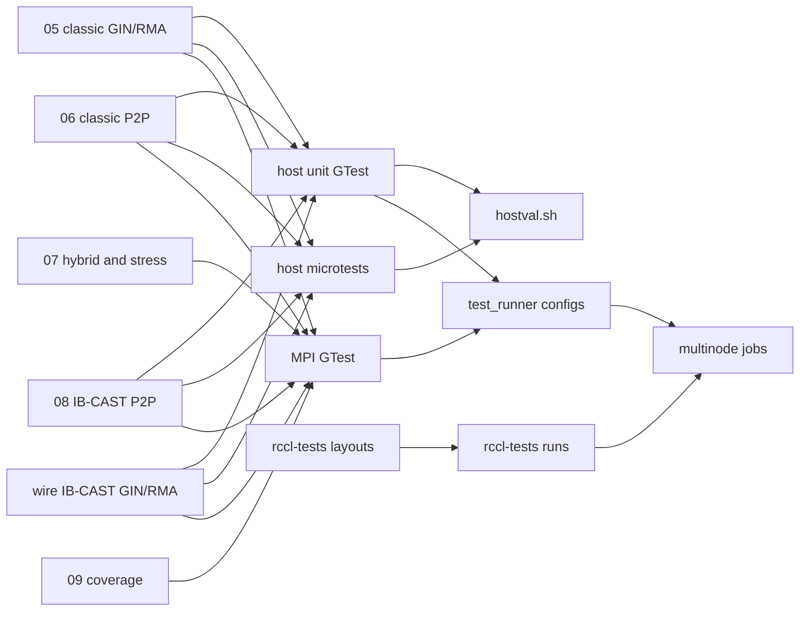

# Multi-segment validation plan

This plan lists every test the open multi-segment layers add (05, 06, 07, 08, the IB-CAST GIN/RMA wire layer and the coverage layer 09), classifies each one, and maps it to the test_runner jobs and platforms that run it. It also cross-checks the coverage pull request's test list against the code, records the known gaps with proposed tests, and gives the commands for a full validation. The test strategy and suite descriptions are in [Testing](multi_segment_testing.md); this doc is the inventory and the plan.

*Terms follow the [overview](multi_segment_overview.md#terms).*

> [!NOTE]
> Counts were taken on 2026-11-04 from the branches `05-gin-rma-multisegment`, `06-classic-netib-multisegment`, `07-hybrid-stress-ci`, `08-cast-netib-multisegment`, `multi-segment-dmabuf-cast-gin` and `09-tests-local` with its uncommitted runner overlay, all under `users/atulkulk/mseg/`. A test is counted in the first layer that adds it. Tests that already exist in develop are listed only where a job or the coverage pull request depends on them.

> [!IMPORTANT]
> **Update 2026-11-23.** The per-test categories below are still the 11-04 inventory. The old stack has since been reworked and rebased onto develop `c43b4a9e7307` (wire tests tip `ba3ab26f30a7`), 07 was folded into 05 and 06, and 09 has not been rebased onto it. [Changes at the wire tip](#changes-at-the-wire-tip) lists the suites and jobs that were renamed, added or removed, with fresh per-file counts; where it disagrees with the tables below, it wins. Validation of the IB-MSEG forks is in [the fork plugin](multi_segment_fork_plugin.md#validation).

## Summary

The layers add 369 tests: 187 host unit tests (GTest binaries that need no GPU), 78 host microtests (fake verbs and HIP, run by `run_host_tests.sh`) and 104 MPI tests (`rccl-UnitTestsMPI`, on GPUs and NICs). One more host microtest on the 09 overlay, `SymKernelMicrotest.DynamicSmemMask_AmdLeavesGinOutAndKeepsTma`, belongs to the GIN-occupancy work and is out of scope.

| Category | Tests | Meaning |
|---|---|---|
| positive | 97 | a host-level unit or hook does the expected thing on valid input |
| negative | 95 | invalid input, a failed post or a missing MR is rejected or fails cleanly |
| corner case | 78 | boundaries, zero length, partial segments, offsets, wrap, mixed handles, retries |
| end-to-end | 34 | collectives, DeepEP windows and hierarchical CE through the full stack |
| compatibility | 31 | switch off, old peers, legacy paths, single-segment regressions, gates |
| stress/scale | 18 | send-queue oversubscription, churn, sweeps, many pairs, many ranks |
| functional | 16 | MPI transfers on the multi-segment path with ordinary input |

Each test has exactly one category. The first matching rule wins, in the order compatibility, negative, stress/scale, corner case, end-to-end; the rest are positive at host level and functional at MPI level. `~/ginocc/sw/docs_update_1104/classify_tests.py` applies the rules.

| Layer | Host unit | Host microtest | MPI | Total |
|---|---|---|---|---|
| 05 classic GIN/RMA | 25 | 30 | 47 | 102 |
| 06 classic NET/IB P2P | 97 | 15 | 21 | 133 |
| 07 hybrid and stress | 0 | 0 | 3 | 3 |
| 08 IB-CAST P2P | 57 | 17 | 3 | 77 |
| wire IB-CAST GIN/RMA | 8 | 16 | 0 | 24 |
| 09 coverage | 0 | 0 | 30 | 30 |

The wire layer adds no MPI tests of its own; its MPI coverage is the 05 RMA suites run with `NCCL_NET=IB-CAST`.

## Changes at the wire tip

Tests per file at the wire tests tip `ba3ab26f30a7`, counted as `TEST`/`TEST_F` definitions:

| File | Suites (tests) | Change since 11-04 |
|---|---|---|
| `test/NetIbMultiSegmentUnitTests.cpp` | `NetIbMultiSeg` (11), `NetIbCtsLayout` (10), `NetIbLayoutBlob` (2) | `NetIbSplit` and `NetIbSideTable` removed with the side table and the uniform-layout rule; `NetIbLayoutBlob` added for referenced layouts; cap tests check `rcclIbRegSegCap` |
| `test/RmaSegmentMathTests.cpp` | `RmaSegmentMathTest` (34), `RmaRoundTest` (7) | credit tests replaced by rounds, the cursor, the one count check and the in-flight cap |
| `test/transport/NetIb/NetIbSegmentedSendPrefixTests.cpp` | `NetIbSegmentedSendPrefix` (29), `NetIbSegmentedFlushPrefix` (8), `NetIbSegmentedHooks` (19) | slice posts and resume; flush tests expect one write and one read |
| `test/transport/NetIbCast/NetIbCastMultiSegTests.cpp` | `NetIbCastSegmentedSendPrefix` (22), `NetIbCastSegmentedHooks` (18), `NetIbCastSegmentedFlush` (12), `NetIbCastSideTable` (3), `NetIbCastFlushPrefix` (1) | `NetIbCastSideTable` keeps its name but tests the cached scope and combined CTS slots |
| `test/transport/NetIbMPI/NetIbMultiSegmentMPITests.cpp` | `NetIbMultiSegmentMPITest` (22) | `NonUniformLayoutDeclined` became `NonUniformLayoutRegisters` |
| `test/transport/RmaMPI/RmaMultiSegmentMPITests.cpp` | `RmaMultiSegmentMPITest` (32), `RmaMultiSegmentPostMPITest` (13) | the DeepEP elastic cases moved in from `RmaMultiSegmentElasticMPITests.cpp`; `IPutSignalPastSendQueueDepthWaitsForCredits` replaced by `IPutSignalAtProxyInflightCapFitsSendQueue` |
| `test/RegistrationMPITests.cpp` | `UBR_MultiSegment` (18) | unchanged in shape; 09 would move them to `test/multisegment/` |

New host microtest suites: `RmaProxyInflightCapTest`, `NetIbConnectMultiSegOk`, `NetIbCastConnectMultiSegMicrotest`, `NetIbCastGinSegRegMicrotest`, `NetIbCastGinRoundMicrotest`, `RegisterSegmentWalkMicrotest`, `P2pMultiSegmentMicrotest` (some may predate the stack in develop; not checked one by one).

Runner changes at the wire tip, from the job matrix in `~/ginocc/sw/docs_update_1123/oldstack_runner_jobs.md`:

- `ce_hierarchical_multisegment_multinode` is now `ce_hierarchical_multisegment_8node` (16 ranks), disabled in every architecture config because it needs at least 8 nodes.
- `ubr_multisegment_lsagin_rs_multinode` is gone; `Symmetric_LsaGin` and its IB-CAST twin run in `ubr_multisegment_lsagin_multinode`.
- The nightly stress jobs, `multisegment_hier_ce_8node` and `ubr_multisegment_hybrid_singlenode` belong to the 09 overlay and are not on the old stack.
- `multisegment_host_boundary_math` still filters on `NetIbSplit.*` and `NetIbSideTable.*`, which match nothing, and does not name `NetIbLayoutBlob`; `check_test_filters.py` should flag the first two.
- Several suite descriptions still say "side table" or "credits".

The IB-MSEG forks are validated the same way, with the switch selecting the fork: hostval on every fork tip (including the four IB-MSEG compile-twice binaries) and `launch.sh` on the top fork on both ROCm versions. Results, and the configs that do not run the fork yet (AINIC, Mellanox IB hardware), are in [fork validation](multi_segment_fork_plugin.md#validation).

## Test tiers



Host microtests run only through `run_host_tests.sh` (CI's "Host unit tests (CPU-only)" stage), not through test_runner. Every host unit suite the layers add is named by a test_runner job, and `hostval.sh` also runs them locally.

## Coverage by area

Platforms: `mi300x_mellanox_ib` and `mi300_mellanox_ib_func` are MI300X with InfiniBand; `mi355x_thor2_roce` and `_func` are MI355X with Thor2 RoCE; `mi455_ainic_roce` and `_func` are MI455X with AINIC RoCE; `mi455_roce_func` is MI455X with Thor Ultra RoCE; `net_ib_transport` is any InfiniBand host the runner detects.

### 05 classic GIN/RMA

Covered: per-segment RMA registration and consensus, segmented WR building, slicing, credits, signal and flush, rejected operations, window gates, the host owner DMA-BUF fd and GIN registration through the plugin's DMA-BUF entry.

| Tests | File | Tier | Count | Categories | Jobs |
|---|---|---|---|---|---|
| `RmaSegmentMathTest` | `test/RmaSegmentMathTests.cpp` | host unit | 25 | 15 positive, 7 corner, 3 negative | `multisegment_rma_segment_math` |
| `SymMemoryMapLsaTeamTest` | `test/host/dev-runtime-test.cc` | microtest | 12 | 6 positive, 3 compatibility, 2 negative, 1 corner | `hostval.sh` |
| `SymMemoryRegisterGinTest`, `SymMemoryRegisterGinElasticTest`, `SymMemoryRegisterRmaTest` | `test/host/dev-runtime-test.cc` | microtest | 13 | 7 positive, 4 compatibility, 2 negative | `hostval.sh` |
| `GinHostProxyRegMrMicrotest`, `GinHostRegisterMicrotest` | `test/host/gin-host-proxy-test.cc`, `gin-host-test.cc` | microtest | 4 | 2 positive, 2 compatibility | `hostval.sh` |
| `NetIbRegMicrotest.RegMr_MultiDeviceFailureUnwindsEarlierRegistrations` | `test/host/transport/net_ib/reg-test.cc` | microtest | 1 | negative | `hostval.sh` |
| `RmaMultiSegmentMPITest` | `test/transport/RmaMPI/RmaMultiSegmentMPITests.cpp` | MPI | 27 | 7 negative, 6 functional, 6 corner, 4 stress, 3 compatibility, 1 end-to-end | `multisegment_transport_multinode`, `cast_rma_multisegment`, `net_ib_rma_multisegment` |
| `RmaMultiSegmentMPITest.DeepEP_*` | `test/transport/RmaMPI/RmaMultiSegmentElasticMPITests.cpp` | MPI | 5 | 2 stress, 1 corner, 1 end-to-end, 1 negative | `ubr_multisegment_lsagin_multinode`, `cast_rma_multisegment(_hybrid)`, `net_ib_rma_multisegment_hybrid`, `multisegment_hybrid_stress_nightly` |
| `RmaMultiSegmentPostMPITest` | `test/transport/RmaMPI/RmaMultiSegmentMPITests.cpp` | MPI | 13 | 6 stress, 5 corner, 1 functional, 1 negative | `multisegment_transport_multinode`, `cast_rma_multisegment`, `net_ib_rma_multisegment(_wrbatch, _scale_1x2, _scale_2x4)` |
| `CeMPI_AllGather`, `CeMPI_AlltoAll` `.MultiNodeHierarchicalMultiSegment` | `test/ce/CeMPITests.cpp` | MPI | 2 | end-to-end | `ce_hierarchical_multisegment_multinode` |

`multisegment_rma_segment_math` runs `RmaSegmentMathTest.*` from `rccl-UnitTests`; 05 adds it to `net_ib_transport` and 07 to every hardware config. On the hardware configs, `multisegment_transport_multinode` runs the classic `RmaMultiSegmentPostMPITest` suite, with `IPutSignalSendQueueOversubscribe` as a separate entry under `RCCL_MSEG_SQ_STRESS=1`.

### 06 classic NET/IB P2P

Covered: boundary math, splitting, CTS layout validation, side-table readiness, the capability trailer and P2P-only advertising, every P2P hook, prefix posts and the keep-or-free rule, the multi-segment flush, the GDR flush flag, registration unwinding, and transfers across boundaries on two nodes.

| Tests | File | Tier | Count | Categories | Jobs |
|---|---|---|---|---|---|
| `NetIbMultiSeg`, `NetIbSplit`, `NetIbCtsLayout` | `test/NetIbMultiSegmentUnitTests.cpp` | host unit | 46 | 20 corner, 12 negative, 11 positive, 3 compatibility | `multisegment_host_boundary_math` |
| `NetIbSideTable` | `test/NetIbMultiSegmentUnitTests.cpp` | host unit | 4 | 2 positive, 2 negative | `multisegment_host_boundary_math` |
| `NetIbSegmentedSendPrefix`, `NetIbSegmentedFlushPrefix`, `NetIbSegmentedHooks` | `test/transport/NetIb/NetIbSegmentedSendPrefixTests.cpp` | host unit | 46 | 14 positive, 14 negative, 14 corner, 4 compatibility | `unit_tests_fixtures_debug` |
| `RmaSegmentMathTest.WrCreditsBlockChainPastQpDepth` | `test/RmaSegmentMathTests.cpp` | host unit | 1 | stress | `multisegment_rma_segment_math` |
| `NetProxyRegBufferMicrotest`, `NetProxyRegBufferCuMemMicrotest` | `test/host/transport/net-test.cc` | microtest | 4 | 2 positive, 2 negative | `hostval.sh` |
| `NetIbConnectMultiSegMicrotest`, `NetIbGinMicrotest` | `test/host/transport/net_ib/connect-test.cc`, `gin-test.cc` | microtest | 6 | 4 positive, 2 corner | `hostval.sh` |
| `NetIbRegMicrotest`, `NetIbRegRangeMicrotest`, `NetIbP2pMicrotest` | `test/host/transport/net_ib/reg-test.cc`, `net-ib-p2p-test.cc` | microtest | 5 | negative | `hostval.sh` |
| `NetIbMultiSegmentMPITest` | `test/transport/NetIbMPI/NetIbMultiSegmentMPITests.cpp` | MPI | 20 | 8 functional, 3 each negative, corner, stress, compatibility | `net_ib_multisegment`, `_register_off`, `_flush`, `_gdr_flush_flag`, `_old_peer`, `_scale_2x4`, `multisegment_transport_multinode`, `multisegment_stress_nightly`, the `cast_multisegment*` jobs |
| `UBR_MultiSegment.NetProxyPartialFinalSegment` | `test/multisegment/MultiSegmentRegistrationMPITests.cpp` | MPI | 1 | corner | `multisegment_transport_multinode`, `multisegment_netproxy_intranode_multinode` |

07 names the classic host suites in the runner, next to their IB-CAST counterparts: `NetIbSideTable.*` in `multisegment_host_boundary_math`, and `A20_NetIb_SegmentedSendPrefix`, `A20_NetIb_SegmentedFlushPrefix` and `A20_NetIb_SegmentedHooks` in `unit_tests_fixtures_debug`, in every hardware config.

### 07 hybrid and stress

Covered: DeepEP elastic and hybrid window registration, handle reuse and the elastic-off gate; the runner jobs that run the hybrid and stress suites.

| Tests | File | Tier | Count | Categories | Jobs |
|---|---|---|---|---|---|
| `UBR_MultiSegment.DeepEP_ElasticWindowRegistration`, `DeepEP_HybridWindowRegistrationAndHandleReuse`, `DeepEP_HybridElasticRegistrationDisabled` | `test/multisegment/MultiSegmentRegistrationMPITests.cpp` | MPI | 3 | 2 end-to-end, 1 compatibility | `ubr_multisegment_lsagin_multinode` |

Gaps: the nightly stress jobs are defined but not enabled in `mi300x_mellanox_ib` and disabled in `mi355x_thor2_roce` and `mi455_ainic_roce`, so no config runs the hybrid IGet stress or the send-queue stress by default.

### 08 IB-CAST P2P

Covered: the IB-CAST segmented send with BY_INDEX remap and weighted split, flush, hooks, the CTS block, RMA pairs that never advertise, registration declines, the FAILED drain, the nreqs bound, connect pairs, and the unsafe-mode and optRecvCompletion paths on two nodes.

| Tests | File | Tier | Count | Categories | Jobs |
|---|---|---|---|---|---|
| `NetIbCastSegmentedSendPrefix`, `NetIbCastFlushPrefix`, `NetIbCastSegmentedFlush`, `NetIbCastSegmentedHooks`, `NetIbCastSideTable` | `test/transport/NetIbCast/NetIbCastMultiSegTests.cpp` | host unit | 57 | 18 positive, 17 negative, 17 corner, 5 compatibility | `unit_tests_fixtures_debug`, `net_ib_cast_multiplane_unit`, `net_ib_cast_plane_subnet` |
| `NetIbCastRegMultiSegMicrotest`, `NetIbCastRegFromRangeMicrotest` | `test/host/transport/net_ib_cast/net-ib-cast-reg-test.cc` | microtest | 5 | 4 negative, 1 positive | `hostval.sh` |
| `NetIbCastP2pFailedDrainMicrotest`, `NetIbCastP2pIsendMicrotest`, `NetIbCastP2pTestMicrotest` | `test/host/transport/net_ib_cast/net-ib-cast-p2p-test.cc` | microtest | 8 | negative | `hostval.sh` |
| `NetIbCastConnectTest` (4 of 6) | `test/host/transport/net_ib_cast/net-ib-cast-connect-test.cc` | microtest | 4 | 2 positive, 1 negative, 1 corner | `hostval.sh` |
| `NetIbMultiSegmentMPITest.CastUnsafeMode_DeclinesRegistration`, `OptRecvCompletionSegmentedSkipsImm`, `OptRecvInvalidRangeRejectedBeforeRequest` | `test/transport/NetIbMPI/NetIbMultiSegmentMPITests.cpp` | MPI | 3 | 2 negative, 1 functional | `cast_multisegment_unsafe_modes`, `cast_multisegment_opt_recv(_2qp)` |

The IB-CAST MPI jobs also run the 06 `NetIbMultiSegmentMPITest` suite with `NCCL_NET=IB-CAST`; AINIC BY_ORDER needs `NCCL_IB_RECEIVER_SIDE_MATCHING_SCHEME=0`, which every `cast_multisegment*` job sets.

### Wire: IB-CAST GIN/RMA

Covered: device slots and rkey lookup per physical IB device, past-end refusal, the RMA post path with credits and timeouts, abandoned and failed requests, the error log's remote device, the RMA QP and CQ depths, AINIC restore of RMA requests, and the window gates over IB-CAST.

| Tests | File | Tier | Count | Categories | Jobs |
|---|---|---|---|---|---|
| `RmaSegmentMathTest` (7) | `test/RmaSegmentMathTests.cpp` | host unit | 7 | 5 positive, 2 negative | `multisegment_rma_segment_math` |
| `NetIbMultiSeg.RmaQueueCreditsBoundSegmentedChains` | `test/NetIbMultiSegmentUnitTests.cpp` | host unit | 1 | stress | `multisegment_host_boundary_math` |
| `NetIbCastGinPostPathMicrotest`, `NetIbCastGinErrorLogMicrotest` | `test/host/transport/net_ib_cast/net-ib-cast-gin-test.cc` | microtest | 10 | 5 negative, 4 positive, 1 stress | `hostval.sh` |
| `NetIbCastConnectTest` (2 of 6) | `test/host/transport/net_ib_cast/net-ib-cast-connect-test.cc` | microtest | 2 | positive | `hostval.sh` |
| `P2pResiliencyRecoveryAinicRmaMicrotest` | `test/host/p2p-resiliency-recovery-ainic-test.cc` | microtest | 2 | 1 negative, 1 compatibility | `hostval.sh` |
| `SymMemoryRegisterGinTest`, `SymMemoryRegisterRmaTest` (IB-CAST) | `test/host/dev-runtime-test.cc` | microtest | 2 | positive | `hostval.sh` |
| 05 RMA suites over IB-CAST | `test/transport/RmaMPI/*` | MPI | reused | as 05 | `cast_rma_multisegment`, `cast_rma_multisegment_hybrid` |

Every config runs the same IB-CAST RMA job pair: `cast_rma_multisegment` names all 31 `RmaMultiSegmentMPITest` cases, the register-off runs and the post-path suite, and `cast_rma_multisegment_hybrid` runs the DeepEP hybrid cases on 8 ranks. Each platform keeps its own job environment, for example `NCCL_IB_MERGE_NICS` on MI300X.

### 09 coverage tests

Covered: the multi-segment collectives over LSA, LSA plus GIN and elastic windows, DeepEP hybrid collectives on one and two nodes, CE on multi-segment windows, the CE receive offset and elastic gates. The layer moves the `UBR_MultiSegment` cases from `test/RegistrationMPITests.cpp` to `test/multisegment/` with a shared fixture.

| Tests | File | Tier | Count | Categories | Jobs |
|---|---|---|---|---|---|
| `UBR_MultiSegment.Symmetric_Lsa_*`, `Symmetric_Elastic_Lsa_*` | `test/multisegment/MultiSegmentCollectiveMPITests.cpp` | MPI | 5 | end-to-end | `ubr_multisegment_comprehensive` |
| `UBR_MultiSegment.Symmetric_LsaGin_*` | same | MPI | 3 | 2 end-to-end, 1 compatibility (`LegacyFallback`) | `ubr_multisegment_comprehensive`, `ubr_multisegment_lsagin_rs_multinode` |
| `UBR_MultiSegment.Symmetric_Elastic_LsaGin_*` | same | MPI | 3 | end-to-end | `ubr_multisegment_comprehensive`, `ubr_multisegment_lsagin_multinode` |
| `UBR_MultiSegment.DeepEP_Hybrid{AllGather,AllReduce,ReduceScatter}` | same | MPI | 3 | end-to-end | `ubr_multisegment_lsagin_multinode` |
| `UBR_MultiSegment.DeepEP_HybridSingleNode*` collectives | same | MPI | 3 | end-to-end | `ubr_multisegment_hybrid_singlenode` |
| `UBR_MultiSegment.CE_RecvOffset` | same | MPI | 1 | end-to-end | `ce_2rank`, `ubr_multisegment_comprehensive` |
| `UBR_MultiSegment.CE_Elastic_Gating`, `CE_Elastic_HierarchicalGating` | `test/multisegment/MultiSegmentRegistrationMPITests.cpp` | MPI | 2 | end-to-end | `ce_2rank`, `ubr_multisegment_comprehensive`, `multisegment_hier_ce_8node` |
| `UBR_MultiSegment.DeepEP_HybridSingleNodeRegistrationAndHandleReuse`, `DeepEP_HybridSingleNodeElasticRegistrationDisabled` | same | MPI | 2 | 1 end-to-end, 1 compatibility | `ubr_multisegment_hybrid_singlenode` |
| `CeMPI_MultiSegment.SingleNode*` | `test/ce/CeMPITests.cpp` | MPI | 6 | end-to-end | `ce_2rank` |
| `CeMPI_MultiSegment.Hierarchical{AllGather,AlltoAll}` | `test/ce/CeMPITests.cpp` | MPI | 2 | end-to-end | `multisegment_hier_ce_8node` only |

Gaps: the hierarchical `CeMPI_MultiSegment` cases run only in `multisegment_hier_ce_8node`, which no config enables. `Symmetric_LsaGin_*` across nodes is in `ubr_multisegment_lsagin_rs_multinode`, which every config disables.

## Runner jobs and configs

Marks: E enabled in `test_suites`, D present in `test_suites` but disabled, d defined in `test_configurations` but not listed in `test_suites`, a dash for not defined. Columns, in order: `mi300x_mellanox_ib`, `mi300_mellanox_ib_func`, `mi355x_thor2_roce`, `mi355x_thor2_roce_func`, `mi455_ainic_roce`, `mi455_ainic_roce_func`, `mi455_roce_func`, `net_ib_transport`. The table is for `09-tests-local` with its overlay.

| Job | Ranks and nodes | 300x | 300f | 355 | 355f | 455 | 455f | 455rf | netib |
|---|---|---|---|---|---|---|---|---|---|
| `multisegment_host_boundary_math` | 1 | E | E | E | E | E | E | E | - |
| `multisegment_rma_segment_math` | 1 | E | E | E | E | E | E | E | E |
| `unit_tests_fixtures_debug` | 1 | E | E | E | E | E | E | E | - |
| `ubr_multisegment_comprehensive` | 2 / 1 | E | E | E | E | E | E | E | - |
| `ubr_multisegment_hybrid_singlenode` | 4 / 1 | d | - | E | - | E | - | - | - |
| `ubr_multisegment_lsagin_multinode` | 8 / 2 | E | E | E | E | E | E | D | - |
| `ubr_multisegment_lsagin_rs_multinode` | 8 / 2 | D | D | D | D | D | D | D | - |
| `ce_2rank` | 2 / 1 | E | - | E | - | E | - | - | - |
| `ce_allreduce_recv_offset` | 2 / 1 | E | E | E | E | E | E | E | - |
| `ce_hierarchical_multisegment_multinode` | 8 / 2 | E | E | E | E | E | E | - | - |
| `multisegment_hier_ce_8node` | 16 / 8 | d | - | D | - | D | - | - | - |
| `multisegment_transport_multinode` | 2 / 2 | E | E | E | E | E | E | D | - |
| `multisegment_netproxy_intranode_multinode` | 4 / 2 | E | E | E | E | E | E | D | - |
| `multisegment_stress_nightly` | 2 / 2 | d | - | D | - | D | - | - | - |
| `multisegment_hybrid_stress_nightly` | 8 / 2 | d | - | D | - | D | - | - | - |
| `net_ib_multisegment` | 2 / 2 | E | E | E | E | E | E | D | E |
| `net_ib_multisegment_register_off` | 2 / 2 | E | E | E | E | E | E | D | E |
| `net_ib_multisegment_flush` | 2 / 2 | E | E | E | E | D | D | D | E |
| `net_ib_multisegment_gdr_flush_flag` | 2 / 2 | E | E | E | E | E | E | D | E |
| `net_ib_multisegment_old_peer` | 2 / 2 | E | E | E | E | E | E | D | E |
| `net_ib_multisegment_scale_2x4` | 8 / 2 | E | E | E | E | E | E | D | E |
| `net_ib_multisegment_stress_nightly`, `net_ib_multisegment_hybrid_stress_nightly` | 2 / 2, 8 / 2 | - | - | - | - | - | - | - | D |
| `net_ib_rma_multisegment`, `_wrbatch`, `_scale_1x2`, `_scale_2x4`, `_hybrid` | 2 to 8 | - | - | - | - | - | - | - | E |
| `cast_multisegment`, `_register_off`, `_unsafe_modes`, `_opt_recv`, `_opt_recv_2qp` | 2 / 2 | E | E | E | E | E | E | D | E |
| `cast_rma_multisegment`, `cast_rma_multisegment_hybrid` | 2 / 2, 8 / 2 | E | E | E | E | E | E | D | E |
| `gin_barrier_session` | 4 / 2 | E | - | E | - | E | E | E | - |
| `ce_hier_alltoallv` | 4 / 2 | E | E | E | E | E | E | E | - |

`mi455_roce_func` disables every multi-node NET-IB and IB-CAST RMA job because Thor Ultra has no matching verbs userspace in that image. Both MI455X AINIC configs run every classic job except `net_ib_multisegment_flush`, which is disabled because ionic rejects the flush RDMA READ; `mi455_ainic_roce_func` also sets `NCCL_GDR_FLUSH_DISABLE=1` in `net_ib_base`. Two more configs carry IB-CAST jobs: `mi300_ainic_ccs_roce` and `mi355x_ainic_tw_roce` enable the `cast_multisegment*` jobs and the IB-CAST host unit suites.

## Coverage PR tests

The coverage pull request (`users/bdoganca/mseg/09-mseg-tests-coverage`) lists 178 tests. 174 match a test in the code; the matches were checked by suite and test name against the branches above.

| Group | Listed | Layer of the matching code | Categories |
|---|---|---|---|
| NET/IB (MPI) | 20 | 06: 17, 08: 3 | 8 functional, 3 each corner, stress, negative, compatibility |
| RMA (MPI) | 37 | 05 | 11 corner, 9 stress, 8 negative, 6 functional, 2 compatibility, 1 end-to-end |
| RMA elastic (MPI) | 5 | 05 | 2 stress, 1 each corner, end-to-end, negative |
| Collectives (MPI) | 23 | develop: 5, 09: 17, missing 1 | 20 end-to-end, 2 compatibility, 1 negative |
| Registration (MPI) | 14 | develop: 7, 06: 1, 07: 3, 09: 2, missing 1 | 8 end-to-end, 4 compatibility, 2 corner |
| CE (MPI) | 14 | 05: 2, 09: 11, renamed 1 | 13 end-to-end, 1 compatibility |
| NET/IB host | 27 | 06: 25, wire: 1, removed 1 | 13 corner, 6 positive, 4 negative, 3 compatibility, 1 stress |
| NET/IB split | 11 | 06 | 5 corner, 4 positive, 2 negative |
| CTS layout | 9 | 06 | 6 negative, 2 corner, 1 positive |
| Side table | 4 | 06 | 2 positive, 2 negative |
| IB-CAST host | 6 | 08: 5, 06 and 08: 1 | 4 positive, 2 negative |
| GIN device | 8 | develop (`test/device/GinBackendMaskDispatch_test.cpp`, `GinAnvilSdmaTemplate_test.cpp`) | 5 corner, 3 functional |
| Total | 178 | | 43 end-to-end, 42 corner, 29 negative, 17 functional, 17 positive, 15 stress, 15 compatibility |

Names that do not match the code:

| Listed name | Status in the code |
|---|---|
| `CE_RecvOffset_BeforeLegacyCorruptsResult` | exists as `UBR_MultiSegment.Symmetric_Lsa_BeforeLegacyRecvOffsetCorruptsResult` (develop) |
| `Symmetric_Lsa_RecvRangePastWindowStagingOverflow` | only on the coverage pull request's head; not on `09-tests-local` |
| `Generic_Reuse_BeforeCePlanBypassesRegistrationCache` | only on the coverage pull request's head; not on `09-tests-local` |
| `NetIbMultiSeg.FlushQpDepthCoversEveryOutstandingStep` | removed by 06 and replaced by a `static_assert` on the flush QP depth |

Tests in the code that the list omits: `RmaMultiSegmentMPITest.BuildSkipped` and `MultiSegmentRegisterOff_KeepsUpstreamPath`, `RmaMultiSegmentPostMPITest.IPutSignalPastSendQueueDepthWaitsForCredits`, and `NetIbMultiSegmentMPITest.GdrFlushFlag_SegmentedSendWritesFlag`, `NonUniformLayoutDeclined` and `SegmentCountMismatchRejected`. The code has 40 RMA MPI tests against 37 listed and 23 `NetIbMultiSegmentMPITest` tests against 20 listed. The list also omits the 46 classic and 57 IB-CAST prefix, flush and hook tests, the 33 `RmaSegmentMathTest` tests and all 78 host microtests.

## rccl-tests layouts

The rccl-tests branch `users/bdoganca/mseg/10-rccl-tests-buffer-layouts` adds `--buffer_layout default|multiseg|elastic`, `--nsegments` (default 2, at least 2) and `--host_segments` (elastic only, default 1, fewer than `--nsegments`). Elastic needs a host VMM runtime (ROCm 7.0.2.2 or 7.12) and rejects `-R 1`, because `ncclCommRegister` skips host segments. No runner config runs these layouts yet.

| Layout | What it exercises | Proposed runs |
|---|---|---|
| `default` | develop's single-allocation buffers | the existing perf sweeps, as a baseline |
| `multiseg` | send and receive buffers of `--nsegments` device allocations | AllReduce, AllGather, ReduceScatter, AlltoAll and SendRecv at `-R 0` and `-R 2`, 2 and 16 segments, one and two nodes, switch on and off |
| `elastic` | device segments followed by `--host_segments` host segments | the same collectives at `-R 0` and `-R 2` with one host segment and with one per local rank, two nodes, `NCCL_SYM_REUSE_SYSMEM_HANDLES=1` |

## Known gaps

| Gap | Effect | Proposed fix or test |
|---|---|---|
| Closed 2026-11-19: the rebased wire tip ran on two MI355X nodes, 220 of 221 units per ROCm version, and the one fixtures failure was fixed and rerun (135 of 135) | — | see [Results](multi_segment_testing.md#results) |
| `multisegment_host_boundary_math` names removed suites and misses `NetIbLayoutBlob` | `NetIbLayoutBlob` runs only through a broader filter, if any | update the filter in every config |
| `multisegment_hier_ce_8node`, `multisegment_stress_nightly` and `multisegment_hybrid_stress_nightly` are defined but not listed in `mi300x_mellanox_ib`'s `test_suites` and are disabled in `mi355x_thor2_roce` and `mi455_ainic_roce`; `ubr_multisegment_hybrid_singlenode` is also defined but not listed in `mi300x_mellanox_ib` | no default run covers 8-node hierarchical CE, nightly stress, or single-node hybrid collectives on MI300X | enable them in a nightly profile on allocations that fit |
| Closed at the wire tip: `ubr_multisegment_lsagin_rs_multinode` is gone and `Symmetric_LsaGin` runs in `ubr_multisegment_lsagin_multinode` | — | — |
| `ce_hierarchical_multisegment_8node` needs 8 nodes and is disabled everywhere | hierarchical CE on multi-segment windows has no default run | run it on an 8-node allocation before merge |
| IB-CAST RMA with `NCCL_IB_SUBNET_AWARE_ROUTING=1` and mixed rails fails with "no registration slot"; classic fails the same layout with a protection error | develop's subnet routing can move a per-peer RMA comm to a NIC on which the window was not registered; the gap exists on develop too | add a mixed-rail RMA job with subnet-aware routing that expects success once registration follows the routed NIC |
| Committed `09-tests-local` alone keeps the `UBR_MultiSegment` cases in both `test/RegistrationMPITests.cpp` and `test/multisegment/` | the same tests are defined twice | always validate 09 with its runner overlay |
| The rccl-tests layouts are not in any runner config | no perf or correctness run uses multi-segment or elastic buffers | add `multiseg` and `elastic` runs to the perf configs (see [rccl-tests layouts](#rccl-tests-layouts)) |

Layer 06 also replaces 05's `RmaSegmentMathTest.WrCreditsBlockNinthMaxChain` with `WrCreditsBlockChainPastQpDepth` and enables develop's `DISABLED_Iflush_ReadPostFailurePropagatesError` as `NetIbP2pMicrotest.Iflush_ReadPostFailurePropagatesError`.

## How to run

Host tests, as CI runs them, for one worktree under `~/code/rocm-sparse/_wt/`:

```bash
# run_host_tests.sh on ROCm 7.0.2.x and 10.3, the test_runner pytest suite,
# and a build with the cuMem host gate off that mirrors CI's HIP 7.2
~/ginocc/sw/valrun/hostval.sh <worktree> <out dir>
# progress: <out dir>/status; logs: <out dir>/host_<ver>.log and stage_<ver>.log
```

Node runs over the allocated nodes, single-node units first and then multi-node ones:

```bash
~/ginocc/sw/valrun/launch.sh <run name> [--no-build] [--only <regex on unit id>]
# writes ~/ginocc/sw/<run name>/status and summary.txt, and starts the dashboard
```

`launch.sh` derives its units from `net_ib_transport` and `mi355x_thor2_roce` and builds for ROCm 7.0.2.x and 10.3 by default. To run a platform config directly, use the runner from `tools/scripts/test_runner`:

```bash
python test_runner.py --config configs/<config>.json --suite-name "<suite>"
# configs: mi300x_mellanox_ib, mi300_mellanox_ib_func, mi355x_thor2_roce, mi355x_thor2_roce_func,
#          mi455_ainic_roce, mi455_ainic_roce_func, mi455_roce_func, net_ib_transport
```

Before committing a runner change, run `check_test_filters.py` and confirm that a new job is defined and listed in every config whose GPU and NIC can run it, with the reason in the suite's `description` where a config skips it on purpose.

A full validation is: `hostval.sh` on each branch tip from 05 to 09, `launch.sh` on the 09 tip with the overlay on both ROCm versions, the platform configs above on MI300X, MI355X and MI455X allocations, and the multinode jobs on at least two nodes (eight for `multisegment_hier_ce_8node`).
