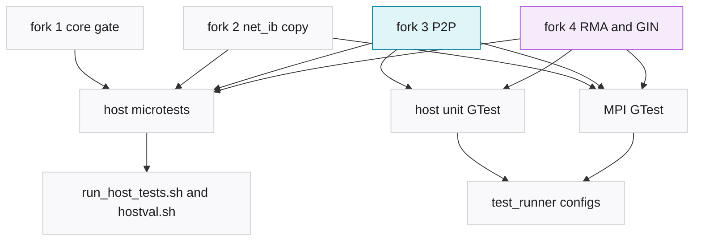

# Multi-segment validation plan

This plan lists every test the IB-MSEG fork stack adds (forks 1 to 4, with forks 5 and 6 planned), classifies each one, and maps it to the test_runner jobs and platforms that run it. It also records the known gaps and gives the commands for a full validation. The test strategy and suite descriptions are in [Testing](multi_segment_testing.md); this doc is the inventory and the plan.

*Terms follow the [overview](multi_segment_overview.md#terms).*

> [!NOTE]
> Counted on 2026-11-23 at fork 4 (branch `users/atulkulk/netib-mseg/04-rma-gin-multiseg`, on develop) with `git grep` for `TEST`, `TEST_F` and `TEST_P` definitions under `projects/rccl/test`. A test is counted in the first fork that defines it and only if it still exists at fork 4. The later test reductions in forks 3 and 4 kept every test name, so the counts still hold. Tests that already exist in develop are listed only where a job depends on them. The scripts and their output are in `~/ginocc/sw/docs_update_1123/forkbook/testing/`.

## Summary

The stack adds 309 tests: 110 host unit tests (GTest binaries that need no GPU), 129 host microtests (fake verbs and HIP, run by `run_host_tests.sh`) and 70 MPI tests (`rccl-UnitTestsMPI`, on GPUs and NICs). On top of these, the four compile-twice IB-MSEG binaries rerun the 180 tests of develop's `net_ib` host test files against the fork; they are not counted here because they are develop tests (see [IB-MSEG fork tests](multi_segment_testing.md#ib-mseg-fork-tests)).

| Fork | Host unit | Host microtest | MPI | Total |
|---|---|---|---|---|
| 1 core gate | 3 | 52 | 0 | 55 |
| 2 net_ib copy | 0 | 14 | 2 | 16 |
| 3 registration and P2P | 77 | 31 | 19 | 127 |
| 4 RMA and GIN | 30 | 32 | 49 | 111 |
| 5 IB-CAST base (planned) | — | — | — | — |
| 6 IB-CAST multi-segment (planned) | — | — | — | — |
| Total | 110 | 129 | 70 | 309 |

Fork 3 first added full copies of the `net_ib` host test files under `test/host/transport/net_ib_multiseg/`; fork 4 replaced them with the compile-twice binaries, which removed 172 copied test definitions. Only the fork-only tests in those files are counted.

| Category | Fork 1 | Fork 2 | Fork 3 | Fork 4 | Total | Meaning |
|---|---|---|---|---|---|---|
| positive | 30 | 14 | 46 | 31 | 121 | a host-level unit or hook does the expected thing on valid input |
| negative | 12 | 0 | 36 | 29 | 77 | invalid input, a failed post or a missing MR is rejected or fails cleanly |
| corner case | 2 | 0 | 27 | 20 | 49 | boundaries, zero length, partial segments, offsets, wrap, mixed handles |
| compatibility | 11 | 1 | 7 | 6 | 25 | switch off, gates off, fallbacks, single-segment regressions |
| functional | 0 | 1 | 8 | 9 | 18 | MPI transfers on the multi-segment path with ordinary input |
| stress/scale | 0 | 0 | 3 | 12 | 15 | send-queue oversubscription, churn, sweeps, many pairs, many ranks |
| end-to-end | 0 | 0 | 0 | 4 | 4 | DeepEP windows and collectives through the full stack |

Each test has exactly one category. The first matching name rule wins, in the order compatibility, negative, stress/scale, corner case, end-to-end; the rest are positive at host level and functional at MPI level. `classify_fork4.py` in the directory above applies the rules.

## Test tiers



Host microtests run only through `run_host_tests.sh` (CI's "Host unit tests (CPU-only)" stage), not through test_runner; fork 1's three host unit tests run in `multisegment_rma_segment_math`. Every host unit suite the forks add is named by a test_runner job, and `hostval.sh` also runs them locally.

## Coverage by area

Platforms: `mi300x_mellanox_ib` and `mi300_mellanox_ib_func` are MI300X with InfiniBand; `mi355x_thor2_roce` and `_func` are MI355X with Thor2 RoCE; `net_ib_transport` is any InfiniBand host the runner detects. At fork 4 these five configs carry the fork jobs. The MI455X AINIC configs (`mi455_ainic_roce`, `_func`) get them with fork 5, and `mi455_roce_func` has none.

### Fork 1: core gate

Covered: the comm-level plugin multi-segment flag, the GIN and RMA window gates, the in-flight cap, the host owner fd borrowed only when exactly one rank can export it, the `fd = -1` NET registration and its declines, and the hierarchical CE fallback.

| Tests | File | Tier | Count | Categories | Jobs |
|---|---|---|---|---|---|
| `RmaSegmentMathTest.SegCountSupportedIsTheOnlyCap`, `SegTableFitsBoundsRanksTimesSegments`, `InflightCapAppliesOnlyToMultiSegmentChains` | `test/RmaSegmentMathTests.cpp` | host unit | 3 | 2 positive, 1 corner | `multisegment_rma_segment_math` |
| `SymMemoryMapLsaTest` | `test/host/dev-runtime-test.cc` | microtest | 14 | 8 positive, 4 negative, 2 compatibility | `hostval.sh` |
| `SymMemoryObtainRegisterTest` | `test/host/dev-runtime-test.cc` | microtest | 5 | 2 positive, 2 negative, 1 compatibility | `hostval.sh` |
| `SymMemoryRegisterGinTest`, `SymMemoryRegisterGinElasticTest`, `SymMemoryRegisterRmaTest`, `RmaProxyInflightCapTest` | `test/host/dev-runtime-test.cc` | microtest | 17 | 11 positive, 4 compatibility, 2 negative | `hostval.sh` |
| `GinHostRegisterMicrotest`, `GinHostProxyRegMrMicrotest`, `GinHostProxyContextMicrotest` | `test/host/gin/gin-host-test.cc`, `gin-host-proxy-test.cc` | microtest | 6 | 4 positive, 2 compatibility | `hostval.sh` |
| `NetProxyRegBufferMicrotest`, `NetProxyRegBufferCuMemMicrotest` | `test/host/transport/net-test.cc` | microtest | 6 | 3 negative, 2 positive, 1 compatibility | `hostval.sh` |
| `ProxyServiceFixture`, `RmaProxyAllocGraphTest`, `RmaProxyDescriptorTest`, `HierCeAvailableMicrotest` | `test/host/proxy-test.cc`, `rma/rma-proxy-test.cc`, `rma/rma-proxy-launch-test.cc`, `ce-coll-test.cc` | microtest | 4 | 1 each positive, corner, negative, compatibility | `hostval.sh` |

Fork 1 replaces three develop microtests whose expectations the gate changes (`SymMemoryRegisterGinTest.MultiSegmentDeviceWindow_RejectedBeforeRegistering`, `SymMemoryRegisterRmaTest.MultiSegment_ConnectsWithoutRegistering`, `NetProxyRegBufferMicrotest.Reg_HsaDmaBuf_RegistersByFdEvenAcrossSegments`).

### Fork 2: net_ib copy

Covered: plugin selection by the switch, the RMA backend choice, RAS treating IB-MSEG as verbs, and the GDR flush flag routed through the fork. Fork 2 also adds the `*_mseg` jobs, which rerun develop's NET-IB MPI whitebox suites on IB-MSEG.

| Tests | File | Tier | Count | Categories | Jobs |
|---|---|---|---|---|---|
| `PluginNetMicrotest`, `RmaPluginListTest`, `RasDiagnosticsCommonMicrotest` | `test/host/plugin/plugin-net-test.cc`, `rma-plugin-init-test.cc`, `test/host/ras/ras-diagnostics-common-test.cc` | microtest | 8 | positive | `hostval.sh` |
| `InitMicrotest` (2), `NetProxySetupMicrotest`, `NetRecvProgressMicrotest`, `NetRecvProxyConnectMicrotest` | `test/host/init-test.cc`, `test/host/transport/net-test.cc` | microtest | 6 | positive | `hostval.sh` |
| `NetIbMPITest.DefaultPluginIsIbMsegUnderMultiSegmentRegister` | `test/transport/NetIbMPI/GeneralTests.cpp` | MPI | 1 | functional | `net_ib_initialization_mseg` |
| `NetPluginSelection.IbFollowsTheMultiSegmentSwitch` | `test/transport/NetIbMPI/GeneralTests.cpp` | MPI | 1 | compatibility | `net_plugin_selection`, `net_plugin_selection_mseg` (`net_ib_transport` only) |

The `*_mseg` jobs are `net_ib_initialization_mseg`, `net_ib_properties_mseg`, `net_ib_connection_mseg`, `net_ib_memory_mseg`, `net_ib_transfer_mseg`, `net_ib_gdr_flush_mseg` and `net_ib_gdr_flush_flag_mseg` in the four architecture configs and `net_ib_transport`, plus `net_plugin_selection_mseg`, `net_ib_wqe_lat_mseg` and `net_ib_gin_peermem_mseg` in `net_ib_transport` only. Each extends develop's job and sets `NCCL_MULTI_SEGMENT_REGISTER=1`.

### Fork 3: registration and P2P

Covered: boundary math, CTS layout and blob validation, the layout bit, slice posts and resume, the one-read flush, every P2P hook, per-segment registration and its unwind, the combined CTS slots for classic comms and the legacy FIFO for GIN comms, the connect-time `useMultiSeg` check, the comm flag following the plugin, and transfers across boundaries on two nodes.

| Tests | File | Tier | Count | Categories | Jobs |
|---|---|---|---|---|---|
| `NetIbMultiSeg`, `NetIbCtsLayout`, `NetIbLayoutBlob` | `test/NetIbMultiSegmentUnitTests.cpp` | host unit | 20 | 8 negative, 8 corner, 4 positive | `multisegment_host_boundary_math` |
| `NetIbSegmentedSendPrefix`, `NetIbSegmentedFlushPrefix`, `NetIbSegmentedHooks` | `test/transport/NetIb/NetIbSegmentedSendPrefixTests.cpp` | host unit | 57 | 27 positive, 17 negative, 12 corner, 1 compatibility | `unit_tests_fixtures_debug` (`A20_NetIb_*` entries) |
| `NetIbMsegConnectMicrotest` (1), `NetIbMsegConnectMultiSegMicrotest` (6), `NetIbMsegConnectUseMultiSeg` (1) | `test/host/transport/net_ib_multiseg/connect-test.cc` | microtest | 8 | 5 positive, 2 compatibility, 1 negative | `hostval.sh` |
| `NetIbMsegGinMicrotest` (2) | `test/host/transport/net_ib_multiseg/gin-test.cc` | microtest | 2 | positive | `hostval.sh` |
| `NetIbMsegP2pMicrotest` | `test/host/transport/net_ib_multiseg/net-ib-p2p-test.cc` | microtest | 9 | 5 positive, 2 negative, 2 corner | `hostval.sh` |
| `NetIbMsegRegMicrotest`, `NetIbMsegRegRangeMicrotest` | `test/host/transport/net_ib_multiseg/reg-test.cc` | microtest | 10 | 7 negative, 3 positive | `hostval.sh` |
| `InitMicrotest.CommAlloc_MultiSegNetFollowsIbMsegPlugin`, `CommAlloc_MultiSegNetOffWhenGateOff` | `test/host/init-test.cc` | microtest | 2 | compatibility | `hostval.sh` |
| `NetIbMultiSegmentMPITest` | `test/transport/NetIbMPI/NetIbMultiSegmentMPITests.cpp` | MPI | 18 | 8 functional, 4 corner, 3 stress, 2 compatibility, 1 negative | `net_ib_multisegment`, `_register_off`, `_flush`, `_scale_2x4`, `_gdr_flush_flag`, `multisegment_netproxy_multinode` |
| `UBR_MultiSegment.NetProxyPartialFinalSegment` | `test/RegistrationMPITests.cpp` | MPI | 1 | corner | `multisegment_netproxy_multinode`, `multisegment_netproxy_intranode_multinode` |

`NetIbMsegP2pMicrotest` holds the fork's versions of eight `net_ib` P2P tests that the P2P binary excludes as `replaced`, plus `Iflush_GpuScratchChainsWriteAndReadInOnePost`. The `useMultiSeg` mismatch is covered on the host by `NetIbMsegConnectMultiSegMicrotest.ConnectAndAccept_PeerWithTheOtherSettingFails`; tests for the capability word and old peers have no counterpart, because the fork has no capability negotiation.

### Fork 4: RMA and GIN

Covered: one MR per physical segment on GIN and RMA windows, the consensus exchange, segmented WR building, slicing, the cursor, rounds, prefix posts, signal and flush, rejected operations, send-queue depth by role, sequence-id release, and the DeepEP Engram, elastic and hybrid windows on two nodes.

| Tests | File | Tier | Count | Categories | Jobs |
|---|---|---|---|---|---|
| `RmaSegmentMathTest` (24), `RmaRoundTest` (6) | `test/RmaSegmentMathTests.cpp` | host unit | 30 | 14 positive, 9 negative, 7 corner | `multisegment_rma_segment_math` |
| `NetIbMsegGinMicrotest` (23), `NetIbMsegGinRmaSeqId` (1) | `test/host/transport/net_ib_multiseg/gin-test.cc` | microtest | 24 | 14 positive, 8 negative, 2 corner | `hostval.sh` |
| `NetIbMsegConnectMicrotest` (4), `NetIbMsegConnectMultiSegMicrotest` (1) | `test/host/transport/net_ib_multiseg/connect-test.cc` | microtest | 5 | 2 positive, 2 negative, 1 compatibility | `hostval.sh` |
| `AllocMicrotest.GetAddressRange_PropertiesFailureReleasesTheRetainedHandle`, `GinHostDevCommSetupMicrotest`, `InitMicrotest.CommAlloc_MultiSegRmaFollowsIbMsegRmaProxy` | `test/host/alloc-test.cc`, `gin/gin-host-test.cc`, `init-test.cc` | microtest | 3 | 1 each negative, positive, compatibility | `hostval.sh` |
| `RmaMultiSegmentMPITest` | `test/transport/RmaMPI/RmaMultiSegmentMPITests.cpp` | MPI | 32 | 8 negative, 7 functional, 7 corner, 6 stress, 3 compatibility, 1 end-to-end | `net_ib_rma_multisegment`; the three `DeepEP_Hybrid*` cases in `net_ib_rma_multisegment_hybrid` and `ubr_multisegment_lsagin_multinode` |
| `RmaMultiSegmentPostMPITest` | `test/transport/RmaMPI/RmaMultiSegmentMPITests.cpp` | MPI | 13 | 6 stress, 4 corner, 2 functional, 1 negative | `net_ib_rma_multisegment` (default WR batch, 8 and 2, and the flood under `RCCL_MSEG_SQ_STRESS=1`), `net_ib_rma_multisegment_scale_1x2`, `_scale_2x4` |
| `UBR_MultiSegment.DeepEP_ElasticWindowRegistration`, `DeepEP_HybridWindowRegistrationAndHandleReuse`, `DeepEP_HybridElasticRegistrationDisabled`, `Symmetric_Elastic_RmaRegistration` | `test/RegistrationMPITests.cpp` | MPI | 4 | 3 end-to-end, 1 compatibility | `ubr_multisegment_lsagin_multinode`; `Symmetric_Elastic_RmaRegistration` also in `ubr_multisegment_comprehensive` |

`RmaMultiSegmentMPITest.BuildSkipped` is a placeholder that skips in builds without the IB RMA proxy backend; it is counted but no job names it. Fork 4 also turns develop's `AllocMicrotest.GetAddressRange_KnownBug_PropertiesFailureLeaksTheRetainedHandle` into the fixed-behavior test above.

### Forks 5 and 6 (planned)

Fork 5 replays develop's `net_ib` to `net_ib_cast` diff onto the fork and adds the AINIC runner entries; it adds `BASE net_ib_cast` to the compile-twice configuration so the IB-CAST host tests also run against the fork. Fork 6 adds the IB-CAST-specific multi-segment pieces and their tests. Neither has a branch yet, so neither has tests to count.

## Runner jobs and configs

Marks: E enabled in `test_suites`, E\* a develop job whose fork 4 definition changes, a dash for not defined. Columns, in order: `mi300x_mellanox_ib`, `mi300_mellanox_ib_func`, `mi355x_thor2_roce`, `mi355x_thor2_roce_func`, `mi455_ainic_roce`, `mi455_ainic_roce_func`, `mi455_roce_func`, `net_ib_transport`. The table lists the jobs the stack adds or changes at fork 4.

| Job | Ranks and nodes | 300x | 300f | 355 | 355f | 455 | 455f | 455rf | netib |
|---|---|---|---|---|---|---|---|---|---|
| `multisegment_host_boundary_math` | 1 | E | E | E | E | - | - | - | - |
| `multisegment_rma_segment_math` | 1 | E | E | E | E | - | - | - | E |
| `unit_tests_fixtures_debug` (`A20_NetIb_*` entries) | 1 | E\* | E\* | E\* | E\* | - | - | - | - |
| `ubr_multisegment_comprehensive` | 2 / 1 | E\* | E | E | E | - | - | - | - |
| `ubr_multisegment_lsagin_multinode` | 8 / 2 | E\* | E | E | E | - | - | - | - |
| `multisegment_netproxy_multinode` | 2 / 2 | E | E | E | E | - | - | - | - |
| `multisegment_netproxy_intranode_multinode` | 4 / 2 | E | E | E | E | - | - | - | - |
| `net_ib_multisegment`, `_register_off`, `_flush`, `_gdr_flush_flag` | 2 / 2 | E | E | E | E | - | - | - | E |
| `net_ib_multisegment_scale_2x4` | 8 / 2 | E | E | E | E | - | - | - | E |
| `net_ib_rma_multisegment` | 2 / 1 in the architecture configs, 2 / 2 in `net_ib_transport` | E | E | E | E | - | - | - | E |
| `net_ib_rma_multisegment_hybrid` | 8 / 2 | E | E | E | E | - | - | - | E |
| `net_ib_rma_multisegment_scale_1x2`, `_scale_2x4` | 2 / 1, 8 / 2 | E | E | E | E | - | - | - | E |
| `net_ib_initialization_mseg`, `_properties_mseg`, `_connection_mseg`, `_memory_mseg`, `_transfer_mseg`, `net_ib_gdr_flush_mseg`, `net_ib_gdr_flush_flag_mseg` | as the base job | E | E | E | E | - | - | - | E |
| `net_plugin_selection_mseg`, `net_ib_wqe_lat_mseg`, `net_ib_gin_peermem_mseg` | as the base job | - | - | - | - | - | - | - | E |

Every job the stack defines is enabled where it is defined; no config disables one on purpose. The AINIC configs get the block with fork 5. `mi455_roce_func` (Thor Ultra RoCE) gets none of these jobs. The generator for the matrix is `job_matrix.py` in the scripts directory above.

## Coverage PR tests

The coverage pull request (layer 09) is superseded by forks 3 and 4: its registration tests are ported where they apply, for example `UBR_MultiSegment.NetProxyPartialFinalSegment` in fork 3 and `DeepEP_HybridElasticRegistrationDisabled` and `Symmetric_Elastic_RmaRegistration` in fork 4, all in `test/RegistrationMPITests.cpp`.

## Results

| Run | Tree | Result |
|---|---|---|
| Hostval (7.0.2.1 build 55, 10.3, pytest, gate-off build) | fork 2 after the tool split | passed; pytest 156 passed; gate-off build 193 binaries, 13,003 tests passed |
| Hostval | fork 3 after the test reductions | passed; 0 failed binaries on 7.0.2.1 build 55 and 10.3; gate-off build 197 binaries, 13,197 tests passed |
| Hostval | fork 4 after the test reductions | passed; 0 failed binaries on 7.0.2.1 build 55 and 10.3; pytest 156 passed; gate-off build 197 binaries, 13,272 tests passed |
| Hardware, two MI355X Thor2 nodes | fork 4 after the test reductions, ROCm 7.0.2.1 build 55 and 10.3 | 214 of 214 units on each ROCm version; gtest 23,702 passed and 13 skipped on 10.3, 23,622 passed and 75 skipped on 7.0.2.1 build 55; 0 failed (`~/ginocc/sw/fork4-hw6-reduce/summary.txt`) |

Earlier runs are in [Testing](multi_segment_testing.md#results).

## Known gaps

| Gap | Effect | Proposed fix or test |
|---|---|---|
| The Mellanox IB configs (`mi300x_mellanox_ib`, `mi300_mellanox_ib_func`) have not run any fork | the RMA send-queue depth of 2080 is not checked against Mellanox `max_qp_wr` (it fits Thor2's 4351; only a `static_assert` guards the size) | run both configs on an MI300X allocation and query `max_qp_wr` |
| AINIC configs have no fork jobs | no AINIC coverage of IB-MSEG | fork 5 adds the AINIC runner entries |
| The hierarchical CE multi-segment tests (`MultiNodeHierarchicalMultiSegment`) are not ported | no hierarchical CE run on multi-segment windows; only the fork 1 fallback microtest | port them with an 8-node job in every config whose allocation fits |
| `OffsetRangeOkRejectsPastEnd` and `RmaRoundTest.DropUnlinksTheMiddleTailAndHead` are not ported | two shared-math cases have no fork test | port them to `RmaSegmentMathTests.cpp` |
| In the architecture configs `net_ib_rma_multisegment` inherits a single-node `net_ib_base` | `DeepEP_MultiNodeEngramMixedWindowIGetStress` and `MultiNodeAsymmetricIGetBoundaryStress` skip there ("requires exactly one rank on each of two nodes"); only `net_ib_transport` runs them | set `num_nodes` 2 with one rank per node on the job |
| The `reg.cc` unwind after a later device fails is covered only by develop's disabled AICOMRCCL-3112 test, which the IB-MSEG registration binary re-enables | the unwind has no hardware test | none, by decision |
| IB-CAST requirements carried to fork 6: the scope must exclude AINIC inline CTS (`IbCastAinicCtsInlineData`); the receiver must size its CTS slots from the peer's raw capability, not from `peerCaps` masked by its own scope; the send-resume path must bound the peer-written `nreqs` to 1..8 as `IbCastIsend` does | not fixed in any tree | fork 6 tests for each |
| No switch-off latency or bandwidth comparison for single-segment sends | the claim that the switch costs nothing is unmeasured | P2 performance work |
| The test_runner include (a shared job fragment for the near-identical configs) is a separate pending PR | the fork block is repeated in four configs | land the include, then move the block into it |
| IB-CAST RMA with `NCCL_IB_SUBNET_AWARE_ROUTING=1` and mixed rails fails with "no registration slot" | develop's routing moves the per-peer RMA comm to a NIC the window was not registered on; a develop failure | add a mixed-rail RMA job with subnet-aware routing once registration follows the routed NIC |

## How to run

Host tests, as CI runs them, for one worktree:

```bash
# run_host_tests.sh on ROCm 7.0.2.1 build 55 and 10.3, the test_runner pytest suite,
# and a build with the cuMem host gate off that mirrors CI's HIP 7.2
~/ginocc/sw/valrun/hostval.sh <worktree> <out dir>
# progress: <out dir>/status
```

Node runs over the allocated nodes, single-node units first and then multi-node ones:

```bash
~/ginocc/sw/valrun/launch.sh <run name> [--no-build] [--only <regex on unit id>]
# writes ~/ginocc/sw/<run name>/status and summary.txt, and starts the dashboard
```

`launch.sh` derives its units from `net_ib_transport` and `mi355x_thor2_roce` and builds for 7.0.2.1 build 55 and 10.3 by default. To run a platform config directly, use the runner from `tools/scripts/test_runner`:

```bash
python test_runner.py --config configs/<config>.json --suite-name "<suite>"
# configs with fork jobs at fork 4: mi300x_mellanox_ib, mi300_mellanox_ib_func,
#          mi355x_thor2_roce, mi355x_thor2_roce_func, net_ib_transport
```

Before committing a runner change, confirm that a new job is defined and enabled in every config whose GPU and NIC can run it, with the reason in the suite's `description` where a config skips it on purpose.

A full validation is: `hostval.sh` on each fork tip from 1 to 4, `launch.sh` on the fork 4 tip on both ROCm versions, the platform configs above on MI300X Mellanox IB and MI355X Thor2 allocations, and the multinode jobs on at least two nodes. The AINIC configs join once fork 5 adds their entries.
