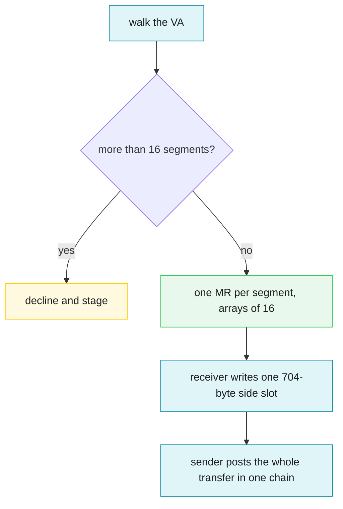
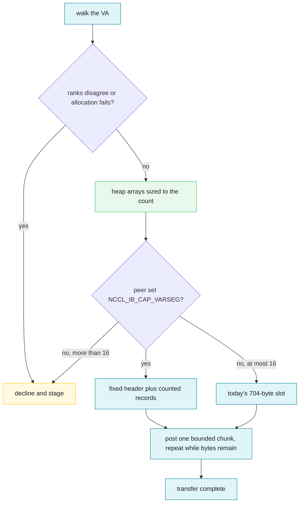
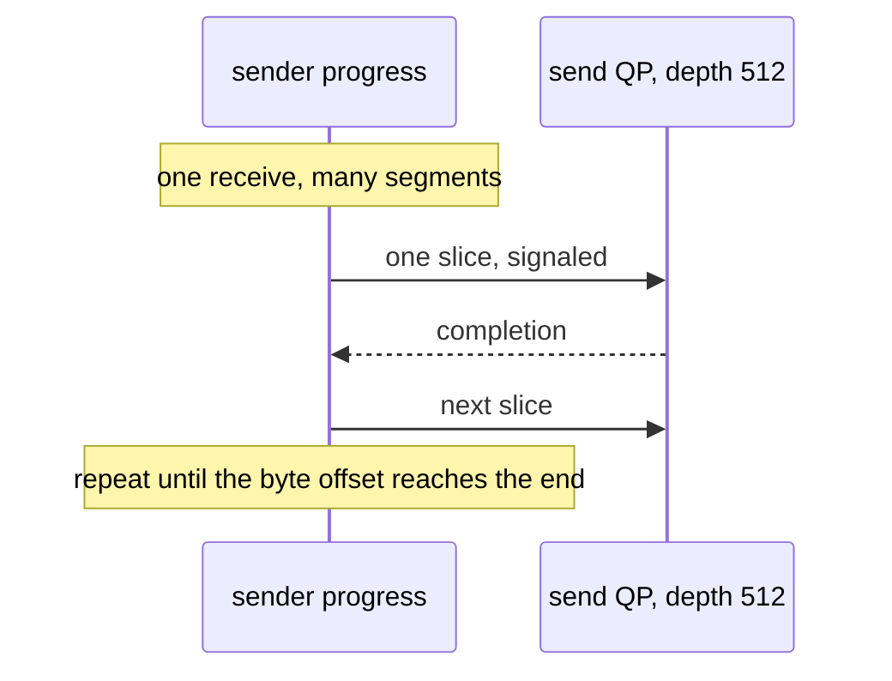

# Follow-up: register past 16 physical segments

Today a buffer whose walk returns more than 16 physical segments cannot register and is staged. This design removes the fixed cap. It sizes storage to the real segment count and sends the segment records only to peers that advertise a new capability bit. It also bounds every queue with the upstream depth formulas, so a long transfer resumes on a later progress call instead of growing the queue pair (QP). It is design only and is not implemented.

*Terms, diagram colors and callout boxes follow the [overview](multi_segment_overview.md#color-legend).*

> [!IMPORTANT]
> **Status:** design only, not in the open stack. Do not change `ncclIbSegLayout` or `NCCL_IB_MAX_SEGMENTS` inside layers 06, 08 or wire. The 16-entry slot is the CTS side-table wire format (`sizeof` is 704, asserted in `common.h`), so changing it reopens all three branches. The work lands as two later pull requests: the first branches from 06 after it lands and changes classic NET/IB; the second branches from the wire tip and changes CAST P2P, classic GIN and CAST GIN together.

## Problem

A buffer of 16 or fewer segments registers today; a buffer past 16 stages (see [limits](multi_segment_current.md#limits)). An allocator that maps one physical page per extension crosses 16 segments early, so such a window stops fitting at about 320 MiB. The cap was not sized for any one allocator or workload.

Raising `NCCL_IB_MAX_SEGMENTS` does not work. `NCCL_IB_MAX_WRS_PER_SEND` is `8 * 2 * NCCL_IB_MAX_SEGMENTS`, so the sender QP depth, the embedded `sges` and `wrs` arrays, `flushWrs` and the side FIFO would all scale with the constant. Multiplying `max_send_wr` by the segment count exceeds the HCA `max_qp_wr`, and `ibv_create_qp` fails. Each of these products has to go.



The same 16 sizes the RMA path. One put or get splits into at most `4 * 16 = 64` data work requests (WRs) plus one atomic, and the credit check refuses a wider chain. A flush posts at most `8 * 16 = 128` reads. Nothing resumes a tail, because a legal buffer is never wider than one chain.

## Design

Storage follows the count the walk returns. No queue depth depends on the segment count. A post that does not cover the whole buffer stores its byte offset, and the next progress call continues from there.



### Records and capability

A variable count changes the RDMA length, so the records leave the fixed FIFO. The header that carries `idx` stays fixed, and the sender waits on it. The records go in their own buffer and MR, sized to `nSeg`, and are published only to a peer that set `NCCL_IB_CAP_VARSEG`. That bit rides the existing `devName` trailer next to `NCCL_IB_CAP_MULTISEG`, so the connect message does not grow. A peer that only set `NCCL_IB_CAP_MULTISEG` keeps receiving the 704-byte slot and can describe at most 16 segments; a buffer past 16 declines unless both sides set the new bit.

```cpp
#define NCCL_IB_CAP_VARSEG (1u << 1)
#define NCCL_IB_MAX_SEND_WRS (2 * NET_IB_MAX_REQUESTS)

struct ncclIbSegLayoutHdr {
  uint32_t nSegments;
  uint32_t pad;
  uint64_t idx;
};

struct ncclIbSegRecord {
  uint64_t segStart;
  uint32_t rkeys[NCCL_IB_MAX_DEVS_PER_NIC];
};

struct ncclIbMrHandle {
  int nSegments;
  uintptr_t* segStart;
  size_t* segLen;
  ibv_mr** segMrs;
};
```

### Queue depths

| Queue | Today (switch on) | With this design |
|---|---|---|
| Classic P2P send | 2568 | `2 * NET_IB_MAX_REQUESTS` = 512 |
| CAST P2P send | 769 | 512 |
| Classic RMA send | same QP as P2P send | 512 |
| CAST RMA send | 575 | `2 * NCCL_RMA_MAX_INFLIGHT_REQUESTS` = 512 |
| Classic P2P flush | 1024 | `2 * NET_IB_MAX_REQUESTS` = 512 |
| CAST P2P flush | 1024 | `NET_IB_MAX_REQUESTS` = 256 |
| CAST RMA flush | 271 | `NCCL_RMA_MAX_INFLIGHT_REQUESTS` = 256 |

`NCCL_IB_MAX_WRS_PER_SEND`, `NCCL_RMA_MAX_DATA_WRS`, `NCCL_RMA_MAX_FLUSH_WRS`, `NCCL_RMA_MAX_SIGNAL_WRS` and the `NCCL_STEPS * NCCL_NET_IB_MAX_RECVS * NCCL_IB_MAX_SEGMENTS` arm of the flush depth are removed.

### P2P send and flush

One progress call posts one slice of each receive (at most `NCCL_NET_IB_MAX_RECVS` data WRs) plus the signaled tail. Each slice uses its own segment's rkey. A direct-GDR flush posts one read per receive and resumes for the remaining segments. The same-MR collapse in [flush read collapse](multi_segment_flush_read_collapse.md), if it lands, only drops reads inside one post.



```cpp
int nSlice = 0;
for (int r = 0; r < nreqs && remain > 0; r++) {
  nSlice += ncclIbTakeOneSlice(nLocal, lVA, lOff, nRemote, rVA, rOff, &localOff, &remoteOff, &remain, slices + nSlice);
}
if (nSlice < 0) return ncclInternalError;
```

### Failed post on a resumed send

Today each QP posts one chain for the whole transfer, with only the last WR signaled. With resume, every progress call posts a shorter chain with its own signaled tail. The partial-post rule from the 06 and 08 review fixes still applies to each round: if a round's tail never posted, no completion is coming, so that QP's pending event is dropped. Classic keeps the request as failed only when a prefix posted, like classic `iflush`; CAST frees the request, like `IbCastIflush`. Two rules are new. A failed round must not advance the stored offset. Earlier rounds of the same request have already completed, so the failure path accounts only for the round that failed.

### RMA data

A slice is `min(local segment left, remote segment left, UINT32_MAX, bytes left)`. One `ibv_post_send` carries at most `NCCL_RMA_IB_WR_BATCHSIZE` (64) WRs. That 64 is the upstream doorbell batch, not a segment cap. The signal atomic is the last WR of the last doorbell. A batch that does not fit in the remaining send queue waits for the next progress call. The per-rank offset table becomes `nSeg + 1` entries for that window instead of 17.

```cpp
static inline bool rcclDevrRmaRegistersMultiSegment(struct ncclComm* comm, int minSeg, int maxSeg) {
  return rcclRmaMultiSegEnabled() && minSeg == maxSeg && maxSeg >= 1;
}
```

Classic and CAST GIN must drop the cap in the same release. Shipping it in the classic PR while CAST GIN still asserts 16 would make 06 and 05 disagree about the cap, which is why the GIN edits are in the second PR.

## Changes by file

Classic (first PR, files under `src/transport/net_ib/`):

| File | Change |
|---|---|
| `multiseg.h` | No fixed cap, the new capability bit, a segment record helper; the layout check takes a caller-supplied count |
| `common.h` | `ncclIbSegLayout` becomes a fixed header plus a heap record array; `ncclIbMrHandle` arrays become counted pointers; `NCCL_IB_MAX_SEND_WRS` is `2 * NET_IB_MAX_REQUESTS`; `NCCL_IB_MAX_WRS_PER_SEND` is removed |
| `reg.cc` | Accept any `nSeg >= 1`; allocate `segStart`, `segLen` and `segMrs` with `ncclCalloc`; free them in `rcclIbDeregMrMultiSeg` |
| `connect.cc` | Allocate and register the record buffer only when the new bit is advertised and publish it only to a peer that set it; `max_send_wr` is 512 on the advertised path too |
| `p2p.cc` | Heap the per-request VA and rkey arrays; post one slice per receive and resume; the flush list is `NCCL_NET_IB_MAX_RECVS` long |

```cpp
if (nSeg < 1) return ncclInvalidUsage;
NCCLCHECK(ncclCalloc(&mhandleWrapper->segStart, nSeg));
NCCLCHECK(ncclCalloc(&mhandleWrapper->segLen, nSeg));
NCCLCHECK(ncclCalloc(&mhandleWrapper->segMrs, (size_t)nSeg * base->vProps.ndevs));
```

CAST P2P and both GIN paths (second PR):

| File | Change |
|---|---|
| `net_ib_cast/common_cast.h`, `reg.cc` | Same header and record split and counted allocation as classic |
| `net_ib_cast/rccl_reg_multiseg_cast.cc` | Remove the `nSeg > NCCL_IB_MAX_SEGMENTS` decline |
| `net_ib_cast/connect.cc`, `connect_cast.h` | Record MR only when advertising both bits; `IbCastFlushQpSendDepth` returns 256 for P2P and RMA comms (the 1024 and 271 arms go) |
| `net_ib_cast/p2p.cc` | Same one-slice post; `lVA`, `rVA`, `starts`, `rkeys` and `flushSeg` become counted allocations. `IbCastWaitSideTable` already returns after 2 s; a partial post continues on a later call and must not treat the timeout as success |
| `net_ib/rma_multiseg.h` | Drop the RMA segment and WR caps; `NCCL_RMA_SEND_QP_WRS` is `2 * NET_IB_MAX_REQUESTS`; CAST `NCCL_RMA_MAX_SEND_QP_WRS` is `2 * NCCL_RMA_MAX_INFLIGHT_REQUESTS` |
| `net_ib/gin.cc`, `net_ib_cast/gin.cc` | Heap `segOff`, `mrHandle`, `localVas` and `localRkeys`; `rankSegOff` stride is `nSeg + 1`; fill 64 slices, post, resume; remove the fail-closed check at `NCCL_RMA_MAX_DATA_WRS` |
| `net_ib/connect.cc` | `ncclIbFlushQpSendDepth` returns 512 |
| `src/rccl_dev_runtime.cc` | `rcclDevrRmaRegistersMultiSegment` accepts any matching count; a rank-count mismatch still skips RMA and leaves the window registered |

## Tests

- `NetIbMultiSegmentUnitTests`: a count of 17 is valid and the layout check has no fixed maximum.
- `NetIbMultiSegmentMPITests` and `RmaMultiSegmentMPITests`: 17 segments register and a boundary-crossing transfer completes.
- `RmaSegmentMathTests`: one doorbell stops at 64 and the next continues; replaces `FixedDataWrBudgetRejectsUnrepresentableChain`.
- `dev-runtime-test.cc`: the helper that treats 17 as not multi-segment RMA accepts 17.
- `NetIbSegmentedSendPrefix` (06) and `NetIbCastSegmentedSendPrefix` (08) assume one chain per QP. Rework them for one slice per receive per call, covering a round whose tail never posts, a failed round that leaves the offset unchanged, and a later round that fails after earlier rounds completed.
- `net_ib_transport.json`: update the job comment that names the cap of 16.

After the 17-segment tests pass, a larger buffer should log per-segment registration instead of the staging fallback. That run checks the result and is not tied to one workload.

## Cost

Registration cost follows the real count. A 410-segment buffer creates 410 MRs and one record message of 410 records. Registration time and the HCA MR table are the practical limit. If allocation or MR registration fails, decline and stage; do not fail `ncclCommWindowRegister`. Each extra round is one signaled tail and one later progress call.

## Alternatives not taken

| Alternative | Why not |
|---|---|
| Leave the cap at 16 | Buffers past 16 keep staging |
| Raise `NCCL_IB_MAX_SEGMENTS` and keep everything scaled to it | `ibv_create_qp` fails on `max_qp_wr`, and every array grows even for a 2-segment buffer |
| One MR for the whole VA | HIP's export describes only segment 0, so registering it for the whole VA returns EINVAL; this is the right end state once the runtime can export the range ([removal plan](multi_segment_sync_and_removal.md)) |
| One side slot wide enough for any count | Every peer, including today's, would see a new slot size, and small buffers would carry the largest slot |
| More QPs until one post fits every slice | Costs QPs, cross-QP ordering and CAST QP sharing; the upstream queue already holds one post and the rest resumes |

## Unchanged

- One MR per physical segment.
- The 64-byte CTS slot, the connect message size and its field offsets.
- The `NCCL_MULTI_SEGMENT_REGISTER` default and its switch-off behavior.
- Decline and stage when ranks disagree on the count or allocation fails.
- The side-table placement, which is a separate follow-up ([side table on first registration](multi_segment_sidetable_first_reg.md)).
