# Fork 1 code walkthrough: core multi-segment gate

## Purpose

Fork 1 changes only core RCCL. It adds two comm-level flags that say whether the comm's net plugin and RMA backend register one MR per physical segment, and it routes every multi-segment decision in core through them: NET proxy registration of user buffers, GIN and RMA registration of symmetric windows, the per-peer in-flight cap of the RMA and GIN proxies, the RMA put check and the hierarchical CE availability check. A multi-segment window that passes the GIN or RMA gate registers with fd -1, so the backend walks its segments instead of receiving a whole-range DMA-BUF. It also adds the host owner fd path, which lets a hybrid window register an imported host segment from the DMA-BUF fd of the rank that created it. No plugin sets the flags in this fork, so every multi-segment buffer stages and every multi-segment window skips the new paths until later forks set them. The reasons are in [the fork plugin, fork 1](../multi_segment_fork_plugin.md#fork-1-core-gate); terms follow the [overview](../multi_segment_overview.md#terms) and diagram colors follow its [color legend](../multi_segment_overview.md#color-legend).

## Files touched

### Production code

| File | Role in this fork |
|---|---|
| `src/include/comm.h` | adds `ncclComm::rcclMultiSegNet` and `ncclComm::rcclMultiSegRma` |
| `src/include/proxy.h`, `src/proxy.cc` | adds `ncclProxyState::rcclMultiSegNet`, copied from the comm in `ncclProxyCreate` |
| `src/include/rccl_common.h` | declares the `src/rccl_dev_runtime.cc` functions below |
| `src/rccl_dev_runtime.cc` | `rcclMultiSegOn`, the window gate predicates, the in-flight cap wrapper and the VA-keyed owner-fd table |
| `src/transport/rccl_mseg.h` | the per-registration segment cap and the fd -1 convention |
| `src/transport/rccl_mseg_rma.h` | the RMA segment-table budget and the in-flight cap |
| `src/CMakeLists.txt` | lists the two headers |
| `src/transport/net.cc` | multi-segment branch of the send and receive proxy register handlers |
| `src/dev_runtime.cc`, `src/dev_runtime_internal.h` | minimum segment count, host owner fds, GIN and RMA window gates, RMA deregister |
| `src/gin/gin_host.cc`, `src/include/gin/gin_host.h`, `src/include/gin/gin_host_win_stub.h`, `src/os/windows_stubs.cc` | `ncclGinRegister` registers with a published owner fd; `rcclGinRegisterMultiSeg` passes fd -1 to GIN proxy backends |
| `src/gin/gin_host_proxy.cc`, `src/include/gin/gin_host_proxy.h` | the GIN proxy's `regMrSymDmaBuf` entry (fd -1 without DMA-BUF registers plain), queue-size cap and `rcclGinProxySetMultiSeg` |
| `src/rma/rma_proxy.cc`, `src/include/rma/rma_proxy.h` | per-peer in-flight cap in `ncclRmaProxyCtxAlloc`; `rcclRmaProxyRegisterMultiSeg` registers a multi-segment window with fd -1 |
| `src/include/plugin/net/net_v12.h` | documents the fd -1 convention above `regMrDmaBuf` |
| `src/rma/rma_proxy_launch.cc` | rejects a put on a window without an RMA registration |
| `src/ce_coll.cc` | hierarchical CE falls back when a window has no RMA registration |
| `changelog.d/mseg-core-dmabuf-multiseg.changed.md` | changelog fragment |

### Tests and configs

| File | Role in this fork |
|---|---|
| `test/RmaSegmentMathTests.cpp`, `test/host/CMakeLists.txt` | header math, built only into the host binary `rccl-HostUnitTests`; the CMake file also adds the host location type probe that defines `RCCL_HIP_MEM_LOCATION_HOST_SUPPORTED` |
| `test/host/dev-runtime-test.cc`, `test/host/fakes/dev_runtime_micro_fakes.h`, `test/host/fakes/dev_runtime_micro_fakes.cc`, `test/DevRuntimeTestsStubs.cc` | owner fds, window gates, obtain and destroy; hooks and stubs for the two multi-segment register calls |
| `test/host/transport/net-test.cc` | NET proxy register, fd -1 or stage |
| `test/host/gin/gin-host-test.cc`, `test/host/gin/gin-host-proxy-test.cc`, `test/host/gin/host_tests.cmake` | owner-fd and fd -1 registration, the GIN proxy DMA-BUF entry and queue cap |
| `test/host/rma/rma-proxy-test.cc`, `test/host/rma/rma-proxy-launch-test.cc`, `test/host/rma/host_tests.cmake`, `test/host/fakes/rma_vtable_fake.h`, `test/test_categories_micro_rma.yaml` | in-flight cap, window registration with fd -1, and the put check; the fake RMA backend records DMA-BUF registrations; adds the `RmaProxyRegisterWindowTest.*` filter |
| `test/host/ce-coll-test.cc`, `test/test_categories_micro.yaml` | hierarchical CE fallback; adds the `HierCeAvailable*` filter |
| `test/host/proxy-test.cc` | the proxy copy of the net flag |
| `test/host/fakes/rccl_mseg_fakes.h`, `test/host/fakes/rccl_mseg_fakes.cc` | fakes of `rcclRmaProxyMaxInflightRequests` and `rcclHostSegmentFdLookup` for binaries that do not link `src/rccl_dev_runtime.cc` |
| `tools/scripts/test_runner/configs/*.json` | the `ubr_multisegment_hybrid_reuse_sysmem` job in the six platform configs and `net_ib_transport` |

## Comm-level flags

Both flags come from the same predicate. The net flag reaches the NET proxy through the proxy state:

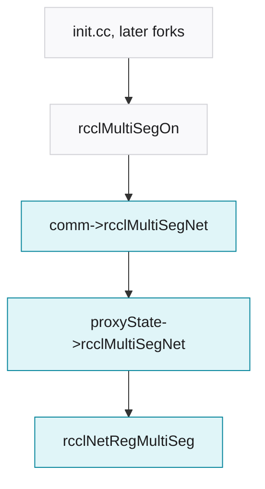

The RMA flag is read by the window gates and the RMA proxy directly, and reaches the GIN proxy through a file-scope copy:

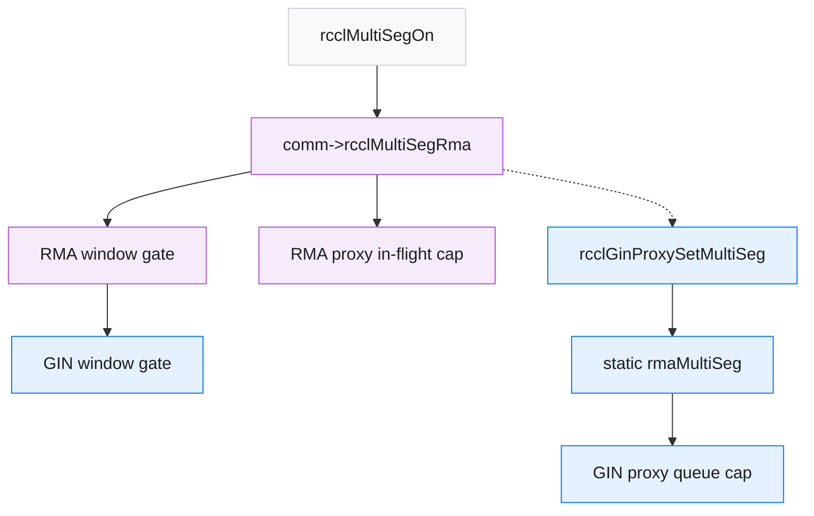

1. `src/rccl_dev_runtime.cc` `rcclMultiSegOn(pluginRegistersPerSegment)` returns true only when its argument is true, `NCCL_MULTI_SEGMENT_REGISTER` is on (`ncclParamMultiSegmentRegister`) and `NCCL_DMABUF_ENABLE` is on. Fork 1 defines it but does not call it.
2. `src/include/comm.h` `ncclComm::rcclMultiSegNet` and `ncclComm::rcclMultiSegRma` hold the per-comm result. Fork 1 never writes them, so they keep the zero value of the comm allocation. A later fork sets the net flag from `rcclMultiSegOn` when the comm's net is IB-MSEG and the RMA flag when its RMA backend is IB-MSEG's; see [the fork plugin, forks](../multi_segment_fork_plugin.md#forks).
3. `src/proxy.cc` `ncclProxyCreate` copies `comm->rcclMultiSegNet` into `proxyState->rcclMultiSegNet`, next to `dmaBufSupport`, because the NET register handlers run on the proxy thread and see only the proxy state.
4. `src/gin/gin_host_proxy.cc` keeps the RMA flag in a file-scope `rmaMultiSeg`, set by `rcclGinProxySetMultiSeg`. `ncclGinProxyInit` runs inside `ncclRmaInit` before the comm flag is known, so the value has to be handed in before `ncclGinProxyCreateContext` runs. Fork 1 has no caller of the setter (the dotted edge); a later fork calls it just before it creates each comm's GIN contexts.

The read sites at the tip:

| Flag | Read in | Effect when set |
|---|---|---|
| `proxyState->rcclMultiSegNet` | `src/transport/net.cc` `rcclNetRegMultiSeg` | a multi-segment buffer goes to `regMrDmaBuf` with fd -1 |
| `comm->rcclMultiSegRma` | `src/rccl_dev_runtime.cc` `rcclDevrRmaRegistersMultiSegment` | a multi-segment window may register with RMA, and with GIN through `rcclDevrGinRegistersMultiSegment` |
| `comm->rcclMultiSegRma` | `src/rma/rma_proxy.cc` `rcclRmaProxyRegisterMultiSeg`, `src/gin/gin_host.cc` `rcclGinRegisterMultiSeg` | a multi-segment window registers with fd -1 instead of a whole-range fd ([proxy fd for multi-segment windows](#proxy-fd-for-multi-segment-windows)) |
| `comm->rcclMultiSegRma` | `src/rma/rma_proxy.cc` `ncclRmaProxyCtxAlloc` | the RMA proxy's per-peer in-flight cap |
| `rmaMultiSeg` | `src/gin/gin_host_proxy.cc` `ncclGinProxyCreateContext` | the GIN proxy's per-peer queue-size cap |

## NET proxy registration

The proxy register handler first splits single-segment buffers from multi-segment ones:

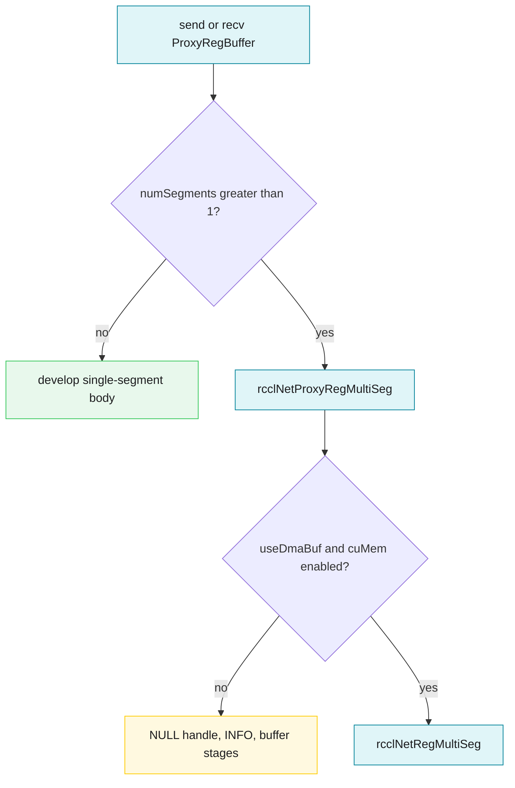

`rcclNetRegMultiSeg` then decides whether the plugin gets fd -1:

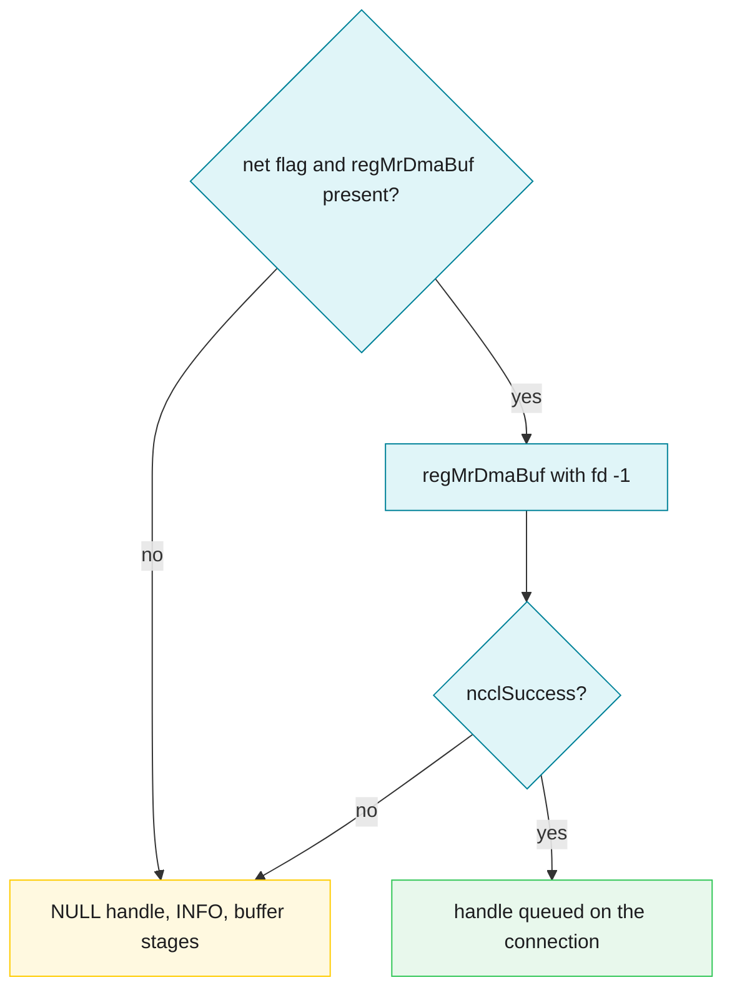

1. The main thread decides first, with develop code: `src/transport/net.cc` `ncclNetLocalRegisterBuffer` and `ncclNetGraphRegisterBuffer` count the buffer's physical segments and return before any proxy call when the count is above 1 and `NCCL_MULTI_SEGMENT_REGISTER` is off. Otherwise `netRegisterBuffer` sends a `netRegInfo` with `numSegments` to the proxy of each peer connection.
2. `src/transport/net.cc` `sendProxyRegBuffer` and `recvProxyRegBuffer` check the request and response sizes as before. For `numSegments > 1` they return `rcclNetProxyRegMultiSeg` with their own net comm (`netSendComm` or `netRecvComm`), `useDmaBuf` and `useGdr`. For one segment they fall through to the develop body unchanged, so the whole-range `cuMemGetHandleForAddressRange` export, the HSA portable export and the plain `regMr` fallback now run only for single-segment buffers.
3. `rcclNetProxyRegMultiSeg` is the one multi-segment decision for both directions. Inside the `CUDA_VERSION >= 11070 || NCCL_CUMEM_DMABUF_EXPORT_GATE` build gate it registers only if `useDmaBuf` and `ncclCuMemEnable()` hold and `rcclNetRegMultiSeg` succeeds; without the gate nothing registers. On success it enqueues a `proxyMemHandle` on `connection->proxyMemHandleQueue`, the same queue develop uses, so the connection frees the MR as before. On any refusal it logs an INFO line naming the buffer, size and segment count. Either way it writes the handle (or NULL) to the response, sets `*done` and returns `ncclSuccess`.
4. `rcclNetRegMultiSeg` passes fd -1 only to a plugin that walks the range itself:

```cpp
static bool rcclNetRegMultiSeg(struct ncclProxyState* proxyState, void* netComm, void* buffer, size_t size, int flags,
                               void** handle) {
  ncclNet_t* net = proxyState->ncclNet;
  if (!proxyState->rcclMultiSegNet || net == NULL || net->regMrDmaBuf == NULL) return false;
  return net->regMrDmaBuf(netComm, buffer, size, NCCL_PTR_CUDA, (uint64_t)(uint32_t)flags, -1, handle) == ncclSuccess;
}
```

The fd -1 convention, recorded in `src/transport/rccl_mseg.h` and in a comment above `regMrDmaBuf` in `src/include/plugin/net/net_v12.h`: a `regMrDmaBuf` call with fd -1 asks the plugin to find the segments of `[buffer, buffer + size)` itself and export each one; the `offset` argument then carries the `cuMemGetHandleForAddressRange` flags from `getHandleForAddressRangeFlags(useGdr)`. Core sends fd -1 only when the comm's net flag is set, so a plugin that does not know the convention never receives it. The plugin side is in [the fork 3 walkthrough](multi_segment_walkthrough_fork3_p2p.md).

5. The main thread receives a NULL handle as "not registered" and the collective copies through RCCL's own buffers (staging). No error reaches the user.

## Symmetric window obtain

The obtain path first gathers the segment counts and the owner-fd status from every rank:

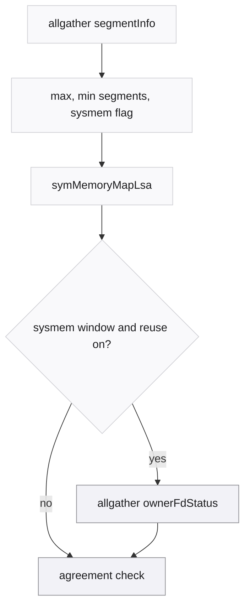

Once every rank agrees, it publishes the fds and registers the window:

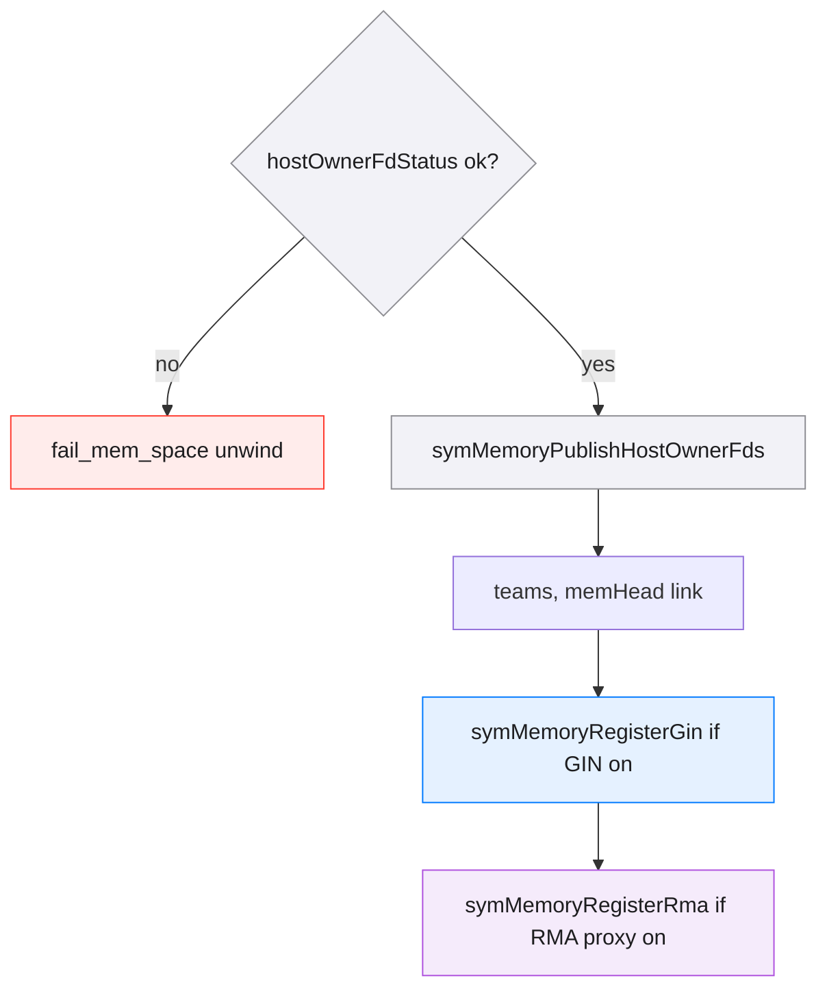

1. `src/dev_runtime.cc` `symMemoryObtain` allgathers one `segmentInfo` per rank, as develop does. Fork 1 adds two fields to the aggregate: `minGlobalNumSegments` (the RMA gate needs the same count on every rank) next to `maxGlobalNumSegments`, and `ownerFdStatus`, set to `ncclSuccess` for the first gather. Both aggregates and `globalHasSysmemSegment` are stored in `ncclDevrMemory`, so every later gate reads communicator-wide values and every rank takes the same branch.
2. `symMemoryMapLsa` maps the LSA peers' segments and, on HIP, runs the host owner fd steps described in [host owner fd](#host-owner-fd). A failure to get an owner fd is not returned from it; it is recorded in `mem->hostOwnerFdStatus` so the rank still reaches the next collective.
3. On HIP, when the window has a host segment on some rank and `NCCL_SYM_REUSE_SYSMEM_HANDLES=1`, `symMemoryObtain` gathers `segmentInfo` a second time with each rank's `ownerFdStatus`. Both conditions are communicator-wide, so every rank joins this gather or none does.

```cpp
  if (globalHasSysmemSegment && ncclParamSymReuseSysmemHandles()) {
    globalSegmentInfo[comm->rank].ownerFdStatus = mem->hostOwnerFdStatus;
    NCCLCHECKGOTO(bootstrapAllGather(comm->bootstrap, globalSegmentInfo, sizeof(*globalSegmentInfo)), ret,
                  fail_mem_space);
    for (int r = 0; r < comm->nRanks && mem->hostOwnerFdStatus == ncclSuccess; r++) {
      if (globalSegmentInfo[r].ownerFdStatus != ncclSuccess) {
        WARN("Symmetric window: rank %d could not obtain a host owner fd", r);
        mem->hostOwnerFdStatus = globalSegmentInfo[r].ownerFdStatus;
      }
    }
  }
```

4. `NCCLCHECKGOTO(mem->hostOwnerFdStatus, ...)` then fails the obtain on every rank if any rank failed, before teams, GIN or RMA start their own collectives. Without this agreement a failed rank would leave its peers waiting in the next collective.
5. Once `primaryAddr` is set (the caller's VA or the rank's LSA flat slot), `symMemoryPublishHostOwnerFds` publishes the owner fds by VA. It must run after `primaryAddr` is known and before GIN or RMA registration, which look the fds up by VA.
6. The rest is develop order: CFT teams, team binding, linking `mem` into `memHead`, then `symMemoryRegisterGin` when `devr->ginEnabled` (otherwise `numGinSegments = 1` until GIN activation) and `symMemoryRegisterRma` when `ncclRmaProxyEnabled(comm)`.

## Host owner fd

A hybrid window (for example a DeepEP buffer) has host segments that one LSA rank created and the others imported. An imported host handle cannot export a DMA-BUF, but the creating rank's POSIX fd is a DMA-BUF the NIC accepts in any process. This path runs only on HIP builds, only with `NCCL_SYM_REUSE_SYSMEM_HANDLES=1`, only when the cuMem handle type is `CU_MEM_HANDLE_TYPE_POSIX_FILE_DESCRIPTOR`, and only when the window requests LSA registration. It does not depend on `NCCL_MULTI_SEGMENT_REGISTER`. The design is in [host owner DMA-BUF](../multi_segment_gin_rma.md#host-owner-dma-buf).

### Export and allgather

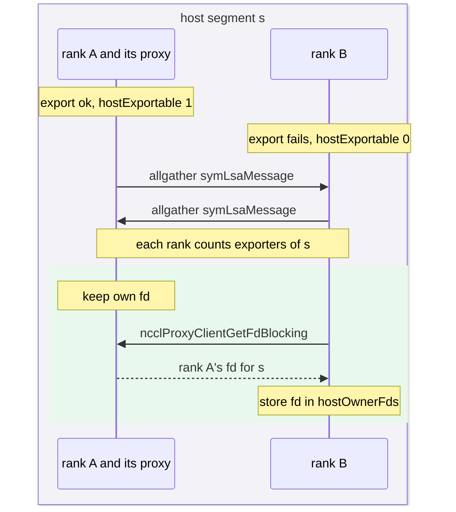

1. `src/dev_runtime.cc` `symMemoryMapLsa` sets `mem->hostOwnerFdStatus = ncclSuccess` and tries to allocate `localHostFds`, one entry per local segment, all -1. If that allocation fails the rank only skips offering its own fds; it still exports its handles and joins the allgather.
2. For each local segment (segment s in the diagram, created by rank A and imported by rank B), after `symMemoryExportSegmentHandle` fills the rank's `symLsaMessage`, the rank tries `cuMemExportToShareableHandle` on its own handle when the segment type is host and the conditions above hold. A success sets the new message field `hostExportable = 1` and keeps the fd in `localHostFds`. On a rank that imported the segment the export fails, so its message says 0.
3. `bootstrapIntraNodeAllGather` exchanges the messages, as in develop. Rank A keeps its own fd in `hostOwnerFds`; rank B fetches rank A's fd through rank A's proxy, as the next section describes.
4. With `NCCL_SYM_REUSE_SYSMEM_HANDLES=1`, develop's loop over `maxSegments` then counts host and device owners per segment, fails a segment that mixes several host owners with device owners (`ncclInvalidUsage`) and, when exactly one rank owns it as host memory, copies that rank's type into every rank's message. Fork 1 removes the `TODO(ROCM-29810)` above this loop; the loop itself stays.

### Exporter selection and fetch

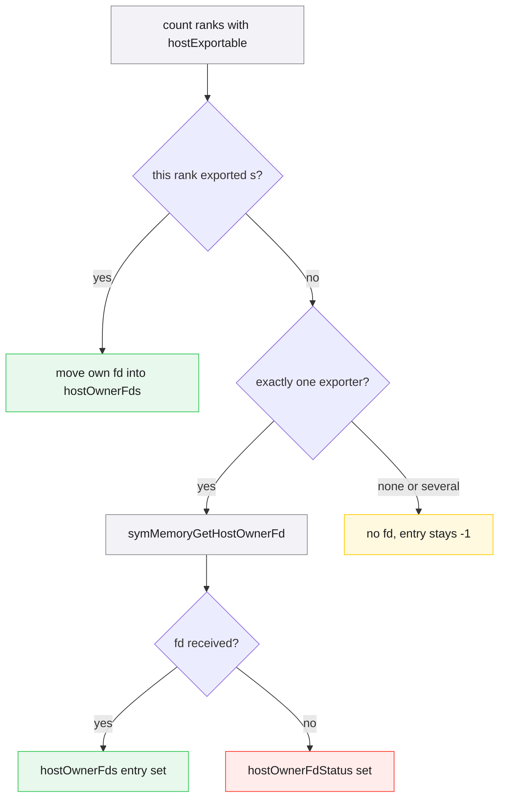

1. In the same per-segment loop, `symMemoryMapLsa` counts the LSA ranks whose message has `hostExportable` for the segment and remembers the first one as `exporter`.
2. It then takes one of three branches:

```cpp
      if (segment < numSegments && localHostFds != nullptr && localHostFds[segment] >= 0) {
        if (mem->hostOwnerFdStatus == ncclSuccess) mem->hostOwnerFdStatus = symMemoryEnsureHostOwnerFds(mem);
        if (mem->hostOwnerFds != nullptr) {
          mem->hostOwnerFds[segment] = localHostFds[segment];
          localHostFds[segment] = -1;
          INFO(NCCL_REG, "Symmetric window segment %d: NIC registration uses the local host allocation fd", segment);
        }
      } else if (nExporters == 1) {
        // RCCL: no fallback to a non-exporter. Its proxy would repeat the failed export and never reply.
        if (mem->hostOwnerFdStatus == ncclSuccess) {
          mem->hostOwnerFdStatus =
            symMemoryGetHostOwnerFd(comm, mem, segment, exporter, messages + exporter * maxSegments + segment);
        }
      }
```

3. A rank that exported the segment keeps its own fd. `symMemoryEnsureHostOwnerFds` creates `mem->hostOwnerFds` on first use, one entry per local segment, all -1; an allocation failure goes into `hostOwnerFdStatus`.
4. A rank that did not export borrows only when exactly one rank exported. With several exporters it borrows none, because an import could map a peer's pages rather than the owner's. With none it does not ask a non-exporter, because that rank's proxy would repeat the failed export and never reply.
5. `symMemoryGetHostOwnerFd` returns without doing anything when the owner is invalid or is this rank, when the segment index is past this rank's segments, or when the handle type is not POSIX fd. Otherwise it calls `ncclProxyClientGetFdBlocking` on the exporter's proxy with the exporter's message, the same request develop uses to import a peer handle, and stores the fd it gets back. Its return value becomes `hostOwnerFdStatus`; it is not returned from `symMemoryMapLsa`.
6. After the import and map loop and the intranode barrier, the `leave` label closes every fd still in `localHostFds` (exported but not kept) and frees the table.

### Agreement, publish and lookup

1. `symMemoryObtain` gathers the status a second time and fails every rank together, as shown in [symmetric window obtain](#symmetric-window-obtain).
2. `symMemoryPublishHostOwnerFds` walks the window from `primaryAddr` by `segmentSizes` and calls `src/rccl_dev_runtime.cc` `rcclHostSegmentFdRegister(va, size, fd)` for each segment with an fd. The table is a process-wide vector of `{base, size, fd}` under a mutex.
3. `rcclHostSegmentFdLookup(addr, len, &offset)` returns the fd of the first entry whose range contains `[addr, addr + len)` and sets `offset = addr - base`; it returns -1 when nothing matches. The fd stays owned by the window: callers must not close it, and it is valid until the window is destroyed.
4. In fork 1 the only lookup is in `src/gin/gin_host.cc` `ginRegister`, the body of `ncclGinRegister` and `rcclGinRegisterMultiSeg` ([GIN window registration](#gin-window-registration)). IB-MSEG's RMA backend adds a lookup per segment in a later fork.

## GIN window registration

`symMemoryRegisterGin` first decides whether the window registers with GIN at all:

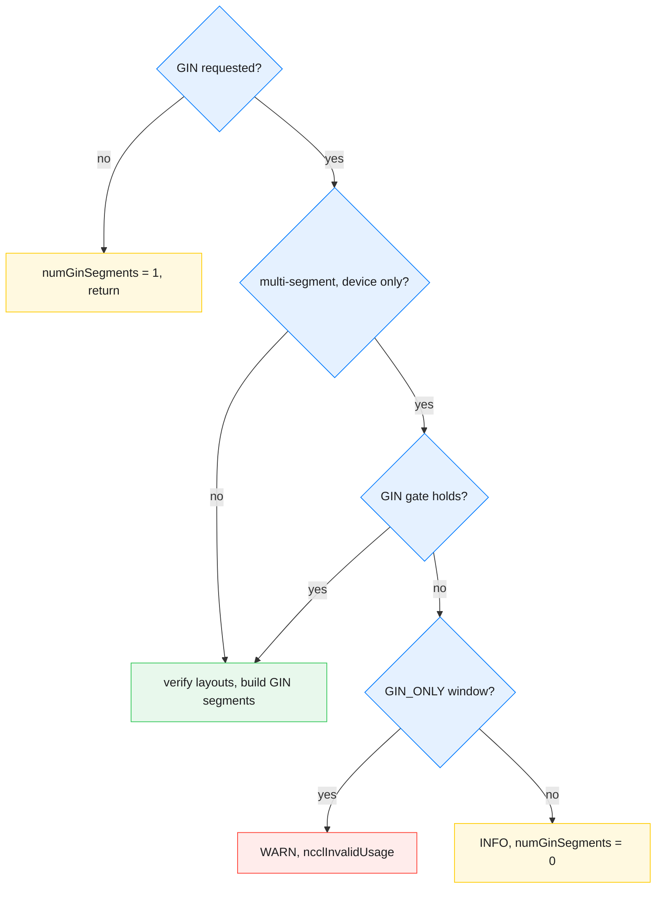

1. `src/dev_runtime.cc` `symMemoryRegisterGin` returns early with one GIN segment when the window does not request GIN registration, as in develop.
2. On HIP, a window with more than one segment on some rank and no host segment on any rank is the case develop keeps off GIN, because one HIP DMA-BUF export covers only the first segment. Fork 1 lets it through when the GIN gate `rcclDevrGinRegistersMultiSegment(comm, minGlobalNumSegments, maxGlobalNumSegments)` holds. Otherwise a `NCCL_WIN_GIN_ONLY` window fails with `ncclInvalidUsage` (the WARN now names the missing proxy-over-RMA backend), and any other window is left unregistered with GIN (`numGinSegments = 0`, INFO line) and stays usable for LSA.
3. `src/rccl_dev_runtime.cc` `rcclDevrGinRegistersMultiSegment` requires `rcclDevrRmaRegistersMultiSegment` ([RMA window registration](#rma-window-registration)) and that every active, not closed GIN backend has `ginType == NCCL_GIN_TYPE_PROXY`, because only the GIN proxy registers through the RMA backend.
4. `ncclDevrVerifySegmentLayouts` and `ncclDevrBuildGinSegmentInfos` (`src/dev_runtime_segments.cc`, unchanged) build the GIN segments: one GIN segment over the whole window when no rank has host memory, one per physical segment otherwise.

Each GIN segment then takes one of two register calls:

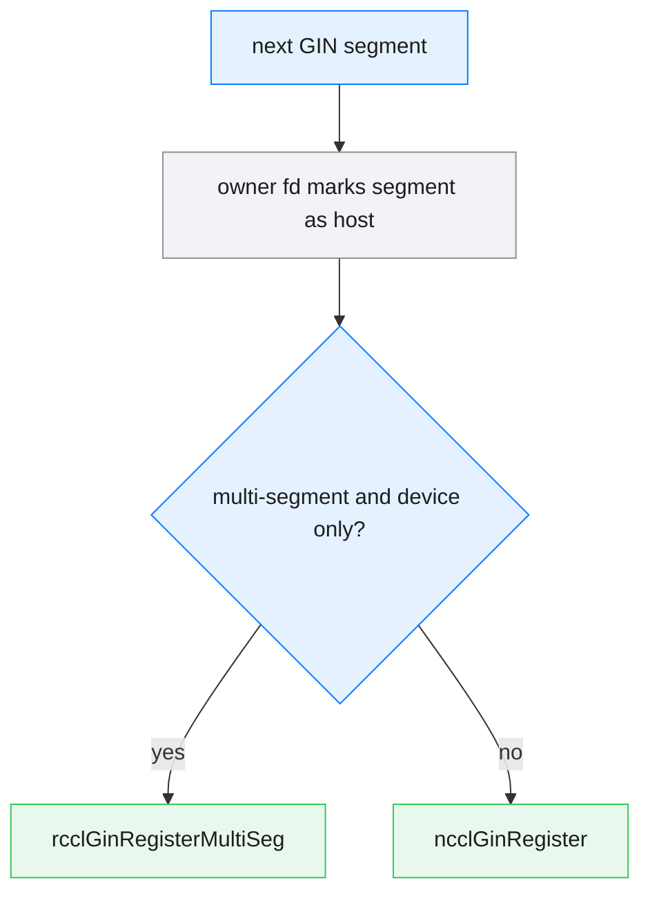

5. In the per-segment loop, under `NCCL_CUMEM_HOST_GATE`, a segment with an entry in `mem->hostOwnerFds` is treated as host memory (`hipMemLocationTypeHost`), because an imported host handle may read as device. The develop code that follows records host segments as `CU_MEM_LOCATION_TYPE_HOST_NUMA` for the device put fence. `rcclDevrGinSegmentRegType` (develop) chooses `NCCL_PTR_CUDA` and `needDmabuf = maxGlobalNumSegments > 1 || globalHasSysmemSegment`.
6. On HIP, a window with more than one segment and no host segment (`maxGlobalNumSegments > 1 && !globalHasSysmemSegment`) has one GIN segment over the whole window, and only the gate in step 2 lets it get here. It registers through `src/gin/gin_host.cc` `rcclGinRegisterMultiSeg` at `primaryAddr`. Every other GIN segment goes to `ncclGinRegister` with `needDmabuf` as `multiSegment`, as in develop.

Both register calls share one body, `ginRegister`, which runs once per GIN backend:

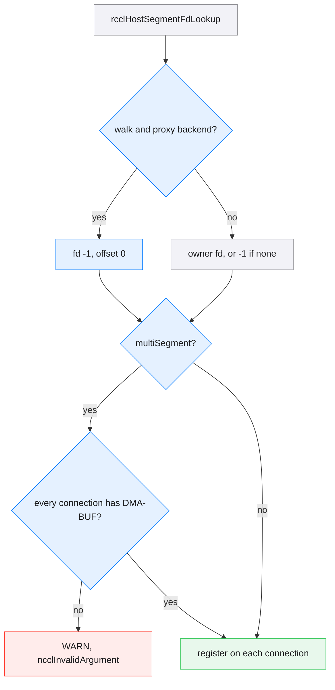

7. `src/gin/gin_host.cc` `ncclGinRegister` and `rcclGinRegisterMultiSeg` both call the file-local `ginRegister`. `ncclGinRegister` passes its own `multiSegment` and `walkSegments = false`; `rcclGinRegisterMultiSeg` passes `multiSegment = true` and `walkSegments = comm->rcclMultiSegRma`.
8. `ginRegister` looks up a published owner fd for the segment's address and size once, before the backend loop. For each backend, `walk` is `walkSegments` and `ginType == NCCL_GIN_TYPE_PROXY`. A walking backend gets fd -1 with offset 0 (the export flags); any other backend gets the owner fd and its offset, or -1 when none is published. With `multiSegment` set it still requires DMA-BUF support on every connection of each backend and returns `ncclInvalidArgument` otherwise, as in develop.

On each connection the backend's DMA-BUF entry takes the fd; the GIN proxy forwards it to the RMA backend:

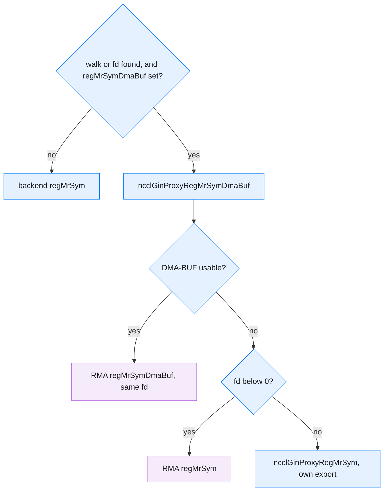

9. For each connection `ginRegister` calls the backend's `regMrSymDmaBuf` with that fd and offset when the backend walks or an owner fd was found, and the backend has that entry; otherwise it calls `regMrSym` as before. A device segment registered through `ncclGinRegister` never has a published fd, so it always takes `regMrSym`.
10. `src/gin/gin_host_proxy.cc` now fills the `regMrSymDmaBuf` slot of `ncclGinProxy` with `ncclGinProxyRegMrSymDmaBuf`. It forwards the caller's fd and offset to the RMA backend's `regMrSymDmaBuf` and copies the MR handle into the GIN handle. DMA-BUF is not usable when `NCCL_DMABUF_ENABLE` is off, the RMA backend has no `regMrSymDmaBuf`, or the connection lacks `NCCL_PTR_DMABUF`. Then fd -1 goes to the RMA backend's `regMrSym`, never to a whole-range export, and a real fd falls back to `ncclGinProxyRegMrSym`, which exports its own fd ([proxy fd for multi-segment windows](#proxy-fd-for-multi-segment-windows)). It does not close the caller's fd.
11. After the loop, a window with one GIN segment caches the handles in `mem->ginDevWins` and `mem->ginHostWins`, as in develop.

## RMA window registration

`symMemoryRegisterRma` keeps develop's single-segment branch and sends every other window to the multi-segment gate:

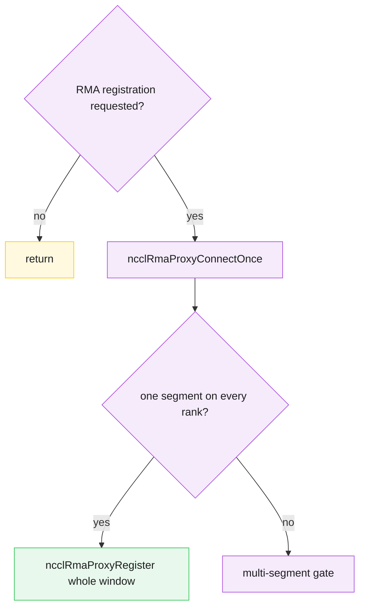

The gate admits a multi-segment window or skips its RMA registration on every rank:

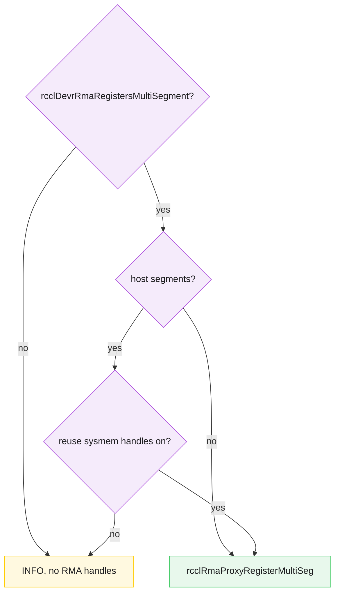

1. `src/dev_runtime.cc` `symMemoryRegisterRma` returns when the window does not request RMA registration, then connects the RMA proxy once (`ncclRmaProxyConnectOnce`), as in develop.
2. Develop registered only windows with one segment on every rank and skipped the rest silently. Fork 1 keeps that branch and adds the multi-segment one, which registers through `rcclRmaProxyRegisterMultiSeg` ([proxy fd for multi-segment windows](#proxy-fd-for-multi-segment-windows)); the skip now logs an INFO line with the segment range. All inputs are communicator-wide, so every rank registers or skips together:

```cpp
  if (mem->maxGlobalNumSegments == 1) {
    NCCLCHECK(ncclRmaProxyRegister(comm, mem->primaryAddr, mem->size, mem->rmaHostWins));
  } else if (rcclDevrRmaRegistersMultiSegment(comm, mem->minGlobalNumSegments, mem->maxGlobalNumSegments) &&
             (!mem->globalHasSysmemSegment || ncclParamSymReuseSysmemHandles())) {
    NCCLCHECK(rcclRmaProxyRegisterMultiSeg(comm, mem->primaryAddr, mem->size, mem->rmaHostWins));
  } else {
    INFO(NCCL_INIT, "Skipping RMA registration for window %p with %d..%d segments per rank", mem->primaryAddr,
         mem->minGlobalNumSegments, mem->maxGlobalNumSegments);
  }
```

3. `src/rccl_dev_runtime.cc` `rcclDevrRmaRegistersMultiSegment` holds when `comm->rcclMultiSegRma` is set, `minGlobalNumSegments == maxGlobalNumSegments`, and `rcclRmaSegTableFits(nRanks, maxGlobalNumSegments)` holds.
4. `src/transport/rccl_mseg_rma.h` `rcclRmaSegTableFits` requires at least one rank and a count accepted by `rcclIbSegCountSupported` (1 to `RCCL_IB_REG_SEG_DEFAULT`, 1024, in `src/transport/rccl_mseg.h`); above one segment it also requires `nranks * nSeg <= RCCL_RMA_SEG_TABLE_MAX_ENTRIES` (2^20), because every rank holds every rank's segment table.
5. A window with host segments also needs `NCCL_SYM_REUSE_SYSMEM_HANDLES=1`, because only then are owner fds published for the backend to find.
6. A skipped window keeps `rmaHostWins` all NULL. That NULL is what the [launch-time checks](#launch-time-checks) test.

## Proxy fd for multi-segment windows

This section describes which fd the GIN and RMA proxies hand to the RMA backend when a multi-segment window passes the gates. It is kept separate so a change to that choice only touches this section.

On HIP a whole-range DMA-BUF export describes only the first physical segment, so a multi-segment window that passes the gates never gets one. Both proxies hand the RMA backend fd -1 instead, and the backend walks the segments itself:

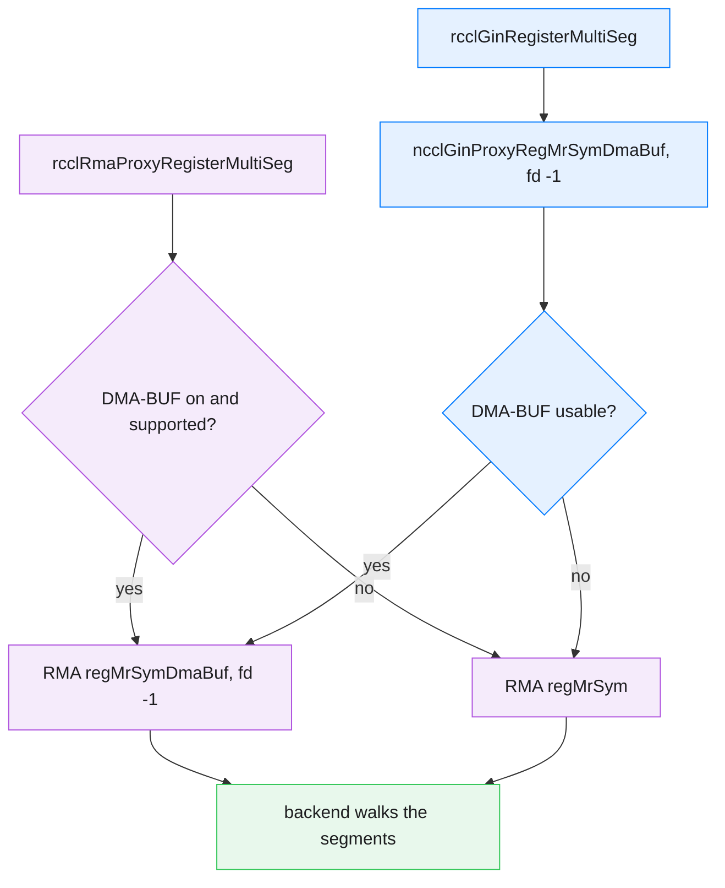

1. RMA: `src/rma/rma_proxy.cc` `ncclRmaProxyRegister` and `rcclRmaProxyRegisterMultiSeg` share the file-local `rmaProxyRegister`, which registers the whole window once per RMA comm and fails with `ncclSystemError` (WARN) when a handle comes back NULL. `ncclRmaProxyRegister` passes `walkSegments = false`; `rcclRmaProxyRegisterMultiSeg` passes `comm->rcclMultiSegRma`, which the gate guarantees is set.
2. With `walkSegments`, `rcclRmaProxyRegMrSymSegments` exports nothing. It reads the RMA comm's own properties, so the cuMem and RMA proxy DMA-BUF strip of step 3 does not apply:

```cpp
static ncclResult_t rcclRmaProxyRegMrSymSegments(ncclRma_t* rmaComm, void* rmaCollComm, ncclNetProperties_t props,
                                                 void* addr, size_t size, void** mhandle) {
  if (ncclParamDmaBufEnable() && rmaComm->regMrSymDmaBuf != nullptr && (props.ptrSupport & NCCL_PTR_DMABUF)) {
    return rmaComm->regMrSymDmaBuf(rmaCollComm, addr, size, NCCL_PTR_CUDA, 0, -1, 0, mhandle);
  }
  return rmaComm->regMrSym(rmaCollComm, addr, size, NCCL_PTR_CUDA, 0, mhandle);
}
```

3. Without `walkSegments` (single-segment windows), develop's `ncclRmaProxyRegMrSym` runs with `NCCL_PTR_CUDA` and `sym_buffer = true`. Builds with `NCCL_CUMEM_DMABUF_EXPORT_GATE` strip DMA-BUF support when `ncclCuMemEnable()` is false; other builds strip it when the RMA proxy's DMA-BUF parameter is off. With DMA-BUF, `getDmaBufFd` exports the whole page-aligned range (with `cuMemGetHandleForAddressRange` under the export gate with cuMem on, otherwise with the HSA portable export), then `regMrSymDmaBuf` runs with offset 0 and the fd is closed; if the export fails it calls `regMrSym`.
4. GIN, device-only multi-segment window: the window is one GIN segment, registered through `rcclGinRegisterMultiSeg`, so the GIN proxy backend gets fd -1 ([GIN window registration](#gin-window-registration)). `ncclGinProxyRegMrSymDmaBuf` forwards fd -1 to the RMA backend's `regMrSymDmaBuf`, or, when DMA-BUF is not usable, calls the RMA backend's `regMrSym`. Neither exports a fd.
5. GIN, hybrid window: each physical segment is its own GIN segment, registered through `ncclGinRegister`. Host segments with an owner fd take `ncclGinProxyRegMrSymDmaBuf` with that fd. Device segments have no published fd, so `ncclGinProxyRegMrSym` runs: for `NCCL_PTR_CUDA` with DMA-BUF enabled and supported it exports the segment's range with `getDmaBufFd` (`cuMemGetHandleForAddressRange` over the page-aligned length), calls the RMA backend's `regMrSymDmaBuf` with offset 0 and closes the fd. If that registration fails it retries with a non-DataDirect export; if no export succeeds it calls `regMrSym`. That export covers one physical segment, so it is exact.
6. The gates admit a multi-segment window only when `comm->rcclMultiSegRma` says the RMA backend registers one MR per segment and walks the segments when it gets fd -1 (see the comment on `rcclDevrRmaRegistersMultiSegment`). The fd -1 convention is the one the NET path uses ([NET proxy registration](#net-proxy-registration)). The backend side is in [the fork 4 walkthrough](multi_segment_walkthrough_fork4_gin_rma.md).

## In-flight and queue-size caps

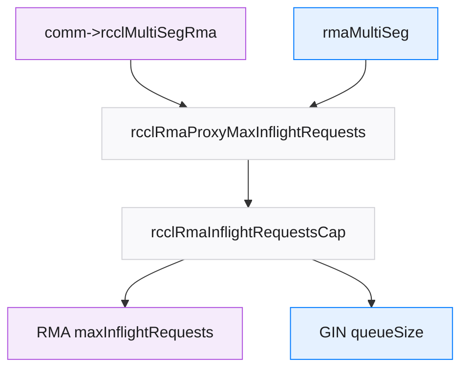

1. `src/transport/rccl_mseg_rma.h` `rcclRmaInflightRequestsCap(multiSegChains, maxRequests)` returns `RCCL_RMA_MAX_INFLIGHT_REQUESTS` (32) when the flag is set and the limit is larger, else the limit unchanged. `src/rccl_dev_runtime.cc` `rcclRmaProxyMaxInflightRequests` wraps it so host tests can fake it. A multi-segment request may post a whole round of WRs, so the backend's send queue bounds how many requests fit.
2. `src/rma/rma_proxy.cc` `ncclRmaProxyCtxAlloc` computes develop's `maxRequests` (`NCCL_NET_MAX_REQUESTS * props.maxRecvs`) and sets `maxInflightRequests` to the cap with `comm->rcclMultiSegRma`, with an INFO line when it is lower. The queue size is still sanitized against `maxRequests`. `src/rma/rma_proxy_progress.cc` `ncclRmaProxyCanIssueRequest` compares the per-peer in-flight count with `maxInflightRequests` before it issues a request.
3. `src/gin/gin_host_proxy.cc` `ncclGinProxyCreateContext` sanitizes `NCCL_GIN_PROXY_QUEUE_SIZE` as before and then caps the result with `rmaMultiSeg`, logging an INFO line when it lowers it. For GIN the per-peer queue size is what bounds requests in flight.

## Launch-time checks

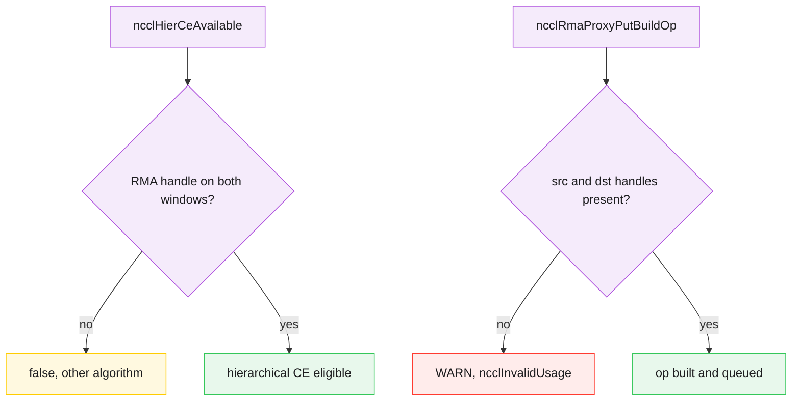

1. `src/ce_coll.cc` `ncclHierCeAvailable` adds a last check after the window registration type: when `ncclDevrGetRmaWin(sendWin, 0)` or `ncclDevrGetRmaWin(recvWin, 0)` is NULL it returns false with a TRACE line, and the collective takes another algorithm. The inter-node rail step puts through RMA handles, so a window whose RMA registration was skipped cannot use it. Every rank skipped that registration together, so every rank gets the same answer; this matters because the answer gates a group join in `taskAppend`.
2. `src/rma/rma_proxy_launch.cc` `ncclRmaProxyPutBuildOp` looks up the source and destination handles by `collCommIdx`, as before. When a window is given but its handle is NULL it logs a WARN with the size and peer and returns `ncclInvalidUsage`, instead of posting a put with a NULL MR. The error appears when the put is built at launch, not at the `ncclPut` call.

## Deregister and destroy

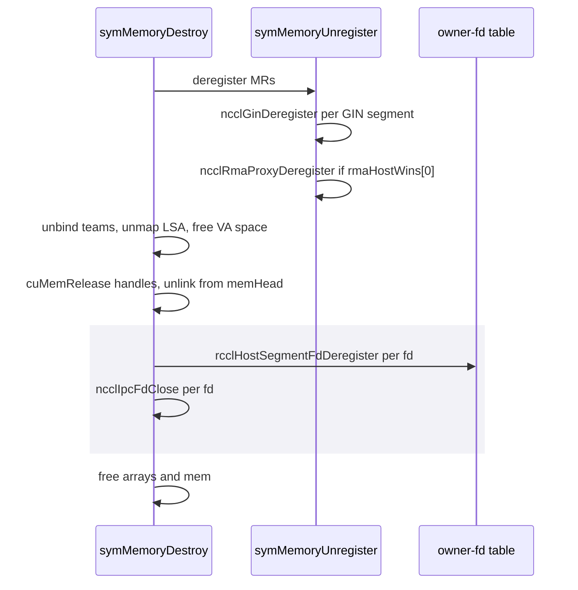

1. `src/dev_runtime.cc` `symMemoryDestroy` runs when the last reference drops (`symMemoryDropRef`) or from `ncclDevrFinalize`. It first calls `symMemoryUnregister`.
2. `symMemoryUnregister` deregisters every GIN segment when GIN is enabled, as before. It now deregisters the RMA window whenever the RMA proxy is enabled, the window requested RMA registration and `rmaHostWins[0]` is set; develop also required one segment, which a multi-segment window registered through the gate would fail. A skipped window has `rmaHostWins[0] == NULL` and is left alone. `ncclRmaProxyDeregister` skips NULL entries.
3. The develop teardown follows: team and LE unbinding, `symMemoryUnmapLsaTeam`, `ncclSpaceFree`, allocation untracking, `cuMemRelease` of each handle, and unlinking from `memHead`.
4. `symMemoryCloseHostOwnerFds` then, for each owner fd, removes the table entry with `rcclHostSegmentFdDeregister` and only then closes the fd with `ncclIpcFdClose`, and frees `hostOwnerFds`. The MRs that used the fds were deregistered in step 2. The table is matched by fd number, so unpublishing before closing keeps a later window that reuses the same fd number from colliding with a stale entry.

## Switch-off and single-segment paths

With `NCCL_MULTI_SEGMENT_REGISTER=0` (the HIP default), and in fork 1 even with it on, both comm flags are false. Each new path leaves at these points:

- NET: with the switch off, `ncclNetLocalRegisterBuffer` and `ncclNetGraphRegisterBuffer` return before any proxy call for a multi-segment buffer, which is develop code. With the switch on, the buffer reaches `rcclNetProxyRegMultiSeg`, `rcclNetRegMultiSeg` returns false and the buffer stages; develop instead tried a whole-range DMA-BUF export and then the HSA export for such a buffer.
- GIN: `rcclDevrGinRegistersMultiSegment` is false, so `symMemoryRegisterGin` takes develop's branch for a device-only multi-segment window; only the WARN text differs.
- RMA: `rcclDevrRmaRegistersMultiSegment` is false, so `symMemoryRegisterRma` registers exactly the windows develop registered and skips the rest, now with an INFO line. `symMemoryUnregister` behaves as develop for every window this leaves registered.
- Proxy fd: with both gates false, `rcclRmaProxyRegisterMultiSeg` and `rcclGinRegisterMultiSeg` are never called, so no registration gets fd -1 and every window that registers takes develop's whole-range export.
- Caps: `rcclRmaInflightRequestsCap(false, n)` returns `n`, so the RMA in-flight limit and the GIN queue size are develop's.

Single-segment buffers and windows leave before every new branch: `sendProxyRegBuffer` and `recvProxyRegBuffer` run the develop body for `numSegments == 1`, `symMemoryRegisterRma` takes its `maxGlobalNumSegments == 1` branch, and the GIN gate applies only above one segment.

These fork 1 changes do not depend on the switch:

- The host owner fd path runs whenever `NCCL_SYM_REUSE_SYSMEM_HANDLES=1` on HIP with POSIX fd handles: the extra export, the exporter selection and fetch, the second allgather, publication, the host marking in `symMemoryRegisterGin` and the `regMrSymDmaBuf` call in `ncclGinRegister`. With `NCCL_SYM_REUSE_SYSMEM_HANDLES=0` none of it runs: nothing is exported, `hostOwnerFds` stays NULL, the second gather is skipped and every lookup returns -1.
- The NULL-handle checks in `ncclRmaProxyPutBuildOp` and `ncclHierCeAvailable` apply to every window. On develop a skipped multi-segment window could still be selected for hierarchical CE or receive a put with a NULL handle.
- `ncclGinProxy` exposes `regMrSymDmaBuf`; with the comm flags off, core calls it only when an owner fd is published.

## Error and unwind paths

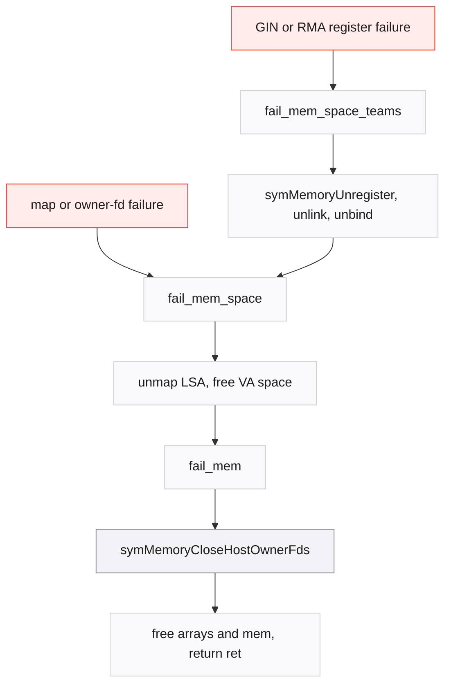

- Owner-fd fetch or table allocation fails on one rank: `symMemoryMapLsa` records the status and returns success, the second allgather spreads it, and every rank leaves `symMemoryObtain` through `fail_mem_space`. The failing rank returns its own status; the others WARN with the lowest failing rank and return that rank's status. `fail_mem` calls `symMemoryCloseHostOwnerFds`, which closes any fd already kept or fetched; the fds were not yet published, so the deregister finds nothing. The window registration returns the error on every rank.
- `symMemoryMapLsa` itself fails (for example a segment that mixes host and device owners): it returns the error after closing the unkept `localHostFds`; `hostOwnerFds` stays on `mem` and `fail_mem` closes it.
- GIN or RMA registration fails after publication: `fail_mem_space_teams` runs `symMemoryUnregister`, unlinks the window and unbinds teams, then falls through to `fail_mem`, where `symMemoryCloseHostOwnerFds` unpublishes and closes the fds. `symMemoryRegisterGin`'s own failure path first deregisters the GIN segments it registered and frees `ginSegmentInfos`.
- A device-only multi-segment `NCCL_WIN_GIN_ONLY` window without a per-segment backend: `ncclInvalidUsage` from `symMemoryRegisterGin`. A multi-segment GIN segment on a connection without DMA-BUF: `ncclInvalidArgument` from `ginRegister`, through `ncclGinRegister` or `rcclGinRegisterMultiSeg`. A NULL handle from `rcclRmaProxyRegisterMultiSeg`: WARN and `ncclSystemError`, as from `ncclRmaProxyRegister`.
- NET registration never returns an error for a multi-segment buffer; a NULL handle makes the buffer stage.
- An RMA put on a window without an RMA registration: `ncclInvalidUsage` from `ncclRmaProxyPutBuildOp` at launch.

## Tests

The fork 1 tests are host tests with fake HIP, bootstrap and plugins, plus one header-math suite, and one `test_runner` job that runs the host owner fd path on hardware. The other runner jobs that exercise these paths on hardware come with later forks and are listed in [testing, runner jobs](../multi_segment_testing.md#runner-jobs).

| Path | Suites | Binary |
|---|---|---|
| Comm flags | `SymMultiSegOnTest`; `ProxyServiceFixture.Create_CopiesTheCommMultiSegNetFlag` | `rccl-UnitTestsMicroDevRuntime`; `rccl-UnitTestsMicroProxy` |
| NET proxy registration | `NetProxyRegBufferMicrotest`, `NetProxyRegBufferCuMemMicrotest` | `rccl-UnitTestsMicroTransportNet` |
| Host owner fd | `SymMemoryMapLsaTest`, `SymMemoryObtainRegisterTest` | `rccl-UnitTestsMicroDevRuntime` |
| GIN window registration | `SymMemoryRegisterGinTest`, `SymMemoryRegisterGinElasticTest`; `GinHostRegisterMicrotest` (`RegisterMultiSeg_*` for fd -1); `GinHostProxyRegMrMicrotest` (`DmaBuf_FdMinusOne_*` for fd -1) | `rccl-UnitTestsMicroDevRuntime`; `rccl-UnitTestsMicroGinHost`; `rccl-UnitTestsMicroGinHostProxy` |
| RMA window registration and deregister | `SymMemoryRegisterRmaTest`; `RmaProxyRegisterWindowTest` (fd -1, plain without DMA-BUF, develop path with the flag off or one segment) | `rccl-UnitTestsMicroDevRuntime`; `rccl-UnitTestsMicroRmaProxy` |
| Caps | `RmaProxyAllocGraphTest.MaxInflightRequestsTakesTheMultiSegmentCap`; `GinHostProxyContextMicrotest.Create_MultiSegmentCapClampsQueueSize` | `rccl-UnitTestsMicroRmaProxy`; `rccl-UnitTestsMicroGinHostProxy` |
| Launch-time checks | `RmaProxyDescriptorTest.PutOp_WindowWithoutRmaRegistrationFails`; `HierCeAvailableMicrotest` | `rccl-UnitTestsMicroRmaProxyLaunch`; `rccl-UnitTestsMicroCeColl` |
| Header limits | `RmaSegmentMathTest` | `rccl-HostUnitTests` |

The runner job `ubr_multisegment_hybrid_reuse_sysmem` (suite "Multi-Segment - Hybrid Window Owner FDs") runs develop's `UBR_MultiSegment.Symmetric_Elastic_Lsa` from `rccl-UnitTestsMPI` with 2 ranks on one node and `NCCL_SYM_REUSE_SYSMEM_HANDLES=1`, plus `NCCL_MULTI_SEGMENT_REGISTER=1`, `NCCL_ELASTIC_BUFFER_REGISTER=1`, `NCCL_WIN_ENABLE=1` and `NCCL_CUMEM_ENABLE=1`, so the host owner fd export and allgather run on hardware and the LSA AllReduce is checked. It is enabled in `mi300x_mellanox_ib`, `mi300_mellanox_ib_func`, `mi355x_thor2_roce`, `mi355x_thor2_roce_func`, `mi455_ainic_roce` and `mi455_ainic_roce_func`. `net_ib_transport` defines it but disables the suite, because the test is LSA-only on one node and has no NET IB transport path.

Run them from `projects/rccl/`:

```bash
# Every host binary, as CI runs them (configure, build, run, coverage)
./test/host/run_host_tests.sh

# Only the fork 1 suites, after a build; the filter applies to every host binary
GTEST_FILTER='SymMultiSegOnTest.*:SymMemory*:NetProxyRegBuffer*:GinHostRegisterMicrotest.*:GinHostProxyRegMrMicrotest.*:GinHostProxyContextMicrotest.*:RmaProxyAllocGraphTest.*:RmaProxyRegisterWindowTest.*:RmaProxyDescriptorTest.*:HierCeAvailableMicrotest.*:ProxyServiceFixture.Create_CopiesTheCommMultiSegNetFlag:RmaSegmentMathTest.*' \
  ./test/host/run_host_tests.sh run

# One binary from the host-test build directory
./test/host/build/rccl-UnitTestsMicroDevRuntime --gtest_filter='SymMemoryMapLsaTest.*:SymMemoryObtainRegisterTest.*'

# The hybrid owner-fd job on hardware, from tools/scripts/test_runner
python test_runner.py --config configs/mi300x_mellanox_ib.json --suite-name "Multi-Segment - Hybrid Window Owner FDs"
```

Run the host tests on both ROCm versions the [testing doc](../multi_segment_testing.md#how-to-run) names, because `NCCL_CUMEM_HOST_GATE` and the DMA-BUF export gate compile differently between them.

## Where to change things

- Which plugin counts as registering per segment: set `comm->rcclMultiSegNet` or `comm->rcclMultiSegRma` where the comm picks its plugins, through `rcclMultiSegOn`. Core reads only the flags and names no plugin.
- The switch and DMA-BUF prerequisites for multi-segment registration: `rcclMultiSegOn` in `src/rccl_dev_runtime.cc`.
- The fd -1 contract with a net plugin: `rcclNetRegMultiSeg` in `src/transport/net.cc`, and the comments in `src/transport/rccl_mseg.h` and above `regMrDmaBuf` in `src/include/plugin/net/net_v12.h`.
- What a multi-segment NET buffer does when the plugin declines: `rcclNetProxyRegMultiSeg` in `src/transport/net.cc`.
- The per-registration segment cap: `RCCL_IB_REG_SEG_DEFAULT` and `rcclIbSegCountSupported` in `src/transport/rccl_mseg.h`.
- The RMA segment-table budget: `RCCL_RMA_SEG_TABLE_MAX_ENTRIES` and `rcclRmaSegTableFits` in `src/transport/rccl_mseg_rma.h`.
- Which multi-segment windows RMA registers: the condition in `symMemoryRegisterRma` and `rcclDevrRmaRegistersMultiSegment`. Keep every input communicator-wide so all ranks skip together.
- Which GIN backends may take a multi-segment window: `rcclDevrGinRegistersMultiSegment`.
- The fd the proxies pass for a multi-segment window: `rcclRmaProxyRegMrSymSegments` (called from `rcclRmaProxyRegisterMultiSeg`) in `src/rma/rma_proxy.cc`, the `walk` choice in `ginRegister` (called from `rcclGinRegisterMultiSeg`) in `src/gin/gin_host.cc`, and the fd -1 fallback in `ncclGinProxyRegMrSymDmaBuf` in `src/gin/gin_host_proxy.cc` ([proxy fd for multi-segment windows](#proxy-fd-for-multi-segment-windows)).
- Which windows take the fd -1 registration: the multi-segment branches in `symMemoryRegisterRma` and in the per-segment loop of `symMemoryRegisterGin` (GIN only without host segments).
- The hardware check of the host owner fd path: the `ubr_multisegment_hybrid_reuse_sysmem` job; add it to any new platform config that can run a 2-rank LSA test.
- The in-flight cap: `RCCL_RMA_MAX_INFLIGHT_REQUESTS` and `rcclRmaInflightRequestsCap`; the call sites are `ncclRmaProxyCtxAlloc` and `ncclGinProxyCreateContext`.
- Which rank's host fd a rank registers: the exporter block in `symMemoryMapLsa`; the fetch is `symMemoryGetHostOwnerFd`, publication `symMemoryPublishHostOwnerFds`, teardown `symMemoryCloseHostOwnerFds`, and the table `rcclHostSegmentFd*` in `src/rccl_dev_runtime.cc`.
- A new consumer of owner fds: call `rcclHostSegmentFdLookup` with the exact range to register and do not close the fd.
- A new launch path that needs RMA handles: test `ncclDevrGetRmaWin` as `ncclHierCeAvailable` does, so every rank falls back together.
- Non-symmetric windows: `windowRegisterNonSym` in `src/dev_runtime.cc` registers RMA over the user range without these gates; fork 1 leaves it unchanged.
