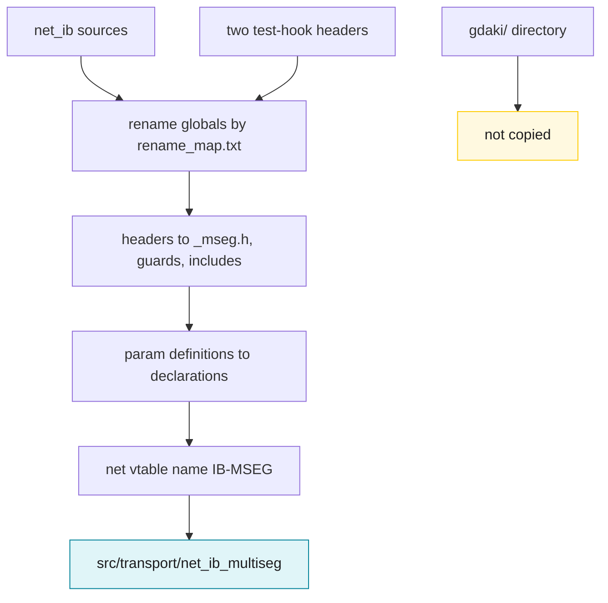
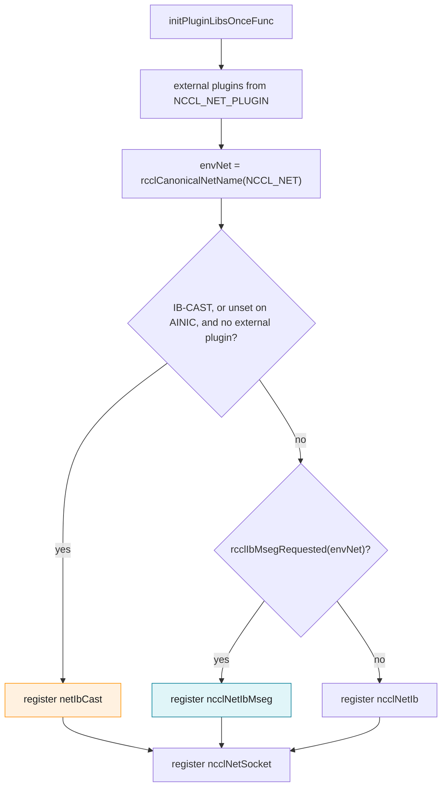
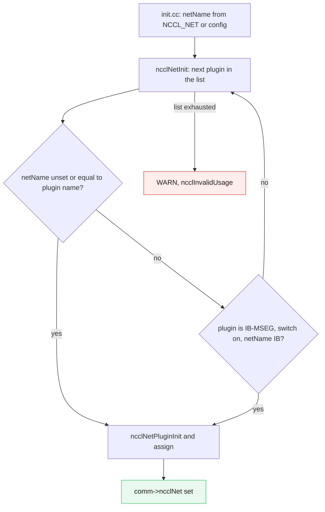
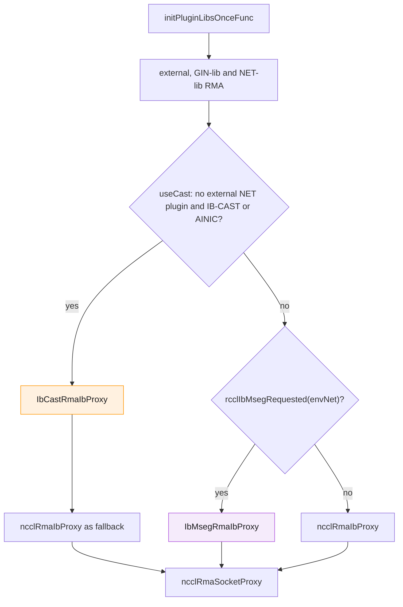
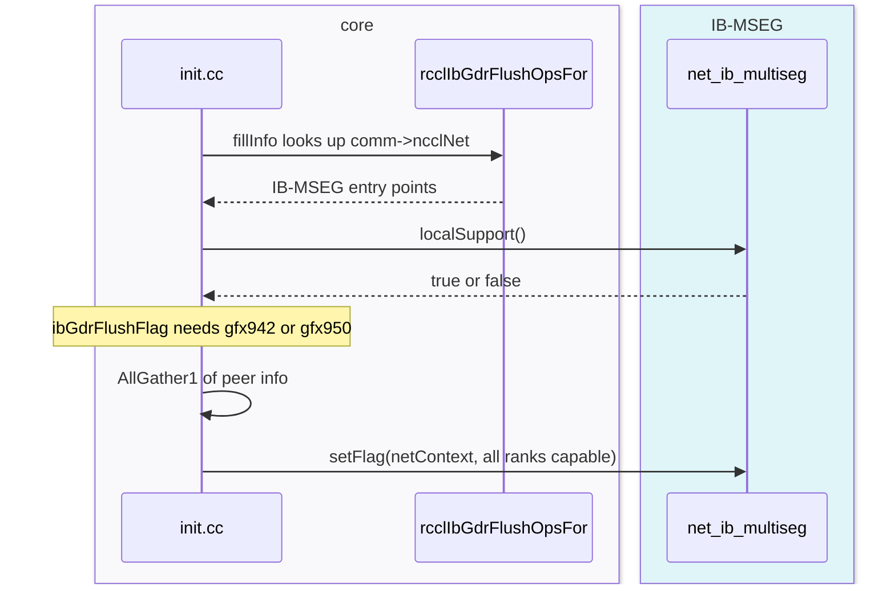
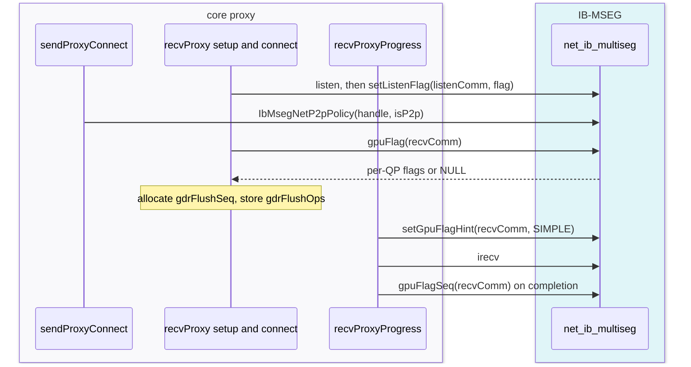
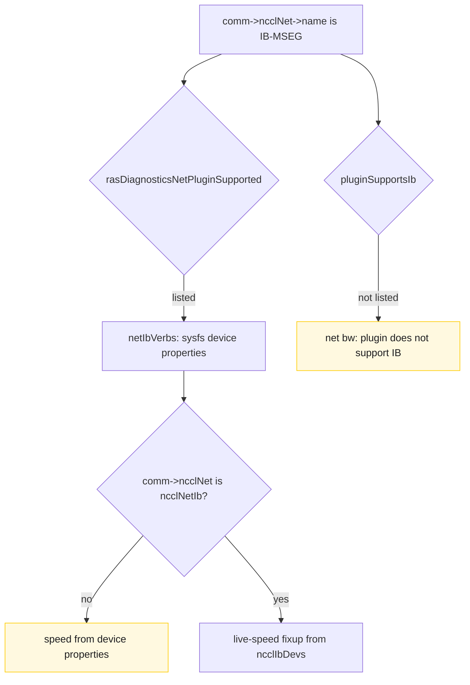

# Fork 2 code walkthrough: the IB-MSEG copy and its selection

Fork 2 adds IB-MSEG, a renamed copy of `net_ib` under `src/transport/net_ib_multiseg/`, and the core changes that select it: the internal NET plugin slot, the comm's `netName` match, the RMA backend, the P2P policy call, the GDR flush flag entry points and the RAS plugin list. The copy behaves exactly like `net_ib`; it carries no multi-segment logic yet (fork 3 adds it), so at this fork a multi-segment buffer still stages even when IB-MSEG is selected. The copy is kept in step with develop's `net_ib`; the latest sync brought in the inline GDR flush scratchpad write and the flush QP's inline room for it. Why the code lives in a fork, and how it is meant to move back, is in [the fork plugin](../multi_segment_fork_plugin.md); terms such as IB-MSEG, IB-CAST and the switch are defined in the overview's [Terms](../multi_segment_overview.md#terms).

## Files touched

Production code:

| File | Role in this fork |
|---|---|
| `src/transport/net_ib_multiseg/*` (21 files) | the copy: `net_ib`'s sources, headers renamed to `*_mseg.h`, plus copies of the two test-hook headers |
| `src/transport/net_ib_multiseg/CMakeLists.txt` | lists the copy's sources in `NET_IB_MULTISEG_SOURCES` |
| `src/CMakeLists.txt` | adds the subdirectory and appends `NET_IB_MULTISEG_SOURCES` to the library sources |
| `src/include/net.h` | declares `ncclNetIbMseg`, `IbMsegNetP2pPolicy` and the six IB-MSEG GDR flush entry points; adds `rcclIbMsegRequested` and `rcclIbGdrFlushOpsFor` |
| `src/include/rma.h` | declares `IbMsegRmaIbProxy` |
| `src/plugin/net.cc` | registers `ncclNetIbMseg` in the internal IB slot; lets it serve a request for `IB` under the switch |
| `src/plugin/rma.cc` | puts `IbMsegRmaIbProxy` in the generic IB RMA slot unless IB-CAST leads |
| `src/init.cc` | reaches the GDR flush flag through `rcclIbGdrFlushOpsFor` in `fillInfo` and `rcclSetIbGdrFlushFlag` |
| `src/transport/net.cc` | calls `IbMsegNetP2pPolicy`; the receive proxy stores the flush entry points it found at connect time |
| `src/ras/diagnostics_checks_common.cc` | lists `IB-MSEG` as a verbs plugin |
| `changelog.d/netib-mseg-copy.changed.md` | changelog fragment |
| `docs/api-reference/env-variables.rst`, `docs/userguide/source/env.rst` | environment documentation |
| `tools/scripts/net_ib_multiseg/rename_map.txt` | the rename map: each renamed `net_ib` global and its fork name |

Tests and configs:

| File | Role in this fork |
|---|---|
| `test/host/fakes/net_ib_multiseg_fakes.{h,cc}` | fakes for `ncclNetIbMseg`, `IbMsegNetP2pPolicy` and the IB-MSEG flush entry points |
| `test/host/fakes/init_fakes.{h,cc}`, `test/host/CMakeLists.txt`, `test/host/transport/host_tests.cmake` | link and reset the new fakes |
| `test/host/plugin/plugin-net-test.cc` | plugin list and `netName` match under the switch and `NCCL_NET=IB-MSEG` |
| `test/host/plugin/rma-plugin-init-test.cc` | RMA backend order under the switch |
| `test/host/init-test.cc` | flush flag vote and setter on an IB-MSEG comm |
| `test/host/transport/net-test.cc` | P2P policy, listen flag, connect-time flag and progress calls on IB-MSEG |
| `test/host/ras/ras-diagnostics-common-test.cc` | `IB-MSEG` counts as a verbs plugin, a prefix-sharing name does not |
| `test/transport/NetIbMPI/NetIbMsegInspect.hpp` (new) | includes the copy's inspect headers for the MPI tests |
| `test/transport/NetIbMPI/NetIbMPITestBase.hpp`, `GeneralTests.cpp` | the fixture resolves `IB` to IB-MSEG under the switch; pins the default |
| `test/transport/NetIbMPI/GdrFlushFlagTests.cpp`, `GdrFlushTests.cpp` | drive the flag and flush scratch through the resolved plugin |
| `test/transport/NetIbMPI/GidChangeTests.cpp` | adds an IB-MSEG instance of the GID change suite |
| `test/transport/NetIbMPI/NetIbWqeLatInspect.hpp`, `NetIbWqeLatMonTests.cpp` | WQE latency monitor on either plugin |
| `test/transport/RmaMPI/RmaMPITestBase.hpp` | maps `IB` and `IB-MSEG` to `IbMsegRmaIbProxy` as `plugin/rma.cc` does |
| `tools/scripts/test_runner/configs/*.json` (7 configs) | the `*_mseg` jobs and suite entries |

## How the copy maps to net_ib



The copy is every file of `src/transport/net_ib/` except the `gdaki/` subdirectory, plus the two test-hook headers that sit next to it, `src/transport/net_ib_gid_inspect.h` and `src/transport/net_ib_wqe_lat_inspect.h`. Each `.cc` keeps its name; each header gets a `_mseg` suffix (`common.h` becomes `common_mseg.h`, `net_ib_gid_inspect.h` becomes `net_ib_gid_inspect_mseg.h`), as IB-CAST uses `_cast`, because hipify maps repeated basenames to one output.

### Renamed symbols

`tools/scripts/net_ib_multiseg/rename_map.txt` holds one `net_ib name` / `fork name` pair per line, 395 pairs. The replacement is whole-word over the whole file, code and comments alike. It covers every global the copy defines or declares, not only exported functions, because the copy and `net_ib` link into the same library and a type or variable with the same name and a different layout would break the one-definition rule once later forks change the copy's structs.

- Plugin objects: `ncclNetIb` becomes `ncclNetIbMseg`, `ncclRmaIbProxy` becomes `IbMsegRmaIbProxy`, `ncclGinIbGdaki` becomes `IbMsegGinIbGdaki`.
- Functions, variables, struct and enum types and enum constants: `ncclIb*` becomes `IbMseg*` (for example `ncclIbMultiSend`, `ncclIbDevs`, `ncclIbSendComm`, `ncclIbCommStateConnect`), `ncclGinIb*` becomes `IbMsegGinIb*`, `ncclRmaIbProxy*` becomes `IbMsegRmaIbProxy*`, and `ncclNIbDevs` and `ncclNMergedIbDevs` become `IbMsegNDevs` and `IbMsegNMergedDevs`.
- The few names without the `ncclIb` prefix: `rcclNetP2pPolicy` becomes `IbMsegNetP2pPolicy`, `ibProviderName` becomes `IbMsegProviderName`, `ncclNetIbDevIsMlx5` becomes `IbMsegNetDevIsMlx5`, and `ncclProfilerFunction` and `ncclProfilerInfo` become `IbMsegProfilerFunction` and `IbMsegProfilerInfo`.
- Test hooks: the GID hooks (`ncclIbGid*`) and WQE latency hooks (`ncclIbWqeLat*`) get the `IbMseg` prefix, so the MPI tests can reach the copy's state. The shared GID header also declares IB-CAST's `ncclIbCastGid*` hooks; the map renames those declarations too, so `net_ib_gid_inspect_mseg.h` declares `IbMsegCastGid*` functions that nothing defines or calls.

The file's header says what it is for: reversed, it turns a change made in the copy into a patch against `net_ib`, which is what fold-back needs.

### Transforms outside the rename map

After the renames, the copy differs from `net_ib` only in these places:

1. Header names, include lines and include guards: every `#include "X.h"` of a copied header becomes `"X_mseg.h"`, every guard gains `_MSEG` (`NET_IB_COMMON_H_` becomes `NET_IB_COMMON_MSEG_H_`), and the hook header's `#include "net_ib/wqe_lat_mon.h"` becomes `#include "wqe_lat_mon_mseg.h"`.
2. Parameter definitions become declarations. `NCCL_PARAM(IbX, ...)` and `RCCL_PARAM(IbX, ...)` become `extern int64_t ncclParamIbX();` and `extern int64_t rcclParamIbX();`, and `DEFINE_NCCL_PARAM(ncclParamIbX, type, ...)` becomes `USE_NCCL_PARAM(ncclParamIbX, type);`. The parameter accessors are not in the rename map, so both copies call `net_ib`'s definitions and read the same `NCCL_IB_*`, `RCCL_IB_*`, `NCCL_GIN_*` and `NCCL_RMA_IB_*` values; there is one parse per variable, not two.
3. The net vtable's name string: `ncclNetIbMseg` in `common.cc` is named `"IB-MSEG"`. The other vtables keep `net_ib`'s strings: `IbMsegRmaIbProxy` is still named `"RMA_IB_PROXY"` and `IbMsegGinIbGdaki` `"GIN_IB_GDAKI"`, so RMA logs that print the backend name do not tell the two apart; `plugin/rma.cc` prints its own `IB-MSEG` line instead (see below).
4. GDAKI: `gdaki/` is not copied. The GDAKI block in the copy's `gin.cc`, including its `#include "gdaki/gin_host_gdaki.h"`, stays inside `#if !defined(__HIP_PLATFORM_AMD__)`, so a HIP build never compiles it. The copy's GIN path is the RMA proxy backend only.
5. `CMakeLists.txt` is written for the copy, not renamed: it only lists the other 20 files.

### What stays shared

The copy calls no `net_ib` function, and `net_ib` calls none of the copy's. They share only code outside both directories:

- The parameter definitions in `net_ib` (transform 2 above).
- `src/include/net.h`. The copy has no public header, so the core-facing entry points are declared there, next to `net_ib`'s: `ncclNetIbMseg`, `IbMsegNetP2pPolicy`, and the six GDR flush flag functions (`IbMsegGdrFlushFlagLocalSupport`, `IbMsegSetGdrFlushFlag`, `IbMsegSetListenGdrFlushFlag`, `IbMsegGetGpuFlushFlag`, `IbMsegGetGpuFlushFlagSeq`, `IbMsegSetGpuFlushFlagHint`). `IbMsegGdrFlushFlagOrdered` has no production declaration; only `test/transport/NetIbMPI/NetIbMsegInspect.hpp` declares it.
- `rcclIbGdrFlushOps` and `rcclIbGdrFlushOpsFor(net)` in `net.h`: one table of the six flag entry points per plugin. It returns `net_ib`'s set for `&ncclNetIb`, the copy's for `&ncclNetIbMseg` (HIP only), and `NULL` for every other net, including IB-CAST. It is `inline` because the host unit-test binaries compile `init.cc` without `transport/net.cc`.
- Common helpers the copy includes unchanged: `ibvwrap.h`, `mlx5/mlx5dvwrap.h`, `socket.h`, `ib_gid_utils.h`, `net_ib_limits.h` (`MAX_IB_DEVS` and friends), `gin/gin_host.h`, `profiler/net_ib.h` and the core headers.

State is not shared: the copy has its own device table (`IbMsegDevs`, `IbMsegNDevs`), merged devices, async and port recovery threads, MR cache and WQE latency globals. Anything outside the copy that reads `ncclIbDevs` sees only `net_ib`'s devices; that is why RAS skips its live-speed fixup on IB-MSEG.

### Producing and re-syncing the copy

The copy is produced by a rename tool that is kept outside this pull request; nothing in the build or CI runs it, and the committed copy is the source of truth. The tool has two jobs:

- Copy: take `net_ib` (and the two hook headers) at a recorded baseline, apply the rename map, then the transforms above, and write `src/transport/net_ib_multiseg/` and `rename_map.txt`. Run on this fork's baseline it reproduces the committed copy byte for byte.
- Port: take the `net_ib` change between the recorded baseline and a newer develop, push it through the same renames and transforms, and apply it to the copy, so an upstream or develop change to `net_ib` lands in the fork as a mechanical patch. Names that a `net_ib` change adds must be added to the map in the same step.

Whether the tool moves into the tree or stays standalone is still open (see [the copy and the rename map](../multi_segment_fork_plugin.md#the-copy-and-the-rename-map)).

## Registering the internal net plugin



This runs once per process, from the first `ncclNetInit`.

1. `src/plugin/net.cc` `initPluginLibsOnceFunc` first queues the external plugins named in `NCCL_NET_PLUGIN`. `extNetPluginRequested` is true only for a non-empty value other than `none`.
2. It canonicalizes `NCCL_NET` with `rcclCanonicalNetName` (`net.h`), which maps `ROCM-IB` to `IB-CAST` and passes every other value through.
3. IB-CAST keeps priority: `NCCL_NET=IB-CAST` (or `ROCM-IB`), or `NCCL_NET` unset on an AINIC host (`rcclUseAinic`), registers `netIbCast`, but only when no external plugin was requested.
4. Otherwise `rcclIbMsegRequested(envNet)` decides between the copy and `net_ib`. It is true when `NCCL_MULTI_SEGMENT_REGISTER=1` or when `NCCL_NET` is `IB-MSEG` (case-insensitive):

```cpp
inline bool rcclIbMsegRequested(const char* envNet) {
  return ncclParamMultiSegmentRegister() || (envNet && strcasecmp(envNet, "IB-MSEG") == 0);
}
```

5. Socket is registered after the IB slot as before. The slot holds exactly one of the three IB plugins, so `NCCL_NET_NUM_INTERNAL_PLUGINS` and the unload logic do not change.

```cpp
  {
    const char* envNet = rcclCanonicalNetName(ncclGetEnv("NCCL_NET"));
    if ((envNet && strcasecmp(envNet, "IB-CAST") == 0 && !extNetPluginRequested) ||
        (!envNet && rcclUseAinic() && !extNetPluginRequested)) {
      ncclNetPluginRegisterInternal(&pluginCounter, &netIbCast, 0);
    } else if (rcclIbMsegRequested(envNet)) {
      ncclNetPluginRegisterInternal(&pluginCounter, &ncclNetIbMseg, 0);
    } else {
#endif
      ncclNetPluginRegisterInternal(&pluginCounter, &ncclNetIb, 0);
#if defined(__HIP_PLATFORM_AMD__) || defined(__HIPCC__)
    }
  }
#endif
```

Two consequences follow from the order. With an external plugin requested, the IB-CAST branch is skipped even for `NCCL_NET=IB-CAST` or AINIC, so the switch then puts IB-MSEG in the internal slot. And with the switch on, any other `NCCL_NET` value (for example `Socket`) still puts IB-MSEG, not `net_ib`, in the IB slot, as develop would put `net_ib` there.

## Matching a comm to a plugin



1. `src/init.cc` (comm config parsing) copies `NCCL_NET`, canonicalized with `rcclCanonicalNetName`, into `comm->config.netName`; without `NCCL_NET` the comm's own `netName` config stays, or `NULL`.
2. `src/plugin/net.cc` `ncclNetInit` walks the plugin list. A plugin is a candidate when the comm has no `netName` or the name matches the plugin's name. The fork adds one more case: the plugin is `ncclNetIbMseg`, the switch is on, and `netName` is `IB`. So `NCCL_NET=IB` with the switch on lands on IB-MSEG, and `NCCL_NET=IB-MSEG` matches by name.

```cpp
    if ((netPluginLibs[pluginIndex].ncclNetPluginState >= ncclNetPluginStateInitReady) &&
        (!comm->config.netName || (strcasecmp(comm->config.netName, netPluginLibs[pluginIndex].ncclNet->name) == 0)
#if defined(__HIP_PLATFORM_AMD__) || defined(__HIPCC__)
         // RCCL: with NCCL_MULTI_SEGMENT_REGISTER=1, IB-MSEG serves requests for IB.
         || (netPluginLibs[pluginIndex].ncclNet == &ncclNetIbMseg && ncclParamMultiSegmentRegister() &&
             strcasecmp(comm->config.netName, "IB") == 0)
#endif
             )) {
```

3. The extra case needs the switch itself, not `rcclIbMsegRequested`: with only `NCCL_NET=IB-MSEG`, a comm whose `netName` is `IB` does not match IB-MSEG. It also never lets IB-CAST serve `IB`; on AINIC with `NCCL_NET` unset and a comm `netName` of `IB`, no plugin matches and `ncclNetInit` returns `ncclInvalidUsage`, as in develop.
4. A candidate is initialized (`ncclNetPluginInit`, which calls `IbMsegInit` and builds the copy's own device table) and assigned to the comm; the loop stops at the first assigned plugin.

## Choosing the RMA backend



1. `src/plugin/rma.cc` `initPluginLibsOnceFunc` queues the external RMA plugins and the RMA entry points of the GIN and NET plugin libraries, as develop does.
2. It computes `useCast` with the same inputs as `plugin/net.cc`: no external NET plugin, and canonical `NCCL_NET` equal to `IB-CAST` or, when unset, `rcclUseAinic()`. So whenever the internal net plugin is IB-CAST (`NCCL_NET=IB-CAST`, `ROCM-IB` or AINIC autodetect), IB-CAST's own RMA backend leads, followed by the generic IB slot, which then stays `ncclRmaIbProxy` even with the switch on.
3. Otherwise `rcclIbMsegRequested(envNet)` puts `IbMsegRmaIbProxy` in the generic IB slot in place of `ncclRmaIbProxy`. The INFO line names the choice (`IB-CAST, then IB`, `IB-MSEG` or `IB`), because the backend's own name string is `RMA_IB_PROXY` either way.

```cpp
    const char* envNet = rcclCanonicalNetName(ncclGetEnv("NCCL_NET"));
    const bool useCast = !extNetPluginRequested && (envNet ? strcasecmp(envNet, "IB-CAST") == 0 : rcclUseAinic());
    if (useCast) {
      pluginLibs[pluginCounter].ncclRma = &IbCastRmaIbProxy;
      pluginLibs[pluginCounter].state = ncclRmaPluginStateInitReady;
      pluginLibs[pluginCounter].version = ncclRmaVersion[0];
      pluginCounter++;
    }
    // RCCL: IB-MSEG's RMA backend takes the generic IB slot, as in plugin/net.cc.
    if (!useCast && rcclIbMsegRequested(envNet)) ibRma = &IbMsegRmaIbProxy;
    pluginInternalCount = useCast ? 3 : 2;
```

4. `ncclRmaInit` then initializes the list in order and assigns the first backend that comes up. `src/plugin/gin.cc` is not changed: the GIN proxy type runs over whatever RMA backend `ncclRmaInit` assigned, so with the switch on (and IB-CAST not leading) GIN proxy traffic goes through `IbMsegRmaIbProxy`.

## Voting on the GDR flush flag



1. `src/init.cc` `fillInfo` sets `info->ibGdrFlushFlag` when `rcclIbGdrFlushOpsFor(comm->ncclNet)` returns a table, that plugin's `localSupport()` holds, and the GPU is gfx942 or gfx950. On IB-MSEG this calls `IbMsegGdrFlushFlagLocalSupport`, the copy's own check; `net_ib`'s answer does not count. On IB-CAST or any other net the table is `NULL` and the flag is 0.
2. After the peer-info allgather, `rcclSetIbGdrFlushFlag` enables the flag for the comm only when every rank reported it, and calls the table's `setFlag(comm->netContext, decision)` unless the comm shares its net context with its parent. Rank 0 logs when only some ranks are capable.

Both steps replace develop's `comm->ncclNet == &ncclNetIb` comparisons; for `net_ib` the table points at the same `ncclIb*` functions develop called directly.

## Proxy connect and receive progress



All four functions are in `src/transport/net.cc` and run on the proxy thread.

1. `recvProxySetup` opens the listen comm with `proxyState->ncclNet->listen`, then, if `rcclIbGdrFlushOpsFor(proxyState->ncclNet)` returns a table, passes the comm's flag decision to the listen comm through `setListenFlag`. On IB-MSEG that is `IbMsegSetListenGdrFlushFlag`.
2. `sendProxyConnect` applies the P2P QP policy for the plugin in use: `rcclNetP2pPolicy` for `&ncclNetIb`, `rcclCastNetP2pPolicy` for `&netIbCast`, and now `IbMsegNetP2pPolicy` for `&ncclNetIbMseg`. The copy's function is `net_ib`'s under the fork name: it checks the handle's magic and stores `isP2p` in the handle; it returns `ncclInvalidArgument` for a `NULL` handle or a wrong magic, and `NCCLCHECK` fails the connect.
3. `recvProxyConnect` looks up the table once. When the connection can use the flag (same process, GDR, a flush is needed, no GDRCOPY flush, and `gpuFlag(recvComm)` is not `NULL`), it allocates the per-step `gdrFlushSeq` in fine-grained or uncached VRAM, zeroes it, and stores both the flag pointer in `resources->gdrFlushFlag` and the table in the new `resources->gdrFlushOps`. The two are set together, so `gdrFlushOps` is non-null exactly when `gdrFlushFlag` is.
4. `recvProxyProgress` uses the stored table, not the plugin pointer: before each `irecv` it calls `gdrFlushOps->setGpuFlagHint(recvComm, protocol is SIMPLE)`, and when a SIMPLE receive completes with the flag in use it reads `gdrFlushOps->gpuFlagSeq(recvComm)` and publishes it into each grouped connection's `gdrFlushSeq` slot instead of posting an RDMA read flush. Keeping the connect-time entry points means the progress loop needs no per-step plugin comparison and always calls the same transport that created the flag.

## RAS and the bandwidth diagnostic



1. `src/ras/diagnostics_checks_common.cc` `rasDiagnosticsNetPluginSupported` adds `IB-MSEG` to its verbs plugin names. A name matches exactly or followed by `_` or a space, so `IB-MSEGX` does not. A listed plugin sets `snapshot->netIbVerbs`, and RAS collects its devices' properties.
2. The live link-speed fixup (`rasDiagnosticsNetApplyLiveSpeed`) still runs only when `comm->ncclNet == &ncclNetIb`, because it reads `net_ib`'s `ncclIbDevs`. On IB-MSEG, as on IB-CAST, RAS reports the speed from the device properties.
3. `src/diagnostics/ib_write_bw.cc` `pluginSupportsIb` is not changed and does not list `IB-MSEG` (nor `IB-CAST`), so the active network bandwidth diagnostic stops with "selected network plugin does not support IB".

## Environment documentation

- `docs/userguide/source/env.rst`, under `NCCL_MULTI_SEGMENT_REGISTER`: on HIP the switch replaces the internal IB plugin and its RMA backend with IB-MSEG; `NCCL_NET=IB` and the comm `netName` `IB` are served by it; `IB-CAST`, `ROCM-IB` and AINIC autodetect keep IB-CAST unless `NCCL_NET_PLUGIN` names an external plugin; the RMA backend follows the net plugin; `NCCL_NET=IB-MSEG` is a temporary developer selector that does not turn on multi-segment registration and will be removed without an alias; `RCCL_IB_GDR_FLUSH_FLAG` works on IB-MSEG; and the RAS behavior above.
- `docs/api-reference/env-variables.rst`: the network table says IB-MSEG reads the same `NCCL_IB_*` and `RCCL_IB_*` variables as IB; `NCCL_IB_QUERY_PORT_SPEED` applies to IB-MSEG, and runtime speed-change detection is in IB and IB-MSEG only; the `RCCL_IB_GDR_FLUSH_FLAG` entry applies to IB-MSEG when the switch or `NCCL_NET=IB-MSEG` selects it.
- `changelog.d/netib-mseg-copy.changed.md` states the same selection rules in one entry.

## Switch-off and single-segment paths

With `NCCL_MULTI_SEGMENT_REGISTER=0` and `NCCL_NET` not `IB-MSEG`, the fork's code is compiled and linked but never selected:

- `plugin/net.cc`: `rcclIbMsegRequested` is false, so the IB slot gets `ncclNetIb` (or `netIbCast` on the IB-CAST branch, which comes first and is unchanged). The extra `netName` case in `ncclNetInit` is false because it requires the switch.
- `plugin/rma.cc`: `ibRma` keeps its initial value `&ncclRmaIbProxy`, and the list is develop's.
- `init.cc` and `transport/net.cc`: `rcclIbGdrFlushOpsFor(&ncclNetIb)` returns a table of the same `ncclIb*` functions develop called directly, and every other net still gets `NULL`, so the flag decisions are develop's; the calls only go through a function pointer. The `== &ncclNetIbMseg` P2P policy branch is never taken.
- RAS: no comm's plugin is named `IB-MSEG`, so the list entry never matches.
- The copy itself does nothing until `IbMsegInit` runs; it starts no threads and opens no devices.

`NCCL_NET=IB-MSEG` with the switch off selects the copy, which at this fork is exactly `net_ib` under other names. With the switch on, single-segment buffers take the same path as on `net_ib`. Multi-segment buffers also stage at this fork: fork 1's net flag `comm->rcclMultiSegNet` is set only from fork 3, so `transport/net.cc` does not register them on IB-MSEG yet.

## Error and unwind paths

The fork adds no allocation of its own outside the copy, so there is no new unwind.

- No plugin matches: `ncclNetInit` logs "Failed to initialize any NET plugin" and returns `ncclInvalidUsage`. That now also covers a comm `netName` of `IB` when IB-CAST holds the slot under the switch (AINIC with `NCCL_NET` unset), the same result as develop.
- `IbMsegNetP2pPolicy` rejects a `NULL` or foreign handle with `ncclInvalidArgument`; `sendProxyConnect` returns it and the connection fails.
- `recvProxyConnect`: when the `gdrFlushSeq` allocation fails it clears the HIP error, leaves `gdrFlushSeq`, `gdrFlushFlag` and `gdrFlushOps` unset, logs "GDR flush flag sequence allocation failed, using RDMA read flush" and keeps the RDMA read flush; the connect succeeds. On free, `gdrFlushSeq` is released with `hipFree` as before; `gdrFlushOps` points at a static table and is not freed.
- Errors inside the copy (device init, connect, registration, close) unwind exactly as in `net_ib`, under the fork's names.

## Tests

### Host tests

All run in the CPU-only host suite (`test/host/run_host_tests.sh`), which links the fakes in `test/host/fakes/net_ib_multiseg_fakes.cc` instead of the real copy.

- `rccl-UnitTestsMicroPluginNet` (`test/host/plugin/plugin-net-test.cc`): `PluginNetMicrotest.ListPicksIbMsegUnderTheSwitchOrByName` walks the switch, `NCCL_NET`, `NCCL_NET_PLUGIN` and AINIC combinations and checks which plugin sits in the IB slot; `NetInitServesIbWithIbMsegUnderMultiSegmentRegister`, `NetInitDoesNotServeIbWithIbCastUnderMultiSegmentRegister`, `NetInitMatchesIbMsegByNameWithoutTheSwitch` and `NetInitDoesNotServeIbWithIbMsegWithoutTheSwitch` cover the `netName` match.
- `rccl-UnitTestsMicroPluginRmaPluginInit` (`rma-plugin-init-test.cc`): `RmaInternalBackendTest.MultiSegmentRegisterPicksTheForkBackend` and `MultiSegmentRegisterKeepsTheIbCastBackend`.
- `rccl-UnitTestsMicroInit` (`init-test.cc`): `InitMicrotest.FillInfo_IbGdrFlushFlagOnIbMsegUsesTheForksLocalSupport` and `SetIbGdrFlushFlag_IbMsegContextTakesTheDecision`; `SetIbGdrFlushFlag_MixedReportedByRankZeroAndOtherNetsUntouched` checks that neither setter is called for another net.
- `rccl-UnitTestsMicroTransportNet` (`transport/net-test.cc`): `NetProxySetupMicrotest.RecvSetup_IbMsegPlugin_PassesGdrFlushFlagToTheForksListenComm`, `NetSendProxyConnectMicrotest.IbPlugins_ApplyP2pPolicy`, `NetRecvProxyConnectMicrotest.IbMsegGdrFlushFlag_ReturnsTheForksFlag`, `NetRecvProgressMicrotest.Post_GdrFlushFlag_IbMsegHintsThroughTheFork` and `Receive_GpuFlagWait_IbMsegPublishesTheForksFlagSeq`. Each IB-MSEG case also asserts that `net_ib`'s entry point was not called.
- `rccl-UnitTestsMicroRasDiagnosticsCommon`: `RasDiagnosticsCommonMicrotest.CollectCommSnapshotsTreatsRcclIbMsegAsVerbs`.

### MPI tests

In `rccl-UnitTestsMPI` (debug build with MPI tests). The `NetIbMPITest` fixture resolves its plugin as the library does (`ResolveNetPlugin`, `IbSlotNetPlugin` in `NetIbMPITestBase.hpp`): `IB` and unset map to IB-MSEG under the switch, except on AINIC with `NCCL_NET` unset, which keeps IB-CAST. So develop's NET-IB suites drive the copy when the runner sets the switch.

- `NetIbMPITest.DefaultPluginIsIbMsegUnderMultiSegmentRegister` pins that choice, so an `(IB-MSEG)` job cannot silently run on `net_ib`; it skips when `NCCL_NET` is set, the switch is off, or the host is AINIC.
- `NetPluginSelection.*` (`GeneralTests.cpp`) checks name resolution, including `IB-MSEG` and near-miss names such as `IB-MSE` and `IB-MSEG-2`.
- `GdrFlushFlagTest.*` reaches the flag through `rcclIbGdrFlushOpsFor(net_)`, and `Ordering_EachDisqualifierRulesTheFlagOut` runs the ordering check on both `ncclIbGdrFlushFlagOrdered` and `IbMsegGdrFlushFlagOrdered`. `GdrFlushTests.cpp` reads the copy's flush scratch through `IbMsegGdrFlushGetScratch`.
- `Transport/NetIbGidChangeTest.*/NetIbMseg` (fault-injection builds) runs the GID change suite on the copy; `static_assert`s check that the copy's GID structs keep `net_ib`'s layout so one test table serves both.
- `NetIbWqeLatMonTest.*` reads and overrides the monitor of whichever plugin the fixture drives; `ScopedWqeLatGlobals` overrides both monitors.
- `RmaMPITestBase.hpp` `GetRmaPlugin` maps `IB-MSEG`, and `IB` under the switch, to `IbMsegRmaIbProxy`, so the RMA and GIN peer-memory suites run on the copy's backend.

### Runner jobs and configs

Each `*_mseg` job `extends` develop's job and adds `NCCL_MULTI_SEGMENT_REGISTER=1`; its suite entry carries the base name plus ` (IB-MSEG)`. `net_ib_initialization_mseg` also adds the `NetIB_Init_DefaultIsIbMseg` test entry (filter `NetIbMPITest.DefaultPluginIsIbMsegUnderMultiSegmentRegister`).

| Config | `*_mseg` jobs |
|---|---|
| `mi300x_mellanox_ib`, `mi300_mellanox_ib_func`, `mi355x_thor2_roce`, `mi355x_thor2_roce_func` | `net_ib_initialization_mseg`, `net_ib_properties_mseg`, `net_ib_connection_mseg`, `net_ib_memory_mseg`, `net_ib_transfer_mseg`, `net_ib_gdr_flush_mseg`, `net_ib_gdr_flush_flag_mseg` |
| `net_ib_transport` | the seven above, plus `net_plugin_selection_mseg`, `net_ib_wqe_lat_mseg`, `net_ib_gin_peermem_mseg` |
| `mi455_ainic_roce`, `mi455_ainic_roce_func` | `net_plugin_selection_mseg` only |

The architecture configs have no `net_plugin_selection`, `net_ib_wqe_lat` or `net_ib_gin_peermem` job to extend, so those three twins exist only in `net_ib_transport`. In the two `mi355x_thor2_roce` configs the `Resiliency_GidChangeRefresh` filter now also excludes `PortRecoveryRefreshesStaleCommGid/NetIbMseg`, for the same reason it excludes the `net_ib` instance: the port-recovery UC capability gate is not there yet.

AINIC stays on IB-CAST: on an AINIC host with `NCCL_NET` unset the switch leaves IB-CAST in the slot, so an `_mseg` twin of a NET IB suite would rerun the same IB-CAST suite. `mi455_ainic_roce_func` says so in the `description` of each NET IB suite entry (initialization, properties, connection, memory, transfer, WQE latency monitor). In `mi455_ainic_roce` the base NET IB suites are disabled in develop, so there is nothing to twin. Both AINIC configs do run `net_plugin_selection_mseg`, which needs no NIC and checks the fixture's resolution under the switch.

### How to run

```bash
# Host suite, as CI runs it
test/host/run_host_tests.sh all

# One host binary, narrowed to the fork's cases (from the host build directory)
./rccl-UnitTestsMicroPluginNet --gtest_filter='PluginNetMicrotest.*IbMseg*'
./rccl-UnitTestsMicroTransportNet --gtest_filter='*IbMseg*:NetSendProxyConnectMicrotest.IbPlugins_ApplyP2pPolicy'

# The (IB-MSEG) runner suites of one config
cd tools/scripts/test_runner
python test_runner.py --config configs/net_ib_transport.json --suite-name "*(IB-MSEG)*"

# By hand, two nodes, on IB-MSEG
NCCL_MULTI_SEGMENT_REGISTER=1 RCCL_IB_GDR_FLUSH_FLAG=1 mpirun -np 2 --map-by ppr:1:node ./build/test/rccl-UnitTestsMPI \
  --gtest_filter='NetIbMPITest.DefaultPluginIsIbMsegUnderMultiSegmentRegister:GdrFlushFlagTest.*'
```

The full run matrix and results are in [testing](../multi_segment_testing.md) and the [validation plan](../multi_segment_validation_plan.md).

## Where to change things

- Which plugin fills the internal IB slot: `src/plugin/net.cc` `initPluginLibsOnceFunc`, and `rcclIbMsegRequested` in `src/include/net.h`. Keep `src/plugin/rma.cc` `initPluginLibsOnceFunc` and the test fixture's `ResolveNetPlugin` and `IbSlotNetPlugin` (`NetIbMPITestBase.hpp`) and `GetRmaPlugin` (`RmaMPITestBase.hpp`) in step.
- Which `netName` values IB-MSEG serves: the match condition in `src/plugin/net.cc` `ncclNetInit`.
- A new GDR flush flag entry point, or the flag on another plugin: `rcclIbGdrFlushOps` and `rcclIbGdrFlushOpsFor` in `src/include/net.h`, then the declarations next to them and the fakes in `test/host/fakes/net_ib_multiseg_fakes.*`.
- Another per-plugin connect hook like the P2P policy: `src/transport/net.cc` `sendProxyConnect`.
- RAS treatment: `rasDiagnosticsNetPluginSupported` and the live-speed condition in `src/ras/diagnostics_checks_common.cc`; the bandwidth diagnostic's list is `pluginSupportsIb` in `src/diagnostics/ib_write_bw.cc`.
- A `net_ib` change that must reach the fork: run it through the rename tool's port step, add any new global to `tools/scripts/net_ib_multiseg/rename_map.txt`, and commit the result into `src/transport/net_ib_multiseg/`.
- A new `*_mseg` runner job: define it in every config whose NIC can run the base job and enable it in `test_suites`; on AINIC configs give the reason in the base suite's `description` instead.
