# Fork 3 code walkthrough: registration and P2P

Fork 3 makes IB-MSEG register a NET send or receive buffer that spans several physical segments with one MR per segment, and moves data into and out of such buffers over NET/IB P2P. Both ends of each connection decide at connect time whether the comm uses the multi-segment CTS (`useMultiSeg`) and fail the connect when they disagree. The receiver then sends the layout of a multi-segment receive in the same RDMA write as its CTS, the sender cuts every write at local and remote segment boundaries and posts one slice per QP at a time, and the flush reads one byte through the MR of the segment that holds it. Why the protocol looks like this is in [IB-MSEG NET/IB P2P](../multi_segment_netib_wire.md); terms such as segment, slice, CTS, layout prefix and staging are defined in the [overview](../multi_segment_overview.md#terms). This walkthrough follows the code in the order it runs. All plugin files are in `src/transport/net_ib_multiseg/` unless a path says otherwise.

## Files touched

| File | Role in this fork |
|---|---|
| `src/init.cc` | `commAlloc` sets `comm->rcclMultiSegNet` from `rcclMultiSegOn(comm->ncclNet == &ncclNetIbMseg)`, which lets `transport/net.cc` pass fd -1 to IB-MSEG |
| `ib_multiseg_mseg.h` | new: `IbMsegUseMultiSeg`, the connect-time decision; `struct rcclIbSegStats` and the `rcclIbSendCommSegStats` test hook |
| `connect.cc` | resolves, sends and checks `useMultiSeg`; allocates and frees the CTS block, the send cursor, the layout cache and the receiver's legacy FIFO; `rcclIbMarkGinListen`; frees the layout cache on close |
| `connect_mseg.h` | `IbMsegConnectionMetadata::useMultiSeg` |
| `common_mseg.h` | `IbMsegCtsSlot`, `rcclIbSendCursor`, `IbMsegMrHandle::seg`, `IbMsegDev::maxMr`, `IbMsegRequest::send.mh`, the new comm fields (`sendCursor` and `layoutCache` are pointers, and so is `IbMsegRemCtsFifo::elems`), the send comm's `segStats` with `rcclIbSegStatsAdd` and `rcclIbSegStatsRead`, `rcclIbMrAdmit` declaration |
| `init.cc` | stores `devAttr.max_mr` in `IbMsegDevs[].maxMr` |
| `gin.cc` | marks GIN and RMA listeners with `rcclIbMarkGinListen` (`IbMsegGinIbGdakiListen`, new `IbMsegRmaIbProxyListen`, `IbMsegRmaIbProxyCreateContext`) |
| `reg.cc` | fd -1 segment walk, `rcclIbMrAdmit`, `rcclIbMultiSegAdmit`, `IbMsegRegMrDmaBufMultiSeg`, layout publish, multi-segment deregistration |
| `seg_reg_mseg.h` | `rcclIbSegRegister` and `rcclIbSegDeregister` with unwind, the walk scratch block |
| `seg_mseg.h` | `rcclIbSegTable` and the two-sided `rcclIbSegCursor` |
| `seg_wr_mseg.h` | `rcclIbSegFillWr`, the WR and SGE fill for one slice of a local and a remote table |
| `seg_p2p_mseg.h`, `seg_p2p.cc` | `IbMsegSegLayout` and the layout bit, `rcclIbSegMr`, sender segment tables, the referenced-layout cache |
| `p2p_multiseg_mseg.h`, `p2p_multiseg.cc` | the hooks `p2p.cc` calls: CTS write shape, irecv layout fill, segmented WR fill, slice bookkeeping, layout readiness, `IbMsegMrForRange` |
| `p2p.cc` | hook calls in `IbMsegMultiSend`, `IbMsegIsend`, `IbMsegPostFifo`, `IbMsegIrecv`, `IbMsegIflush`, completion handling and `IbMsegTest`; new `rcclIbSendProgress`, `rcclIbSendResume` and the shared post `rcclIbPostSendWrs` |
| `CMakeLists.txt` | the new sources |
| `docs/userguide/source/env.rst` | user-facing rules for `NCCL_MULTI_SEGMENT_REGISTER` on IB-MSEG |

| Test or config file | Role in this fork |
|---|---|
| `test/host/transport/net_ib_multiseg/connect-test.cc`, `reg-test.cc`, `net-ib-p2p-test.cc`, `gin-test.cc`, `NetIbMsegGlobals.h` | host microtests for the IB-MSEG units, one binary each |
| `test/host/transport/host_tests.cmake`, `test/host/fakes/*mseg*` | host binaries and the fakes and parameter stubs they link; the Connect binary gets the directories of the hand-copied parameter files and of the `net_ib` sources for the drift check |
| `test/host/init-test.cc` | `InitMicrotest.CommAlloc_MultiSegNet*` for the core flag |
| `test/transport/NetIb/NetIbSegmentedSendPrefixTests.cpp`, `test/common/IbFakePostSend.hpp` | `rccl-UnitTestsFixturesDebug` fixtures for the send, flush and hook paths with a fake `ibv_post_send` |
| `test/NetIbMultiSegmentUnitTests.cpp` | `rccl-UnitTestsFixtures` checks of segment, layout and blob math |
| `test/transport/NetIbMPI/NetIbMultiSegmentMPITests.cpp`, `NetIbMultiSegmentHelpers.hpp`, `test/common/MultiSegmentVmmHelpers.hpp` | two-node MPI tests through real MRs |
| `test/RegistrationMPITests.cpp`, `test/common/MPITestCore.*` | `UBR_MultiSegment.NetProxyPartialFinalSegment` and the non-blocking test stream |
| `test/test_categories_fixtures_debug.yaml`, `test/test_categories_mpi.yaml` | category entries for the new suites |
| `tools/scripts/test_runner/configs/*.json` | `net_ib_multisegment*` and `multisegment_netproxy*` jobs and the `A20_NetIb_Segmented*` fixture entries |

## Connect and the useMultiSeg decision

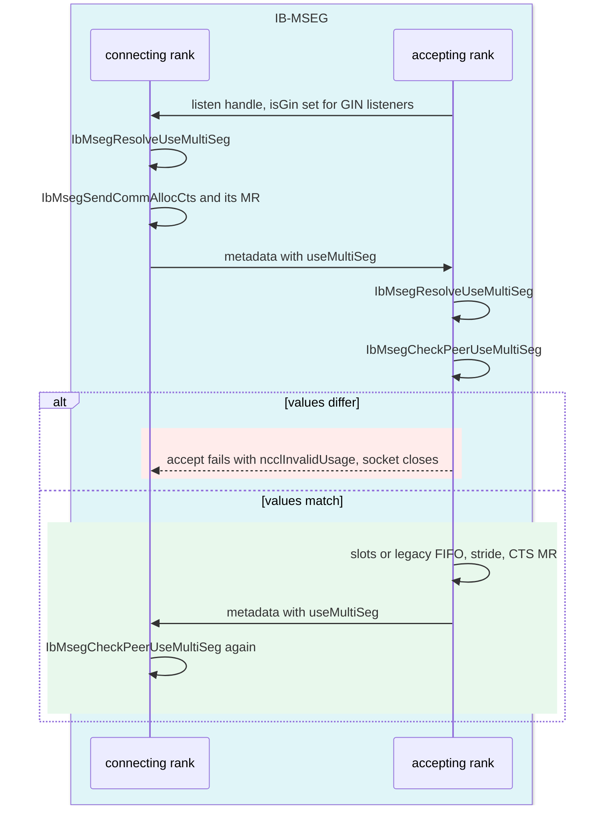

1. `gin.cc` marks every GIN or RMA listener: `IbMsegGinIbGdakiListen`, `IbMsegRmaIbProxyListen` (which replaces `IbMsegListen` in the `IbMsegRmaIbProxy` table) and `IbMsegRmaIbProxyCreateContext` call `connect.cc` `rcclIbMarkGinListen` after the listen. It sets `IbMsegHandle::isGin`, which travels to the connecting rank inside the opaque handle, and `IbMsegListenComm::isGin` for the accepting rank. Plain P2P listens through `IbMsegNetListen` leave both at 0.
2. `connect.cc` `IbMsegConnectImpl` initializes the send comm and calls `IbMsegResolveUseMultiSeg(handle->isGin != 0, comm->base.resiliency != NULL)`. That calls `ib_multiseg_mseg.h` `IbMsegUseMultiSeg` with `rcclMultiSegOn(true)`, the core gate that is true only with `NCCL_MULTI_SEGMENT_REGISTER=1` and `NCCL_DMABUF_ENABLE=1`, and logs the result at TRACE:

```c
// RCCL: one connect-time decision. multiSegOn is the core's fd -1 gate, so the CTS follows registration; GIN has no
// CTS. Resiliency replays a whole slot, which a send resumed across tests cannot do yet.
static inline bool IbMsegUseMultiSeg(bool multiSegOn, bool forGin, bool resilient) {
  return multiSegOn && !forGin && !resilient;
}
```

3. `IbMsegSendCommAllocCts` allocates the CTS block as one page-aligned allocation: `IbMsegCtsSlot[NET_IB_MAX_REQUESTS]` (`NCCL_IB_CTS_SLOTS_BYTES`) when `useMultiSeg` is 1, else the legacy FIFO (`NCCL_IB_CTS_FIFO_BYTES`). `IbMsegSendComm::ctsFifo` is now a pointer, and exactly one of `ctsFifo` and `ctsSlots` is set. With the slots it also allocates the send cursor (`sendCursor`) and the referenced-layout cache (`layoutCache`); a legacy comm leaves both NULL. Each device registers one `ctsFifoMr` over whichever block exists, so the layout prefix is inside that MR.
4. The connecting rank copies `useMultiSeg` into `IbMsegConnectionMetadata` and publishes `meta.addr`: the first CTS row (`ctsSlots[0].cts`) for slots, `ctsFifo` otherwise. The receiver adds its stride to this address, so it never addresses the prefix of slot 0 directly.
5. `IbMsegAcceptImpl` resolves its own value from `lComm->isGin` and its resiliency, receives the metadata and calls `IbMsegCheckPeerUseMultiSeg`. On a mismatch it WARNs, naming `NCCL_MULTI_SEGMENT_REGISTER`, `NCCL_DMABUF_ENABLE` and `NCCL_IB_RESILIENCY_PORT_FAILOVER`, returns `ncclInvalidUsage` and closes the socket before replying.
6. On a match the accepting rank allocates its own `IbMsegCtsSlot` array and sets `ctsSlotStride` to `sizeof(struct IbMsegCtsSlot)`; for a legacy comm it allocates the `remCtsFifo.elems` shadow (`NCCL_IB_CTS_FIFO_BYTES`, now a pointer), `ctsSlots` stays NULL and the stride is develop's `NCCL_NET_IB_MAX_RECVS * sizeof(struct IbMsegSendFifo)`. Exactly one of the two blocks exists, and its `ctsFifoMr` covers it. It sends its metadata back with its `useMultiSeg`.
7. The connecting rank checks the reply with `IbMsegCheckPeerUseMultiSeg` too. In a real mismatch the accepting rank has already closed the socket, so this read fails first; the check is a defense for a peer that does reply.

## Register a buffer

`transport/net.cc` sends a buffer of more than one segment to `rcclNetProxyRegMultiSeg`, which calls the plugin's `regMrDmaBuf` with fd -1 and the export flags in `offset` only when `proxyState->rcclMultiSegNet` is set. Any error from the plugin leaves the handle NULL, logs that the buffer was not registered, and the collective stages.

`IbMsegRegMrDmaBuf` first counts the segments and admits the count:

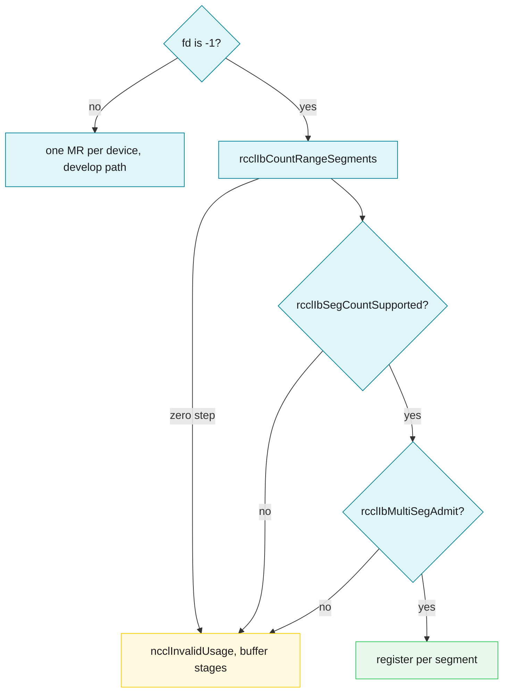

An admitted range is then exported and registered one segment at a time:

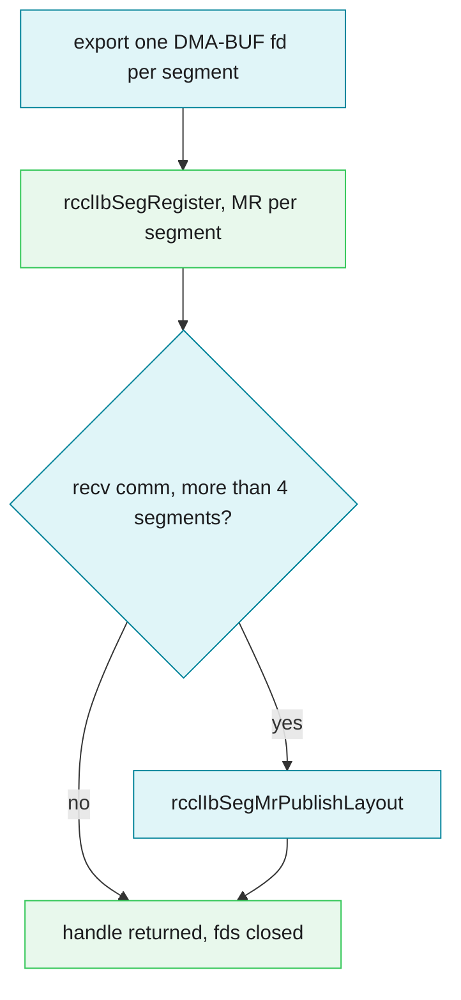

1. `reg.cc` `IbMsegRegMrDmaBuf` sends `fd == -1` to `rcclIbRegMrDmaBufFromRange` when the build has the per-segment export (`CUDA_VERSION >= 11070 || NCCL_CUMEM_DMABUF_EXPORT_GATE`). A real fd, and every `IbMsegRegMr` call, go to `IbMsegRegMrDmaBufInternal`, which now `ncclCalloc`s the handle and sets `seg.nSegments = 1`; that is develop's one MR per device.
2. `rcclIbCountRangeSegments` walks the range with `cuMemGetAddressRange`, taking each step's length from `IbMsegBytesRemainingInSegment` (which treats a reported base of 0 as the segment start, for host VMM). A zero-length step returns `ncclInvalidUsage`. The walk stops one past `RCCL_IB_REG_SEG_DEFAULT`, so `rcclIbSegCountSupported` then declines the count with an INFO line.
3. `rcclIbMultiSegAdmit` runs the comm-level declines before any fd is exported. For one segment it admits at once. Otherwise it returns `ncclInvalidUsage` with an INFO line when `rcclIbMrAdmit` finds that `nSeg` more MRs would pass `max_mr` on any rail (it compares `mrCache.population + nSeg` with `IbMsegDevs[].maxMr` under each device's mutex), when the comm is resilient, and when a receive comm has `useMultiSeg` 0 (a GIN comm or a legacy-CTS comm), because the layout describes the receiver.
4. The walk scratch is one `ncclCalloc` of `rcclIbSegWalkBytes(nSeg)`, split by `rcclIbSegWalkBind` into the address, length, offset and fd arrays; every fd starts at -1. A second walk exports each segment's exact bytes with `cuMemGetHandleForAddressRange`, using `offset` as the export flags.
5. `IbMsegRegMrDmaBufMultiSeg` repeats the count check (WARN) and `rcclIbMultiSegAdmit` for callers that enter it directly, allocates the handle, and `seg_p2p.cc` `rcclIbSegMrInit` sizes `segStart`, `segLen`, `segOff` (with `segOff[nSeg]` the total) and `segMrs` from the walked count.
6. `seg_reg_mseg.h` `rcclIbSegRegister` fills `segMrs[s * RCCL_IB_MSEG_MAX_DEVS + dev]` through `rcclIbMultiSegRegOne`, which skips device slots past `ndevs` and calls `IbMsegRegMrDmaBufInternal2` with the segment's fd. That function keeps develop's per-device MR cache, so a segment already registered on this device is shared by reference count.
7. Segment 0's MRs are aliased into `mrs[]`, so code that only knows one MR keeps working.
8. A receive registration of more than `RCCL_IB_CTS_INLINE_SEGS` (4) segments publishes its layout: `rcclIbMrHandlePublishLayout` calls `rcclIbSegMrPublishLayout`, which allocates the blob `{va0, off[nSeg + 1], rkeys[ndevs][nSeg]}`, registers it with `IBV_ACCESS_REMOTE_READ` on every device's PD and stamps it with a new `layoutGen` from a process-wide counter. Send registrations and receives of up to four segments publish nothing.
9. `*mhandle` is set only on success, and the exit path of `rcclIbRegMrDmaBufFromRange` closes every exported fd and frees the scratch on success and failure alike.

## Deregister a buffer

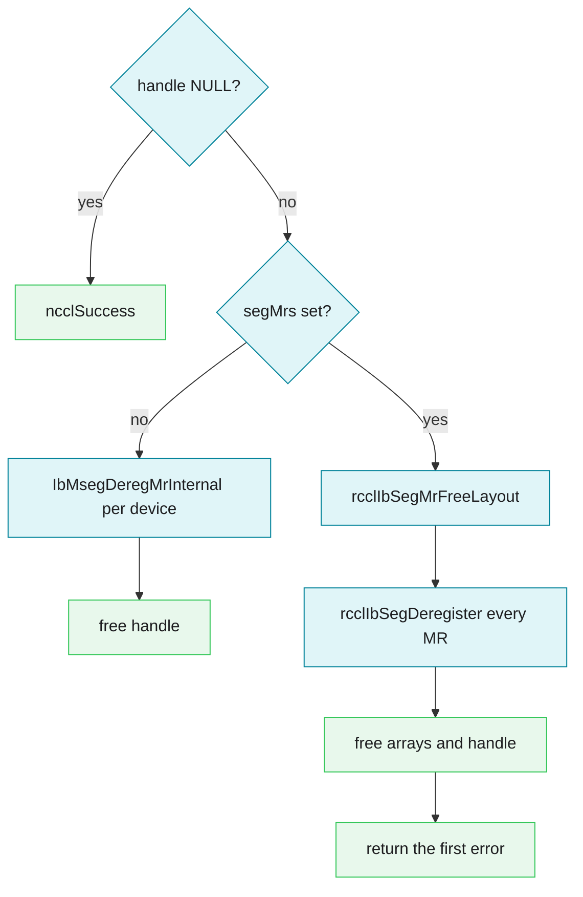

1. `reg.cc` `IbMsegDeregMr` routes on `seg.segMrs`, not on `nSegments`: a handle made by the walk owns `segMrs` even when it has one segment, so a one-segment walked handle also goes to `rcclIbDeregMrMultiSeg`. Only a real-fd or `IbMsegRegMr` handle (`segMrs` NULL) takes develop's loop over `mrs[]`.
2. `rcclIbDeregMrMultiSeg` first releases the published layout (`seg_p2p.cc` `rcclIbSegMrFreeLayout`: each `layoutMrs[d]`, then the blob).
3. `rcclIbSegDeregister` releases every non-NULL `segMrs` slot through `rcclIbMultiSegDeregOne`, which calls `IbMsegDeregMrInternal` and so drops the MR cache reference. It keeps going after an error, clears each slot and remembers the first error. `mrs[]` is never released on its own, because it aliases segment 0.
4. `rcclIbMrHandleFreeSegments` frees the arrays and the handle. The function returns the first deregistration error, else the layout error.

## Receive and the CTS write

`IbMsegIrecv` fills one CTS entry and its layout per receive:

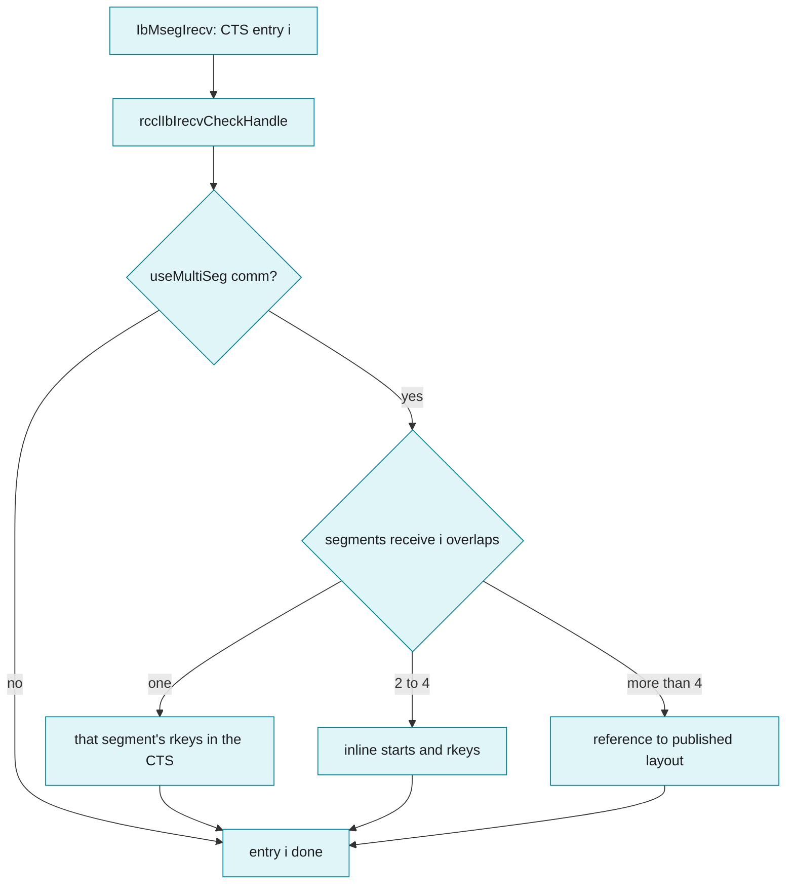

After the last entry, the slot is flagged and posted as one write:

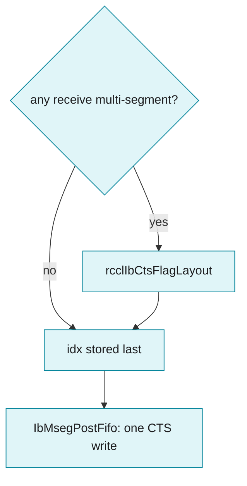

1. `p2p.cc` `IbMsegIrecv` gets the slot's CTS row from `rcclIbRecvCtsRow`, which is `ctsSlots[slot].cts` on a `useMultiSeg` comm and `remCtsFifo.elems[slot]` otherwise.
2. For each receive, `p2p_multiseg.cc` `rcclIbIrecvCheckHandle` rejects a NULL handle or a NULL `mrs[j]` before the rkeys are read. The entry gets develop's address, size, tag, `nreqs`, flush flag and segment 0's rkeys.
3. `rcclIbIrecvFillLayout` returns at once on a legacy comm. Otherwise `seg_p2p.cc` `rcclIbSegLayoutFill` fills the receive's `IbMsegSegLayout`, which `rcclIbCtsLayout` places immediately before the CTS row (`row - nreqs + i`). It clears `nSegments` and `byRef`, checks the range against the registration and that every overlapped segment has an MR on every device, then takes one of three forms. A receive inside one segment overwrites the CTS rkeys with that segment's rkeys and leaves the prefix empty. A receive over 2 to 4 segments stores their starts and rkeys inline, beginning with the segment holding its first byte (`rcclIbLayoutSetRkey` spreads the rkeys over the three 64-byte lines). A receive over more segments stores a `rcclIbSegLayoutRef` with the blob's address, generation, segment count, device count and per-device rkeys; without a published blob it WARNs and fails. The last two forms set `anyMultiSeg`.
4. Only when some receive in the slot is multi-segment does `rcclIbCtsFlagLayout` set `NCCL_IB_CTS_NREQS_LAYOUT` in every entry's `nreqs` and stamp all three lines of every layout in the slot with the slot's `idx` (`rcclIbLayoutStamp`). Then every entry's `idx` is stored, after the layouts.
5. `IbMsegPostFifo` builds develop's CTS write and calls `rcclIbPrepareCtsWrite`, which computes the remote row as `remCtsFifo.addr + slot * stride` and, when the slot carries the bit, extends the same WR backward over the prefix so the write still ends at `idx`:

```c
  bool longForm = comm->ctsSlots != NULL && nreqs > 0 && IbMsegCtsHasLayout(row[0].nreqs);
  if (longForm) {
    uint64_t prefix = (uint64_t)nreqs * sizeof(struct IbMsegSegLayout);
    remote -= prefix;
    local -= prefix;
    length += (uint32_t)prefix;
    wr->send_flags &= ~IBV_SEND_INLINE;
  }
```

A slot without the bit keeps develop's address, length and inline flag. The write is posted as one WR on the CTS QP, so the CTS QP depth does not change.

## Send and the arriving CTS

`IbMsegIsend` first waits until the CTS and its layout lines have landed:

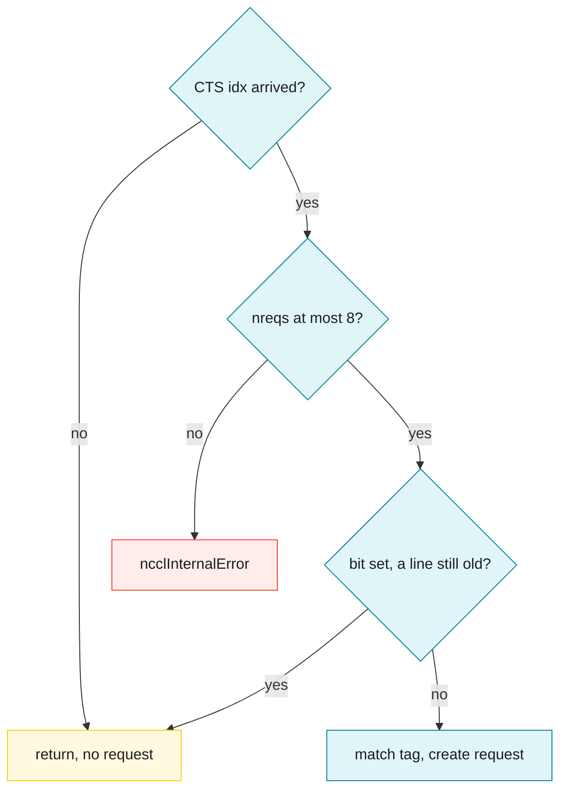

Once the request exists, the last receive of the slot posts it or queues it:

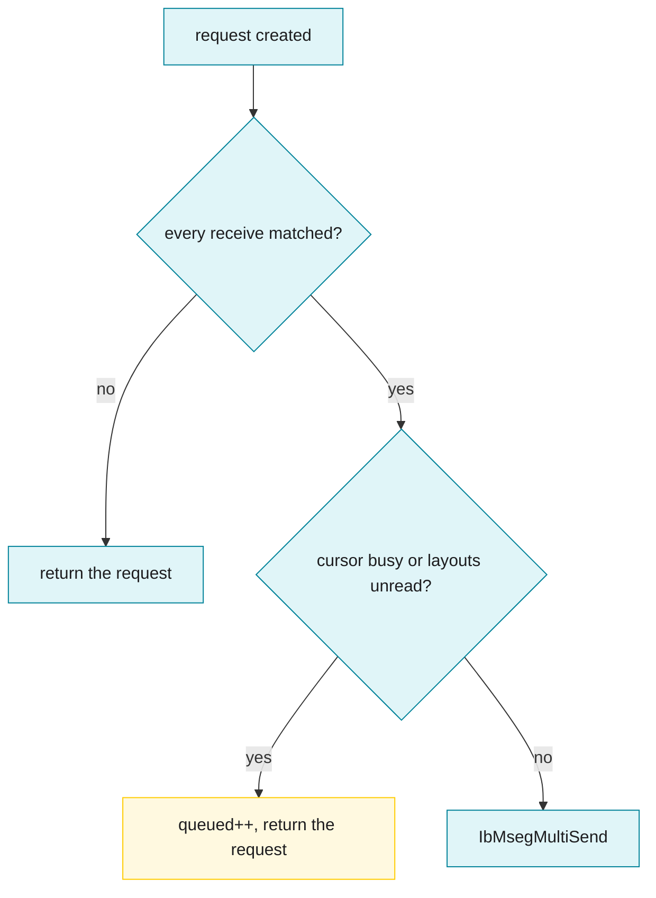

1. `p2p.cc` `IbMsegIsend` reads the slot through `rcclIbSendCtsRow` and returns no request until `slots[0].idx` reaches `fifoHead + 1`, as on develop.
2. It strips the layout bit with `IbMsegCtsNreqs`, bounds the peer-written count, spins for the other entries' `idx` as develop does, and then checks the layout stamps. A long write can land out of order and the layout lines are outside the CTS rows' cache lines, so a stale line returns no request and the caller retries:

```c
  nreqs = IbMsegCtsNreqs(slots[0].nreqs); // RCCL: ignore the layout bit in the count.
  if (nreqs > NCCL_NET_IB_MAX_RECVS) {
    WARN("NET/IB : peer posted nreqs %d > %d", nreqs, NCCL_NET_IB_MAX_RECVS);
    ret = ncclInternalError;
    goto isendFail;
  }
  // Wait until all data has arrived
  for (int r = 1; r < nreqs; r++)
    while (slots[r].idx != idx);
  // RCCL: the layout lines sit outside the CTS rows' cache lines, so each carries its own idx; retry until all land.
  if (comm->useMultiSeg && IbMsegCtsHasLayout(slots[0].nreqs) && !rcclIbCtsLayoutsArrived(slots, nreqs, idx)) {
    *request = NULL;
    return ncclSuccess;
  }
```

3. The tag match and request setup are develop's, plus `req->send.mh`, which keeps the send handle so the fill can read per-segment lkeys.
4. When the last receive of the slot matches, the slot posts at once only if the cursor is idle (no `sendCursor`, or none `active` and none `queued`) and `p2p_multiseg.cc` `rcclIbSendLayoutsReady` reports every referenced layout read; that check returns ready at once on a comm without a layout cache. Otherwise `sendCursor->queued` is incremented; only a `useMultiSeg` comm can have unread layouts, and it always has a cursor. Either way `fifoHead` advances and the request is returned; a queued slot is posted later by `rcclIbSendProgress` from `IbMsegTest`, in FIFO order.

### Referenced layouts and the cache

`rcclIbLayoutsReady` looks each referenced layout up in an LRU cache keyed by address and generation, and starts a read on a miss:

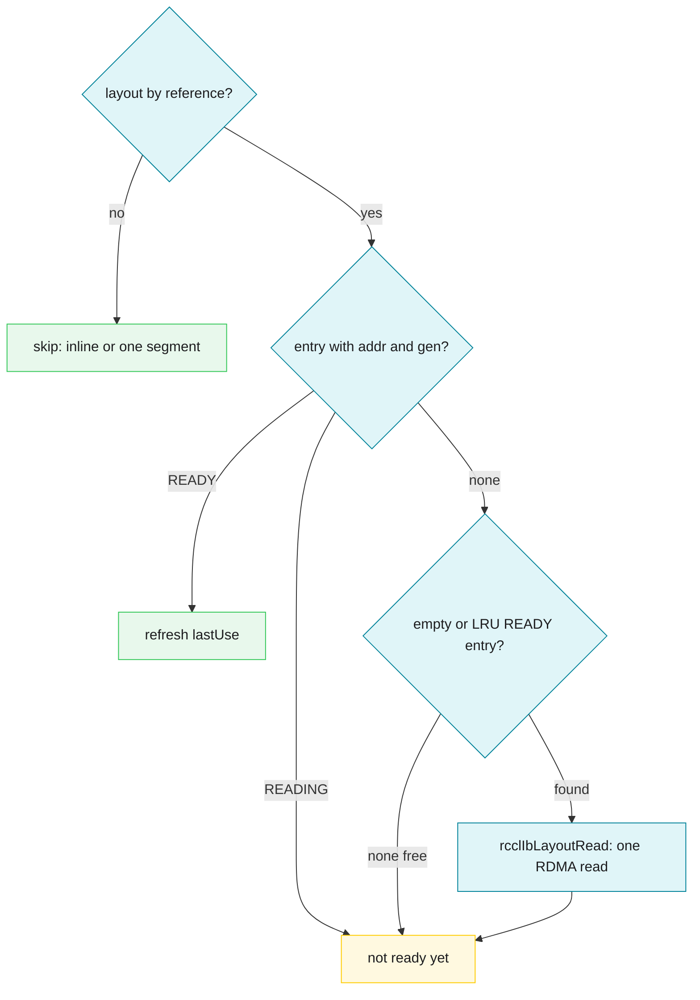

The read's completion validates the blob and makes the entry usable:

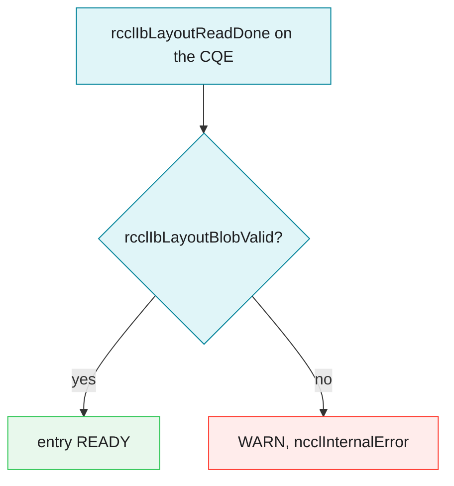

1. `rcclIbSendLayoutsReady` collects each receive's layout with `rcclIbCtsRemoteLayout` (NULL on a legacy comm or without the bit) and calls `seg_p2p.cc` `rcclIbLayoutsReady` on the cache `comm->layoutCache` points to, which has `RCCL_IB_LAYOUT_CACHE_ENTRIES` (16) entries.
2. Each call takes a new clock stamp. A referenced layout found READY gets that stamp as `lastUse`; one still READING keeps the slot not ready.
3. A miss takes an EMPTY entry, else the READY entry with the oldest `lastUse` that this call has not stamped, so a slot never evicts a layout it is about to use. When every entry is busy the slot stays not ready and a later progress call retries.
4. `rcclIbLayoutRead` bounds the peer's segment count (more than 4, at most `RCCL_IB_REG_SEG_DEFAULT`) and device count, picks the rkey for the QP's remote device, clears the entry's key, reallocates and re-registers the entry's buffer when it is too small or on another device's PD, and posts one signaled `IBV_WR_RDMA_READ` whose `wr_id` is the entry index. The QP comes from `rcclIbLayoutReadQp`: the QP of the slot's first request, chosen once per call. The entry becomes READING with the new address and generation.
5. `p2p.cc` `IbMsegCompletionEventProcess` sends every read completion on a send comm to `rcclIbSendLayoutReadDone`, which validates the blob with `rcclIbLayoutBlobValid` (offsets from 0 and increasing, every rkey nonzero) and marks the entry READY.
6. Because the generation is part of the key, a new registration at the same address is read again, and a stale entry is never used for it.

## Send across segment boundaries and QPs

`IbMsegMultiSend` builds each QP's first post with one slice per receive:

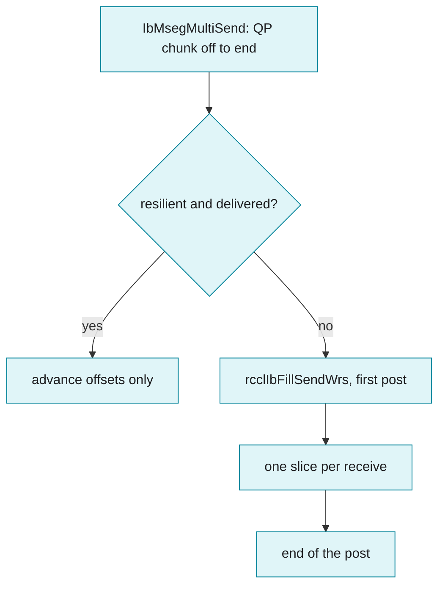

The end of the post decides the tail and whether the QP still has slices for the cursor:

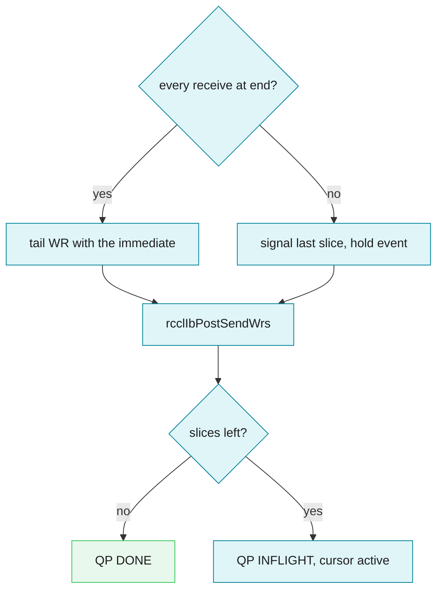

1. `p2p.cc` `IbMsegMultiSend` takes `nreqs` from the request that `IbMsegIsend` validated, not from the peer-written row, and rejects a count outside 1 to 8. `rcclIbMultiSendNeedsSegmented` sets `multi` when any local handle has more than one segment or any CTS entry carries a multi-segment layout (`IbMsegCtsRemoteMultiSeg`: more than one inline segment or a reference).
2. The tail flags are decided once per slot. `needSizesWr` is develop's `nreqs > 1`, plus a split single receive whose receiver does not match by index, because the immediate rides only the last slice. `extraImmWr` adds adaptive routing's dedicated immediate WR. The flush-flag source is set as on develop.
3. A segmented send (`multi`) on a comm without a cursor, which is a legacy-CTS comm sending from a multi-segment handle, allocates `sendCursor` here; it stays until close. Per QP, develop's chunking (split threshold, weights, 128-byte alignment, which `rcclIbWriteChunkAlignment` must equal) gives each receive a range `[off, end)`, stored in `sendCursor->off[i]` and `end[i]`, or in stack arrays when the comm has no cursor. With a cursor, every QP starts DONE and the cursor's slot, QP and index are recorded.
4. A QP that resiliency already delivered posts nothing but still advances the offsets. Otherwise `p2p_multiseg.cc` `rcclIbFillSendWrs` builds the post with `first` set:

```c
  for (int r = 0; r < nreqs; r++) {
    if (off[r] == end[r] && !first) continue;
    struct rcclIbSendSegTable local, remote;
    NCCLCHECK(rcclIbSegTableLocal(reqs[r]->send.mh ? &reqs[r]->send.mh->seg : NULL, (uintptr_t)reqs[r]->send.data,
                                  reqs[r]->send.size, &local));
    NCCLCHECK(rcclIbBuildRemoteSegmentLayout(comm, slot, r, remDevIdx, &remote));
    uint32_t moved = 0;
    NCCLCHECK(rcclIbAppendSegmentedRequestWrs(comm, reqs[r], &local, &remote, off[r], end[r] - off[r], devIndex, wrId,
                                              &w, &moved));
    off[r] += moved;
    if (off[r] != end[r]) *last = false;
  }
```

5. `seg_p2p.cc` `rcclIbSegTableLocal` gives the local table from the send handle (one segment for a single-segment handle). `rcclIbBuildRemoteSegmentLayout` gives the remote table for the QP's remote device: one segment from the CTS entry, the inline layout through `rcclIbSegTableInline` (which copies the starts and rkeys once, validates them with `IbMsegCtsRemoteLayoutValid` and trims the table to the request's end), or the read blob through `rcclIbSegTableReferenced`. Both are `rcclIbSendSegTable`s (`seg_p2p_mseg.h`): each embeds the shared `rcclIbSegTable seg` (`base`, `nSeg`, `off`) and adds `multi`, the rkeys and its own `reqOff` from `seg.base`, so the two sides may start in different segments ([why](../multi_segment_netib_wire.md#independent-offsets)).
6. `rcclIbAppendSegmentedRequestWrs` emits one WR per receive per post. It takes one step of an `rcclIbSegCursor` (`seg_mseg.h`, `rcclIbSegCursorInit` and `rcclIbSegCursorNext`) over `local->seg` and `remote->seg`, which cuts the slice at the nearer of the local and remote boundary, at `RCCL_IB_SGE_MAX_BYTES`, or at the end of the range. It takes the lkey of the slice's local segment on this device from `rcclIbSegMrAt` and the remote segment's rkey, and fills the WR and SGE with `seg_wr_mseg.h` `rcclIbSegFillWr`; `moved` is the slice length. A zero-length receive writes one 0-byte WR on the first post, with the rkey of the segment from `IbMsegSegmentForZeroLengthOffset`, which range-checks the offset and then uses `rcclIbSegIndexOf`. Each slice logs its offset, length and local and remote segment at TRACE (`NET/IB: segmented send slice`), and marks the post as reaching a later segment when either side is past segment 0.
7. `rcclIbFillSendWrs` adds the post to the comm's `segStats` (`common_mseg.h` `rcclIbSegStatsAdd`, relaxed atomic adds): one post, its data WRs, and one later-segment post if any slice reached a later segment. `rcclIbSendCommSegStats` (end of `p2p_multiseg.cc`) reads the three counters for tests and rejects a null comm.
8. When every receive reached its end, `rcclIbAppendSegmentedTailWr` adds develop's tail: the sizes write and this QP's flush-flag write for a flag flush, a dedicated sizes or immediate WR, or the last data WR turned into the `WRITE_WITH_IMM`; it is signaled. Otherwise the post's last data WR is signaled and `rcclIbSendHoldSlice` adds one event per request on that device, so the request cannot complete while the slice is outstanding. The WRs are chained and posted on the QP by `p2p.cc` `rcclIbPostSendWrs`, which takes that hold just before the post.
9. A QP with slices left becomes INFLIGHT and the slot is recorded in the cursor (`active`, `wrId`, `immData` and the tail flags). A single-segment send on both sides finishes in the first post on every QP, so the cursor never becomes active, and a legacy-CTS comm never allocates one for it.

### Completion and resume

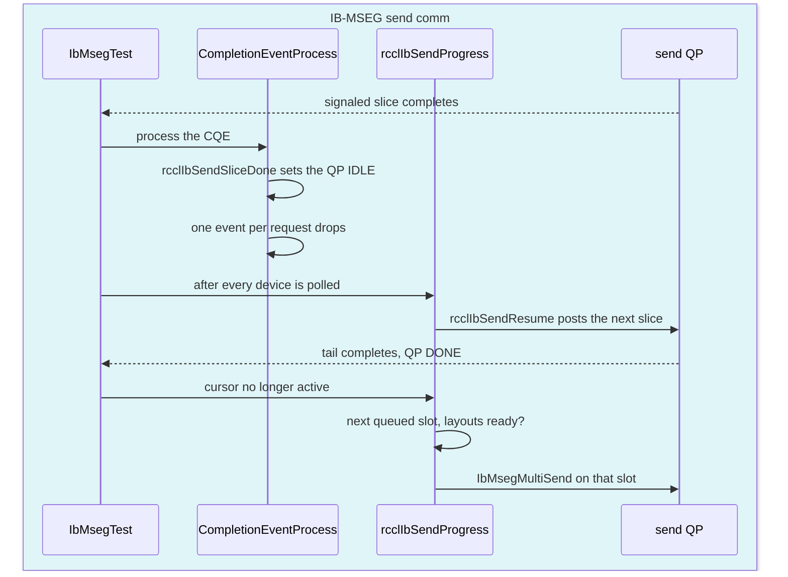

1. `p2p.cc` `IbMsegCompletionEventProcess` calls `p2p_multiseg.cc` `rcclIbSendSliceDone` for each send completion. It matches the active slot and an INFLIGHT QP by device index and `qp_num` (QP numbers are unique only per HCA) and sets that QP IDLE. The develop loop then drops one event per request on that device, which releases the slice's held event. The QP's profiler event stops only on the tail.
2. After each poll round over the devices, `IbMsegTest` calls `rcclIbSendProgress` on a send comm, which returns at once when the comm has no cursor:

```c
ncclResult_t rcclIbSendProgress(struct IbMsegSendComm* comm) {
  struct rcclIbSendCursor* c = comm->sendCursor;
  if (c == NULL) return ncclSuccess;
  for (;;) {
    if (c->active) {
      NCCLCHECK(rcclIbSendResume(comm));
      if (c->active) return ncclSuccess;
    }
    if (c->queued == 0) return ncclSuccess;
    const int next = (int)((comm->base.fifoHead - c->queued) % NET_IB_MAX_REQUESTS);
    bool ready = true;
    NCCLCHECK(rcclIbSendLayoutsReady(comm, next, &ready));
    if (!ready) return ncclSuccess;
    c->queued--;
    NCCLCHECK(IbMsegMultiSend(comm, next));
  }
}
```

3. `rcclIbSendResume` calls `rcclIbFillSendWrs` with `first` false for each IDLE QP, which skips receives that are done and writes the tail when the last one finishes. `flagFlushSge` still points at this slot's flag because no other slot posts while the cursor is active. When every QP is DONE the cursor is cleared.
4. The oldest queued slot posts next, once its layouts are read, so slots post in FIFO order and at most one slot is segmented at a time. A QP therefore holds at most one post per receive plus the tail, and the send QP keeps develop's depth ([QP depths](../multi_segment_current.md#qp-depths)).

## Flush

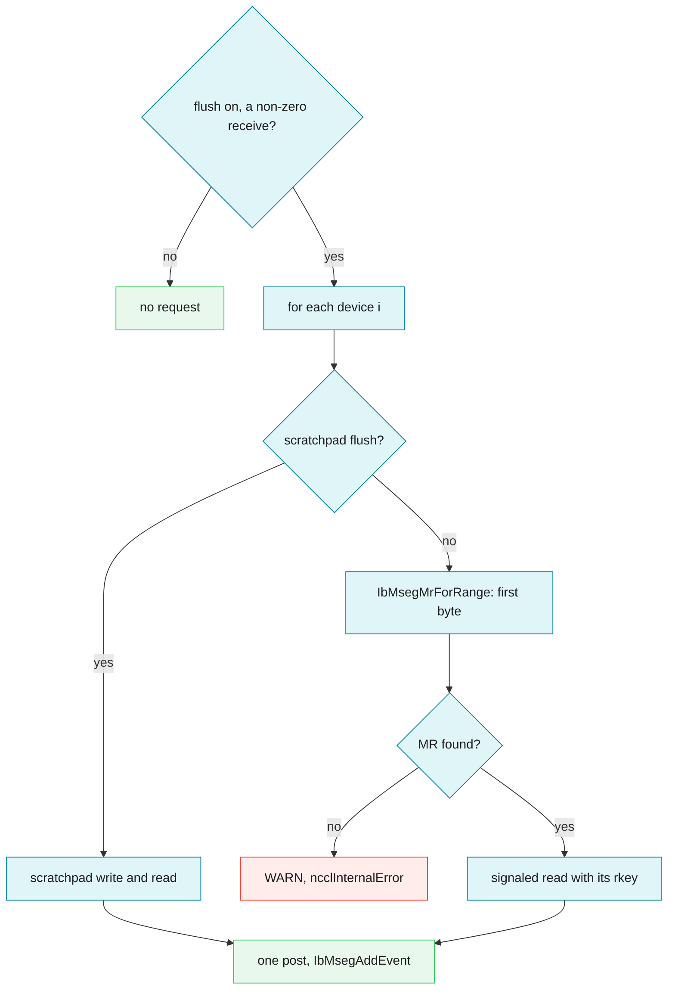

1. `p2p.cc` `IbMsegIflush` keeps develop's choice of the last non-zero receive and its scratchpad path (`RCCL_GDR_FLUSH_GPU_MEM_NO_RELAXED_ORDERING`, on by default), which never reads a receive buffer. The scratchpad write carries `IBV_SEND_INLINE`, and `connect.cc` sizes the flush QP's `maxInlineData` to the flush word, both taken from develop's `net_ib`.
2. On the direct path, `p2p_multiseg.cc` `IbMsegMrForRange(mhandle, data[last], 1, i)` returns `mrs[i]` for a single-segment handle, else `seg_p2p.cc` `rcclIbSegMrForRange`, the MR of the segment that contains the byte (`IbMsegSegmentIndexForRange`). The read uses that MR's rkey. One read per device fences the device, so the flush QP keeps develop's depth.

## Close

1. `connect.cc` `IbMsegCloseSend` calls `rcclIbSendLayoutCacheFree` before the per-device resources are released, because the cache MRs live on those PDs. It returns at once on a comm without a cache; otherwise `seg_p2p.cc` `rcclIbLayoutCacheFree` deregisters each entry's MR, frees its buffer, zeroes the entry and returns the first error. `IbMsegSendCommFreeCts` then frees whichever CTS block exists, the cursor and the cache, and the comm is freed.
2. `IbMsegCloseRecv` frees `ctsSlots` (NULL on a legacy comm) and `remCtsFifo.elems` (NULL on a `useMultiSeg` comm) before the comm. A registration's published layout is freed by its deregistration, not by the comm.

## Switch-off and single-segment paths

With the switch off, `NCCL_DMABUF_ENABLE=0`, a GIN or RMA comm or a resilient comm, every step leaves the new code at a fixed point and builds develop's work requests:

| Path | Where it leaves the new code | Result |
|---|---|---|
| Core | `commAlloc` sets `rcclMultiSegNet` false, so `rcclNetProxyRegMultiSeg` never passes fd -1 | multi-segment buffers stage; a real fd registers through `IbMsegRegMrDmaBufInternal` |
| Registration with a real fd | `IbMsegRegMrDmaBuf` skips the walk; `seg.nSegments` is 1 and `segMrs` NULL | develop's one MR per device |
| Connect | `IbMsegUseMultiSeg` is false on both ends; `IbMsegSendCommAllocCts` allocates the legacy FIFO and no cursor or cache; the receiver allocates the `remCtsFifo.elems` shadow and keeps `ctsSlots` NULL and develop's stride | same CTS bytes and address as develop; the metadata carries `useMultiSeg` 0 |
| Receive | `rcclIbIrecvFillLayout` returns at once; no bit is set; `rcclIbPrepareCtsWrite` computes develop's address and length | develop's CTS write |
| Send | the layout checks see no bit, `rcclIbSendLayoutsReady` returns ready without a cache, `multi` is false; each fill moves the whole chunk with its offsets on the stack, so every QP posts once and no cursor is allocated | develop's chain: one data WR per receive, then develop's tail |
| Progress | `rcclIbSendProgress` returns at once without a cursor | no extra posts |
| Flush | `IbMsegMrForRange` returns `mrs[i]` | develop's rkey |
| Close | `rcclIbSendLayoutCacheFree` returns at once without a cache | develop's teardown plus one `free` of the CTS block on each side |

On a `useMultiSeg` comm, a buffer of one segment, and a slot whose receives each sit inside one segment, take the same short paths: the CTS entry carries the containing segment's rkeys, no bit is set, and the send fill builds develop's chain. A one-segment handle made by the fd -1 walk behaves as single-segment in the data path and is released through `segMrs`.

The code that runs on every path but is not develop's is limited to hardening: `IbMsegIsend` bounds the peer's `nreqs`, `IbMsegMultiSend` rejects a count below 1, `IbMsegIrecv` rejects a NULL handle or device MR, `IbMsegIflush` rejects a missing MR, the failed-isend path unlinks a request it frees, and the legacy CTS FIFO on each side (`ctsFifo`, `remCtsFifo.elems`) is a separate allocation instead of an embedded array. The user-level contract is in [switch-off behavior](../multi_segment_current.md#switch-off-behavior).

## Error and unwind paths

### Connect and accept

A mismatch fails the accepting rank with `ncclInvalidUsage` before it replies; the connecting rank sees the socket close, or `ncclInvalidUsage` from its own check if the peer replied. On any connect failure `IbMsegConnectImpl` frees the CTS block, the cursor and the cache with `IbMsegSendCommFreeCts` after develop's cleanup; `IbMsegAcceptImpl` frees `ctsSlots` or `remCtsFifo.elems` after the flush resources. Neither leaves a comm for the caller.

### Registration

| Failure | What is released | Caller sees |
|---|---|---|
| Zero-length walk step, count past the cap, `max_mr`, resilient comm, legacy-CTS receive comm | nothing was exported yet; the scratch is freed | `ncclInvalidUsage`, INFO line, `*mhandle` untouched; the core stages |
| `cuMemGetAddressRange` or `cuMemGetHandleForAddressRange` fails during export | every fd exported so far is closed, the scratch is freed | the driver call's error result, `*mhandle` untouched; the core stages |
| `rcclIbSegMrInit` allocation fails | the arrays allocated so far and the handle | the error, `*mhandle` untouched |
| An MR registration fails | `rcclIbSegRegister` deregisters slots 0 to the failing index, including a handle `regOne` stored before failing; then the arrays, the handle, the fds and the scratch | the error, `*mhandle` untouched |
| The layout blob allocation or one device's layout MR fails | `rcclIbDeregMrMultiSeg`: the layout MRs made so far and the blob, every segment MR, the arrays and the handle | the error, `*mhandle` untouched |
| A deregistration error | every later MR is still released, then the arrays and the handle | the first error |

### Receive

`rcclIbIrecvCheckHandle` and `rcclIbIrecvFillLayout` (range outside the registration, a missing segment MR, more than four segments without a published layout) WARN and return `ncclInternalError` through develop's `irecvFail` path before the CTS is posted.

### Send post

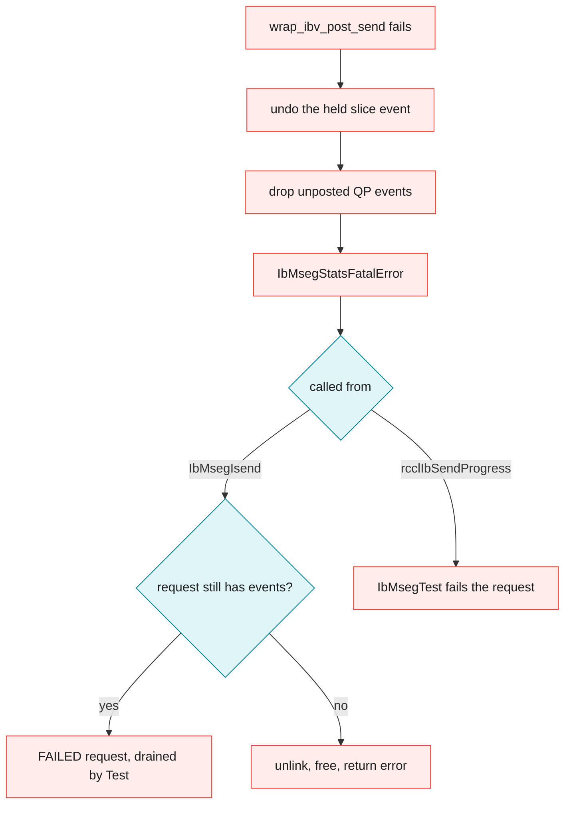

1. `IbMsegMultiSend` and `rcclIbSendResume` both post through `p2p.cc` `rcclIbPostSendWrs`. A failed post first undoes `rcclIbSendHoldSlice` if the post was a non-final slice. It then counts the WRs accepted before `bad_wr` and asks the caller's `unposted` callback which QPs will never complete: if some WRs were accepted, this QP keeps its event (its accepted prefix will complete), otherwise it is listed too. Each listed QP drops one event per request. It marks the comm fatal and returns the error. From `IbMsegMultiSend` the list is empty for a send that is not segmented, and otherwise holds every QP after this one, except QPs that resiliency already delivered.
2. `IbMsegIsend` keeps that error in `ret`. A request that still has events becomes `NCCL_NET_IB_REQ_FAILED` and is returned with `ncclSuccess`, so the caller drains it with `IbMsegTest`, where the fatal count fails it. A request with no events left is unlinked from `sendReqs[slot]`, `sendReqsCnt` is decremented, the request is freed and the error is returned.
3. A fill error (invalid inline layout, a referenced layout that is not READY, a split that runs off a table, a missing segment MR, the WR pool exceeded) WARNs and returns `ncclInternalError` before that QP posts. From `IbMsegIsend` it takes the same failed-request path; when nothing posted, the request keeps its events and the next `IbMsegTest` fails on the fatal count.
4. From `rcclIbSendResume` the list holds the QPs after this one that are still IDLE, since they will not post their next slice this pass; INFLIGHT QPs keep their events because their posted slices still complete. From `rcclIbSendProgress` the error goes to `IbMsegTest`'s `fail` label, which marks the connection and device fatal, sets the request FAILED and `done`, and returns the error.

### Layout reads

An invalid reference (segment count, device count or rkey) fails `rcclIbLayoutRead` before posting, and an invalid blob fails `rcclIbLayoutReadDone` after the read and resets the entry to EMPTY; both WARN and return `ncclInternalError` through the isend or test path above. An error completion of the read takes develop's error-CQE path in `IbMsegTest` (`ncclRemoteError` without resiliency; a resilient comm never sends a layout). A read completion on a comm without a layout cache cannot come from this code; `rcclIbSendLayoutReadDone` WARNs and returns `ncclInternalError` for it.

### Flush and close

A missing MR in `IbMsegIflush` WARNs and takes develop's `iflushFail` path: the comm is marked fatal, and a request with events is returned FAILED, else freed. In `IbMsegCloseSend` a cache deregistration error returns at once, before the per-device resources and the comm are released.

## Tests

### Host binaries

The IB-MSEG host binaries are defined in `test/host/transport/host_tests.cmake` and run by `test/host/run_host_tests.sh`, as in CI.

| Binary | Suites | Paths covered |
|---|---|---|
| `rccl-UnitTestsMicroTransportNetIbMsegConnect` (`connect-test.cc`) | `NetIbMsegConnectUseMultiSeg`, `NetIbMsegConnectMultiSegMicrotest`, `NetIbMsegConnectResilientMicrotest`, `NetIbMsegParamCopies` | the decision, CTS slots on connect and accept, GIN keeps the legacy FIFO, switch off, cuMem off, peer mismatch; `ConnectAndAccept_MultiSegStateFollowsUseMultiSeg` (cursor, cache and receiver FIFO follow `useMultiSeg`); `Connect_ResilientCommKeepsTheLegacyCts` and `Accept_ResilientCommKeepsTheLegacyCts`; `EveryCopiedStatementMatchesItsNetIbSource`, which fails when the hand-copied `test/host/fakes/net_ib_mseg_params*.cc` drift from the `net_ib` sources |
| `rccl-UnitTestsMicroTransportNetIbMsegReg` (`reg-test.cc`) | `NetIbMsegRegMicrotest` (`RegMrDmaBufMultiSeg_*`, `DeregMr_MultiSegment*`), `NetIbMsegRegRangeMicrotest` | unwind, resilient and `max_mr` declines, inline limit and layout publish, range walk, fd close, cap and resilient decline before export, base-zero walk |
| `rccl-UnitTestsMicroTransportNetIbMsegP2p` (`net-ib-p2p-test.cc`) | `NetIbMsegP2pMicrotest` | develop's P2P behavior on the fork, `LayoutCacheFree_DeregistersEachReadLayoutAndClearsItsEntry`, `SendCommSegStats_ReadsTheCommCountersAndRejectsNull` |
| `rccl-UnitTestsMicroTransportNetIbMsegGin` (`gin-test.cc`) | `NetIbMsegGinMicrotest` | `GinListens_MarkHandleAndListenCommAsGin`, `CreateContext_MarksTheRmaListenCommAsGin`, and develop's GIN behavior on the fork |
| `rccl-UnitTestsMicroInit` (`init-test.cc`) | `InitMicrotest.CommAlloc_MultiSegNet*` | `rcclMultiSegNet` follows the IB-MSEG plugin and the gate |

The connect, P2P and GIN suites without "MultiSeg" in their names are copies of develop's `net_ib` microtests run against the fork.

### Fixture binaries

- `rccl-UnitTestsFixturesDebug` (`test/transport/NetIb/NetIbSegmentedSendPrefixTests.cpp`) drives the real send, flush and hook code against a fake `ibv_post_send` (`test/common/IbFakePostSend.hpp`). `NetIbSegmentedSendPrefix` covers local and remote splitting, a legacy-CTS comm that allocates its cursor on the first segmented send and none for a single-segment send (`LegacyCtsComm*`), independent offsets, zero-length sends, the sizes, flag and adaptive-routing tails, the split threshold, queued slots behind a sliced one, slice matching, layout line arrival, referenced reads, generations and LRU eviction, invalid layouts, and every partial-post case. `NetIbSegmentedFlushPrefix` covers the one-read flush and its failures. `NetIbSegmentedHooks` covers segmented-send selection, the CTS write with and without the prefix, and irecv handle checks and layout fill. They are listed in `test/test_categories_fixtures_debug.yaml`.
- `rccl-UnitTestsFixtures` (`test/NetIbMultiSegmentUnitTests.cpp`) checks the header math: `NetIbMultiSeg` (segment lookup, zero-length rkey, host VMM base 0), `NetIbCtsLayout` (`IbMsegCtsRemoteLayoutValid`, the inline limit) and `NetIbLayoutBlob` (blob packing and validation).

### MPI tests

`rccl-UnitTestsMPI` suite `NetIbMultiSegmentMPITest` (`test/transport/NetIbMPI/NetIbMultiSegmentMPITests.cpp`) registers VMM windows through `regMrDmaBuf` with fd -1 and moves data through real MRs: per-segment registration, intra-segment offsets, asymmetric DeepEP offsets, boundary crossing, whole-buffer transfer, the segment cap, non-uniform layouts, one-segment and host or device regressions, mixed single- and multi-segment receives, concurrent pairs, the opt-in fat chain, ID matching, the switch-off decline, direct-GDR flush and the GDR flush flag. It skips unless the net is IB-MSEG. `UBR_MultiSegment.NetProxyPartialFinalSegment` (`test/RegistrationMPITests.cpp`) covers the NET proxy path into the walk. `test/test_categories_mpi.yaml` runs the suite in `standard_env_multi_segment_register`, which also sets `UT_NET_IB_MSEG_REQUIRE_DMABUF=1` so a missing IB-MSEG net, DMA-BUF or VMM fails instead of skipping, and the switch-off cases in `standard_env_multi_segment_register_off`.

### Runner jobs

| Job | Paths covered |
|---|---|
| `unit_tests_fixtures_debug` entries `A20_NetIb_SegmentedSendPrefix`, `A20_NetIb_SegmentedFlushPrefix`, `A20_NetIb_SegmentedHooks` | the three fixture suites |
| `unit_tests_fixtures` entry `Fixtures_All` | the `rccl-UnitTestsFixtures` math suites |
| `net_ib_multisegment` | registration, splitting, offsets, the cap, regressions, ID matching (`NCCL_IB_RECEIVER_SIDE_MATCHING_SCHEME=1`) and the fat chain (`RCCL_MSEG_SQ_STRESS=1`) |
| `net_ib_multisegment_register_off` | `NCCL_NET=IB-MSEG` with the switch off: decline and single-segment regression |
| `net_ib_multisegment_flush` | direct-GDR flush (`RCCL_GDR_FLUSH_GPU_MEM_NO_RELAXED_ORDERING=0`) |
| `net_ib_multisegment_scale_2x4` | concurrent pairs, 4 ranks on each of 2 nodes |
| `net_ib_multisegment_gdr_flush_flag` | segmented sends with `RCCL_IB_GDR_FLUSH_FLAG=1`, default and 4 split QPs |
| `multisegment_netproxy_multinode`, `multisegment_netproxy_intranode_multinode` | NET proxy registration into IB-MSEG, including a clipped final segment and an intra-node peer |

The `net_ib_multisegment*` and `multisegment_netproxy*` jobs are defined and enabled in `mi300x_mellanox_ib`, `mi300_mellanox_ib_func`, `mi355x_thor2_roce` and `mi355x_thor2_roce_func`; `net_ib_transport` has the `net_ib_multisegment*` jobs and says in its suite description that the proxy jobs run in the hardware configs. The fixture entries are in all four and in `mi455_ainic_roce` and `mi455_ainic_roce_func`, whose `NET IB - Memory Registration` suite description gives the reason the data-path jobs are not defined there (AINIC keeps IB-CAST). Every `net_ib_multisegment*` job sets `UT_NET_IB_MSEG_REQUIRE_DMABUF=1`, which turns a missing DMA-BUF, VMM or export API into a failure. The full matrix is in [testing](../multi_segment_testing.md#runner-jobs).

### How to run

```bash
# Every host binary, as CI runs it
test/host/run_host_tests.sh all

# Only the fork 3 host suites, after a build
GTEST_FILTER='NetIbMsegConnectUseMultiSeg.*:NetIbMsegConnectMultiSegMicrotest.*:NetIbMsegConnectResilientMicrotest.*:NetIbMsegParamCopies.*:NetIbMsegReg*:NetIbMsegP2pMicrotest.*:NetIbMsegGinMicrotest.*:InitMicrotest.CommAlloc_MultiSegNet*' \
  test/host/run_host_tests.sh run

# Send-path and math fixture suites
./build/test/rccl-UnitTestsFixturesDebug --gtest_filter='NetIbSegmented*'
./build/test/rccl-UnitTestsFixtures --gtest_filter='NetIbMultiSeg.*:NetIbCtsLayout.*:NetIbLayoutBlob.*'

# Runner jobs from a platform config
cd tools/scripts/test_runner
python test_runner.py --config configs/mi300x_mellanox_ib.json --suite-name "NET IB - Multi-Segment*:Multi-Segment - NET Proxy*"
python test_runner.py --config configs/mi300x_mellanox_ib.json --test-name "A20_NetIb_Segmented*"

# Two-node MPI by hand
NCCL_MULTI_SEGMENT_REGISTER=1 NCCL_DMABUF_ENABLE=1 mpirun -np 2 --map-by ppr:1:node ./build/test/rccl-UnitTestsMPI \
  --gtest_filter='NetIbMultiSegmentMPITest.*'
```

## Where to change things

- Which comms use the multi-segment CTS: `ib_multiseg_mseg.h` `IbMsegUseMultiSeg`, and its inputs in `connect.cc` `IbMsegResolveUseMultiSeg`. Keep the WARN in `IbMsegCheckPeerUseMultiSeg` naming every input.
- A new reason to decline a multi-segment registration: `reg.cc` `rcclIbMultiSegAdmit`, so it runs before any fd is exported.
- The segment cap: `RCCL_IB_REG_SEG_DEFAULT` in `src/transport/rccl_mseg.h`; `seg_p2p.cc` `rcclIbLayoutRead` bounds a peer's reference by the same value.
- The inline limit or the layout lines: `RCCL_IB_CTS_INLINE_SEGS`, `RCCL_IB_LAYOUT_RKEYS_HEAD`, `RCCL_IB_LAYOUT_RKEYS_LINE` and `IbMsegSegLayout` in `seg_p2p_mseg.h`; its `static_assert`s pin the 192-byte size and the stamp offsets, and `IbMsegCtsSlot` in `common_mseg.h` follows it.
- The CTS write shape: `p2p_multiseg.cc` `rcclIbPrepareCtsWrite`, `rcclIbCtsFlagLayout` and `rcclIbCtsLayoutsArrived`.
- The layout cache size or eviction: `RCCL_IB_LAYOUT_CACHE_ENTRIES` and `seg_p2p.cc` `rcclIbLayoutsReady`.
- How much one post carries: the single cursor step in `p2p_multiseg.cc` `rcclIbAppendSegmentedRequestWrs`. More than one WR per receive per post changes the send QP depth, which then needs `connect.cc` and [QP depths](../multi_segment_current.md#qp-depths).
- The tail of a segmented send: `rcclIbAppendSegmentedTailWr`, kept in step with `needSizesWr` and `extraImmWr` in `p2p.cc` `IbMsegMultiSend`.
- Slot ordering or resume: `p2p.cc` `rcclIbSendProgress` and `rcclIbSendResume`, with `rcclIbSendSliceDone` for the completion match.
- Event accounting after a failed post: `p2p.cc` `rcclIbPostSendWrs`, and the `unposted` callbacks its two callers pass.
- Which comms carry the cursor and the layout cache: `connect.cc` `IbMsegSendCommAllocCts` and `IbMsegSendCommFreeCts`, and the on-demand cursor in `p2p.cc` `IbMsegMultiSend`; every reader must keep handling a NULL pointer.
- A `net_ib` parameter change: update the hand-copied definitions in `test/host/fakes/net_ib_mseg_params*.cc`; `NetIbMsegParamCopies.EveryCopiedStatementMatchesItsNetIbSource` fails until they match.
- The flush rkey: `p2p_multiseg.cc` `IbMsegMrForRange`.
- A new P2P runner job: define and enable it in the four Mellanox and Thor2 configs and in `net_ib_transport` where it applies, and give the reason in the `mi455_ainic_roce` and `mi455_ainic_roce_func` suite descriptions.
