# Fork 4 code walkthrough: GIN and RMA windows

## Purpose

Fork 4 teaches the IB-MSEG RMA backend (`IbMsegRmaIbProxy`, in `src/transport/net_ib_multiseg/gin.cc`) to register a symmetric window that spans several physical segments as one MR per segment, and to split `iput`, `iget`, `iputSignal` and `iflush` at segment boundaries, in rounds of at most 64 data work requests. GIN on the host-proxy type posts every operation through this backend, so the same code serves GIN and RMA windows. The fork also wires the communicator's RMA flag into the core and the GIN proxy, deepens the send queue of GIN/RMA connections, and replaces the hand-copied IB-MSEG host tests with tests that compile the `net_ib` host tests a second time against the fork. The reasons for each rule are in [GIN/RMA: per-segment registration and RMA rounds](../multi_segment_gin_rma.md); terms such as segment, window and switch are defined in the [overview](../multi_segment_overview.md#terms).

## Files touched

### Production code

| File | Role in this fork |
|---|---|
| `src/transport/net_ib_multiseg/gin.cc` | Installs the multi-segment entries, allocates the registration records at connect, registers and deregisters per segment, builds and posts segmented WRs, runs rounds, and fails requests whose tail never posted, including every request in a batch whose doorbell failed. |
| `src/transport/net_ib_multiseg/seg_export_mseg.h` (new) | Walks a VA range one physical segment at a time and exports each segment as a DMA-BUF, or borrows the owner's published fd. |
| `src/transport/net_ib_multiseg/seg_sym_mseg.h` (new) | Consensus record, status agreement and the gathers that build every rank's offset, VA and key table. |
| `src/transport/net_ib_multiseg/seg_rma_mseg.h` (new) | Round and send-queue limits, the keep-or-free rule after a post, the handle tag and segment count. |
| `src/transport/net_ib_multiseg/seg_rma_round_mseg.h` (new) | Per-peer round queues and the pump that posts one round at a time through plugin hooks. |
| `src/transport/net_ib_multiseg/seg_wr_mseg.h` | Adds the chain builder `rcclIbSegWrIn` and `rcclIbSegAppendWrs` on top of fork 3's one-slice `rcclIbSegFillWr`; the RMA build and the host math tests use it. |
| `src/transport/net_ib_multiseg/ib_multiseg_mseg.h` | Declares the `rcclRmaIbProxy*` entries, `rcclRmaReleaseSeqId` and the `rcclRmaIbProxySegStats` test hook. |
| `src/transport/net_ib_multiseg/gin_mseg.h` | Adds `IbMsegGinIbCollComm::regRecords`. |
| `src/transport/net_ib_multiseg/common_mseg.h` | Adds `IbMsegNetCommBase::isRma`. |
| `src/transport/net_ib_multiseg/connect.cc` | Sets `isRma`, sizes the RMA send queue, validates the peer's device index, and sets the loopback flush QP's device indices. |
| `src/transport/net_ib_multiseg/reg.cc` | `IbMsegRegMrDmaBufInternal` deregisters the MRs of earlier devices when a later device fails. |
| `src/transport/net_ib_multiseg/CMakeLists.txt`, `init.cc` | Lists the new headers; `init.cc` includes `seg_mseg.h`. |
| `src/init.cc` | `commAlloc` sets `comm->rcclMultiSegRma`. |
| `src/gin/gin_host.cc` | `ginDevCommSetupWithBackend` hands the comm's RMA flag to the GIN proxy before creating contexts. |
| `src/gin/gin_host_proxy.cc` | Makes the proxy's copy of that flag `thread_local`. |
| `src/include/alloc.h` | Factors out `rcclCuMemIsSysmemSegment`, which now releases the retained handle when the properties query fails. |
| `docs/userguide/source/env.rst`, `changelog.d/netib-mseg-gin-rma.added.md` | User-facing description of the GIN/RMA behavior under `NCCL_MULTI_SEGMENT_REGISTER`. |

### Tests and configs

| File | Role in this fork |
|---|---|
| `test/host/transport/derived_transport_tests.cmake` (new) | Generic module that compiles a base transport's host tests against a derived transport: alias header, header shims, exclusion lists. |
| `test/host/transport/derived_transport_tests.h`, `_begin.h`, `_end.h`, `_check.cc` (new) | Registers base tests minus exclusions, and the self-check suite. |
| `test/host/transport/net_ib_multiseg/host_tests.cmake` (new) | Declares IB-MSEG as derived from `net_ib` and its four host binaries; the Connect binary keeps fork 3's two directory definitions for the parameter-copy drift check. |
| `test/host/transport/host_tests.cmake` | Adds the `NET_IB_MSEG_*_CC_PATH` definitions and includes the IB-MSEG file in place of the four hand-written binaries. |
| `test/host/transport/net_ib_multiseg/connect-test.cc`, `gin-test.cc`, `net-ib-p2p-test.cc`, `reg-test.cc` | Include the `net_ib` test file, then the fork's own tests; most hand copies are removed. |
| `test/host/transport/net_ib_multiseg/shim/connect.cc`, `gin.cc`, `p2p.cc` (new) | Seam units that alias fork symbols back to `net_ib` names inside the base test's seam window. |
| `test/host/fakes/transport_net_ib_mseg_*` and `NetIbMsegGlobals.h` (removed) | Hand-copied fakes replaced by the `net_ib` fakes compiled against the fork. |
| `test/host/fakes/net_ib_mseg_p2p_multiseg_fakes.cc`, `net_ib_multiseg_fakes.cc`, `test/host/IbVerbsScene.h` | Link stubs, and a fake `ibv_post_send` that can accept a prefix before failing. |
| `test/host/gin/*`, `test/host/init-test.cc`, `test/host/alloc-test.cc` | Pin the GIN proxy flag hand-off, the comm RMA flag and the released handle. |
| `test/transport/RmaMPI/RmaMultiSegmentMPITests.cpp` (new), `RmaMPITestBase.hpp` | MPI tests for registration, operations and the post path. |
| `test/RmaSegmentMathTests.cpp`, `test/RegistrationMPITests.cpp`, `test/transport/NetIbMPI/NetIbMultiSegmentMPITests.cpp`, `test/common/*` | Host math tests, window-level registration tests, shared VMM and hybrid helpers. |
| `tools/scripts/test_runner/configs/*.json` | New runner jobs per config; the AINIC `NET IB - Memory Registration` descriptions name the GIN/RMA data-path jobs they do not define. |

## Process and communicator setup

The switch is process-wide, so the backend picks its entry points once. The comm flag and the GIN proxy flag are per communicator.

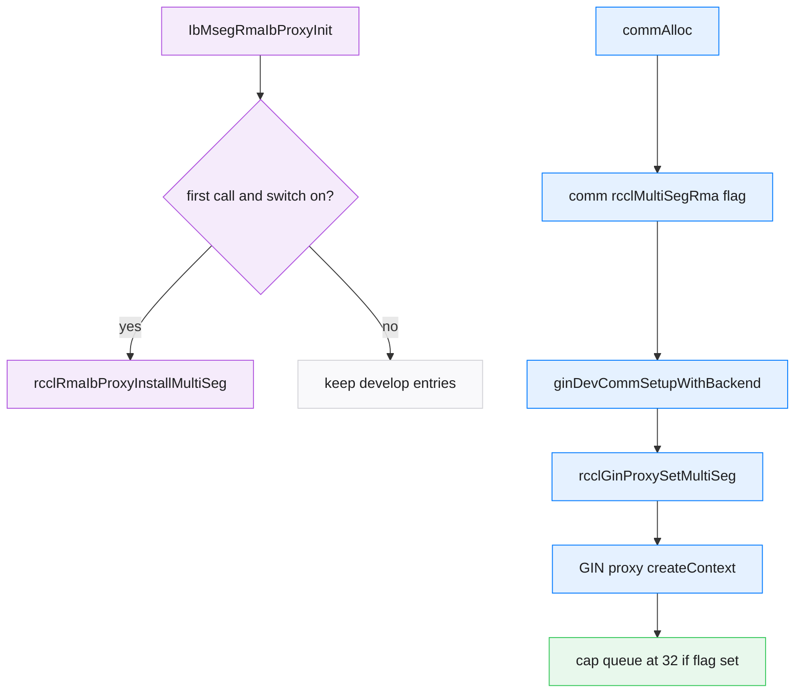

1. `gin.cc` `IbMsegRmaIbProxyInit` runs `std::call_once`. If `rcclRmaMultiSegEnabled()` (`seg_rma_mseg.h`, which calls the core's `rcclMultiSegOn(true)`) holds, `rcclRmaIbProxyInstallMultiSeg` overwrites `regMrSym`, `regMrSymDmaBuf`, `deregMrSym`, `iput`, `iputSignal`, `iget` and `iflush` in `IbMsegRmaIbProxy` with the `rcclRmaIbProxy*` bodies. Every MR takes the multi-segment handle layout from then on, including one-segment windows. `test` stays the develop entry, `IbMsegRmaIbProxyTest`, which gains the FAILED and round hooks described below. Control then goes to develop's `IbMsegGinIbInitType`.
2. `src/init.cc` `commAlloc` sets `comm->rcclMultiSegRma` to `rcclMultiSegOn(comm->rmaState.rmaProxyState.ncclRma == &IbMsegRmaIbProxy)`, or to the parent's value for a child comm. The core's window gates and the RMA proxy's in-flight cap read this flag; both are fork 1 code, described in [window gates](../multi_segment_gin_rma.md#window-gates).
3. `src/gin/gin_host.cc` `ginDevCommSetupWithBackend` calls `rcclGinProxySetMultiSeg(comm->rcclMultiSegRma)` just before its `createContext` loop. `src/gin/gin_host_proxy.cc` keeps the value in a `thread_local`, so a comm set up later on another thread cannot change the value an earlier comm's `createContext` reads.
4. The GIN proxy's `createContext` passes its sanitized `NCCL_GIN_PROXY_QUEUE_SIZE` through `rcclRmaProxyMaxInflightRequests(rmaMultiSeg, queueSize)`; when the flag is set this lowers the per-peer queue to `RCCL_RMA_MAX_INFLIGHT_REQUESTS` (32) and logs an INFO line. That cap is what lets the send queue below hold one full round per in-flight request.

## Connect and queue depths by role

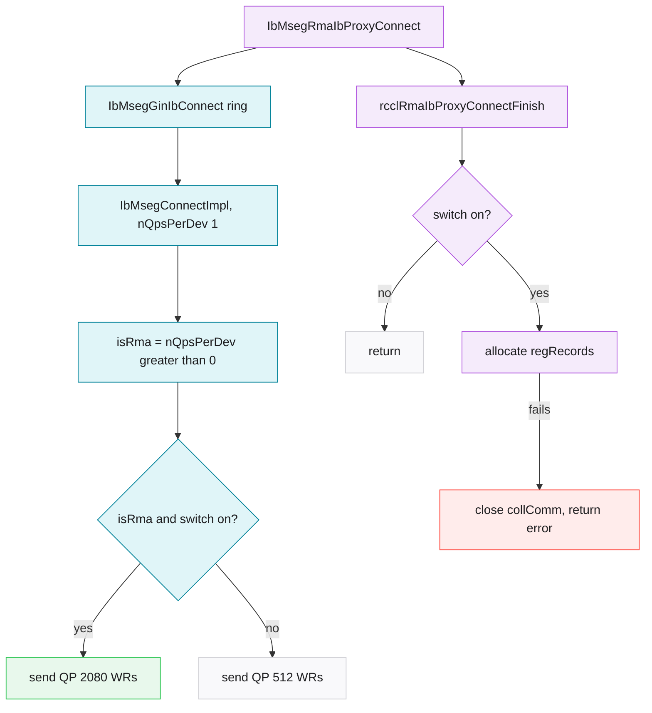

1. `gin.cc` `IbMsegRmaIbProxyConnect` checks GDR support and calls `IbMsegGinIbConnect`, which builds the collective ring: it connects to the next rank and accepts from the previous one through `IbMsegConnectImpl` and `IbMsegAcceptImpl`, both with `nQpsPerDev` 1.
2. `connect.cc` `IbMsegConnectImpl` sets `comm->base.isRma = nQpsPerDev > 0`. Only GIN and RMA connects pass `nQpsPerDev`, so P2P comms keep `isRma` false. The GIN collective ring and, later, every per-peer context comm are marked; the ring never posts multi-segment chains, so for it the deeper queue costs memory only.
3. `connect.cc` `IbMsegSenderQpsCreate` takes its send depth from `rcclIbSendQpWrs`:

```cpp
static_assert(RCCL_RMA_MAX_REQUESTS == NET_IB_MAX_REQUESTS, "RCCL_RMA_MAX_REQUESTS must match NET_IB_MAX_REQUESTS");
static_assert(RCCL_RMA_SEND_QP_WRS >= 2 * NET_IB_MAX_REQUESTS, "multi-segment send QP must not shrink the base");

// RCCL: sender QP depth. A multi-segment RMA comm holds a full chain per in-flight request; NET keeps the base.
static inline int rcclIbSendQpWrs(bool isRma) {
  return isRma && rcclRmaMultiSegEnabled() ? RCCL_RMA_SEND_QP_WRS : 2 * NET_IB_MAX_REQUESTS;
}
```

4. The sender CQ keeps develop's size, `NET_IB_MAX_REQUESTS * rcclIbCqQpsPerDev(nQpsPerDev)`, because a request has at most one signaled WR (its chain's or round's tail) outstanding.
5. `IbMsegSenderQpsToRts` and `IbMsegReceiverQpsCreateToRts` now reject a peer QP whose `devIndex` is outside `[0, min(remMeta->ndevs, NCCL_IB_MAX_DEVS_PER_NIC))` with `ncclInternalError`, because that index selects `remDevs` and the RMA rkey row. `IbMsegCreateFlushQp` sets the loopback flush QP's `devIndex` and `remDevIdx` to its own device, which the multi-segment flush uses to pick the local MR.
6. Back in `IbMsegRmaIbProxyConnect`, `rcclRmaIbProxyConnectFinish` returns at once with the switch off. With it on, it allocates `regRecords` with `ncclIbMalloc` for `nranks` `rcclIbSegSymRecord`s, so that registration has nothing to allocate before its first collective. If the allocation fails it closes the collective comm through `IbMsegGinIbCloseColl`, clears `*collComm` and returns the error. `IbMsegGinIbCloseColl` frees `regRecords` on every close.

| Queue | Switch on | Switch off |
|---|---|---|
| Sender data QP of a GIN/RMA comm (`isRma`) | `RCCL_RMA_SEND_QP_WRS` = `RCCL_RMA_MAX_INFLIGHT_REQUESTS` × `RCCL_RMA_MAX_SIGNAL_WRS` = 32 × 65 = 2080 | 512 |
| Sender data QP of a P2P comm | 512 (`2 * NET_IB_MAX_REQUESTS`) | 512 |
| Sender CQ | `NET_IB_MAX_REQUESTS * rcclIbCqQpsPerDev(nQpsPerDev)`, unchanged | same |
| Receiver QPs and CQ | unchanged | unchanged |
| Loopback flush QP | 512, unchanged | 512 |

7. `gin.cc` `IbMsegRmaIbProxyCreateContext` connects one send and one receive comm to itself and to each peer in the config's peer array, for each context (again with `nQpsPerDev` 1), and, with the switch on, allocates `pending.send`, one `rcclRmaRoundQueue` per peer, for each context. On failure it frees every context's queues; `IbMsegRmaIbProxyDestroyContext` rings the batch, closes the comms and frees the queues with `rcclRmaRoundQueuesFree`, which also frees any queued nodes.

## Symmetric window registration

### Who calls the registration

There is one registration body for both GIN and RMA: `gin.cc` `rcclRmaIbProxyRegMrSymDmaBuf`. The RMA proxy calls it through the `IbMsegRmaIbProxy` vtable. The GIN proxy (`src/gin/gin_host_proxy.cc`) has no backend of its own: `ncclGinProxyRegMrSym` and `ncclGinProxyRegMrSymDmaBuf` call `rmaBackend->regMrSymDmaBuf` or `rmaBackend->regMrSym`, which after the install are `rcclRmaIbProxyRegMrSymDmaBuf` and `rcclRmaIbProxyRegMrSym` (the latter forwards with offset 0 and fd -1). For a multi-segment window both proxies pass fd -1 (fork 1's `rcclRmaProxyRegisterMultiSeg` and `rcclGinRegisterMultiSeg`, see [the fork 1 walkthrough](multi_segment_walkthrough_fork1_core.md#proxy-fd-for-multi-segment-windows)), and the body exports per segment; a single-segment window still gets the proxy's whole-range fd, which the body uses for its one MR. The GDAKI GIN backend is not built on HIP and has no multi-segment path. Which windows reach this function at all is decided by the core's [window gates](../multi_segment_gin_rma.md#window-gates).

The body first counts and admits the segments; a rejection is only recorded, not returned:

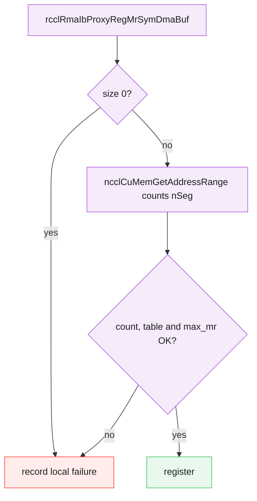

It then registers one MR or one per segment, and every path reaches the consensus:

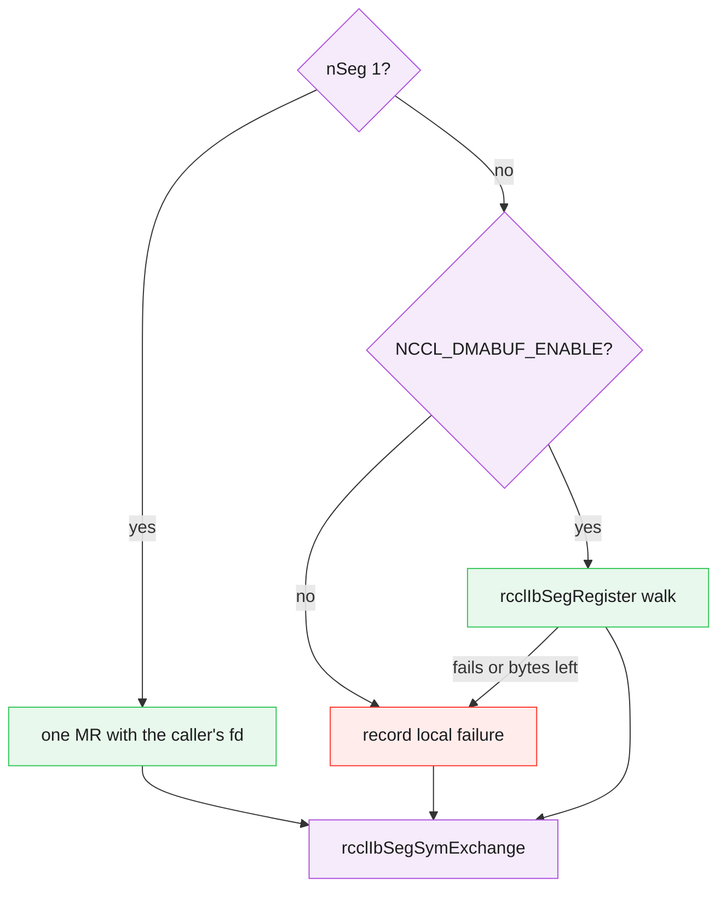

### Count and admit

Every rejection below sets `ret` and jumps to the `reconcile` label; none returns early, because every peer is about to enter the same collective.

1. `*mhandle` is cleared and `nSeg` starts at 1. A `size` of 0 is rejected with `ncclInternalError` before anything is allocated.
2. The handle `rcclRmaIbProxySegMrHandle` is allocated. For `NCCL_PTR_CUDA` with cuMem enabled, `ncclCuMemGetAddressRange` counts the physical segments into `nSeg`; host pointers and non-cuMem buffers stay at one segment.
3. `rcclIbSegCountSupported(nSeg)` (`src/transport/rccl_mseg.h`) requires 1 to `RCCL_IB_REG_SEG_DEFAULT` segments; otherwise `ncclInvalidUsage`.
4. `rcclRmaSegTableFits(cComm->nranks, nSeg)` (`src/transport/rccl_mseg_rma.h`) bounds ranks times segments at `RCCL_RMA_SEG_TABLE_MAX_ENTRIES`; otherwise `ncclInvalidUsage`.
5. For more than one segment, `rcclIbMrAdmit` (`reg.cc`) checks that `nSeg` more MRs stay under each device's `max_mr`; otherwise `ncclInvalidUsage`.
6. The tables are sized from the count: `segOff` (`nSeg + 1` entries), `mrHandle` (`nSeg`), and the scratch arrays `localVas` (`nSeg`) and `localRkeys` (`nSeg * NCCL_IB_MAX_DEVS_PER_NIC`). The handle gets its tag (`rcclRmaSegMrTag`, at offset 0) and `nSegments`.

### Segment walk

1. One segment: `IbMsegRegMrDmaBufInternal` registers the whole range with the caller's `offset` and `fd` (fd -1 falls back to `ibv_reg_mr`), `segOff[1] = size` and `localVas[0] = data`. This is develop's single MR.
2. More than one segment with `NCCL_DMABUF_ENABLE=0`: `ncclInvalidUsage`, so every rank fails through the exchange. On a build without the cuMem DMA-BUF export gate, the multi-segment branch also fails with `ncclInvalidUsage`.
3. Otherwise `rcclIbSegRegister` (`seg_reg_mseg.h`) calls `rcclRmaRegOneSegment` once per segment with an `rcclRmaSegRegCtx` whose `walk` starts at `data` with `size` bytes remaining. For each segment:
    1. `rcclIbSegExportNext` (`seg_export_mseg.h`) calls `cuMemGetAddressRange` at the walk pointer. The bytes left in the segment are `segSize` when `segBase` is 0 (host VMM can report that), otherwise `segSize - (ptr - segBase)`; the slice is the smaller of that and the bytes remaining. The export covers whole host pages around the slice. If `rcclHostSegmentFdLookup` finds an owner fd published for that range (an imported host segment), it is borrowed with its offset; otherwise `cuMemGetHandleForAddressRange` exports a DMA-BUF fd for the page range.
    2. Until the first device segment is found, `rcclIbSegExportIsHost` classifies the segment: a borrowed owner fd is always host memory, otherwise `rcclCuMemIsSysmemSegment` (`src/include/alloc.h`) reads the allocation's location. The first device segment becomes `flushSeg`; it stays -1 if every segment is host memory.
    3. `IbMsegRegMrDmaBufInternal` registers the slice on every device of the collective comm's receive comm, which yields one `IbMsegMrHandle` per segment. An exported fd is closed after the call.
    4. `rcclIbSegWalkAdvance` records `vas[seg]`, `segOff[seg + 1]` and moves the walk past the slice.
4. If any step fails, `rcclIbSegRegister` deregisters every slot up to and including the failing one through `rcclRmaDeregOneSegment` and returns the error, so `registered` stays 0. If the walk ends with bytes still unregistered, the function fails with `ncclInvalidUsage` and `registered` is `nSeg`.
5. The local rkeys are collected per segment and device into `localRkeys`; a missing MR or an out-of-range `ndevs` is `ncclInternalError`. A one-segment handle also allocates `single.rkeys` for `nranks` entries.

### Consensus exchange

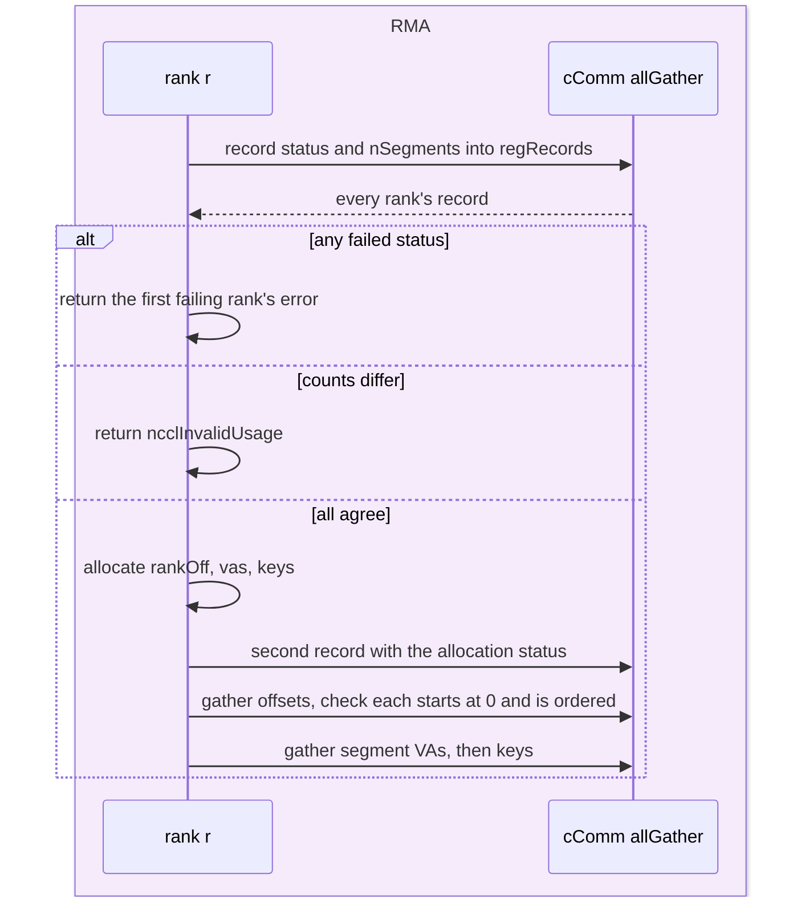

Control reaches the `reconcile` label on success and on every local failure:

```cpp
reconcile:
  // No rank-local failure may return before the exchange's first collective; it carries the status and the count.
  NCCLCHECKGOTO(rcclIbSegSymExchange(rcclRmaRegAllGather, cComm, cComm->nranks, registrations, ret, nSeg,
                                     NCCL_IB_MAX_DEVS_PER_NIC, rmaMrHandle ? rmaMrHandle->segOff : NULL, localVas,
                                     localRkeys, data, "NET/IB/RMA", rmaMrHandle ? &rmaMrHandle->sym : NULL),
                ret, fail);
```

1. `seg_sym_mseg.h` `rcclIbSegSymExchange` first calls `rcclIbSegSymAgree`: every rank allgathers `{status, nSegments}` into `regRecords` through `rcclRmaRegAllGather` (the collective comm's `allGather`). Any failed status makes every rank return that rank's error.
2. Every rank compares every record's `nSegments` with its own; a mismatch is `ncclInvalidUsage` on every rank. Equal counts with different segment sizes are allowed, because each side splits on its own row of the table.
3. It allocates the symmetric table `rcclIbSegSymTable` (`rankOff`, `vas`, `keys`, all sized from `nranks` and `nSeg`) and runs a second `rcclIbSegSymAgree` on the allocation status, so an allocation failure on one rank also fails every rank.
4. It gathers each rank's `segOff`, and every rank checks that every row starts at 0 and never decreases (`ncclInvalidUsage` otherwise). It then gathers the segment VAs and the keys (`NCCL_IB_MAX_DEVS_PER_NIC` rkeys per segment).
5. On success with one segment, `rcclRmaIbProxyRegMrSymDmaBuf` fills the embedded develop handle `single`: `mrHandle[0]`, `base_vas = sym.vas` and each rank's device-0 rkey of segment 0. It returns the handle and frees the scratch arrays.

A registration therefore costs five allgathers (two agreements and three table gathers) where develop's costs two. A gather that fails after the agreements returns on that rank only; those are transport errors, not rank-local registration failures.

## Segmented work-request builder

`gin.cc` `rcclRmaBuildSegmentedWrs` turns one transfer (or the next round of one) into WRs. It is reached through the round hook `rcclRmaIbRoundBuild`.

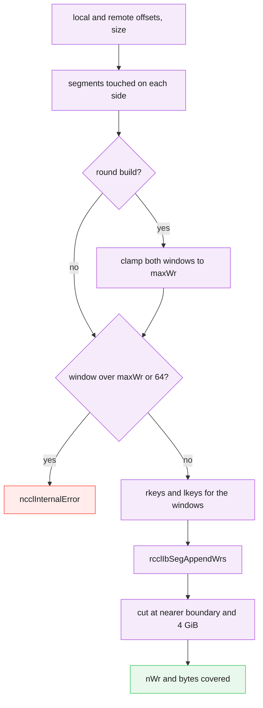

1. `rcclRmaRankOff` selects each side's own row of offsets from the symmetric table, so the local side splits on this rank's boundaries and the remote side on the peer's.
2. `rcclRmaSegIndexOf` finds the first and last segment the transfer touches on each side. When `covered` is passed (a round), `rcclRmaRoundClampWindow` limits both windows to `maxWr`, because a partial round touches at most that many segments. A window larger than `maxWr`, or `maxWr` above `RCCL_RMA_MAX_DATA_WRS`, is `ncclInternalError`.
3. The remote rkeys come from `rcclRmaRemoteRkey` for the QP's `remDevIdx`; the local lkeys come from each segment's MR on the QP's `devIndex`, and a missing local MR is `ncclInternalError`.
4. Two `rcclIbSegTable`s keep the registration base (segment 0's VA) and point their offsets at the first touched segment, so offsets stay absolute. `seg_wr_mseg.h` `rcclIbSegAppendWrs`, which this fork adds, walks an `rcclIbSegCursor` (`seg_mseg.h`) over both tables. Each slice ends at the nearer of the local and remote boundary and at `RCCL_IB_SGE_MAX_BYTES` (`UINT32_MAX`), and becomes one WR with one SGE, one lkey and one rkey, filled by fork 3's `rcclIbSegFillWr` and linked to the previous WR.
5. With `covered`, the chain stops at `maxWr` WRs or at the end of a table and reports the bytes it moves. Without it, a chain that runs past `maxWr` or past a table is an error.

## Posting an operation

The data entries are `rcclRmaIbProxyIPut`, `rcclRmaIbProxyIGet`, `rcclRmaIbProxyIPutSignal` and `rcclRmaIbProxyIFlush`. All of them run on the proxy thread for one context of the RMA proxy context array.

Each entry first decides between the develop body and the multi-segment path:

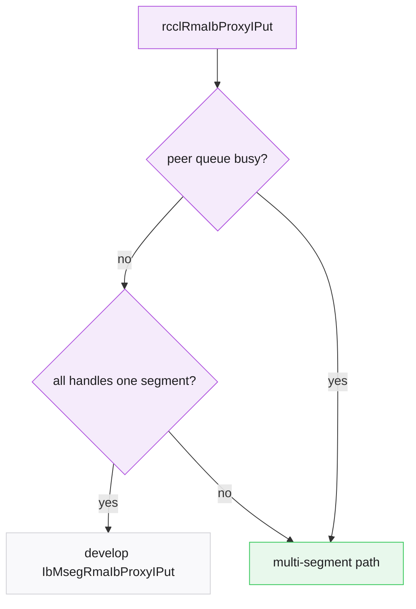

The multi-segment path checks the range and posts one direct chain or queues the op for rounds:

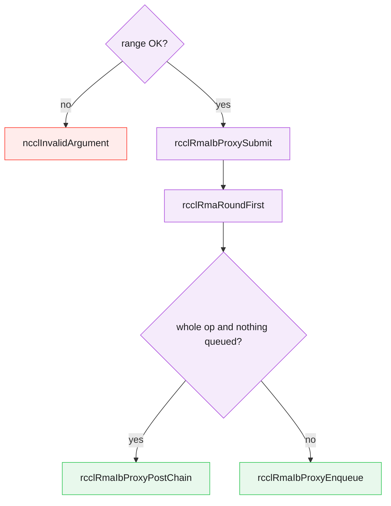

1. `rcclRmaIbProxyPeerBusy` asks whether this context's queue for the peer holds an operation. If not, and `rcclRmaIbProxyUseSingle` finds every handle has one segment, it swaps each handle for its embedded `single` and calls the develop body (`IbMsegRmaIbProxyIPut`, `IGet` or `IPutSignal`). Behind a queued operation every operation takes the multi-segment path, even with one-segment handles, so it cannot complete ahead of the queued one.
2. `rcclRmaRangeOk` checks the local range against this rank's offsets and the remote range against the peer's; a failure returns `ncclInvalidArgument` before any WR is built.
3. The op is described by `rcclRmaRoundDataOp` on the peer's send comm and its first QP: `IBV_WR_RDMA_WRITE` for put, `IBV_WR_RDMA_READ` for get (the local buffer is the destination, so it takes the lkey side).
4. `rcclRmaIbProxyIPutSignal` also accepts only `NCCL_NET_SIGNAL_OP_INC` and `NCCL_NET_SIGNAL_OP_ADD`, checks the 8-byte signal range, and requires `rcclRmaSignalOffsetValid` (8-byte aligned and inside one segment). `rcclRmaRoundSetSignal` stores one `IBV_WR_ATOMIC_FETCH_AND_ADD` aimed at the signal segment's VA plus offset, with that segment's rkey and the comm's scratchpad as the fetch target; `rcclRmaRoundBuild` appends it after the data WRs of the last round. A zero-size put sends only the signal.
5. `rcclRmaIbProxySubmit` builds the first round on a copy of the op (`rcclRmaRoundFirst`). If that round is the whole op (or empty) and the queue is idle, the op posts directly; otherwise it is queued.
6. `rcclRmaIbProxyPostChain` starts the request (`rcclRmaIbProxyStartRequest`: a slot from `IbMsegGetRequest`, `id = ++ginSeq.posted`, every WR stamped with the slot index; a chain with no WRs gives the id back, so it completes with whatever posted before it). For data, `rcclRmaIbProxyQueueRequest` calls `rcclRmaIbProxyQueueWrs`: a chain that fits `wrBatchsize` (`NCCL_RMA_IB_WR_BATCHSIZE`, at most 64) is copied into the context's WR batch and committed as develop does; a longer chain first rings the batch, signals its own tail and posts at once through `rcclRmaPostWrs`. Only `iput` adds a WQE event, as in the develop bodies. `rcclRmaFinishPostedRequest` then applies the keep-or-free rule described under prefix posts.
7. `rcclRmaIbProxyEnqueue` rings the WR batch if the queue was idle, allocates a queue node (`rcclRmaRoundFillNode`), starts the request, publishes it to the caller, and pushes the node. If the node became the head, `rcclRmaRoundPump` posts its first round at once. A context without queues (switch off) returns `ncclInternalError` here.
8. `rcclRmaIbProxyIFlush` with a one-segment handle calls develop's flush. Otherwise it returns no request when flush is disabled on the receive comm or `flushSeg` is -1 (all host memory). It rings the batch, creates the loopback flush QP, and posts one signaled `IBV_WR_RDMA_READ` of one byte (the flush QP's SGE) from this rank's own VA of `flushSeg`, with the local MR's rkey. The flush goes through `rcclRmaIbProxyPostChain` at once even when sends are queued, because it uses the receive comm and its own sequence.

## RMA rounds and completion

A round is at most `RCCL_RMA_MAX_DATA_WRS` (64) data WRs, plus the signal on the last round (`RCCL_RMA_MAX_SIGNAL_WRS` = 65); only its last WR is signaled. A queued operation has at most one round in flight, and the next round posts after that round's tail completes. In the diagram, the GIN proxy thread drives the RMA backend's per-peer round queue and its test entry `IbMsegRmaIbProxyTest`, which post to and poll IB-MSEG's QP and CQ.

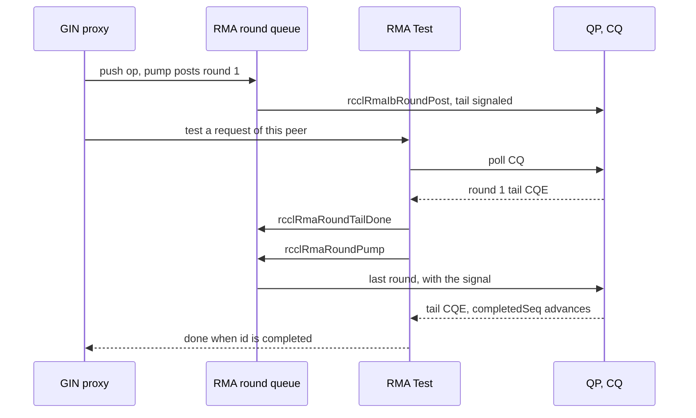

1. `seg_rma_round_mseg.h` `rcclRmaRoundPush` appends the node and reports whether it became the head; only then does the caller pump.
2. `rcclRmaRoundPump` walks the queue from the head. A head already marked FAILED is dropped. A head with a round in flight stops the pump. Otherwise `rcclRmaRoundPostNext` builds the next round (`rcclRmaRoundBuild` advances the op's offsets by the bytes covered) and posts it through `rcclRmaIbRoundPost`, which stamps every WR with the request's slot, signals the last one and calls `rcclRmaPostWrs`. When every WR posted, `rcclRmaIbNoteRound` adds the round to the peer comm's `segStats`: its data WRs (without the signal WR on the last round of an `iputSignal`), and a later-segment round when the round's last local or remote byte lies past segment 0. It logs the round's end at TRACE (`NET/IB/RMA: opcode ... round of ... WRs ends at`). Counting at post time keeps the probe copy that `rcclRmaRoundFirst` builds out of the counts; the direct path in `rcclRmaIbProxySubmit` counts its single round after `rcclRmaIbProxyPostChain`. `rcclRmaIbProxySegStats` reads the counters for one context and peer, for tests. A non-final round sets `roundInFlight` and stops the pump; a last round, or a failed one, retires the op and the pump moves on to the next.

```cpp
static inline void rcclRmaRoundPump(const struct rcclRmaRoundHooks* hooks, struct rcclRmaRoundQueue* q) {
  if (q == NULL) return;
  while (q->head != NULL) {
    struct rcclRmaRoundOp* op = q->head;
    if (!hooks->failed(op)) {
      if (op->roundInFlight && hooks->outstanding(op)) return;
      if (rcclRmaRoundPostNext(hooks, op)) return;
    }
    rcclRmaRoundPop(q);
  }
}
```

3. `gin.cc` `IbMsegRmaIbProxyTest` rings the batch, returns at once for a FAILED request, and polls the send comm's CQ. For each CQE it maps `wr_id` back to the request; if `rcclRmaRoundTailDone` says the CQE ends the head's in-flight round, it clears `roundInFlight` and skips the sequence update, so a non-final round never completes its request. After the poll it pumps the queue, then completes the request if its id is at or below `ginSeq.completed`.

```cpp
    struct IbMsegRequest* wcReq = commBase->reqs + wc[i].wr_id;
    if (rcclRmaRoundTailDone(pending, wcReq)) continue;

    if (wcReq->id > *completedSeq) *completedSeq = wcReq->id;
  }
  rcclRmaRoundPump(&rcclRmaIbRoundHooks, pending);
```

4. Rounds advance only inside `IbMsegRmaIbProxyTest` and when a node becomes the head. The GIN proxy's progress loop tests its outstanding operations, so queued rounds keep moving while any operation of that peer is pending.
5. The in-flight cap (32 per peer and context, from setup) bounds how many requests can each hold one round on the send QP, which is how 2080 send WRs suffice.

## Prefix posts and failed requests

`ibv_post_send` can fail after it accepted a prefix of the chain. `rcclRmaPostWrs` counts the accepted WRs by walking the chain to `bad_wr` (`rcclRmaPostedWrCount`) and logs a WARN.

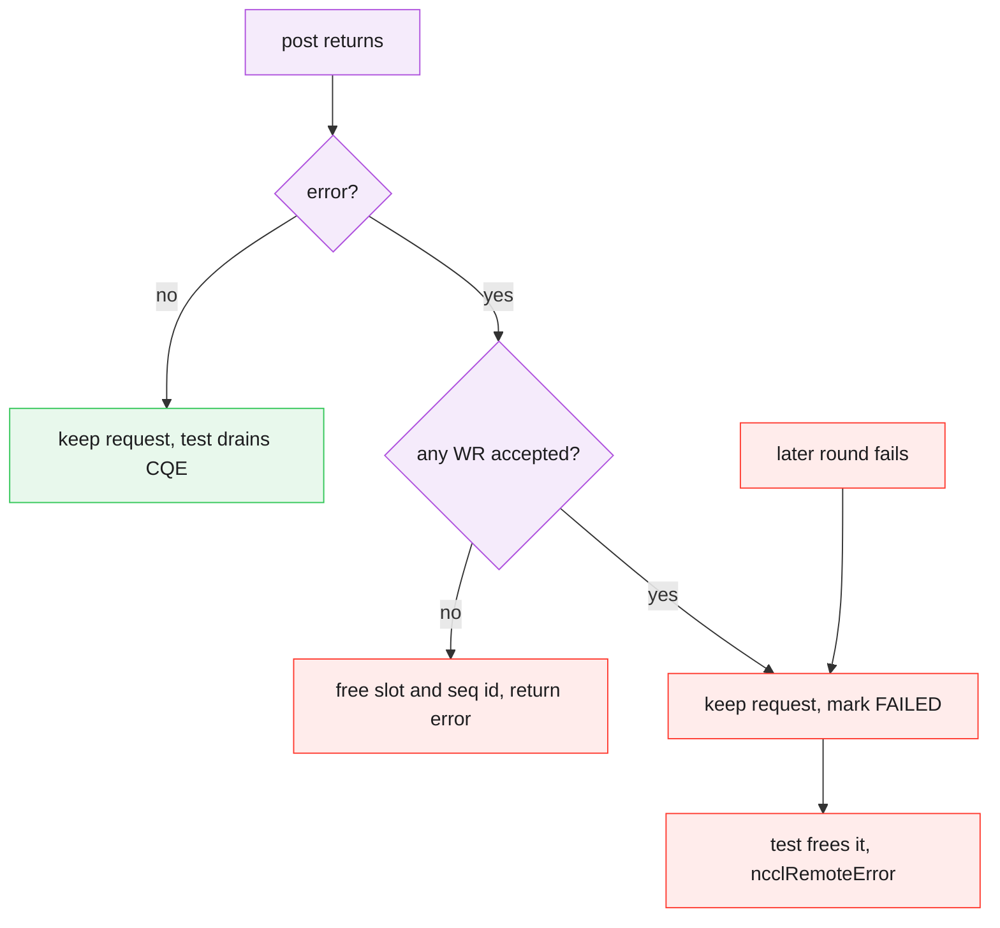

1. `seg_rma_mseg.h` `rcclRmaCompletePostedRequest` is the rule, applied by `gin.cc` `rcclRmaFinishPostedRequest` to a direct chain or the first post of a flush:

```cpp
static inline ncclResult_t rcclRmaCompletePostedRequest(ncclResult_t postRet, int posted, int nWr, int* keepRequest,
                                                        int* markFailed) {
  if (keepRequest) *keepRequest = 0;
  if (markFailed) *markFailed = 0;
  if (postRet != ncclSuccess && posted == 0) return postRet;
  if (keepRequest) *keepRequest = 1;
  // A failed batch doorbell stops at or before the chain's signaled tail, even when posted == nWr.
  if (markFailed) *markFailed = postRet != ncclSuccess || rcclRmaPrefixPostLostSignaledTail(posted, nWr);
  return ncclSuccess;
}
```

2. Nothing accepted: `rcclRmaFinishPostedRequest` returns the sequence id with `rcclRmaReleaseSeqId` (only if no later request took one), frees the slot and returns the post error. The caller gets no request.
3. Anything accepted with an error: the request is published to the caller with `type = NCCL_NET_IB_REQ_FAILED` and the call returns `ncclSuccess`, because the accepted WRs reference the slot and must not find it reused while the provider still owns them.
4. A queued round that fails, or posts only a prefix, goes through `rcclRmaIbRoundRetire(ok = false)`, which marks the request FAILED; the pump pops the op and posts the ops behind it.
5. `IbMsegRmaIbProxyTest` sees `NCCL_NET_IB_REQ_FAILED` right after ringing the batch and calls `rcclRmaIbProxyTestFailed`, which frees the slot, sets `done` and returns `ncclRemoteError`. It does not drain the accepted prefix first. The error is fatal for the context: the accepted WRs may still be moving data after the slot is freed, so the caller must tear the context down rather than retry on it.

## Doorbell failure and batch reset

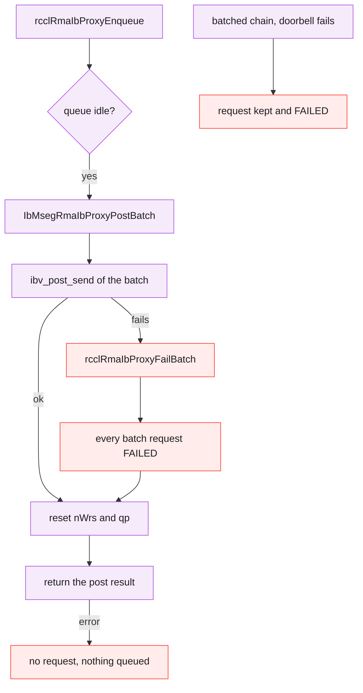

1. `gin.cc` `IbMsegRmaIbProxyPostBatch` now resets `batch->nWrs` and `batch->qp` before returning the result of `ibv_post_send`, even on failure. Develop returned before the reset, so a later doorbell could post WRs the HCA had already accepted a second time. This change applies with the switch off too.
2. Before that reset, a failed `ibv_post_send` calls `rcclRmaIbProxyFailBatch`. Only the batch's last WR is signaled, so a failed doorbell loses the completion of every request in the batch, and a later CQE on the same QP would hide them. The function finds the send comm whose QP is `batch->qp` and sets `NCCL_NET_IB_REQ_FAILED` on the request of every WR in the batch (`reqs[wr_id]`). That includes requests posted earlier with `ncclRmaOptFlagsAggregateRequests`, which were already returned to the caller while their WRs waited in the batch; their next test returns `ncclRemoteError`. This also applies with the switch off.
3. `rcclRmaIbProxyEnqueue` rings an idle queue's batch before it allocates the node or starts the request. A doorbell failure there returns the error with no request published and nothing queued.
4. In `rcclRmaIbProxyQueueWrs`, a chain copied into the batch counts as fully posted (`posted = nWr`) before `IbMsegRmaIbProxyCommitWrs` may ring the doorbell, because a failed doorbell may already have handed those WRs to the QP. If that doorbell fails, `rcclRmaCompletePostedRequest` keeps the request and marks it FAILED. A failure of the doorbell that `IbMsegRmaIbProxyReserveWrs` rings for an earlier batch returns before anything is copied, so the new request is freed.
5. `IbMsegRmaIbProxyTest` and `IbMsegRmaIbProxyDestroyContext` ring the batch with `NCCLCHECK`, so a doorbell failure there is returned to the GIN or RMA proxy as an error.

## Deregistration and rollback

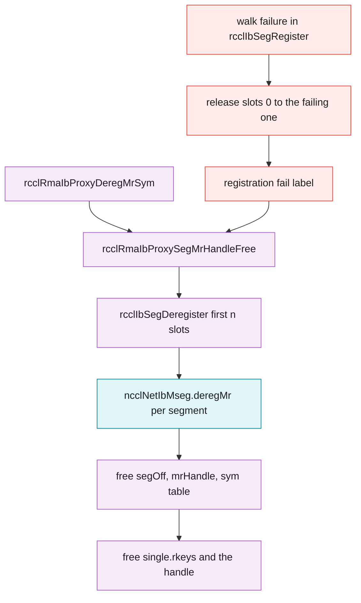

1. `gin.cc` `rcclRmaIbProxyDeregMrSym` calls `rcclRmaIbProxySegMrHandleFree` with `nSegments`. It is local; there is no collective.
2. `rcclRmaIbProxySegMrHandleFree` calls `seg_reg_mseg.h` `rcclIbSegDeregister` over the first `n` slots. It skips empty slots, calls `rcclRmaDeregOneSegment` (which is `ncclNetIbMseg.deregMr`, releasing that segment's MR on every device) and clears each slot, and keeps going after an error. It then frees `segOff`, `mrHandle`, the symmetric table (`rcclIbSegSymTableFree`), `single.rkeys` and the handle, and returns the first deregistration error.
3. On the registration `fail` label the same function runs with `registered`: 0 after a failed walk (already released by `rcclIbSegRegister`), 1 for a one-segment MR, `nSeg` when the walk completed but the remainder check, rkey collection or exchange failed. A failed table allocation inside the exchange is freed here too.
4. `reg.cc` `IbMsegRegMrDmaBufInternal`, which registers one segment on every device, now deregisters the MRs of earlier devices with `IbMsegDeregMrInternal` when a later device fails, so a failed segment leaves no MR behind.
5. `src/include/alloc.h` `rcclCuMemIsSysmemSegment` releases the retained allocation handle even when `cuMemGetAllocationPropertiesFromHandle` fails, which `ncclCuMemGetAddressRange` and `rcclIbSegExportIsHost` both rely on.

## Switch-off and single-segment paths

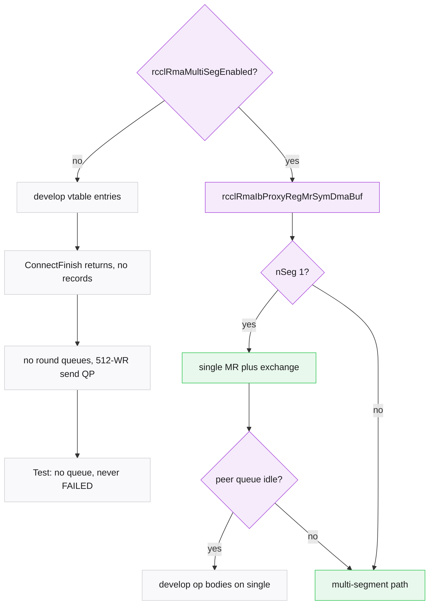

With the switch off (`NCCL_MULTI_SEGMENT_REGISTER=0`, or `NCCL_DMABUF_ENABLE=0`), `rcclRmaMultiSegEnabled()` is false and the new code is left at these points:

1. `IbMsegRmaIbProxyInit` installs nothing, so `IbMsegRmaIbProxy` keeps develop's `IbMsegRmaIbProxyRegMrSym*`, `DeregMrSym`, `IPut`, `IGet`, `IPutSignal` and `IFlush`.
2. `rcclRmaIbProxyConnectFinish` returns before allocating `regRecords`; close frees a NULL pointer.
3. `IbMsegRmaIbProxyCreateContext` leaves `pending.send` NULL, so `rcclRmaIbProxyQueueOf` returns NULL; in `IbMsegRmaIbProxyTest`, `rcclRmaRoundTailDone` returns false and `rcclRmaRoundPump` returns at once. Develop bodies never set `NCCL_NET_IB_REQ_FAILED` themselves; only a failed batch doorbell does, through `rcclRmaIbProxyFailBatch`, and then the new check in `Test` returns `ncclRemoteError` for those requests.
4. `rcclIbSendQpWrs` returns `2 * NET_IB_MAX_REQUESTS`, develop's depth, and `comm->rcclMultiSegRma` is false, so neither proxy lowers its in-flight count.

The data path then matches develop's `net_ib` RMA backend. A few fixes in the copied files apply regardless of the switch and differ from develop's `net_ib`: the batch reset and the FAILED batch requests on a failed doorbell, the peer `devIndex` check at connect, the flush QP's device indices, the per-device unwind in `IbMsegRegMrDmaBufInternal`, and the released handle in `rcclCuMemIsSysmemSegment`. Develop's `net_ib` itself is not edited.

With the switch on, a one-segment window does not take every develop step:

1. Registration runs `rcclRmaIbProxyRegMrSymDmaBuf`, which registers develop's single MR with the caller's fd but adds the consensus exchange (five allgathers instead of two) and wraps the MR in `rcclRmaIbProxySegMrHandle`.
2. Operations swap in the embedded `single` handle and run the develop bodies, unless the peer's queue holds a multi-segment operation; then they take the multi-segment path with one-segment tables.
3. Deregistration goes through `rcclRmaIbProxySegMrHandleFree`.
4. The RMA send queue is 2080 WRs and the GIN proxy queue is capped at 32 for every comm on this backend, whatever its windows' segment counts.

## Error and unwind paths

| Failure | Where | What is freed, in order | What the caller sees |
|---|---|---|---|
| `regRecords` allocation | `rcclRmaIbProxyConnectFinish` | the collective comm, through `IbMsegGinIbCloseColl` | connect error, `*collComm` NULL |
| Zero size, unsupported count, table too large, `max_mr`, DMA-BUF off, unregistered remainder | `rcclRmaIbProxyRegMrSymDmaBuf` | after the exchange: completed MRs, tables, handle | the same error on every rank, no handle |
| Segment export or MR failure | `rcclRmaRegOneSegment` | slots 0 to the failing one (`rcclIbSegRegister`), then tables and handle | the first failing rank's error on every rank |
| Unequal counts or bad offsets | `rcclIbSegSymExchange` | completed MRs, partial symmetric table, handle | `ncclInvalidUsage` on every rank |
| Out-of-range transfer or bad signal | `rcclRmaIbProxyIPut`, `IGet`, `IPutSignal` | nothing; no request taken | `ncclInvalidArgument` |
| Post accepted nothing | `rcclRmaFinishPostedRequest` | slot and sequence id | post error, no request |
| Post accepted a prefix, or batched chain's doorbell failed | `rcclRmaFinishPostedRequest` | nothing yet | success with a FAILED request; its test returns `ncclRemoteError` and frees the slot |
| Any batch doorbell fails | `IbMsegRmaIbProxyPostBatch`, `rcclRmaIbProxyFailBatch` | the batch is reset | every request with a WR in the batch FAILED, including aggregated requests already returned; each test returns `ncclRemoteError` |
| Later round fails | `rcclRmaIbRoundRetire` | the queue node | FAILED request; its test returns `ncclRemoteError` |
| Doorbell failure before enqueue | `rcclRmaIbProxyEnqueue` | the batch is reset | error, no request, nothing queued |
| Context creation | `IbMsegRmaIbProxyCreateContext` | every context's round queues, then the context array | error |

## Compile-twice host tests

The four IB-MSEG host binaries compile the `net_ib` host test files and fakes against the fork's units, so the `net_ib` tests keep checking the copy without a hand-kept duplicate. The design and the developer rule are in [compile-twice host tests](../multi_segment_fork_plugin.md#compile-twice-host-tests).

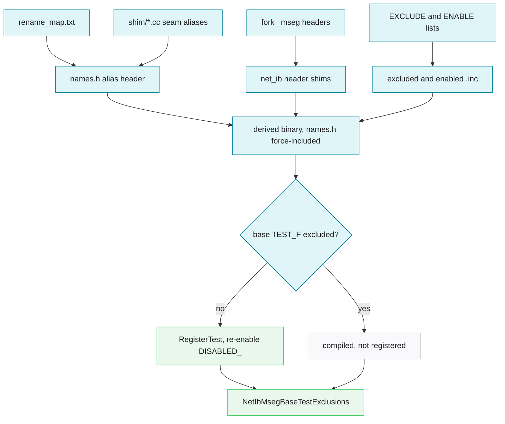

Configure time, `test/host/transport/derived_transport_tests.cmake`:

1. `test/host/transport/net_ib_multiseg/host_tests.cmake` calls `rccl_derived_transport_tests` with `DERIVED net_ib_multiseg`, `HEADER_SUFFIX _mseg`, `SELF_CHECK_SUITE NetIbMsegBaseTestExclusions` and one `BASE net_ib` block: `RENAME_MAP tools/scripts/net_ib_multiseg/rename_map.txt`, `SEAM_DIR shim`, and `KEEP_ALIASES` for five names the tests use outside the seam window.
2. `_rccl_derived_gen_names` reads every `<base name> <derived name>` entry of the rename map (configure fails on a malformed line) and writes `derived_transport/net_ib_multiseg/net_ib/names.h` in the build directory with one `#define <base> <derived>` per entry. It leaves out the names that a seam unit in `shim/` defines back (`#define <derived> <base>`), unless they are in `KEEP_ALIASES`. A seam `#define` that names a map entry on either side but does not reverse it fails configure.
3. `_rccl_derived_gen_shims` writes, for each `src/transport/net_ib_multiseg/*_mseg.h`, a shim `net_ib/<x>.h` and `transport/net_ib/<x>.h` that includes the fork header, and removes stale shims. Generated files are rewritten only when their content changes.
4. Per binary, `rccl_add_derived_transport_binary` checks that the base is declared, and `_rccl_derived_gen_lists` writes `derived_tests_excluded.inc` and `derived_tests_enabled.inc`. `EXCLUDE_BASE_TESTS` takes `<Suite.Name> <tag>` pairs, where the tag is `replaced` (the derived file has a test of the same name), `lagging` (a base change the fork has not taken yet) or `diverged` (the fork differs by design; the comment names the fork test that covers it). `ENABLE_BASE_TESTS` takes `<Suite.DISABLED_Name>` entries to re-enable. A malformed entry fails configure.
5. The binary is a normal `rccl_add_transport_micro_binary` plus `derived_transport_tests_check.cc`, with `-iquote` on the shim and list directories, `-include names.h`, `RCCL_DERIVED_BASE_DIR="transport/net_ib/"` and the self-check suite name.

Compile and run time:

1. A fork test file such as `test/host/transport/net_ib_multiseg/gin-test.cc` points `NET_IB_GIN_CC_PATH` at `shim/gin.cc`, renames the base fixture (`#define NetIbGinMicrotest NetIbMsegGinMicrotest`), and includes `transport/net_ib/gin-test.cc` between `derived_transport_tests_begin.h` and `derived_transport_tests_end.h`. `shim/gin.cc` maps a few fork names back to `net_ib` names around `#include NET_IB_MSEG_GIN_CC_PATH`, so the base test's seam window wraps the fork's `gin.cc`.
2. `derived_transport_tests_begin.h` redefines `TEST_F` so each base test becomes a class registered by `rccl_derived_tests::RegisterBaseTest`. It records every base test, skips excluded ones, and registers the rest through `testing::RegisterTest`, dropping the `DISABLED_` prefix for re-enabled tests. Excluded tests still compile, so a base test that no longer builds against the fork fails the build. `derived_transport_tests_end.h` restores `TEST_F`. The fork's own tests follow the include.
3. `derived_transport_tests_check.cc` adds three tests to `NetIbMsegBaseTestExclusions`: `NoExcludedBaseTestRuns` (every excluded name exists in the base file and none is registered from it; a non-`replaced` entry must have no fork test of that name), `EveryReplacedTestHasADerivedTest` (exactly one fork test, which runs in an unfiltered run), and `EveryReEnabledBaseTestIsRegistered`.

The four binaries are `rccl-UnitTestsMicroTransportNetIbMsegConnect`, `rccl-UnitTestsMicroTransportNetIbMsegGin`, `rccl-UnitTestsMicroTransportNetIbMsegP2p` and `rccl-UnitTestsMicroTransportNetIbMsegReg`. The P2P binary excludes thirteen base tests as `replaced`, eight because the fork's `ctsFifo` is a pointer and five (the `PostFifo_*` and CTS-writing `Irecv_*` tests) because the receiver's `remCtsFifo.elems` is a pointer, and `DISABLED_Iflush_ReadPostFailurePropagatesError` as `diverged` (the fork chains the flush write and read in one post). The registration binary re-enables `DISABLED_RegMr_MultiDeviceFailureUnwindsEarlierRegistrations`, which the `reg.cc` unwind now satisfies.

## Tests

### Host binaries

| Path | Suite and tests | Binary |
|---|---|---|
| Install and comm flag | `NetIbMsegGinMicrotest.RmaVtable_MultiSegmentInstallReplacesMrAndDataOps`; `InitMicrotest.CommAlloc_MultiSegRmaFollowsIbMsegRmaProxy`; `GinHostDevCommSetupMicrotest.DevCommSetup_SetsTheCommRmaFlagBeforeEachContext` | `rccl-UnitTestsMicroTransportNetIbMsegGin`, `rccl-UnitTestsMicroInit`, `rccl-UnitTestsMicroGinHost` |
| Connect and depths | `NetIbMsegConnectMultiSegMicrotest.Connect_NQpsPerDevMarksRmaAndSizesSendQueue`; `NetIbMsegConnectMicrotest.SenderQps_MultiSegmentRegisterSetsSendQueueDepth`, `CreateFlushQp_KeepsBaseDepthAndLoopbackDeviceIndex`, `SenderQpsToRts_PeerDeviceIndexOutOfRangeIsRejected`, `ReceiverQpsCreateToRts_PeerDeviceIndexOutOfRangeCreatesNoQp`; `NetIbMsegGinMicrotest.ProxyConnect_*`, `GinListens_*`, `CreateContext_*` | `rccl-UnitTestsMicroTransportNetIbMsegConnect`, `rccl-UnitTestsMicroTransportNetIbMsegGin` |
| Registration | `NetIbMsegGinMicrotest.RegMrSymDmaBuf_*` (owner fd, table sizing, DMA-BUF off, flush segment, all-host, location and properties query failures, seventeen segments, table budget, supported count, zero size) | `rccl-UnitTestsMicroTransportNetIbMsegGin` |
| Device unwind and released handle | `NetIbMsegRegMicrotest.RegMr_MultiDeviceFailureUnwindsEarlierRegistrations`; `AllocMicrotest.GetAddressRange_PropertiesFailureReleasesTheRetainedHandle` | `rccl-UnitTestsMicroTransportNetIbMsegReg`, `rccl-UnitTestsMicroAlloc` |
| WR builder and rounds | `NetIbMsegGinMicrotest.BuildSegmentedWrs_*`, `IPut_WiderThanOneRound_*` (also checks the round counters and rejects an out-of-range peer), `IPut_BehindAQueuedOp_*`, `IPutSignal_WiderThanOneRound_*`, `IFlush_*` | `rccl-UnitTestsMicroTransportNetIbMsegGin` |
| Prefix post, FAILED, doorbell | `NetIbMsegGinMicrotest.IPut_LaterRoundPostFailure_FailsTheRequest`, `IPut_PrefixPostOfADirectChain_KeepsTheRequestUntilTestFails`, `IPut_PrefixPostOfALaterRound_FailsTheRequest`, `IPut_BatchDoorbellFailure_PublishesNoRequest`, `IPut_BatchDoorbellFailure_FailsTheAggregatedRequests`; `NetIbMsegGinRmaSeqId.ReleaseSeqIdOnlyReturnsNewestId` | `rccl-UnitTestsMicroTransportNetIbMsegGin` |
| Exclusion lists | `NetIbMsegBaseTestExclusions.*` | all four IB-MSEG binaries |
| Slicing, limits, rounds math | `RmaSegmentMathTest.*`, `RmaRoundTest.*` | `rccl-HostUnitTests` |

### MPI suites

`test/transport/RmaMPI/RmaMultiSegmentMPITests.cpp` in `rccl-UnitTestsMPI` holds two suites. `RmaMultiSegmentMPITest` covers registration and layouts (`Reproducer_*`, `PartialFinalSegment*`, `SubPageBounds*`, `RegisterExceedsMaxSegmentsRejected`, `RegisterAsymmetricSegmentCountRejected`, `RegisterEqualCountDifferentBoundariesTransfer`, `RankLocalRegistrationFailureRejectedCollectively`, `RegistrationAfterCollectiveRejectionTransfers`), operations (`IPutCrossSegmentBoundaryAtOffset`, `IGet*`, `IPutSignal*`, `IFlush*`, `IPutSizeSweep*`, `BoundaryStressNoCorruption`, `MultiNodeAsymmetricIGetBoundaryStress`), out-of-range rejection (`*OutOfRange*`), the switch-off and one-segment paths (`MultiSegmentRegisterOff_KeepsSingleRegistration`, `SingleSegmentRegression`, `IFlushSingleSegmentRegression`), and DeepEP layouts (`DeepEP_Engram*`, `DeepEP_Hybrid*`). `RmaMultiSegmentPostMPITest` covers the post path: batching (`ChainsAroundWrBatchSizeLandIntact`), rounds (`OpsWiderThanOneRoundLandIntact`), queue order (`QueuedRequestsCompleteInAnyWaitOrder`, `InterleavedSingleAndMultiSegmentOps`, `ZeroSizeOpsCompleteWithQueuedPredecessor`), contexts, rejected-op accounting (`RejectedOpsLeaveNoSlotOrSequenceGap`), registration churn, the send queue at the cap (`IPutSignalFillsSendQueueWithoutTest`, `IPutSignalAtProxyInflightCapFitsSendQueue`), the opt-in flood `IPutSignalSendQueueOversubscribe` (skips unless `RCCL_MSEG_SQ_STRESS=1`), all-pairs and many-to-one. Window-level registration through the core is in `test/RegistrationMPITests.cpp` (`UBR_MultiSegment.Symmetric_Elastic_RmaRegistration`, `DeepEP_ElasticWindowRegistration`, `DeepEP_HybridWindowRegistrationAndHandleReuse`, `DeepEP_HybridElasticRegistrationDisabled`). What each test asserts is in [testing](../multi_segment_testing.md#ginrma).

### Runner jobs per config

| Job | Runs | Configs that define and enable it |
|---|---|---|
| `net_ib_rma_multisegment` | the `RmaMultiSegmentMPITest` cases one by one (except the hybrid ones), the post path at the default WR batch and at 8 and 2, the send-queue flood, the switch-off entries, and develop's `RmaMPITest` suites with the switch on and off | the four Mellanox and Thor2 configs and `net_ib_transport` |
| `net_ib_rma_multisegment_hybrid` | the three `DeepEP_Hybrid*` RMA cases, 8 ranks on 2 nodes | same five |
| `net_ib_rma_multisegment_scale_1x2`, `net_ib_rma_multisegment_scale_2x4` | `RmaMultiSegmentPostMPITest.*` without the flood | same five |
| `ubr_multisegment_comprehensive`, `ubr_multisegment_lsagin_multinode` | window-level registration, including the RMA registration and DeepEP cases above | `mi300x_mellanox_ib` (updated), `mi300_mellanox_ib_func`, `mi355x_thor2_roce`, `mi355x_thor2_roce_func` (added) |

The RMA math suites have no runner job: they are host tests in `rccl-HostUnitTests`, which `run_host_tests.sh` runs. The AINIC configs define none of these jobs; their `NET IB - Memory Registration` suite `description` lists the GIN/RMA data-path jobs (`net_ib_rma_multisegment*`, `ubr_multisegment_comprehensive`, `ubr_multisegment_lsagin_multinode`) with the P2P ones and says they are not defined because AINIC runs leave `NCCL_NET` unset, so autodetection keeps IB-CAST. `net_ib_transport` covers the plugin API only and says the UBR jobs run in the hardware configs. Every `net_ib_rma_multisegment*` job sets `NCCL_MULTI_SEGMENT_REGISTER=1`, `NCCL_CUMEM_ENABLE=1` and `RCCL_TEST_RMA_MSEG_REQUIRE=1`, which turns "no rank reached the multi-segment path" into a failure instead of a skip.

### How to run

```bash
# Host tests as CI runs them, including the four IB-MSEG binaries
test/host/run_host_tests.sh all

# One path after a build: GTEST_FILTER applies to every host binary
GTEST_FILTER='NetIbMsegGinMicrotest.*:NetIbMsegBaseTestExclusions.*' test/host/run_host_tests.sh run
test/host/build/rccl-UnitTestsMicroTransportNetIbMsegGin --gtest_filter='NetIbMsegGinMicrotest.IPut_*'

# RMA math, in the host unit-test binary
GTEST_FILTER='RmaSegmentMathTest.*:RmaRoundTest.*' test/host/run_host_tests.sh run

# Runner jobs: the suite name selects the job from the config's test_suites
cd tools/scripts/test_runner
python test_runner.py --config configs/mi355x_thor2_roce.json --suite-name "NET IB - RMA Multi-Segment*"
```

Manual MPI command lines and the full validation set are in [how to run](../multi_segment_testing.md#how-to-run).

## Where to change things

- Round width or send-queue depth: `RCCL_RMA_MAX_DATA_WRS` and `RCCL_RMA_SEND_QP_WRS` in `seg_rma_mseg.h`; the in-flight cap is `RCCL_RMA_MAX_INFLIGHT_REQUESTS` in `src/transport/rccl_mseg_rma.h`. Keep `RCCL_RMA_SEND_QP_WRS` at least the in-flight cap times a full round, and recheck the CQ comment in `IbMsegConnectImpl` if more than one WR per request is signaled.
- Which comms get the deeper send queue: `rcclIbSendQpWrs` and the `isRma` assignment in `connect.cc` `IbMsegConnectImpl`.
- A new rejection at registration: add it before `reconcile` in `rcclRmaIbProxyRegMrSymDmaBuf` and jump there with `ret` set; never return before `rcclIbSegSymExchange`.
- How a segment is exported or classified (owner fd, page rounding, host detection): `rcclIbSegExportNext` and `rcclIbSegExportIsHost` in `seg_export_mseg.h`.
- What the ranks exchange (another per-segment value): `rcclIbSegSymTable` and `rcclIbSegSymExchange` in `seg_sym_mseg.h`, plus the local arrays in `rcclRmaIbProxyRegMrSymDmaBuf`.
- Slice rules (boundary cuts, maximum slice): `rcclIbSegCursorNext` in `seg_mseg.h`, and `rcclIbSegAppendWrs` and `rcclIbSegFillWr` in `seg_wr_mseg.h`, which fork 3's P2P send shares through `rcclIbSegFillWr`; key selection is in `rcclRmaBuildSegmentedWrs`.
- Queue order or when the next round posts: `rcclRmaRoundPump` and `rcclRmaRoundTailDone` in `seg_rma_round_mseg.h`, and the CQ loop in `IbMsegRmaIbProxyTest`.
- Keep-or-free after a post: `rcclRmaCompletePostedRequest` in `seg_rma_mseg.h`, applied in `rcclRmaFinishPostedRequest`; the FAILED report is `rcclRmaIbProxyTestFailed`. Which requests a failed doorbell fails: `rcclRmaIbProxyFailBatch`, called from `IbMsegRmaIbProxyPostBatch`.
- A new multi-segment data entry: add the body in `gin.cc`, declare it in `ib_multiseg_mseg.h`, install it in `rcclRmaIbProxyInstallMultiSeg`, and route one-segment handles through `rcclRmaIbProxyUseSingle`.
- A `net_ib` change breaks an IB-MSEG host test: add it to that binary's `EXCLUDE_BASE_TESTS` in `test/host/transport/net_ib_multiseg/host_tests.cmake` as `lagging` with a reason; a new seam alias goes in the matching `shim/*.cc`. A fork change that breaks a base test on purpose (as the pointer CTS FIFOs did) gets a fork test of the same name and a `replaced` entry with the reason.
