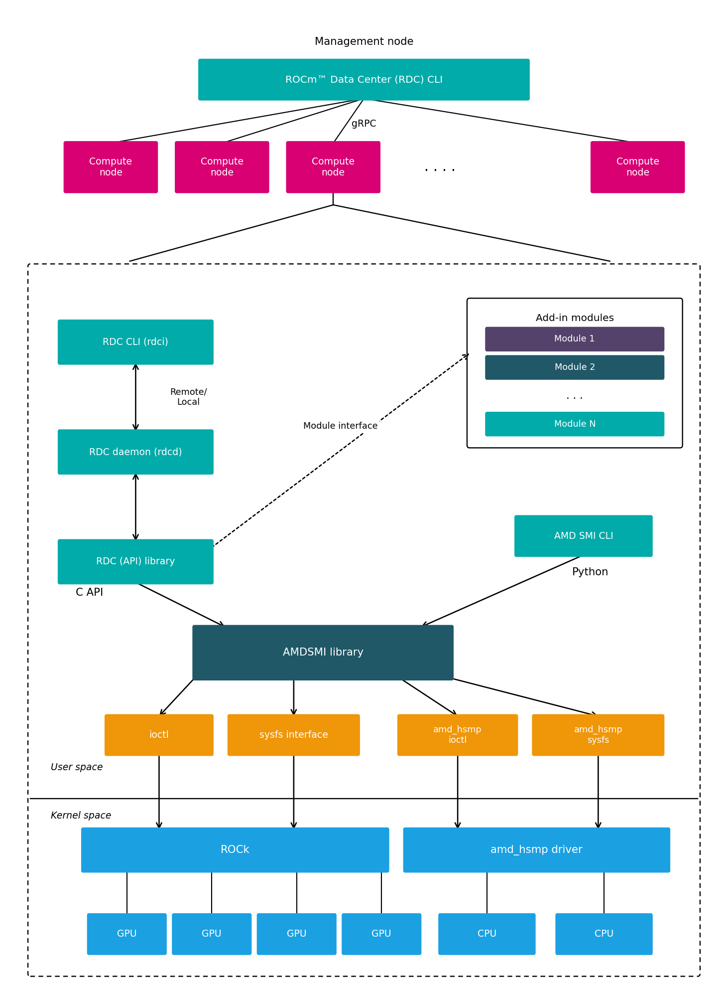

.. meta::
  :description: documentation of the installation, configuration, and use of the ROCm Data Center tool
  :keywords: ROCm Data Center tool, RDC, ROCm, API, reference, data type, support

.. _components:

***************
RDC components
***************

RDC consists of four main components: the RDC (API) library, the RDC daemon (``rdcd``), the RDC command-line tool (``rdci``), and the AMDSMI library. The following figure illustrates these components and the surrounding architecture they interact with.

    High-level diagram of RDC components and the surrounding architecture

RDC (API) library
-----------------

This library is the central piece, which interacts with different modules and provides all the features described. This shared library provides C API and Python bindings so that third-party tools should be able to use it directly if required.

RDC daemon (``rdcd``)
---------------------

The ``rdcd`` daemon records telemetry information from GPUs and CPUs. It also provides an interface to RDC command-line tool (``rdci``) running locally or remotely. It relies on the above RDC Library for all the core features.

RDC command-line tool (``rdci``)
--------------------------------

A command-line tool to invoke all the features of the RDC tool. This CLI can be run locally or remotely.

AMDSMI library
--------------

A stateless system management library that provides low-level interfaces to access GPU and CPU information.
