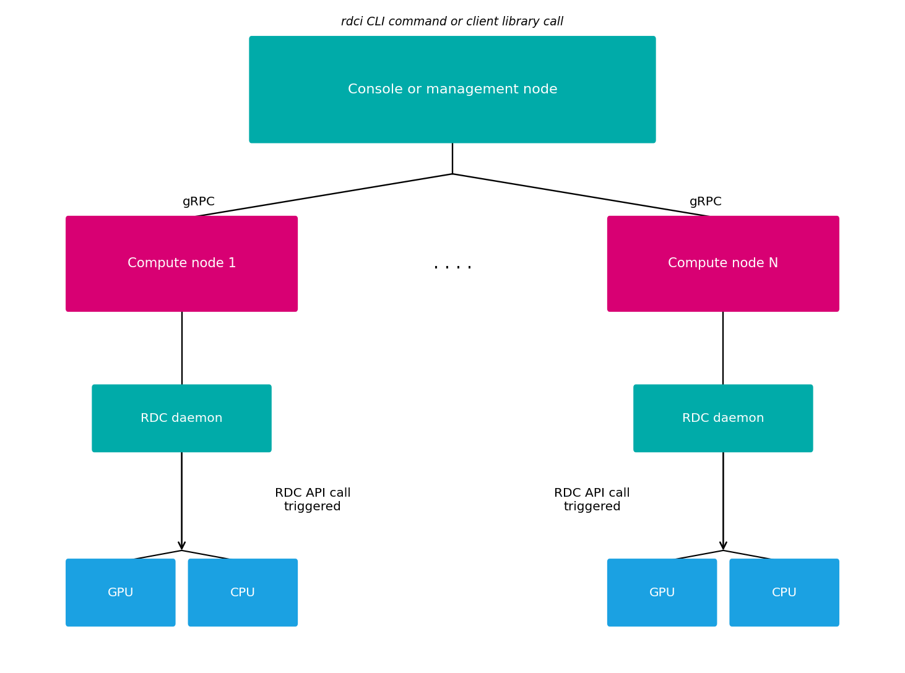
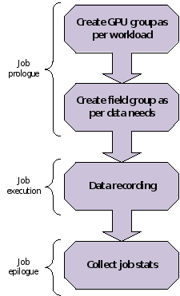

.. meta::
  :description: The ROCm Data Center tool (RDC) addresses key infrastructure challenges regarding AMD GPUs in cluster and data center environments and simplifies their administration
  :keywords: RDC features, ROCm Data Center features, RDC functionalities, ROCm Data Center functionalities

.. _rdc-features:

********************
Using RDC features
********************

This topic describes the features of the RDC tool.

Every feature described in this topic follows the same request path: you issue a ``rdci`` command, or call RDC through a client library, from the console or management node. That request travels over gRPC to the ``RDC daemon`` running on the target compute node, which then triggers the underlying ``RDC API`` call against the GPUs (and CPUs) on that node. The following figure illustrates this common path.

    Request path shared by every RDC feature: a CLI command or client library call travels from the management node, over gRPC, to the RDC daemon and API on each compute node

Discovery
==========

The discovery feature is used to locate and display information of GPUs present in the compute node.

Example:

.. code-block:: shell

    $ rdci discovery <host_name> -l
    2 GPUs found

.. list-table::

    * - **GPU index**
      - **Device information**

    * - 0
      - Name: AMD Radeon Instinct MI50 accelerator

    * - 1
      - Name: AMD Radeon Instinct MI50 accelerator

To list available GPUs, use:

.. code-block:: shell

  $ rdci -l : list available GPUs

Groups
=======

This section explains the GPU and field groups features.

GPU groups
-----------

With the GPU groups feature, you can create, delete, and list logical groups of GPU.

- To create a group, use:

  .. code-block:: shell

    $ rdci group -c GPU_GROUP
    Successfully created a group with a group ID 1

- To add GPUs to a group, use:

  .. code-block:: shell

    $ rdci group -g 1 -a 0,1
    Successfully added the GPU 0,1 to group 1

- To delete a group, use:

  .. code-block:: shell

    $ rdci group -d 1
    Successfully removed group 1

- To list groups, use:

  .. code-block:: shell

    $ rdci group –l
    1 group found

  .. list-table::

    * - **Group ID**
      - **Group name**
      - **GPU index**

    * - 1
      - GPU_GROUP
      - 0, 1

Field groups
-------------

The field groups feature provides you the options to create, delete, list field groups, and monitor specific GPU metrics.

- To create a field group, use:

  .. code-block:: shell

    $ rdci fieldgroup -c <fgroup> -f 150,155
    Successfully created a field group with a group ID 1

- To list field groups, use:

  .. code-block:: shell

    $ rdci fieldgroup -l
    1 group found

  .. list-table::

    * - **Group ID**
      - **Group Name**
      - **Field IDs**

    * - 1
      - Fgroup
      - 150, 155

- To delete a field group, use:

  .. code-block:: shell

    $ rdci fieldgroup -d 1
    Successfully removed field group 1

Monitor errors
===============

To get the Reliability, Availability, and Serviceability (RAS) Error-Correcting Code (ECC) counter, define the following fields:

- Correctable ECC errors:

  .. code-block:: shell

    600 ``RDC_FI_ECC_CORRECT_TOTAL``

- Uncorrectable ECC errors:

  .. code-block:: shell

    601 ``RDC_FI_ECC_UNCORRECT_TOTAL``

For the full list of per-IP-block ECC fields, see this :ref:`example <error-correction>`.

Device monitoring
==================

The device monitoring feature is used to monitor the GPU fields such as temperature, power usage, and utilization.

.. code-block:: shell

  $ rdci dmon -f <field_group> -g <gpu_group> -c 5 -d 1000
  1 group found

.. list-table::

    * - **GPU index**
      - **TEMP (m°C)**
      - **POWER (µW)**

    * - 0
      - 25000
      - 520500

Instead of a GPU group, you can monitor an explicit list of devices with ``-i``. A plain
number monitors a whole GPU, ``g<index>.<partition>`` monitors a single GPU partition, and
``c<index>`` (or ``c<index>.0``) monitors a CPU socket:

.. code-block:: shell

  $ rdci dmon -e <fieldIds> -i 0,g1.0,g1.1,c0

RDC also supports monitoring AMD EPYC CPUs through AMD SMI, so a single ``dmon`` invocation
can mix GPU and CPU fields and devices.

.. _job-stats:

Job stats
==========

The job stats is used to display GPU statistics for any given workload.

- To start recording stats, use:

  .. code-block:: shell

    $ rdci stats -s 2 -g 1
    Successfully started recording job 2 with a group ID 1

- To stop recording stats, use:

  .. code-block:: shell

    $ rdci stats -x 2
    Successfully stopped recording job 2

- To display job stats, use:

  .. code-block:: shell

    $ rdci stats -j 2

  .. list-table::

    * - **Summary**
      - **Executive status**

    * - Start time
      - 1586795401

    * - End time
      - 1586795445

    * - Total execution time
      - 44

    * - Energy consumed (Joules)
      - 21682

    * - Power usage (Watts)
      - Max: 49 Min: 13 Avg: 34

    * - GPU clock (MHz)
      - Max: 1000 Min: 300 Avg: 903

    * - GPU utilization (%)
      - Max: 69 Min: 0 Avg: 2

    * - Max GPU memory used (bytes)
      - 524320768

    * - Memory utilization (%)
      - Max: 12 Min: 11 Avg: 12

Job stats use case
-------------------

A common job stats use case is to record GPU statistics associated with any job or workload. The following figure illustrates how all RDC features can be put together for this use case:

    An example showing how job statistics can be recorded

Here are the ``rdci`` commands for this use case:

.. code-block:: shell

    $ rdci group -c group1

    successfully created a group with a group ID 1

    $ rdci group -g 1 -a 0,1

    GPU 0,1 is added to group 1 successfully.

    rdci stats -s 123 -g 1

    job 123 recorded successfully with the group ID

    rdci stats -x 123

    job 123 stops recording successfully

    rdci stats -j 123

    job stats printed

Error-correcting code output
=============================

In the job output, this feature prints out the Error-Correcting Code (ECC) errors while running the job.

To see the ECC correctable and uncorrectable error counters, see this :ref:`example <error-correction>`.

Diagnostic
===========

The diagnostic feature when run on a GPU group provides the following details:

.. code-block:: shell

    $ rdci diag -g <gpu_group>

    No compute process:  Pass
    Node topology check:  Pass
    GPU parameters check:  Pass
    Compute Queue ready:  Pass
    System memory check:  Pass
    =============== Diagnostic Details ==================
    No compute process:  No processes running on any devices.
    Node topology check:  No link detected.
    GPU parameters check:  GPU 0 Critical Edge temperature in range.
    Compute Queue ready:  Run binary search task on GPU 0 Pass.
    System memory check:  Max Single Allocation Memory Test for GPU 0 Pass. CPUAccessToGPUMemoryTest for GPU 0 Pass. GPUAccessToCPUMemoryTest for GPU 0 Pass.

Policy
=======

The policy feature notifies you, through a registered callback, when a GPU group exceeds a
retired-page, temperature, or power condition, and can optionally reset the GPU in response.

- To set a policy on a GPU group, use:

  .. code-block:: shell

    $ rdci policy -g <gpu_group> -T <max_temp_millidegrees> -A <action>

  Where ``-M``, ``-T``, and ``-P`` set the retired-page, temperature, and power thresholds
  respectively, and ``-A`` is the action to take when the condition triggers: ``0`` to print a
  message, or ``1`` to reset the GPU.

- To list the policies defined on a group, use:

  .. code-block:: shell

    $ rdci policy -g <gpu_group> --get

- To clear the policies defined on a group, use:

  .. code-block:: shell

    $ rdci policy -g <gpu_group> --clear

- To register ``rdci`` to listen for policy events and print them as they occur, use:

  .. code-block:: shell

    $ rdci policy -g <gpu_group> --reg
    A Temperature Limit exceeds the threshold 85 with the value 92 and triggered reset on GPU 0

Health monitoring
===================

The health feature enables and checks hardware health watches, such as PCIe, XGMI, memory,
EEPROM, and power/thermal, for a GPU group.

- To enable watches for a group, use:

  .. code-block:: shell

    $ rdci health -g <gpu_group> -s <flags>

  Where ``flags`` is one or more of the following, concatenated (for example ``pmx``):

  .. list-table::

    * - **Flag**
      - **Component**

    * - a
      - All components

    * - p
      - PCIe

    * - m
      - Memory

    * - e
      - EEPROM

    * - t
      - Power and thermal

    * - x
      - XGMI

- To fetch the current watch status, use:

  .. code-block:: shell

    $ rdci health -g <gpu_group> -f

- To check whether any errors or warnings have occurred on the currently monitored watches,
  use:

  .. code-block:: shell

    $ rdci health -g <gpu_group> -c

    Health monitor report:
    +--------------------+------------------------------------------------------------+
    | Group 1            | Overall Health: Pass                                        |
    +====================+==============================================================+
    |  GPU ID: 0         | Pass                                                        |

- To disable all watches for a group, use:

  .. code-block:: shell

    $ rdci health -g <gpu_group> --clear

Topology
=========

The topology feature shows how a GPU is connected, over PCIe or XGMI, to the other GPUs on
the node.

.. code-block:: shell

    $ rdci topo -i <gpu_index>

    +-----------------------+-----------------------------------------------+
    | GPU ID: 0             | Topology Information                           |
    +=======================+=================================================+
    +-----------------------+-----------------------------------------------+
    | To GPU 1              | Connected via XGMI                             |
    +-----------------------+-----------------------------------------------+

Link status
=============

The link feature reports whether each GPU's XGMI links are currently up, down, or disabled.

.. code-block:: shell

    $ rdci link -l

    GPUs:
        GPU:0
            U U U U U U U U

    * U:Up D:Down X:Disabled
