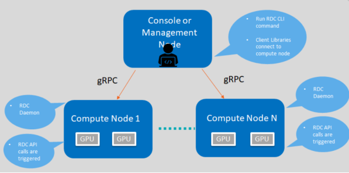
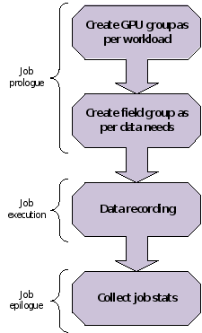

.. meta::
  :description: The ROCm Data Center tool (RDC) addresses key infrastructure challenges regarding AMD GPUs in cluster and data center environments and simplifies their administration
  :keywords: RDC features, ROCm Data Center features, RDC functionalities, ROCm Data Center functionalities

.. _rdc-features:

********************
Using RDC features
********************

This topic provides information related to the features of the RDC tool.

    RDC components and framework for describing features

Discovery
==========

The discovery feature is used to locate and display information of GPUs present in the compute node.

Example:

.. code-block:: shell

    $ rdci discovery <host_name> -l
    2 GPUs found

.. list-table::

    * - **GPU index**
      - **Device information**

    * - 0
      - Name: AMD Radeon Instinct MI50 accelerator

    * - 1
      - Name: AMD Radeon Instinct MI50 accelerator

To list available GPUs, use:

.. code-block:: shell

  $ rdci -l : list available GPUs

Groups
=======

This section explains the GPU and field groups features.

GPU groups
-----------

With the GPU groups feature, you can create, delete, and list logical groups of GPU.

- To create a group, use:

  .. code-block:: shell

    $ rdci group -c GPU_GROUP
    Successfully created a group with a group ID 1

- To add GPUs to a group, use:

  .. code-block:: shell

    $ rdci group -g 1 -a 0,1
    Successfully added the GPU 0,1 to group 1

- To delete a group, use:

  .. code-block:: shell

    $ rdci group -d 1
    Successfully removed group 1

- To list groups, use:

  .. code-block:: shell

    $ rdci group –l
    1 group found

  .. list-table::

    * - **Group ID**
      - **Group name**
      - **GPU index**

    * - 1
      - GPU_GROUP
      - 0, 1

Field groups
-------------

The field groups feature provides you the options to create, delete, list field groups, and monitor specific GPU metrics.

- To create a field group, use:

  .. code-block:: shell

    $ rdci fieldgroup -c <fgroup> -f 150,155
    Successfully created a field group with a group ID 1

- To list field groups, use:

  .. code-block:: shell

    $ rdci fieldgroup -l
    1 group found

  .. list-table::

    * - **Group ID**
      - **Group Name**
      - **Field IDs**

    * - 1
      - Fgroup
      - 150, 155

- To delete a field group, use:

  .. code-block:: shell

    $ rdci fieldgroup -d 1
    Successfully removed field group 1

Monitor errors
===============

To get the Reliability, Availability, and Serviceability (RAS) Error-Correcting Code (ECC) counter, define the following fields:

- Correctable ECC errors:

  .. code-block:: shell

    312 ``RDC_FI_ECC_CORRECT_TOTAL``

- Uncorrectable ECC errors:

  .. code-block:: shell

    313 ``RDC_FI_ECC_UNCORRECT_TOTAL``

Device monitoring
==================

The device monitoring feature is used to monitor the GPU fields such as temperature, power usage, and utilization.

.. code-block:: shell

  $ rdci dmon -f <field_group> -g <gpu_group> -c 5 -d 1000
  1 group found

.. list-table::

    * - **GPU index**
      - **TEMP (m°C)**
      - **POWER (µW)**

    * - 0
      - 25000
      - 520500

.. _job-stats:

Job stats
==========

The job stats is used to display GPU statistics for any given workload.

- To start recording stats, use:

  .. code-block:: shell

    $ rdci stats -s 2 -g 1
    Successfully started recording job 2 with a group ID 1

- To stop recording stats, use:

  .. code-block:: shell

    $ rdci stats -x 2
    Successfully stopped recording job 2

- To display job stats, use:

  .. code-block:: shell

    $ rdci stats -j 2

  .. list-table::

    * - **Summary**
      - **Executive status**

    * - Start time
      - 1586795401

    * - End time
      - 1586795445

    * - Total execution time
      - 44

    * - Energy consumed (Joules)
      - 21682

    * - Power usage (Watts)
      - Max: 49 Min: 13 Avg: 34

    * - GPU clock (MHz)
      - Max: 1000 Min: 300 Avg: 903

    * - GPU utilization (%)
      - Max: 69 Min: 0 Avg: 2

    * - Max GPU memory used (bytes)
      - 524320768

    * - Memory utilization (%)
      - Max: 12 Min: 11 Avg: 12

Job stats use case
-------------------

A common job stats use case is to record GPU statistics associated with any job or workload. The following figure illustrates how all RDC features can be put together for this use case:

    An example showing how job statistics can be recorded

Here are the ``rdci`` commands for this use case:

.. code-block:: shell

    $ rdci group -c group1

    successfully created a group with a group ID 1

    $ rdci group -g 1 -a 0,1

    GPU 0,1 is added to group 1 successfully.

    rdci stats -s 123 -g 1

    job 123 recorded successfully with the group ID

    rdci stats -x 123

    job 123 stops recording successfully

    rdci stats -j 123

    job stats printed

Error-correcting code output
=============================

In the job output, this feature prints out the Error-Correcting Code (ECC) errors while running the job.

To see the ECC correctable and uncorrectable error counters, see this :ref:`example <error-correction>`.

Diagnostic
===========

The diagnostic feature when run on a GPU group provides the following details:

.. code-block:: shell

    $ rdci diag -g <gpu_group>

    No compute process:  Pass
    Node topology check:  Pass
    GPU parameters check:  Pass
    Compute Queue ready:  Pass
    System memory check:  Pass
    Poll latency check:  Pass
    =============== Diagnostic Details ==================
    No compute process:  No processes running on any devices.
    Node topology check:  No link detected.
    GPU parameters check:  GPU 0 Critical Edge temperature in range.
    Compute Queue ready:  Run binary search task on GPU 0 Pass.
    System memory check:  Max Single Allocation Memory Test for GPU 0 Pass. CPUAccessToGPUMemoryTest for GPU 0 Pass. GPUAccessToCPUMemoryTest for GPU 0 Pass.
    Poll latency check:  Read 9 fields from 1 GPU 20 times, 100 ms apart: median 2.04 ms, p95 2.10 ms, max 2.11 ms per poll. 180 values read, 0 failed, 0 not supported.
     Device 0 median 2.04 ms, max 2.11 ms per read; 180 values read, 0 failed, 0 not supported

The poll latency check measures how long RDC takes to read telemetry from the
GPUs. It reads the fields that GPU monitoring polls most (GPU clock,
temperatures, power, utilization, memory usage and ECC error counts) from every
GPU in the group 20 times, 100 ms apart, with the code that ``rdcd`` uses to
update the fields it watches. It reports the median, 95th percentile and
maximum time to read all GPUs once (a poll), and the median and maximum time to
read each GPU. The check warns when a value cannot be read or when a poll takes
longer than 100 ms, and fails when no value can be read. Fields that a GPU does
not support are counted, but are not a warning.

To change the number of polls or the time between them, run the check with the
``rdc_test_case_run()`` API, the ``RDC_DIAG_POLL_LATENCY`` test case and a
configuration such as ``samples=50;interval_ms=1000``. ``samples`` accepts 1 to
1000, and ``interval_ms`` accepts 0 to 60000, where 0 polls back to back. A run
can take at most an hour: ``samples`` times ``interval_ms`` must not exceed
3600000.
