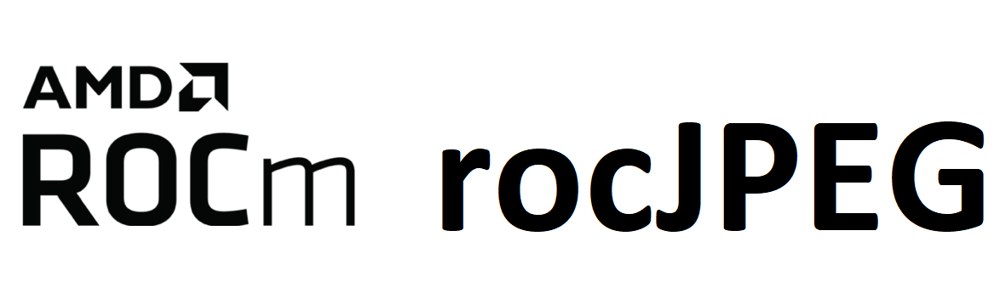

[](https://opensource.org/licenses/MIT)

<p align="center"></p>

rocJPEG is a high performance JPEG decode SDK for AMD GPUs. Using the rocJPEG API, you can access the JPEG decoding features available on your GPU.

> [!NOTE]
> The published documentation is available at [rocJPEG](https://rocm.docs.amd.com/projects/rocJPEG/en/latest/) in an organized, easy-to-read format, with search and a table of contents. The documentation source files reside in `projects/rocjpeg/docs` in this repository. As with all ROCm projects, the documentation is open source. For more information on contributing to the documentation, see [Contribute to ROCm documentation](https://rocm.docs.amd.com/en/latest/contribute/contributing.html).

## Supported JPEG chroma subsampling

* YUV 4:4:4
* YUV 4:4:0
* YUV 4:2:2
* YUV 4:2:0
* YUV 4:0:0

## Supported platforms

* **Linux** (Ubuntu 22.04 / 24.04)
* **Windows** (Windows 11) — via the VA-API on D3D12 (vaon12) backend

> [!IMPORTANT]
> Hardware JPEG decoding is not yet available on Windows. The vaon12 driver does not currently
> expose the JPEG baseline profile (`VAProfileJPEGBaseline`), because the AMD D3D12 video driver does
> not expose JPEG decode profiles and Mesa's D3D12 video driver has no JPEG decoder. As a result,
> `rocJpegCreate` with `ROCJPEG_BACKEND_HARDWARE` returns `ROCJPEG_STATUS_HW_JPEG_DECODER_NOT_SUPPORTED`
> on Windows, and `rocJpegGetDecoderCaps` on the returned handle returns `ROCJPEG_STATUS_NOT_INITIALIZED`.
> The library builds, installs, and loads on Windows, and the stream parsing APIs
> (`rocJpegStreamCreate`, `rocJpegStreamParse`, `rocJpegStreamDestroy`) are available.

## Prerequisites

### Hardware
* **GPU**: [AMD Radeon&trade; Graphics](https://rocm.docs.amd.com/projects/install-on-linux/en/latest/reference/system-requirements.html) / [AMD Instinct&trade; Accelerators](https://rocm.docs.amd.com/projects/install-on-linux/en/latest/reference/system-requirements.html)

> [!IMPORTANT]
> `gfx908` or higher GPU required

### ROCm via TheRock

rocJPEG is built and installed as part of [TheRock](https://github.com/ROCm/TheRock). All core dependencies are provided by the TheRock build, including:

* HIP runtime and development libraries
* AMD Clang++ compiler (C++17 required)
* Libva and VA-API drivers
* Libdrm (amdgpu)
* CMake and pkg-config

### Windows additional dependencies

On Windows, rocJPEG uses the [vaon12](https://devblogs.microsoft.com/directx/video-acceleration-api-va-api-now-available-on-windows/) backend (Mesa's VA-API on D3D12 translation layer). The vaon12 driver and libva are provided by TheRock for Windows under `%ROCM_PATH%\lib\rocm_sysdeps`; no separate download is required. The following additional tools are needed:

* **Visual Studio 2022** version 17.13 or later with the C++ desktop workload (MSVC 19.43+, C++17).
  Earlier toolsets fail at link time because ROCm's prebuilt libraries reference C++ standard library
  internals introduced in MSVC 19.43 (see [TheRock Windows support](https://github.com/ROCm/TheRock/blob/main/docs/development/windows_support.md)).
* **CMake** 3.21 or later (the `Visual Studio 17 2022` generator requires 3.21)
* **Windows SDK**

## Build and install

rocJPEG is built as part of [TheRock](https://github.com/ROCm/TheRock) on both Linux and Windows. To build standalone from source:

### Linux

```shell
git clone https://github.com/ROCm/rocm-systems.git
cd rocm-systems/projects/rocjpeg
mkdir build && cd build
cmake ../
make -j8
sudo make install
```

### Windows

```bat
git clone https://github.com/ROCm/rocm-systems.git
cd rocm-systems\projects\rocjpeg
mkdir build && cd build
set ROCM_PATH=<path-to-TheRock-build>
cmake ..
cmake --build . --config Release
cmake --install . --config Release
```

> [!NOTE]
> * Set `ROCM_PATH` as an environment variable and use the same command prompt for the steps
>   below. CMake reads it from the environment, so no `-DROCM_PATH` is needed. Keep it set: libva
>   reads it at run time to locate the VA-API driver, and the test and sample commands below expand
>   `%ROCM_PATH%`.
> * The library is compiled with MSVC. The HIP color conversion kernels are compiled separately with
>   `%ROCM_PATH%\lib\llvm\bin\amdclang++.exe` for each GPU in `GPU_TARGETS` and linked into
>   `rocjpeg.dll`. Pass `-DGPU_TARGETS=<gfx...>` (for example, `-DGPU_TARGETS=gfx1035`) to build only
>   for your GPU and shorten the build.
> * `BUILD_TESTS=ON` and `ROCJPEG_ENABLE_ROCPROFILER_REGISTER` are ignored on Windows. Build the
>   samples from `%ROCM_PATH%\share\rocjpeg\samples` after installing instead.
> * rocJPEG loads `rocm_sysdeps_va_win32.dll` and `rocm_sysdeps_va.dll` at run time from
>   `%ROCM_PATH%\lib\rocm_sysdeps\bin`, so that directory does not need to be on `PATH`.

### Run tests

  **Linux:**

  ```shell
  make test
  ```

  **Windows:**

  Before running tests or samples, add `%ROCM_PATH%\bin` to your `PATH` so that executables can
  locate `rocjpeg.dll` and the HIP runtime DLL. `ROCM_PATH` must stay set as well, so that libva can
  locate the VA-API driver:

  ```bat
  set PATH=%ROCM_PATH%\bin;%PATH%
  ctest -C Release
  ```

  > [!NOTE]
  > To run tests with verbose output, use `ctest -VV` on Windows (with `-C Release`), or `make test ARGS="-VV"` on Linux.

  > [!IMPORTANT]
  > Because hardware JPEG decoding is not yet available on Windows, the decode tests are reported
  > as skipped when `rocJpegCreate` returns `ROCJPEG_STATUS_HW_JPEG_DECODER_NOT_SUPPORTED` (any other
  > failure still fails the test). `jpeg-decode-caps` and `jpeg-negative-api-tests` run and pass;
  > the negative API test skips only its decoder-handle cases.

## Verify installation

After installation, the following files are available:

**Linux:**

* Libraries in `/opt/rocm/lib`
* Header files in `/opt/rocm/include/rocjpeg`
* Samples in `/opt/rocm/share/rocjpeg`
* Documents in `/opt/rocm/share/doc/rocjpeg`

**Windows:**

* Library `rocjpeg.dll` in `%ROCM_PATH%\bin` and import library `rocjpeg.lib` in `%ROCM_PATH%\lib`
* Header files in `%ROCM_PATH%\include\rocjpeg`
* CMake package files in `%ROCM_PATH%\lib\cmake\rocjpeg`
* Samples, test images, and the CTest project in `%ROCM_PATH%\share\rocjpeg` (`samples`, `images`, `test`)

### Using sample application

To verify your installation using a sample application, run:

**Linux:**

```shell
mkdir rocjpeg-sample && cd rocjpeg-sample
cmake /opt/rocm/share/rocjpeg/samples/jpegDecode/
make -j8
./jpegdecode -i /opt/rocm/share/rocjpeg/images/mug_420.jpg
```

**Windows:**

```bat
set ROCM_PATH=<path-to-rocm-installation>
set PATH=%ROCM_PATH%\bin;%PATH%
mkdir rocjpeg-sample && cd rocjpeg-sample
cmake "%ROCM_PATH%\share\rocjpeg\samples\jpegDecode"
cmake --build . --config Release
Release\jpegdecode.exe -i "%ROCM_PATH%\share\rocjpeg\images"
```

> [!NOTE]
> The samples don't need FFmpeg. Until hardware JPEG decoding is available on Windows, `jpegdecode`
> stops when `rocJpegCreate` fails. To check JPEG decode support on your GPU, build
> `%ROCM_PATH%\share\rocjpeg\samples\jpegDecodeCaps` the same way and run `Release\jpegdecodecaps.exe`
> with no arguments; it currently reports that JPEG decoding is not available on Windows.

### Using CTest

To verify your installation using CTest, run:

**Linux:**

```shell
mkdir rocjpeg-test && cd rocjpeg-test
cmake /opt/rocm/share/rocjpeg/test/
ctest -VV
```

**Windows:**

```bat
set ROCM_PATH=<path-to-rocm-installation>
set PATH=%ROCM_PATH%\bin;%PATH%
mkdir rocjpeg-test && cd rocjpeg-test
cmake "%ROCM_PATH%\share\rocjpeg\test"
ctest -C Release -VV
```

> [!NOTE]
> `-C Release` is required with the multi-config Visual Studio generator.

## Samples

You can access samples to decode your images in the
[samples](https://github.com/ROCm/rocm-systems/tree/develop/projects/rocjpeg/samples) directory. Refer to the
individual folders to build and run the samples.

## Tested configurations

* Linux
  * Ubuntu - `22.04` / `24.04`
* Windows
  * Windows 11 - build `26100`
* [TheRock](https://github.com/ROCm/TheRock) - `7.12` or later
