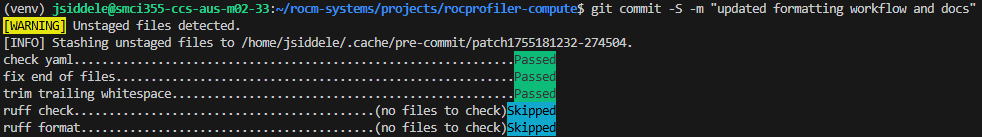

# Contributing to ROCm Compute Profiler

## Getting Started

ROCm Compute Profiler lives under `projects/rocprofiler-compute` in the [ROCm Systems super-repo](https://github.com/ROCm/rocm-systems). To set up your local environment, follow the [clone and setup instructions](https://github.com/ROCm/rocm-systems/blob/develop/CONTRIBUTING.md#getting-started) in the rocm-systems CONTRIBUTING.md. Sparse checkout is recommended for most contributors.

## Reporting Issues and Bugs

- Search [existing issues](https://github.com/ROCm/rocm-systems/issues) before filing a new one — your bug may already be tracked.
- If you don't find an existing issue, [open a new one](https://github.com/ROCm/rocm-systems/issues/new) with a clear description of the problem and steps to reproduce it.

## Submitting a Pull Request

Follow the [pull request guidelines](https://github.com/ROCm/rocm-systems/blob/develop/CONTRIBUTING.md#pull-request-guidelines) in the rocm-systems CONTRIBUTING.md.

> **Note for external contributors:** Please refer to the [ROCm contribution guide](https://rocm.docs.amd.com/en/develop/contribute/contributing.html) for instructions on contributing from a fork.

### Review and Labeling

Labels and reviewer assignments are handled automatically based on the files you've changed. Reviewers for `projects/rocprofiler-compute` are defined in the top-level [CODEOWNERS](https://github.com/ROCm/rocm-systems/blob/develop/CODEOWNERS) file.

### CI Requirements

All pull requests must pass CI checks before merging. For `rocprofiler-compute`, these currently include compilation checks, with correctness and performance tests being added over time. See the [CI documentation](https://github.com/ROCm/rocm-systems/blob/develop/docs/continuous-integration.md) for a full breakdown of what runs on each PR.

> [!TIP]
> Run our pre-commit hooks locally before pushing to catch formatting issues early. See [Using Pre-Commit Hooks](#using-pre-commit-hooks) below for setup instructions.

## Adding or Changing Command-Line Options

Follow these rules for every new or changed option in
[`src/argparser.py`](src/argparser.py) and any other user-facing CLI.

### Filtering

Filter options match with **glob patterns** by default (`fnmatch`), not regex.
Glob covers most filtering cases and is much easier for users to write.

```console
rocprof-compute --select-kernel '*my-kernel*'
```

Regex may be offered **in addition** to glob where it is genuinely needed, never
as the replacement.

### Naming

An option that is only valid together with another option must be named with
that option as a prefix.

```text
--pc-sampling --pc-sampling-method stochastic
```

If an option already exists with the same meaning in another mode,
keep its name. Don't add a prefix. For example, an `--example-ids`
filter in `profile` is also `--example-ids` in `analyze`.

Options that belong to one feature share its name as a prefix even when they can
be used on their own, such as `--roofline-device`.

Frequently used options get a short alias: a single lowercase letter with a
single dash, such as `-v`.

Options are named for what they enable, not what they disable: use
`--roofline`, not `--no-roofline`.

### Arguments

To pass several values, list them after the flag, separated by spaces:

```text
--example-ids 0 1 2
```

Don't split values on commas, so that a value can contain a comma.

### Help Messages

Always set `metavar` so the help shows what the option takes. Never leave it
empty (`metavar=""`).

- If the value is required, use `metavar="<arg>"`.
- If the value is optional (`nargs="?"` or `nargs="*"`), use `metavar="arg"`.
  The help adds the `[]` automatically.

`CliHelpFormatter` adds `...` to options that take a list, so `<args>` shows as
`<args>...` and `args` shows as `[args]...`.

For an option that takes an argument, the help message follows these rules:

| Case | Notation |
|------|----------|
| Required argument | `<arg>` |
| Optional argument | `[arg]` |
| Array of required arguments | `<args>...` |
| Array of optional arguments | `[args]...` |

An argument with a fixed set of accepted values sets `choices`, so that argparse
rejects any other value, and its help ends with `Values: %(choices)s`. An
argument with a default states it at the end of the description as
`(Default: value)`.

```text
--option <arg>   Description of the option (Default: value).
                 Values: <value1>, <value2>, ..., <valueN>
```

### Renaming and Deprecation

A renamed option must keep its old name working for now. Add the old name as an
extra option string of the new option, keep the same `dest`, and declare the
option with `DeprecatedAction`, the `base_action` it used before, and the old name
in `deprecated_names`:

```python
roofline_group.add_argument(
    "--roofline-device",
    "--device",
    dest="device",
    action=DeprecatedAction,
    base_action="store",
    deprecated_names=["--device"],
    help="Target GPU device ID per amd-smi for roofline benchmarking (Default: 0).",
)
```

The help then lists `--device` as a deprecated alias, and using `--device` prints
a warning that names `--roofline-device`.

To deprecate an option without a rename, declare it with `DeprecatedAction` and
leave out `deprecated_names`. Set `advice` to say what to use instead, if
anything. Its help then starts with `DEPRECATED:`.

Every rename also needs these updates:

- Add the new name to `CHANGELOG.md` under "Changed"
- Add the old name to `CHANGELOG.md` under "Upcoming changes", since it will be removed later

An experimental option may be renamed or removed without keeping the old name
working, but the change still needs a `CHANGELOG.md` entry.

### Adding Experimental Features

New features that aren't yet stable can be introduced behind the `--experimental` flag. This lets users opt in to preview functionality while keeping the default experience stable.

#### How It Works

The `--experimental` flag acts as a master toggle:

- Experimental options are **hidden** from help output unless `--experimental` is passed.
- Attempting to use an experimental flag without `--experimental` raises a clear error.
- A warning is displayed when an experimental feature is active.

To see available experimental features:

```bash
rocprof-compute profile --experimental --help
```

#### Adding a New Experimental Feature

Follow these three steps to add a new experimental flag.

**Step 1 — Register it in the `--experimental` help text**

In `src/argparser.py`, update the `add_general_group()` function:

```python
general_group.add_argument(
    "--experimental",
    action="store_true",
    default=False,
    help=(
        "Enable experimental feature(s):\n"
        "   Your feature name (--your-flag)\n"  # Add this line
    ),
)
```

**Step 2 — Add the argument using `ExperimentalAction`**

Add your flag to the relevant parser group (profile, analyze, etc.):

```python
# For a flag that accepts a value
profile_group.add_argument(
    "--your-flag",
    dest="your_flag",
    required=False,
    default=None,
    action=ExperimentalAction,
    experimental_enabled=experimental_enabled,
    feature_label="Your feature name",
    base_action="store",  # Required — see supported actions below
    type=str,
    nargs="*",
    metavar="values",
    help="Description of your feature",
)

# For a boolean toggle flag
analyze_group.add_argument(
    "--your-flag",
    dest="your_flag",
    required=False,
    default=False,
    action=ExperimentalAction,
    experimental_enabled=experimental_enabled,
    feature_label="Your feature description",
    base_action="store_true",  # Required — see supported actions below
    help="Description of your feature",
)
```

The `base_action` parameter is required. The option takes the same arguments as
`add_argument` with that action, and must be one of:

| Value | Behavior |
|---|---|
| `store` | Store a value (standard argparse default) |
| `store_const` | Store a fixed constant; consumes no arguments |
| `store_true` | Store `True` when the flag is present |
| `store_false` | Store `False` when the flag is present |
| `append` | Append each value to a list |
| `append_const` | Append a constant to a list |
| `count` | Count occurrences (e.g. `-vvv`) |
| `extend` | Extend a list with multiple values |

**Step 3 — Verify behavior**

Confirm the flag is hidden without `--experimental` and visible with it:

```bash
# Should not appear
rocprof-compute profile --help

# Should appear with EXPERIMENTAL: prefix
rocprof-compute profile --experimental --help
```

#### Promoting a Feature to Stable

When a feature is ready for general availability:

1. Remove it from the `--experimental` help text in `src/argparser.py`.
2. Replace `action=ExperimentalAction` with a standard argparse action (e.g. `action="store"`).
3. Remove the `experimental_enabled`, `feature_label`, and `base_action` parameters.
4. Update documentation and tests accordingly.

### Adding Debug Options

Debug options help troubleshoot rocprof-compute itself. Like experimental options,
they are hidden from help output unless `--debug` is passed. Unlike experimental
options, they work without `--debug`. The
[analyze CLI documentation](docs/how-to/analyze/cli.rst#debug-options) describes
them for users.

#### Adding a New Debug Option

**Step 1 — Add the argument using `DebugAction`**

In `src/argparser.py`, name the option `--debug-<name>` and add it to the
Debug Options group of its mode, such as `analyze_debug_group` for analyze.

```python
analyze_debug_group.add_argument(
    "--debug-your-option",
    action=DebugAction,
    debug_enabled=debug_enabled,
    base_action="store_true",  # Required — same values as ExperimentalAction
    help="Description of your option.",
)
```

**Step 2 — Verify behavior**

```bash
# Should not appear
rocprof-compute analyze --help

# Should appear
rocprof-compute analyze --debug --help
```

## Using Pre-Commit Hooks

Pre-commit hooks automatically check your code for formatting issues before each commit, helping you catch problems before they reach CI.

**Setup:**

First, install [development dependencies](README.md#development-dependencies), then enable the hooks:

```bash
cd rocprofiler-compute
pre-commit install
```

Once installed, every commit will run the configured checks automatically:



See the [pre-commit documentation](https://pre-commit.com/#quick-start) for more details.

## Code Style and Formatting

ROCm Compute Profiler uses [Ruff](https://docs.astral.sh/ruff/) for linting and formatting. All contributions to `src/` must pass Ruff checks before merging. Pre-commit hooks handle this automatically.

**Style references:**

| Topic | Source of Truth |
|-------|-----------------|
| Function design, naming, code organization | [Python Coding Style Guidelines](PYTHON_CODING_STYLE.md) |
| C++ and CMake conventions | [C++ Coding Style Guidelines](CPP_CODING_STYLE.md) |
| Ruff configuration (enforced rules, ignores, formatting) | [`pyproject.toml`](pyproject.toml) |
| YAML metric equation formatting | [YAML Metric Equation Formatting](#yaml-metric-equation-formatting) |

### Running Ruff Manually

```bash
# Check for issues
ruff check .
ruff format --check .

# Auto-fix most issues
ruff check --fix .
ruff format .
```

### YAML Metric Equation Formatting

Metric equations in YAML config files follow a canonical format. The canonical
implementation is `normalize_equation()` in
[`src/utils/metrics/expression.py`](src/utils/metrics/expression.py), which
[`tools/format_yaml.py`](tools/format_yaml.py) runs on the YAML files.

**Scope.** Equation formatting applies to the metric library,
`src/rocprof_compute_soc/metric_library/<arch>/*.yaml`, including `collectables.yaml`.
Only values under `formula`, `peak` and `peak_empirical` are equations.

**Rules.**

- Operator spacing: each binary operator (`+`, `-`, `*`, `/`) has one space on each
  side, as in `SUM(x) / SUM(y)`.
- Constant factoring: a number that multiplies the single argument of an aggregation
  (`SUM`, `AVG`, `MIN`, `MAX`) moves out of the call, so `SUM(x * 128)` becomes
  `128 * SUM(x)`. A sum or a quotient inside an aggregation stays as written.
- Minimal parentheses: the formatter removes parentheses that operator precedence
  makes redundant, so `(a + b) + c` becomes `a + b + c`. A right operand of the same
  precedence keeps its parentheses, and so does an operand whose parentheses change
  the order of evaluation. `a - (b - c)`, `a + (b + c)` and `(a + b) * c` stay as
  written.
- Unary minus: a minus sign before an operation keeps its parentheses, so `-(a + b)`
  does not become `-a + b`.
- Left as written: the formatter does not parse per-channel templates such as
  `TCC_HIT[::_1]`. A cell without a value is written `None`.

The formatter reports each equation that it cannot parse, such as one with an
unknown character, an unmatched parenthesis or a missing operand. The report gives
the key of the equation and the parser message. The formatter leaves the equation
unchanged, so fix it by hand.

**Enforcement.** The `yaml-format-fix` pre-commit hook runs
`tools/format_yaml.py --fix` on staged metric library files and auto-corrects equations
in place. Re-stage the modified files and commit again.

```bash
# Report equations that need formatting
python tools/format_yaml.py --check src/rocprof_compute_soc/metric_library/gfx950/*.yaml

# Show proposed changes
python tools/format_yaml.py --diff src/rocprof_compute_soc/metric_library/gfx950/*.yaml

# Auto-fix in place
python tools/format_yaml.py --fix src/rocprof_compute_soc/metric_library/gfx950/*.yaml
```

`tests/unit/utils/metrics/test_expression.py` tests the canonical format, and
`tools/test_format_yaml.py` tests the formatter.

## Documentation Changes

For instructions on building and testing changes to files under the `docs/` folder, see the [ROCm documentation contributing guide](https://rocm.docs.amd.com/en/latest/contribute/contributing.html).

## Writing Style

These rules cover how sentences read in documentation, code comments, docstrings, commit messages, pull request descriptions, and design documents. They cover the language only, not what to write. Plain sentences make review faster.

### Rules

- Write short sentences. Give each sentence one idea.
- Put the subject and the main verb first. Do not open a sentence with a long clause.
- Add extra detail in a "which" clause or in a second sentence.
- Use ordinary words. Avoid jargon such as "rolls up to".
- Use the domain word when one exists, such as "aggregate" instead of "add up".
- Say what happens, not how the code makes it happen.
- Reuse the terms that the user docs already define. Define any new term the first time you use it.
- Name the concrete thing, such as "per-kernel ISA CSV" or "source line". Do not write a bare "row", "line", "file", or "it" when the reader cannot tell which one you mean.
- Call a metric a "metric", not a "row".
- When classes with similar names exist in several modules, qualify each with its module, for example `analysis_orm.InstructionLine` and `pc_sampling_analysis.InstructionLineRecord`.
- Write grammatical sentences, not fragments.
- Do not stack nouns. Turn the stack into a sentence with a verb.
- Do not end a relative clause with a preposition. Rewrite "the X that Y gave Z" as "X with Z" or "X without Z".
- Keep the normal order of subject, verb, and object.
- Put one point in each bullet, also inside note boxes in `.rst` files.
- Join ideas with periods, commas, parentheses, or colons. Do not use em dashes or en dashes. Hyphens in compound words are fine.

### Examples

**Long clause before the verb**

- Bad: "Where ROCm Compute Profiler runs, for example on the host when the process is in a container, use the ROCprofiler-SDK from the same ROCm release as ROCm Compute Profiler or a newer one."
- Good: "ROCm Compute Profiler needs ROCprofiler-SDK from the same ROCm release, or a newer one."

**How instead of what**

- Bad: "`_` is left out of the safe set so a run of them collapses to the one replacing it."
- Good: "Consecutive underscores are collapsed into one."

**Relative clause ending in a preposition**

- Bad: `Skip the rows that "?" frames are stored as.`
- Good: `Skip "?" frames, which are stored without a line number.`

**Relative clause with two objects**

- Bad: "the instructions that the compiler gave no line number"
- Good: "instructions without a source line number"

**Inverted order**

- Bad: "A source line's counts add up the instructions whose inline stack names it."
- Good: "The counts of a source line are the sums over all instructions whose inline stack includes that source line."

**Noun stack**

- Bad: "RDNA 3.5 and RDNA 4 specs with GL1 count and GDDR channel fields."
- Good: "Specs of RDNA 3.5 and RDNA 4 GPUs. They also hold the number of GL1 caches and of GDDR channels."

## Writing for Users

Customers read `docs/how-to/`, `CHANGELOG.md`, and the CLI help.

- Write short, complete sentences in plain English. Say what the user sees and what to do.
- Leave out internals such as marker formats, class names, and processing steps. Put those in `docs/design/`.
- Add a changelog entry only for a change users can notice: a new or changed option, output, or requirement, or a fixed bug they could hit. Skip tests, samples, refactors, and dropped support for older workloads.

## Metrics Management

If your PR changes a metric (`src/rocprof_compute_soc/metric_library/<arch>/*.yaml`) or
what a panel shows (`src/rocprof_compute_soc/views/<arch>/*.yaml`), review and stage the
files the `metric-config-check` pre-commit hook regenerates, as the
[metric config management README](./tools/config_management/README.md) describes.

A metric whose counters do not fit one profiling pass is split into collectables. The [metric library README](./src/rocprof_compute_soc/metric_library/README.md#collectables) explains how.

### Metric Library

The metric library in `src/rocprof_compute_soc/metric_library/` defines each metric once per architecture. See the [metric library README](./src/rocprof_compute_soc/metric_library/README.md) for its layout, inheritance and checks, and its [description rules](./src/rocprof_compute_soc/metric_library/README.md#descriptions) before writing a metric description.

## Memory Chart Layouts

The memory chart is drawn from one JSON layout per architecture family. To add or change a layout, see the [memory chart layouts README](./src/memory_chart/README.md).

`tools/test_memory_chart_layout_format.py` and `tools/test_memory_chart_preview.py` test the layout formatter and the preview script.

## Analysis Database Schema Diagrams

The two diagrams in the [analysis data dump docs](docs/how-to/analyze/cli.rst) are
generated from [`src/utils/analysis_orm.py`](src/utils/analysis_orm.py), not drawn
by hand. If your PR changes a table, column, foreign key, or a view definition in
`Database._compile_view_sql`, regenerate them and commit the PNGs:

```bash
./tools/schema_visualizer.py
```

This requires the Graphviz `dot` binary (`apt install graphviz`). The tool reads
the ORM metadata for the schema diagram, and materializes the views in a
throwaway database to read back their real columns for the views diagram, so
neither diagram can drift from the code. Do not edit the PNGs by hand.

`tools/test_schema_visualizer.py` tests the diagram generator.

## Instruction Execution Pipeline Table

[`src/pc_sampling/instruction_pipelines.yaml`](src/pc_sampling/instruction_pipelines.yaml)
is generated, not written by hand. Rerun the generator when a new GPU family
needs support, or when an instruction shows up with an empty type in analyze,
and commit the regenerated file as is:

```bash
./tools/instruction_pipeline_generator.py
```

This requires `llvm-tblgen` and `llvm-objdump` from ROCm (set `ROCM_PATH` if
they are not under `/opt/rocm`) and network access. Do not edit the YAML by
hand.

`tools/test_instruction_pipeline_generator.py` tests the generator.

## Vendoring External Dependencies

rocprofiler-compute vendors certain Python dependencies (via git submodules) to eliminate external dependencies in profile mode. This improves portability and reliability on HPC systems.

**We vendor:**
- Pure Python packages used in profile code path
- Stable packages with permissive licenses

For detailed vendoring workflow (adding/updating packages), see [`src/vendored/README.md`](./src/vendored/README.md).

## AI Agent Guidelines

This project uses AI coding assistants (Claude Code, Cursor, GitHub Copilot). All AI-specific guidelines live in [`AGENTS.md`](AGENTS.md), which serves as the single source of truth. Tool-specific adapter files (e.g., `CLAUDE.md`, `.github/copilot-instructions.md`) reference `AGENTS.md` without duplicating content.

To add or update AI guidelines, edit the appropriate file under `.ai/` and add a reference in `AGENTS.md`.

## Profile Mode Dependency Policy

Profile mode code should not use non-standard Python libraries.

### Why This Matters

Profile mode uses only stdlib to:
1. **Avoid dependency conflicts** - Users can profile without creating virtual environments or worrying about package version conflicts with their own projects
2. **Work everywhere** - No `pip install` needed:
   - HPC systems with locked-down Python environments
   - Security-sensitive systems requiring minimal dependencies
   - Any system with Python 3.8+ installed

### Enforcement

**Python Version Requirement:**
- Import enforcement requires Python 3.10+ (uses `sys.stdlib_module_names`)
- Python 3.8-3.9: Tests run but import enforcement is disabled (warning issued)
- CI uses Python 3.10+ to ensure full enforcement coverage

Enforcement is automatically done for tests which execute profile pipeline using main
function instead of subprocess (unlike multi mpi rank tests).
These tests are automatically protected by guards in `tests/conftest.py` when testing with Python 3.10 and above.
The guard intercepts ALL imports (direct, nested, dynamic) and fails tests immediately if
non-stdlib packages are imported.

Only integration tests use `ProfileModeImportGuard`. Unit tests don't check
profile-mode imports.

### What's Allowed

**Python standard library** (Python 3.8+):
- `json`, `csv`, `sqlite3`, `subprocess`, `pathlib`, `logging`, `sys`, `os`, etc.

**Project modules**:
- `rocprof_compute`, `utils`, `ml_api_tracing`, `vendored.*`, `roofline`, `config`, `argparser`

**ROCm system libraries** (bundled with ROCm, not pip packages):
- `amdsmi` - AMD System Management Interface
- `hip` - HIP runtime Python bindings
- `rocprofv3` - rocprofv3 Python bindings

### What's NOT Allowed

These are forbidden in profile mode

**External packages**:
- `pandas`, `yaml`, `numpy`, `plotly`, etc.
- Anything from `requirements.txt`

### Common Mistakes

**Don't do this in profile code:**
```python
import pandas  # External package
import yaml    # Use json or vendored.pyyaml instead
import numpy   # Use stdlib math/statistics
```

**Do this instead:**
```python
import json              # Stdlib for config/data
import csv               # Stdlib for CSV operations
import sqlite3           # Stdlib for data manipulation
from vendored.pyyaml import yaml  # Vendored package (if needed)
```

### If Your Test Fails

**Error message:**
```
PROFILE MODE DEPENDENCY VIOLATION
Forbidden package: pandas
```

**How to fix:**

1. **Move import to analyze mode**
   - Move the import and relevant code to analysis mode

2. **Use stdlib alternative**
   - `pandas` → `csv` module + `sqlite3` for dataframes
   - `yaml` → `json` module (or `vendored.pyyaml` if YAML required)
   - `numpy` → `math`/`statistics` modules
