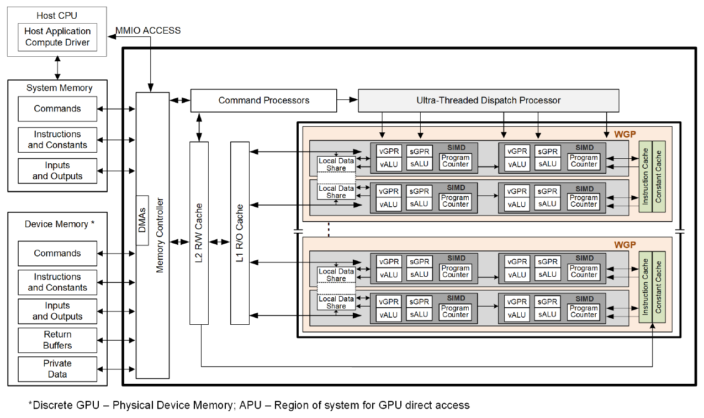
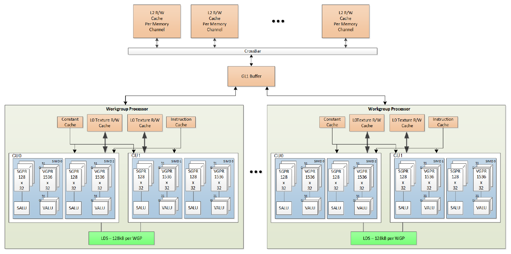

.. meta::
   :description: Understand the AMD RDNA4 architecture and hardware blocks with ROCm Compute Profiler to analyze and optimize performance on AMD Radeon GPUs.
   :keywords: ROCm Compute Profiler, RDNA, RDNA4, gfx1201, Navi 48, Radeon, ROCm

.. _rdna4-performance-model:

********
RDNA4
********

ROCm Compute Profiler makes available an extensive list of metrics to better understand achieved application performance on RDNA4 architecture-based AMD Radeon™ GPUs like the AMD Radeon RX 9070 XT (Navi 48, gfx1201).

To best use the profiling data, it's important to understand the role of various hardware blocks of AMD RDNA4 architecture. Refer to the following top-level block diagram to understand the hardware blocks of RDNA4 architecture.

ALUs, instruction cache, and constant cache
   :align: center

   AMD RDNA4 generation series block diagram (RDNA4 ISA, Figure 1).

For more details on AMD RDNA4 architecture, see section 1.2 of the `RDNA4 instruction set architecture <https://gpuopen.com/download/rdna4-instruction-set-architecture.pdf#page=16>`__.

.. Note::

   * For top-level metrics details on CDNA and RDNA architecture, see :doc:`../performance-model`.

   * For details on metrics available for CDNA-CDNA4 architecture-based Instinct GPUs, see :doc:`../cdna/cdna-performance-model`.

   * For RDNA3.5 architecture-based Ryzen APUs (gfx115x), see :doc:`../rdna/rdna-performance-model`.

ROCm Compute Profiler includes analysis panels targeting RDNA4 parts reporting as
gfx1201. Navi 48 is a discrete GPU with dedicated device memory.

Memory hierarchy in the tool
==============================

The RDNA4 ISA describes the device memory read path as multiple channels of L2
cache that provide data to read-only L1 caches, and finally to L0 caches per WGP.
The figure below shows the memory hierarchy available to each work-item.

per WGP
   :align: center

   RDNA4 shared memory hierarchy (RDNA4 ISA, Figure 2).

See section 1.2.2 of the `RDNA4 instruction set architecture <https://gpuopen.com/download/rdna4-instruction-set-architecture.pdf#page=17>`__.

GL1 is the write-combining cache between the WGPs and GL2. The ISA describes it
as "the first-level (GL1) for write-combining cache (collect scatter and store
operations and combine them to provide good access patterns to memory)". Figure 2
labels this cache GL1 Buffer. The second level, L2 (GL2), is a read/write cache
with atomic units.

On Navi 48, the gfx1201 analysis panels follow this path:

* Instruction cache and scalar data cache (SQC) per WGP.

* GL0, the vector L0 cache (TCP), and the LDS inside each WGP.

* The GL1 write-combining cache, then the GL1-GL2 interface and the 8 MB GL2.

* The Efficiency Arbiter (EA) after GL2.

* MALL, the 64 MB Infinity Cache, then 256-bit GDDR6 memory at 20 Gbps (640 GB/s).
  The tool calls the device memory DRAM and the Infinity Cache roof MALL.

The Memory Chart panel walks the on-chip path: instruction and scalar data caches,
GL0, LDS, the GL0-GL1 interface, the GL1 cache, the GL1-GL2 interface, GL2, and EA
to DRAM. It has no MALL table.

No gfx1201 counter separates MALL hits from DRAM traffic. Requests that
GL2 sends to EA for DRAM can be served by MALL, so a DRAM-destined
bandwidth can exceed the 640 GB/s DRAM peak.

The gfx1201 panel set follows the RDNA3.5 panels and also includes TXA, TXD,
GLARB, Central Hub, and UTCL1 panels. Those five panels have no metrics. The
texture addresser stays TA and the texture data return stays TD, the same block
names as RDNA3.5. TA Busy is a GRBM metric.

What gfx1201 adds on top of that layout is the MALL roof, FP8, FP16, and BF16
WMMA roofs, and DRAM in place of the RDNA3.5 system-memory path.

Workgroups and execution
==============================

Navi 48 has four shader engines (SEs), 64 Compute Units (CUs), and 32 Workgroup
Processors (WGPs). Each WGP pairs two CUs that share a 128 KB LDS. HIP reports the
32 WGPs as multiprocessors, and ``$cu_per_gpu`` in the analysis panels counts the 64 CUs.
RDNA4 supports wave32 and wave64; compute kernels typically run as wave32.

Matrix operations use Wave Matrix Multiply Accumulate (WMMA) instructions. RDNA4
has no MFMA instructions.

The WGP, Workgroup Manager (SPI), and Command Processor Compute (CPC) panels expose
dispatch, occupancy, and command-processor metrics for this execution model (see
the sub-sections under :doc:`shader-engine` and :doc:`command-processor`).

Hardware blocks
========================

The ROCm Compute Profiler documentation follows the RDNA4 gfx1201 block hierarchy below:

Shader engine
-------------

Within each shader engine, gfx1201 metric tables are grouped under:

* :doc:`spi`: Schedules wavefronts onto WGPs after the command processor dispatches work.

* :doc:`wgp`: CU-pair execution, roofline, instruction mix, and WGP instruction and scalar data caches.

* :doc:`gl0-cache`: Vector L0 cache (TCP) and LDS, through the GL0-GL1 interface.

* :doc:`gl1-cache`: The GL1 write-combining cache and the GL1-GL2 interface.

For more details, see :doc:`shader-engine`.

Last-level cache and memory paths
----------------------------------

* :doc:`gl2-cache`: The 8 MB GL2 read/write cache.

* :doc:`gcea`: The Efficiency Arbiter (EA) after GL2. EA sends requests toward MALL and DRAM.

* MALL (Infinity Cache): 64 MB cache between EA and DRAM. The gfx1201 panels have no
  MALL counters. Roofline measures its bandwidth and draws it as the MALL roof; see
  :ref:`rdna4-roofline`.

Host-side control and coarse utilization
-----------------------------------------

* :doc:`command-processor`: CPC panels from packet handling through dispatch toward SPI.

* :doc:`grbm`: GPU-wide utilization from GRBM-derived counters.

Additional reference material
-----------------------------

* :doc:`system-speed-of-light`: System Speed-of-Light table using the same gfx1201 metric keys as the analysis panel.

* :doc:`references`: Public references and links to complementary documentation.

.. Note::

   The System Speed-of-Light, Roofline, Memory Chart, and Efficiency Arbiter
   chapters include metric tables. SPI, WGP, GL0, GL2, CPC, and GRBM also have
   metric descriptions in the analysis report. TXA, TXD, GLARB, Central Hub,
   and UTCL1 panels are present and have no metrics.
