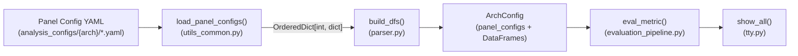
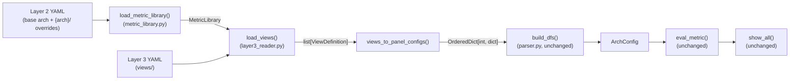
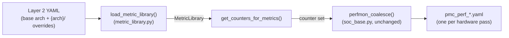
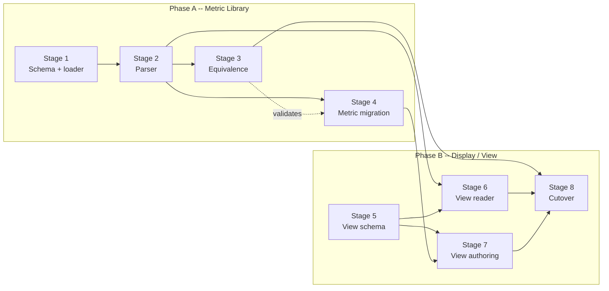
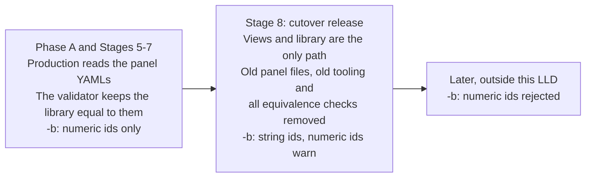

# Implement three-layer analysis config separation

## Motivation

rocprofiler-compute's analysis pipeline consumes a single monolithic `Panel Config`
YAML format. `load_panel_configs()` returns `OrderedDict[int, dict]` to `build_dfs()`,
which builds DataFrame templates with formula strings, and `eval_metric()` evaluates
them against profiled counter data. This format interleaves metric specification, display
configuration, documentation, and grouping -- every change to any concern touches files
that carry all four.

The parent HLD ([`hld-analysis-config-redesign.md`](hld-analysis-config-redesign.md))
defines a three-layer architecture to separate them. This LLD specifies how each layer
connects to the existing pipeline, how the Phase B compatibility adapter translates
between old and new formats, and what each self-contained PR delivers.

**Scope:** Layers 2 and 3 -- metric library, display/view, and the compatibility adapter.
Layer 1.5 (collectables) is a separate epic
([single-pass metrics plan](../../single-pass_and_multi-pass_metrics/hld-plan.md#terms)).
Layer 1 (`sdk_config.yaml`) is out of scope. The metric formula evaluation engine (`eval_metric`, `build_eval_string`, `MetricEvaluator`) is unchanged --
only where formulas are defined and how they reach the engine changes.

Built-in variables (`$GRBM_GUI_ACTIVE_PER_XCD`, `$numActiveCUs`, ...) move into Layer 2
too ([Built-in variable migration](lld-phase-a-metric-library.md#built-in-variable-migration)).

**Phases.** The design docs use these two names:

- **Phase A** is Stages 1-4: the metric library, its equivalence validator, sets and
  built-in variables. Production does not change.
  Detail: [Phase A -- Metric Library](lld-phase-a-metric-library.md).
- **Phase B** is Stages 5-8: the views, `views_to_panel_configs()`, the cutover, and
  string ids in `-b`.
  Detail: [Phase B -- Display / View](lld-phase-b-display-view.md), which also plans
  the view consolidation after Stage 7.


## Current pipeline

### Analyze mode



`load_panel_configs()` globs `*.yaml` from the arch directory, loads each via
`yaml.safe_load`, and produces an `OrderedDict` keyed by panel ID. `build_dfs()`
iterates the panel configs, builds a DataFrame per `metric_table` with formula strings
as cell values, and populates `ArchConfig.dfs`, `dfs_type`, and `dfs_expressions`.
`eval_metric()` evaluates each formula cell against the raw PMC
DataFrame and variable dicts. `show_all()` renders the evaluated DataFrames by panel
order.

### Profile mode


`detect_counters()` takes the metric expressions of the panel YAMLs (all of them, or the
sections `-b` / `--set` select), runs `extract_counters_and_variables()` to extract the
HW counter names, and passes the set to `perfmon_coalesce()`, which bins counters into
per-pass files respecting IP-block limits. Comments, descriptions and labels add no
counters.


## Target pipeline

### Analyze mode



Everything below `OrderedDict[int, dict]` is unchanged. `build_dfs()`, `eval_metric()`,
and `show_all()` require zero modifications during the entire migration. The interface
contract is the `OrderedDict[int, dict]` shape that `build_dfs()` expects.

### Profile mode



`detect_counters()` calls `MetricLibrary.get_counters_for_metrics()` instead of reading
the panel YAMLs' expressions. The counter set reaches the same `perfmon_coalesce()`
path.


## Transition mechanism: legacy_id

The current pipeline -- `build_dfs()`, the `-b` filter, profiling sets -- is built
around numeric positional IDs (e.g., `11.2.3` = panel 1100, table 1102, metric index
3). The new design replaces these with stable string IDs (`compute.salu_util`). During
the transition, both systems must coexist.

`legacy_id` is the numeric positional ID from the current system. It is not a metric
field, because one metric appears in several tables at a different position in each. In
Phase A it stays what it is today, a position in the analysis configs, and the metric
library does not link rows to metric ids: the analysis configs remain the display source
until the Phase B views. A view row stores the `legacy_id` together with the metric id:

```yaml
# view row, table 1102: the third row is 11.2.2
- metric: compute.salu_util      # new stable string ID
  legacy_id: "11.2.2"            # old positional ID, transition only
```

Similarly, `legacy_panel_id` on Layer 3 views carries the old numeric panel ID:

```yaml
view: "Compute Units - Compute Pipeline"
legacy_panel_id: 1100            # old panel ID, transition only
```

The views store `legacy_id` instead of using row positions because one view serves
several archs and skips refs by `archs`, so a row's position is not the same on every
arch.

The Phase B adapter (`views_to_panel_configs()`) uses these fields to reconstruct the
numeric `OrderedDict[int, dict]` that `build_dfs()` expects, and the `-b` filter resolves
numeric IDs through them.

`legacy_id` and `legacy_panel_id` are removed after Stage 8, when string IDs are the
primary format. They are transition artifacts, not part of the target design.


## Stage dependencies and parallelism



A solid arrow is a build dependency; Stage 4 uses Stage 3 only to check its files.
Stages with no path between them can run in parallel, for example Stages 1 and 5.


## Risk mitigation: metric value validation

Metric values are a core product guarantee. Even unrelated refactoring can cause
breakages through typos or missed propagation.

### Validation strategy

1. **Mega-kernel metric-value check:** validates all metric values for a given
   architecture, not just the 2 workloads `test_metric_validation.py` tests
   (`memcopy`, `hbm_bandwidth`). It runs by hand on real hardware with exclusive GPU
   access; it is not a CI test and is not committed.

2. **Per-stage validation gate:** Before merging each implementation stage, run the
   mega-kernel validation test on at least one architecture (preferably gfx942 as
   the most widely deployed). Output must match expected values within tolerance.

3. **Golden-file comparison:** Capture the full `analyze` text output for all
   architectures before the migration begins. After each stage, compare the new
   output to the golden file. Any difference must be explained and approved.


## Cutover timeline



Until the Phase B views, numeric ids are positions in the analysis configs, as today;
string ids need the row links that the views add. After Stage 8, a hardcoded final
mapping handles the numeric-id deprecation window. The cutover is specified in
[Stage 8](lld-phase-b-display-view.md#stage-8----cutover).
