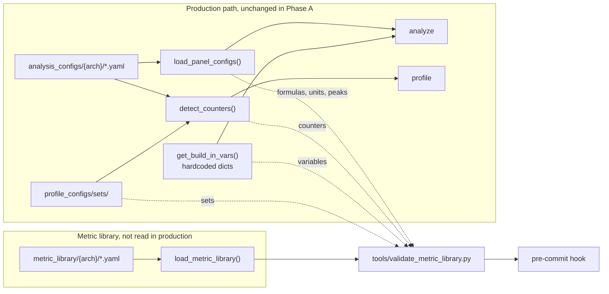
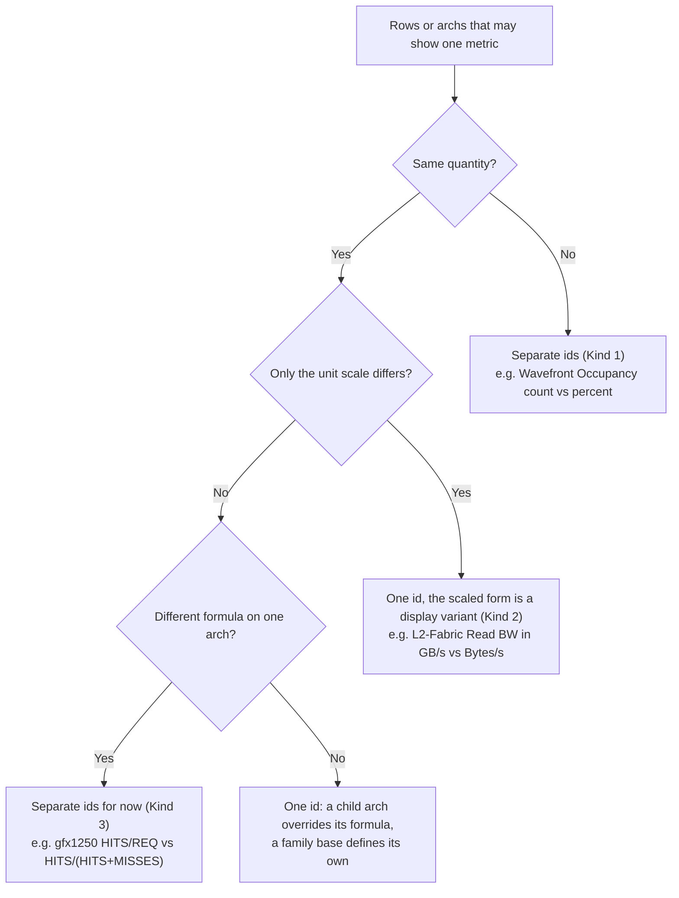

# Phase A -- Metric Library (Stages 1-4)

Parent: [LLD index](lld-index.md)

Stage dependencies: [Stage dependencies and parallelism](lld-index.md#stage-dependencies-and-parallelism).


## Stage 1 -- Layer 2 schema + inheritance loader

### Layer 2 metric schema

New developer tool `tools/validate_metric_library.py`, following the existing
`tools/validate_*.py` checks: it loads each arch's metric library through the
inheritance loader, collects every schema error, and exits 1 if there are any. It runs
as a pre-commit hook on `metric_library/` files and from
`master_config_workflow_script.py --validate-only`. As with today's panel files, the
runtime does not re-validate the files it loads.

`MetricDefinition` fields:

| Field | Type | Required | Notes |
|---|---|---|---|
| `id` | str | yes | Stable hierarchical string, e.g. `l2.hit_rate` |
| `name` | str | yes | Canonical display name, unique on the arch, e.g. `"L2 Cache Hit Rate"`. See [Metric names](#metric-names). |
| `formula` | str | yes | The expression of the row's main column (`avg`, `value` or `expr`), aggregation included; never empty, in the canonical form of `tools/format_yaml.py`. A metric an arch cannot compute does not exist on that arch; a later arch adds it. |
| `unit` | str | yes | One canonical spelling per unit (e.g. `"GB/s"`, `"GFLOP/s"`, `"Cycles per Wavefront"`; aliases such as `Gbps` or `Cycles/wave` are rejected); a display scale such as Bytes/s is not an alias but a view concern ([Kind 2](#metric-id-assignment)); may be empty |
| `description` | str | yes | Human-readable metric description: what the metric is, never how a view shows it (a view adds that as `description_note`, [Phase B](lld-phase-b-display-view.md)); may be empty |
| `peak` | str (formula) or number | no | Theoretical ceiling expression, from the hardware specs, e.g. `$max_sclk * $cu_per_gpu * 512 / 1000`. Required for speed-of-light metrics. Never a measured peak. |
| `peak_empirical` | str | no | Measured ceiling: `$<ceiling>_empirical_peak`, where `<ceiling>` is a roofline benchmark column (`roofline:` blocks of `utils/mi_gpu_spec.yaml`), e.g. `$MFMAF16Flops_empirical_peak`. See [Measured peaks](#measured-peaks). |
| `avg_mode` | str | no | Phase B, with runtime wrapper generation; not in Phase A. Default `weighted` (`SUM(X)/SUM(Y)`). Set to `simple` for metrics that use `AVG()` instead. |

`name`, `unit` and `description` are plain ASCII, as every config file is: `->` for an
arrow, no trademark mark, and no `\uXXXX` escapes (a block scalar shows those as
literal text).

**Aggregation columns belong to the views.** In Phase A, `formula` is the expression of
the row's main column, aggregation included (e.g. `100 * SUM(TCC_HIT_sum) /
SUM(TCC_HIT_sum + TCC_MISS_sum)`). A row's other columns (`min`, `max`, `std dev`, ...)
stay in the analysis configs until the views generate them
([Stage 6](lld-phase-b-display-view.md#stage-6----layer-3-reader)).

Percent-of-peak is not a schema field. In the target state it is computed automatically
when a metric has a `peak` formula and `unit: Percent`. During the transition, the
analysis configs keep today's explicit `pct_of_peak` per table row, so output does not
change.

### Measured peaks

A metric can have two peaks: `peak`, the theoretical one, and `peak_empirical`, the one
the roofline benchmark measures. Both are kept, and a view chooses which to show (today
speed-of-light shows `peak` and roofline shows `peak_empirical`).

The roofline benchmark decides which metrics have a measured peak. Each data type it
benchmarks writes one `roofline.csv` column (a ceiling: `FP16Flops`, `MFMAF16Flops`,
`HBMBw`, `LDSBw`, ...). Each arch's `roofline:` block in `utils/mi_gpu_spec.yaml` lists
the memory levels and data types it measures, and `mi_gpu_specs.get_roofline_columns()`
returns its columns. The validator checks, for every arch:

- every ceiling the benchmark measures on a device of the arch is the `peak_empirical`
  of exactly one metric, or is listed in `CEILINGS_WITHOUT_METRIC` (the VALU integer
  rates `I8Ops`, `I32Ops` and `I64Ops`, and `MALLBw`, which analyze skips: no row shows
  them as a peak), or in `ARCH_CEILINGS_WITHOUT_METRIC` for the rates one arch's roofline
  combines or does not show (the gfx950 F4 and F6 MFMA rates, the gfx115x F16 and BF16
  VALU rates, the gfx1250 VALU rates, whose rows show theoretical peaks);
- no metric names a ceiling the arch does not measure.

So a new ceiling, or a new arch, fails validation until a metric claims each ceiling.
An arch without a benchmark (gfx908) has no measured peaks; the first `peak_empirical`
of a CDNA metric is in the gfx90a override files.

A metric's numeric positional ID (`legacy_id`) is not a metric field either; see
[Transition mechanism](lld-index.md#transition-mechanism-legacy_id).

A metric concept has one `id` on every architecture. Each family base (gfx908 for CDNA,
gfx115x for RDNA, and gfx1250) defines the id with that family's formula, as the HLD's
end-to-end example does for `l2.hit_rate`. Within one architecture, every appearance
of an id uses the same formula. An id has one `name` and one `unit` on every
architecture, the specific ones (`LDS Utilization`, not a panel's `Utilization`); the
validator checks this, and a row that shows another unit is a listed unit variant.

A file maps each metric `id` to its fields, so the `id` is the key rather than a field:

```yaml
# gfx908/compute.yaml
compute.salu_util:
  name: SALU Utilization
  formula: 100 * SUM(SQ_ACTIVE_INST_SCA) / SUM($GRBM_GUI_ACTIVE_PER_XCD * $cu_per_gpu)
  unit: Percent
  description: >-
    Indicates what percent of the kernel's duration the SALU was busy executing instructions.
    Computed as the ratio of the total number of cycles spent by the scheduler issuing
    SALU or SMEM instructions over the total CU cycles.
  peak: 100
```

**Typed row fields** of fabric stall and per-channel tables (`xfer`, `coherency`,
`expr`, `type`, `transaction`, `read req`, `ea read stall - hbm`, ...) are display
columns, so they stay as display data in the analysis config rows, not on
`MetricDefinition`. There is no separate `FabricStallMetric` schema.

`VariableDefinition` fields:

| Field | Type | Required | Notes |
|---|---|---|---|
| `name` | str | yes | The key: variable name without `$`, e.g. `GRBM_GUI_ACTIVE_PER_XCD` |
| `formula` | str | yes | Expression, e.g. `"(GRBM_GUI_ACTIVE / $num_xcd)"` |

Evaluation order stays in code: `calc_builtin_vars()` evaluates the `PER_XCD` variables
first.

```yaml
# gfx908/variables.yaml
GRBM_COUNT_PER_XCD:
  formula: GRBM_COUNT / $num_xcd
GRBM_GUI_ACTIVE_PER_XCD:
  formula: GRBM_GUI_ACTIVE / $num_xcd
GRBM_SPI_BUSY_PER_XCD:
  formula: GRBM_SPI_BUSY / $num_xcd
hbmBandwidth:
  formula: $max_mclk / 1000 * 32 * $num_memory_channels
kernelBusyCycles:
  formula: ROUND(AVG((End_Timestamp - Start_Timestamp) / 1000 * $max_sclk), 0)
numActiveCUs:
  formula: TO_INT(MIN(ROUND(4 * SUM(SQ_BUSY_CU_CYCLES) / SUM($GRBM_GUI_ACTIVE_PER_XCD), 0) / $max_waves_per_cu * 8 + MIN(MOD(ROUND(4 * SUM(SQ_BUSY_CU_CYCLES) / SUM($GRBM_GUI_ACTIVE_PER_XCD), 0), $max_waves_per_cu), 8), $cu_per_gpu))
```

### Layer 1.5 -- Collectables

Phase A has no collectables: the metric library has no collectable file, field or
reference. Collectables are designed in the single-pass metrics plan
([Terms](../../single-pass_and_multi-pass_metrics/hld-plan.md#terms) and
[splitting multi-pass metrics](../../single-pass_and_multi-pass_metrics/hld-plan.md#phase-2--splitting-multi-pass-metrics-into-single-pass-parts))
and its [grouping algorithm](../../single-pass_and_multi-pass_metrics/lld-metrics-grouping-algorithm.md).

### Inheritance loader

New module `src/utils/yaml_inherit_loader.py`. A metric library file names its parent
with a top-level `inherit: <path>` key.

The design follows GitLab CI
([YAML optimization docs](https://docs.gitlab.com/ci/yaml/yaml_optimization/)), which
uses two different mechanisms:

- `extends:` is a key. A job names its parent template, and GitLab deep-merges the
  parent under the job, with the job's own keys winning. `inherit:` works the same way,
  except that it names the parent arch's file instead of a template in the same file.
- `!reference [...]` is a custom tag on a value. `!remove` follows that pattern: it tags
  a value (`key: !remove`), never a whole document.

A first-line `!inherit <path>` tag would mix the two and is not valid YAML: a document has one root node, so a tagged scalar cannot be followed by a mapping.
Keeping a tag would need either a loader that strips the first line, which makes the
files unreadable to other YAML tools (`check-yaml`, `format_yaml.py`, `safe_load`), or a
tag on the whole root mapping, which needs a custom constructor and is harder to edit.
With a key, any YAML tool reads the file, and the loader only removes one key.

Native YAML anchors (`&`/`*`) and merge keys (`<<`) are insufficient -- they only
perform shallow merge, do not work across files, and the merge key is semi-deprecated
in the YAML spec.

**Implementation:** The merge logic is inline, with no new dependency. It must work in
profile mode, which prohibits pip dependencies (`ProfileModeImportGuard` enforces
stdlib-only imports), so yaml is imported from the vendored copy
(`from vendored import yaml`).

`InheritLoader` subclasses `yaml.SafeLoader`. It registers one custom tag, `!remove`,
which marks a key for deletion during the merge, and it rejects a key that appears twice
in one mapping (plain YAML would silently keep the last one, hiding a duplicate metric
id). The repo's `check-yaml`
pre-commit hook needs `--unsafe` for the metric library files because of this tag.

To load a file:

1. Resolve the `inherit` path relative to the current file's directory.
2. Load the parent file recursively, so a chain of any depth works (the chains are in
   the [HLD](hld-analysis-config-redesign.md#yaml-inheritance)).
3. Merge the current file's content on top of the parent, applying `!remove` as it
   goes. Removing a key that the parent does not have is an error.

**Merge operations:**

| Operation | Input | Behavior |
|---|---|---|
| Modify | Scalar in override | Override replaces base value. |
| Add | New key in override | Appended to the merged map. Supports adding new metrics, tables, or fields that the parent arch does not have. |
| Remove | `key: !remove` | The key is deleted from the merged result. Used when a child arch drops a metric (keyed by its id) or a field of one. |
| Deep merge | Map + map | Recursive deep merge. Override keys win; base-only keys preserved, in file order. A metric in a child file lists only the fields that change. |
| Replace | List in override | A list replaces the base list as a whole. |

Example, from the gfx90a files:

```yaml
# gfx90a/compute.yaml
inherit: ../gfx908/compute.yaml

# Modify: gfx90a doubles the BF16 MFMA rate and adds the measured peak
compute.mfma_flops_bf16:
  peak: $max_sclk * $cu_per_gpu * 1024 / 1000
  peak_empirical: $MFMABF16Flops_empirical_peak

# Add: a metric gfx908 cannot compute
compute.valu_flops:
  name: VALU FLOPs
  formula: 64 * SUM(SQ_INSTS_VALU_ADD_F16 + ... + 2 * SQ_INSTS_VALU_FMA_F64) / SUM(End_Timestamp - Start_Timestamp)
  unit: GFLOP/s
  description: >-
    The total floating-point operations executed per second on the VALU. Note: this
    does not include any floating-point operations from MFMA instructions.
  peak: $max_sclk * $cu_per_gpu * 64 * 2 / 1000
```

```yaml
# gfx90a/fabric.yaml
inherit: ../gfx908/fabric.yaml

# Remove: a metric gfx90a no longer shows
fabric.rd_bw_norm: !remove
```

**Cycle detection:** Follow the `inherit` chain from the file to its base, keeping the
resolved absolute paths seen, then merge from the base down. If a path appears twice,
raise `InheritanceError` naming the full chain.

**Errors:** the loader raises `InheritanceError` and does not log. The validator collects
the error of every file; at the cutover, the CLI reports one with `console_error()`.

**No runtime switch in Phase A.** Production does not read Layer 2 before the cutover
(see [Phase A data flow](#phase-a-data-flow)), and no environment variable or hidden
option selects it. Production moves to the new path in one step, at Stage 8. A flag
during Phase A would not lower that risk; it would only add a second path to maintain.
The risk is covered instead by:
- the Stage 3 equivalence check, which keeps Layer 2 equal to today's analysis configs
  on every commit;
- the output and metric-value checks before each stage (see
  [Risk mitigation](lld-index.md#risk-mitigation-metric-value-validation)).

### Tests

- Schema validation (`tools/validate_metric_library.py`): valid files pass; missing
  required fields, unknown fields, bad ids, duplicate ids, names shared on an arch and a
  child file that does not inherit from its parent's file are reported.
- Inheritance loader: single-level inheritance, multi-level chain (4+ deep, matching
  the real `gfx908 -> gfx90a -> gfx940 -> gfx942` chain), cycle detection error.
- Merge operations: key modification (override), key addition (new metric in child),
  removal of a metric or a field (`!remove` deletes from merged result), deep-merge of
  maps, lists replaced, and errors for removing a missing key, for a duplicate key and
  for `!remove` with a value.
- Round-trip: a minimal synthetic YAML family (base + chain of overrides with
  additions, modifications, and removals) loads correctly and produces the expected
  merged structure.
- Equivalence check: Stage 3 compares the library with today's tree, read in the same
  run, so no snapshot files are needed.


## Stage 2 -- Layer 2 parser

### MetricLibrary

New module `src/utils/metric_library.py`.

`load_metric_library(metric_dir: Path, arch: str) -> MetricLibrary`:

1. Resolve the architecture's base arch and inheritance chain:
   ```python
   METRIC_LIBRARY_PARENT_ARCH = {
       "gfx908": None,         # CDNA base -- no parent
       "gfx90a": "gfx908",
       "gfx940": "gfx90a",     # each arch inherits from its immediate predecessor
       "gfx941": "gfx940",
       "gfx942": "gfx940",
       "gfx950": "gfx942",
       "gfx115x": None,        # RDNA base -- no parent
       "gfx1250": None,        # own base -- shares no file with gfx115x
   }
   ```
   gfx1150-gfx1153 map to the `gfx115x` directory through `canonical_config_arch()`.
2. Load YAML files from `{metric_dir}/{arch}/`. Each file either stands alone (base
   arch) or has an `inherit` key pointing to the parent arch's file.
3. The `InheritLoader` (Stage 1) resolves the `inherit` chain recursively and
   deep-merges overrides on top of the base.
4. Do not re-validate: `tools/validate_metric_library.py` checks the files at commit
   time.
5. Collect all metrics into `MetricLibrary.metrics`, keyed by string `id`. Raise on
   duplicate ids. In Phase A the entries are the loaded mappings, as
   `load_panel_configs()` returns today; a typed model can come with the cutover.
6. Load `variables.yaml` (inherited like the metric files) into
   `MetricLibrary.variables`, in file order.

7. Load `sets.yaml` from the arch directory (inherited along `METRIC_LIBRARY_PARENT_ARCH` like the
   metric files) into `MetricLibrary.sets: dict[str, SetDefinition]`. Sets only reference
   metric ids; see [Sets migration](#sets-migration).

`MetricLibrary` class:

```python
class MetricLibrary:
    metrics: dict[str, dict]        # metric id -> its fields
    variables: dict[str, dict]      # variable name -> {formula}, in file order
    sets: dict[str, SetDefinition]  # Stage 4, sets migration

    def get_counters_for_metrics(
        self, metric_ids: list[str], gpu_series: str
    ) -> set[str]: ...
```

`get_counters_for_metrics()` extracts HW counters from the requested metrics:

1. **Concatenate formula strings** for the requested metrics.
2. **Include `peak` values** in the text passed to the extractor, as `detect_counters()`
   does for the panel equations. In both paths, comments, descriptions and labels add no
   counters, so the two counter sets are equal on every arch.
3. **Delegate to `extract_counters_and_variables()`** in `utils_counter_defs.py` for
   regex-based HW counter extraction and transitive built-in variable resolution.

### Tests

- Integration test: load a synthetic family (a base and a four-deep chain of children)
  from test fixtures. Verify: correct number of metrics, inheritance
  overrides applied, variable definitions present, duplicate id raises error.
- Counter extraction: `get_counters_for_metrics()` takes counters from `formula` and
  `peak`, and resolves built-in variables. Equivalence with
  `detect_counters()` over the whole library is the Stage 3 counter check.
- String metric IDs follow the hierarchical convention
  (`{category}.{subcategory}_{name}`).


## Stage 3 -- Equivalence with the analysis configs

Phase A ships no compatibility adapter. The metric library says what each metric is, not
where it is shown: the analysis configs stay the display source and the production
loader, and nothing links a panel row to a metric id until the Phase B views do. The
adapter to the existing pipeline comes with the views, as `views_to_panel_configs()`
([Phase B](lld-phase-b-display-view.md)). A Phase A adapter would need a full copy of the
panel layout with each row linked to its metric, kept in sync with the analysis configs
until Stage 8 deletes both; nothing in production would read it.

### Phase A data flow



Production switches once, at [Stage 8](lld-phase-b-display-view.md#stage-8----cutover).

### Integration point

The Layer 2 files live in a sibling tree, `src/rocprof_compute_soc/metric_library/`
(`default_metric_library_dir()`), not in `analysis_configs/{arch}/`. The old loader
requires a `Panel Config` key in every `*.yaml` of an arch directory, so mixing the two
formats there would break it. A user-supplied `--config-dir` keeps using the old loader.

At the cutover, counters come from the metrics that the selected views place
(`get_counters_for_metrics()`). Phase A checks only the no-filter counter set, because
`-b` tokens and sets select rows, and rows are not linked to metric ids yet.

### Validation

`tools/validate_metric_library.py`, for every arch that has a metric library tree, also
compares the library with today's analysis configs:

- **Formulas:** every equation a row shows (its `avg`, `value` or `expr` form; for a row
  with none of these, each of its table's value columns; without display-only `ROUND()`)
  is a library formula; every library formula is shown by some row. A row that divides
  by the kernel time in seconds shows the GB/s formula scaled by 1e9, its peak too.
  Display variants, listed by positional id and label, write a formula differently; the
  validator checks each one's equation against its metric.
- **Units:** every row's unit is its metric's unit, after unit aliases, except the rows
  listed as unit variants. A row that shows a GB/s metric in seconds says Bytes/s.
- **Counters:** the counters the whole library selects equal the counters
  `detect_counters()` selects with no filter (with `--membw-analysis` where the arch has
  panel 3000).
- **Built-in variables:** the library variables equal `get_build_in_vars()`.
- **Peaks:** every row's `peak` is its metric's `peak` or `peak_empirical`, and every
  library peak is the peak of some row that shows the metric (a measured peak whose
  ceiling the benchmark does not measure on the arch is skipped, as on gfx908, which has
  no benchmark). A display variant names its metric id for
  this check, and a hidden row (`value: None`) names it by its label.

The reference side is today's tree, read through the production loaders in the same
run, so there are no snapshot files. Both trees are source data that cannot change after
install, so this is a pre-commit check, not an installed test. The tool's own tests are
`tools/test_validate_metric_library.py`.

### Removal

The equivalence checks are transitional (TODOs in `tools/validate_metric_library.py`) and
go at the cutover ([cutover timeline](lld-index.md#cutover-timeline)), with the old panel
files: `detect_counters()` and `get_build_in_vars()` then read the library, so the counter
and variable checks would compare it with itself, and the row checks (equations, units and
peaks, with `DISPLAY_VARIANTS` and `UNIT_VARIANTS`) have no panel files left to compare.

The schema checks (file loading, inheritance, fields, id rules, shared formulas and names,
measured peaks, unit spelling, and one name and unit per id) stay.


## Stage 4 -- Metric migration

The largest stage. Parallelizable by hardware concept (compute, memory, system) and by
architecture. The deliverable is the actual Layer 2 YAML files and the migration of
built-in variables and sets.

### New directory structure

```
metric_library/          # sibling of analysis_configs/ (see Stage 3)
  gfx908/                # CDNA base (first arch) -- complete standalone definitions
    variables.yaml
    sets.yaml            # Stage 4, sets migration
    compute.yaml         # SQ instruction issue and execution
    cp.yaml              # CPC/CPF
    dispatch.yaml        # launch parameters and kernel time from the dispatch record
    fabric.yaml          # L2-Fabric interface and HBM
    grbm.yaml
    l1i.yaml             # instruction cache (SQC)
    l2.yaml              # L2 (TCC), and per channel
    lds.yaml
    sl1d.yaml            # scalar L1 data cache (SQC)
    spi.yaml
    ta.yaml
    td.yaml
    vl1d.yaml            # vector L1 data cache (TCP)
    wave.yaml            # SQ wave state
  gfx90a/                # override files only, for each child arch
  gfx940/
  gfx941/
  gfx942/
  gfx950/
  gfx115x/               # RDNA base -- complete standalone definitions
  gfx1250/               # own base -- complete standalone definitions
```

Files are grouped by hardware, as the HLD's Layer 2 asks ("one file per hardware
concept"), not by today's panels: a summary panel such as Speed-of-Light has no hardware
meaning, and where a metric is shown is a Layer 3 concern. Each file is named after an id
category and holds exactly the ids of that category (`l2.yaml` holds `l2.*`), so an id
names its file. The validator enforces this. The RDNA and gfx1250 bases add files for
their own categories.

Top-level keys are sorted in every file (after `inherit`): metric ids, and the variable
names in `variables.yaml`. Where a metric is shown no longer orders the library, and the
`{category}.{subcategory}_{name}` form keeps related metrics together. `format_yaml.py
--fix` sorts the keys, and its pre-commit hook rejects unsorted files. The order of
`variables.yaml` does not affect evaluation (see `VariableDefinition`).

Which arch is a base and which arch each child inherits from is set in the
[HLD](hld-analysis-config-redesign.md#yaml-inheritance) and in
`METRIC_LIBRARY_PARENT_ARCH` (Stage 2).

### Migration order

1. **gfx908** -- the CDNA base. Convert its current panel config files to Layer 2
   format with string IDs, single formulas, and descriptions. This is the largest
   single-arch conversion but produces the foundation for the inheritance chain.
2. **gfx90a** -- inherits gfx908. Override files for metrics added or modified in MI200.
3. **gfx940** -- inherits gfx90a. MI300 generation -- adds MFMA FLOPs variants,
   modifies formulas for new counter names.
4. **gfx941** -- inherits gfx940. Differs in 2 files (one unit override and three
   roofline formulas). The smallest override, ideal for validating the inheritance
   mechanism.
5. **gfx942, gfx950** -- inherits gfx940/gfx942 respectively.
6. **gfx115x** -- RDNA base. Separate standalone definitions, no inheritance from CDNA.
7. **gfx1250** -- own base. Separate standalone definitions.

Each step is validated: run the Stage 3 equivalence check for the migrated architecture
before proceeding to the next.

### Metric ID assignment

Convention: `{category}.{subcategory}_{name}`, all lowercase, underscores for
word separation.

Categories name hardware (or the data source), never a view: `system`, `memchart`,
`roofline` and `wavefront` (today's panels) are not categories, and the validator rejects
them. A metric's category follows the block of the counters it uses, not the panel that
shows it: a metric shown only in a summary panel takes the category of the block it
measures, and SQ instruction counters (`SQ_*INST*`) are `compute`. An arithmetic
intensity combines SQ FLOPs with one memory level's bytes, and takes the category of that
level (`l2.ai`). Memory categories use the names the docs and panels use (`l2`, `vl1d`,
`sl1d`, `l1i`) rather than block names (`tcc`, `tcp`, `sqc`), which change between
families. The RDNA bases use RDNA block names for the hardware CDNA has no category for
(`gl0`, `gl1`, `gl2`, `gcea`, `wgp`, ...), and keep the CDNA id, and so the CDNA file, for
a concept both families share (`l2.bw`, `wave.occupancy`, `lds.util`); units both
families have keep the CDNA names (`l1i`, `sl1d`, `lds`, `compute`, `wave`, `dispatch`).

**Choosing ids.** When rows, tables or archs show what may be one metric:



- **Kind 2:** the scaled form stays in the analysis configs until a Phase B view sets its
  own display unit (`ViewMetricRef.unit`).
- **Kind 3:** the parent arch's formula keeps the id; the other gets a new, descriptive id,
  or an existing id that already means that formula. The panels stay unchanged until the
  metric owners choose one formula; a separate change then fixes the panels, merges the
  ids and lists the value change in the CHANGELOG.
- Two ids with the same formula on one arch are one metric: the validator rejects them,
  and they are merged into one id (each panel's label becomes a view label in Phase B).
  The exceptions are listed in `SHARED_FORMULA_IDS`: the same counters bounded by a
  different measured ceiling (gfx950 and gfx1250 count MXF8 matrix work in the F8
  counter, so `compute.mfma_flops_mxf8` shares the formula of `compute.mfma_flops_f8`,
  and `compute.wmma_flops_mxfp8` that of `compute.wmma_flops_fp8`); a row whose label
  names the listed id shows that id.

The same holds across archs: a formula has one id on every arch. An arch reuses the id
that the first arch to show the quantity gave it (gfx1250 uses gfx115x's `gl1.util`, and
gfx950 keeps gfx942's `fabric.hbm_rd`), and the validator rejects a formula with two
ids. The exceptions are listed in `SPLIT_FORMULA_IDS`: on gfx940 and gfx941 one label
shows two formulas, so the second one has its own id there (`vl1d.cache_bw_128b`), while
gfx942 and gfx950 show only that formula, as `vl1d.cache_bw`.

| Category | Hardware | File | Example IDs |
|---|---|---|---|
| `compute` | SQ instruction issue and execution (`SQ_*INST*`, execution-unit busy, CU busy) | `compute.yaml` | `compute.valu_util`, `compute.mfma_util`, `compute.cu_util`, `compute.inst_mix_valu` |
| `cp` | CPC/CPF | `cp.yaml` | `cp.cpf_util`, `cp.cpc_stall_rate` |
| `dispatch` | The dispatch record (launch parameters, resource allocation, kernel time); no counters | `dispatch.yaml` | `dispatch.grid_size`, `dispatch.vgprs`, `dispatch.kernel_time` |
| `fabric` | TCC-EA: the L2-Fabric interface and HBM | `fabric.yaml` | `fabric.rd_lat`, `fabric.hbm_bw`, `fabric.ai_hbm` |
| `grbm` | GRBM | `grbm.yaml` | `grbm.gui_active_cycles` |
| `l1i` | SQC instruction cache | `l1i.yaml` | `l1i.hit_rate_incl_dup`, `l1i.fetch_lat` |
| `l2` | TCC, and per channel (`l2.chan_*`) | `l2.yaml` | `l2.hit_rate`, `l2.chan_hit_rate_per_chan`, `l2.ai` |
| `lds` | LDS | `lds.yaml` | `lds.util`, `lds.theoretical_bw`, `lds.ai` |
| `sl1d` | SQC scalar data cache | `sl1d.yaml` | `sl1d.bw`, `sl1d.l2_rd_bw` |
| `spi` | SPI | `spi.yaml` | `spi.workgroups_per_cu` |
| `ta` | TA (address processing) | `ta.yaml` | `ta.global_insts`, `ta.busy` |
| `td` | TD (data return) | `td.yaml` | `td.busy`, `td.spi_stall` |
| `vl1d` | TCP (with TA inputs, e.g. coalescing: AMD defines the vL1D as TA + TC + TD) | `vl1d.yaml` | `vl1d.cache_bw`, `vl1d.l2_rd_bw`, `vl1d.ai` |
| `wave` | SQ wave state: occupancy, wave cycles and their wait/active breakdown, save/restore | `wave.yaml` | `wave.occupancy`, `wave.cycles`, `wave.issue_wait_cycles` |
| `gl0` | RDNA GL0 vector cache (TCP on gfx115x) | `gl0.yaml` | `gl0.hit_rate`, `gl0.gl1_rd_bw` |
| `gl1` | RDNA GL1 cache | `gl1.yaml` | `gl1.hit_rate`, `gl1.gl2_bw` |
| `gl2` | RDNA GL2 cache, apart from the concepts shared with `l2` | `gl2.yaml` | `gl2.hit_rate`, `gl2.fabric_rd_bw` |
| `gcea` | gfx115x Graphics Core Efficiency Arbiter (DRAM interface) | `gcea.yaml` | `gcea.dram_rd_bw` |
| `wgp` | RDNA workgroup processor | `wgp.yaml` | `wgp.util` |
| `glarb` | gfx1250 GL1-GL2 arbiter (GLARBA, GLARBC) | `glarb.yaml` | `glarb.glarbc_util` |
| `ea` | gfx1250 Efficiency Arbiter (HBM and remote memory interface) | `ea.yaml` | `ea.dram_rd_bw` |
| `ch` | gfx1250 Central Hub (CHA, CHC) | `ch.yaml` | `ch.chc_util` |
| `utcl1` | gfx1250 L1 address translation cache | `utcl1.yaml` | `utcl1.lookup_hit_rate` |
| `txa` | gfx1250 texture addresser (TX_VCA counters) | `txa.yaml` | `txa.req_bus_util` |
| `txd` | gfx1250 texture data (TX_VCD counters) | `txd.yaml` | `txd.util` |

### Metric names

A metric's `name` says which hardware it measures, so it reads correctly outside the
panel that shows it:

- It starts with the block: `L2 Misses`, `L2-Fabric Atomic Requests`, `vL1D-L2 Read
  Requests`, `UTCL1 Hits`, `LDS Bank Conflict Cycles`, `TA Address Stall`. A metric of
  the vL1D's address translation is named `UTCL1`, after the counters it reads.
- It spells out abbreviations: `Requests`, `Bandwidth`, `Address`, `Memory`,
  `Arithmetic Intensity`.
- A per-channel metric ends with `per Channel`.
- It is in title case; short words (`and`, `by`, `of`, `on`, `over`, `per`, `to`,
  `under`, `vs`) stay lowercase.
- An RDNA metric starts with RDNA's block word (`GL0`, `GL1`, `GL2`, `GCEA`, `CHC`, `EA`,
  `TXA`, `WGP`, `Dcache`, `ICache`); an id both families share keeps its CDNA name.
- A metric that shows one raw counter is named after the counter (`TCC_BUSY`).
- A metric shown only by panel 3000 (memory bandwidth analysis) keeps that model's block
  words (`EA` for the L2-Fabric interface, `L1 Cache` and `TCP` for the vL1D, `TD -`,
  `Normalized`); its abbreviations are spelled out like any other name.
- Names are unique on an arch, ignoring case; the validator rejects two metrics with the
  same name. Two quantities that panels show under one label get names that tell them
  apart (`Wavefront Occupancy`, `Wavefront Occupancy (Percent)`).

A row keeps its panel label (`Hits`, `Req`) in the analysis configs; a Phase B view sets
it as the view's label.

### OQ3 resolution -- metrics with both description and formula drift

The HLD analysis counted 39 such metrics by grouping on metric name alone. Grouping by
(table title, metric name), so that generic names such as `Utilization` or `Req` do not
merge unrelated metrics, gives 17 groups at `f8fac5575b`. Every one of them involves
gfx115x or gfx1250.

**Resolution:** a metric concept has one `id` on every architecture, and each family base
defines it with that family's formula (see Stage 1). Where a family's formula measures
something noticeably different (for example, gfx115x `VALU FLOPs` counts lane-ops), the
id stays shared and the difference is tracked as a formula issue, not as a separate id.
Within one architecture, the [id decision tree](#metric-id-assignment) applies.

### OQ4 resolution -- same description under different names

The HLD analysis counted 43 groups. Recounted at `f8fac5575b` with the grouping above, 30
descriptions are shared by more than one name.

**Resolution criteria:**

1. Select the **most specific, unambiguous name** as the canonical `name` in Layer 2.
   Prefer names that self-document the metric's scope without being excessively verbose.
2. All other names become view-level `label` overrides in Layer 3. Until then they stay
   the row names in the analysis configs.

| Description group | Current names | Canonical `name` |
|---|---|---|
| L2 cache hit ratio | `Cache Hit`, `Hit Rate`, `L2 Cache Hit Rate` | `L2 Cache Hit Rate` |
| Read latency | `L2-Fabric Read Latency`, `Read Latency` | `L2-Fabric Read Latency` |
| INT8 MFMA ops | `MFMA IOPs (INT8)`, `MFMA IOPs (Int8)` | `MFMA IOPs (INT8)` |

Two groups share a description only because of documentation errors: the rows
`L1I Hit Rate` and `L1I BW` (`l1i.hit_rate_excl_dup`, `l1i.bw`) have swapped descriptions
on gfx908-gfx942, and `Dependency Wait Cycles` (`wave.dep_wait_cycles`) reuses the
`Wave Cycles` (`wave.cycles`) description. These keep separate ids.

### Sets migration

A set is a Layer 2 concept: its membership is constrained by hardware (the counters of
its metrics must fit in a single pass), which is checked against the metric formulas.
How a set's results are displayed is a Layer 3 concern (see
[Set display](lld-phase-b-display-view.md#set-display)).

Sets move from `profile_configs/sets/{arch}_sets.yaml` to
`metric_library/{arch}/sets.yaml` and switch from numeric positional IDs to string metric
IDs:

```yaml
# Before
sets:
- title: Compute Throughput Utilization
  set_option: compute_thruput_util
  description: Placeholder
  metric:
  - 11.2.2: SALU Utilization
  - 11.2.3: VALU Utilization

# After
sets:
- title: Compute Throughput Utilization
  set_option: compute_thruput_util
  description: Placeholder
  metric:
  - compute.salu_util
  - compute.valu_util
```

- **References only.** A set entry references a metric id and carries no metric fields,
  so a metric is still defined exactly once per architecture. Every referenced id must
  exist on that architecture.
- **Inheritance.** `sets.yaml` follows the same `inherit` chain as the metric files; for
  example, gfx941 and gfx942 use gfx940's sets unchanged.
- **Single-pass check.** Validation uses `get_counters_for_metrics()` to confirm that each
  set's counters fit in one pass.
- **Transition.** Production `--set` and `--list-sets` keep reading
  `profile_configs/sets/` until the cutover. The equivalence checks prove that each
  string-ID set yields the same counters as the numeric set it replaces.

### Built-in variable migration

The built-in variables move into each base arch's `variables.yaml`. In Phase A,
`get_build_in_vars()` in `utils_counter_defs.py` keeps its hardcoded dicts, and the
Stage 3 equivalence check asserts that the library variables equal `get_build_in_vars()`
for every arch. At the cutover, `get_build_in_vars()` loads from
`MetricLibrary.variables` ([Stage 8](lld-phase-b-display-view.md#stage-8----cutover)).

The evaluation pipeline (`calc_builtin_vars()` in `evaluation_pipeline.py`) is
unchanged -- it receives the same `dict[str, str]` regardless of source.

### Tooling updates

| Tool | What changes |
|---|---|
| `validate_sets_metric_ids.py` | Validate `metric_library/{arch}/sets.yaml`: references resolve through `MetricLibrary`, and each set fits one pass. The numeric files keep their positional check until the cutover. |
| `format_yaml.py` | Also checks `metric_library/gfx*` files (its pre-commit hook covers them): the `formula`, `peak` and `peak_empirical` keys, with the `!remove` tag accepted, and sorts their top-level keys. Core equation formatting logic (factoring constants out of aggregation) is unchanged. |
| `hash_manager.py` | No change: it keeps hashing the analysis configs, and `tools/validate_metric_library.py` checks the metric library files. |
| `verify_against_config_template.py` | No change: `tools/validate_metric_library.py` checks the metric library files, and this script keeps checking the old panel files until the cutover. |
| `metric_description_manager.py` | No change in Phase A: the old panel YAMLs stay the documentation source until the cutover (Stage 8), when it reads descriptions from Layer 2. Output format for docs YAMLs is unchanged. |

### Migration tooling

A one-time local script converts each arch. It is not committed; each PR says how the
files were generated and lists the hand edits made afterwards (for example, the
approved description changes).

1. Read each current panel config YAML for a given architecture.
2. For each metric: generate the Layer 2 format with string `id`, canonical `name`,
   formula, `unit` and `description`.
3. Report every metric whose formula differs between tables of the same architecture,
   for the review described under OQ3.
4. Generate the family base files and arch override files.
5. Keep its row -> metric id decisions locally, keyed by positional id, for the sets
   migration and for generating the Phase B views.

The generated files are checked by `tools/validate_metric_library.py` (schema and Stage 3
equivalence); there is no round trip through an adapter.

### Validation

- Per-arch equivalence check (Stage 3): formulas, no-filter counters and built-in
  variables match today's analysis configs.
- Schema check: `tools/validate_metric_library.py` passes.
