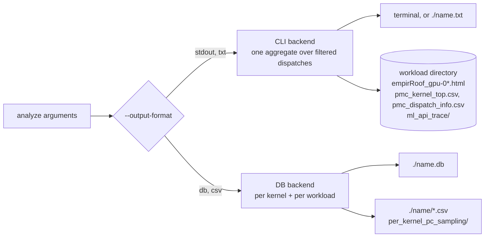
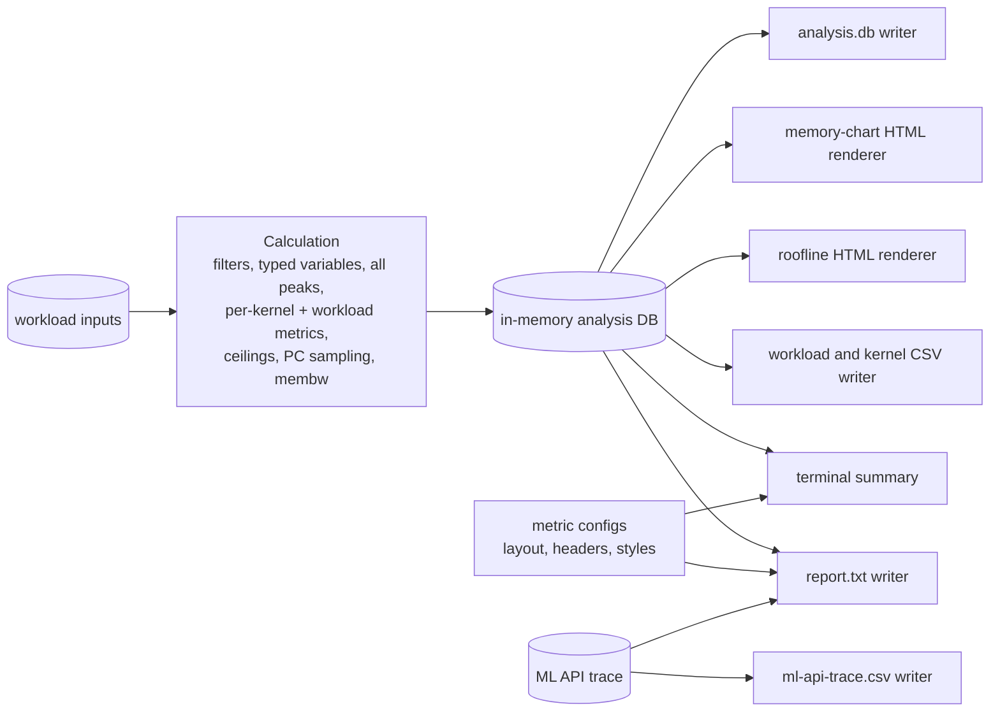
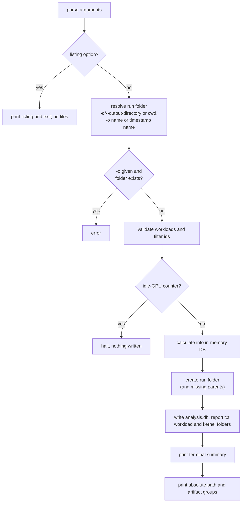

# Analyze: One Calculation, One Output Folder

## System Context

`rocprof-compute analyze` reads a profiled workload, evaluates the metric expressions defined
in the per-architecture metric configs, and presents the results. Its inputs are:

- counter results and system info;
- the roofline benchmark (`roofline.csv`);
- optional PC-sampling data and ML API traces.

`--output-format` picks one of two backends. They evaluate the same expressions with separate
code and produce different artifacts.



| Artifact | stdout | txt | csv | db |
|---|---|---|---|---|
| Terminal report | yes | logs and roofline plot leak to terminal | no | no |
| Report file | — | `./<name>.txt` | — | — |
| Analysis DB | — | — | — | `./<name>.db` |
| View CSVs, PC-sampling export | — | — | `./<name>/` | — |
| Roofline HTML | workload dir, single `-p` only | workload dir, single `-p` only | — | — |
| Top-stats scratch CSVs | workload dir | workload dir | — | — |

`<name>` defaults to `rocprof_compute_<uuid>` in the current directory. `--output-name` replaces
it but must be a bare name, so it cannot place output elsewhere.

Surrounding components:

- **Metric configs** define metrics, expressions, and the report layout. The
  analysis-config-redesign HLD replaces their source but keeps evaluation results identical and
  makes display a separate layer.
- **Analysis DB** is SQLite (schema 2.3.1), built in memory and copied to disk. ROCm Optiq
  (external) reads it. Nothing in the tool reads it back today.
- **Profile mode** already has `-d/--output-directory`, `-n/--name` (ignored when a directory is
  given), and `--overwrite` guarding non-empty directories. Analyze has no `--overwrite`.
- **Memory-chart HTML renderer** is being built in parallel. It turns the memory-chart metric
  values into an interactive HTML chart.

## Problem statement

### The two backends disagree

The same workload and filters give different numbers depending on `--output-format`. Each
divergence is ranked by what it costs users:

- **Fix:** users see wrong or missing numbers, or the DB lacks provenance.
- **Needed by design:** rendering every artifact from the DB cannot work without it.
- **Deferred:** taken up only once a customer need is shown (see
  [Deferred fixes](#deferred-fixes)).

| ID | Divergence | Effect today | Rank |
|---|---|---|---|
| D1 | The DB path reads the Percent of Peak flag after the config loader turned it into a string | DB and CSV never contain Percent of Peak (0 of 543 gfx942 metrics flagged) | Fix |
| D2 | The DB builds peak variables from a subset of `roofline.csv` columns and skips validation | gfx950 MFMA F6F4 and gfx1250 WMMA F6F4 and WMMA FP64 peak metrics are NULL in the DB | Fix |
| D3 | The DB evaluates untyped system info | With `--specs-correction`, string values make DB arithmetic fail to NULL | Fix |
| D4 | CLI uses "N/A" and silently drops roofline points whose AI is missing; the DB stores NULL. Only the CLI halts on an idle-GPU counter | Kernels vanish from the roofline without notice; DBs written from idle-GPU counters | Fix |
| D5 | The CLI computes one filtered aggregate; the DB computes per kernel and per workload | Different granularity | Needed by design |
| D6 | The DB does not validate `--gpu-id`/`--kernel-iteration-range` ids; the top-stats tables differ | A typo silently produces an empty DB | Fix |
| D7 | Membw guidance, top-stats percentages, and some tables exist only in the CLI | The report shows data the DB lacks | Needed by design |
| D8a | The DB stores no ceilings. The limiter exists only in the HTML, which only single-`-p` CLI runs write | Optiq must derive ceilings itself; comparison runs get no HTML; the CSV has no roofline | Needed by design |
| D8b | The DB's per-kernel roofline table has no view, uses GFLOP/s, and fixes one column per memory level. CLI ceilings use the device-0 row while peaks use the first row. Both drop gfx1250 L2 and L0 points | A `--device N` profile has peaks but no roofline; gfx1250 L2 and L0 points are missing | Deferred |
| D9 | Rounding, units, and normalization are not recorded | A DB cannot say which normalization produced its values | Fix |
| D10 | CLI PC sampling ignores `--gpu-id`/`--kernel-iteration-range` and uses only the first `-k` | Counters and samples are filtered differently | Deferred |
| D12 | Variance warnings differ in granularity | — | Deferred |

Users read results in two places, the terminal and Optiq. When those disagree, users cannot
trust either one.

### One run cannot produce everything

Getting the report, an Optiq DB, and the roofline HTML takes at least two runs. Each run pays
for evaluation again, and each uses a different code path. `db` and `csv` exclude each other,
and neither writes the roofline HTML.

### Output is scattered and the profile gets modified

- Report files land in the current directory without distinct names for different analysis workloads.
- stdout and txt runs write the HTML and two scratch CSVs into the workload directory.
  Operator listings delete and recreate `ml_api_trace/` there.
- As a result, read-only or shared profiles break, and two analyses of one profile overwrite
  each other's HTML.
- Results are grouped by artifact type, while users browse them by workload and kernel.

## Requirements

### Functional — CLI and output folder

| ID | Requirement |
|---|---|
| FR-1 | Every analyze run other than a listing run creates one new run folder. It holds the analysis DB, the full text report, and one folder per workload with the workload CSVs and one folder per kernel. When the data exists, the run also writes the roofline HTML, memory-chart HTML, PC-sampling files, and ML API trace export. |
| FR-2 | `--output-format` and `-b/--block` stay for one release as deprecated no-ops: `(DEPRECATED)` in help, a warning when used, value ignored. They are removed in the following release. |
| FR-3 | New analyze option `-d/--output-directory <dir>` names the parent of the run folder. It defaults to the current directory, takes a plain path with no placeholder expansion, and is created with its missing parents. |
| FR-4 | `-o/--output-name <name>` names the run folder and must match `[A-Za-z0-9_-]+`. If the folder already exists, the run errors before any calculation. |
| FR-5 | Without `-o`, the run folder is `rocprof_compute_analyze_<YYYYMMDD_HHMMSS>` in local time. If that folder exists, `_1`, `_2`, … is appended until the name is free. |
| FR-6 | `--list-stats`, `--list-available-metrics`, `--list-torch-operators` and `--list-triton-operators` only print. They create no run folder and write no files. |
| FR-7 | Analyze writes only inside its run folder. It never modifies or deletes existing files, in workload directories or anywhere else. The run folder may lie inside a workload directory. |
| FR-8 | The run folder is always new, so analyze has no cleaning step and no `--overwrite`. |
| FR-9 | The run folder uses the fixed layout in Design. |
| FR-10 | The last line printed gives the absolute run folder and the artifact groups written. Comparison runs also print which workload folder belongs to which `-p`. |

### Functional — calculation

| ID | Requirement |
|---|---|
| FR-11 | One evaluation pass fills an in-memory analysis DB. Every artifact is rendered from it; the only exceptions are the operator tree and the ML API trace export (FR-29). |
| FR-12 | Percent of Peak is calculated once, from the unrounded value and peak, and stored. (D1) |
| FR-13 | Every `roofline.csv` column is a peak variable and is stored with the workload. `roofline.csv` is validated on every run. Peaks come from the first row and ceilings from the device-0 row, as in the CLI today. A file that fails validation gives NULL peaks and no roofline, with a warning. (D2) |
| FR-14 | System variables are typed before evaluation: numeric cast; zero stays 0; a missing value is NULL with a warning, and any expression that uses it evaluates to NULL; `num_xcd` defaults to 1. This applies to `--specs-correction` values too. (D3) |
| FR-15 | A value that cannot be calculated is stored as NULL, never as 0. (D4) |
| FR-16 | If any dispatch reports zero GPU activity (`GRBM_GUI_ACTIVE == 0`), the run halts before the run folder is created. (D4) |
| FR-17 | Every metric is evaluated for each kernel that survives the filters, and once for the workload, on every run. (D5) |
| FR-18 | The dispatch-ID filter is named `--kernel-iteration-range`; `--dispatch` is removed. Unknown `--gpu-id`, `--kernel-iteration-range` or `-k` ids exit with today's messages before the run folder is created. (D6) |
| FR-19 | Kernel and dispatch rows cover only what survives all filters. (D6) |
| FR-20 | The workload's total duration after the `--gpu-id` and `--kernel-iteration-range` filters is stored. Top-stats Pct is a kernel's total duration divided by the filtered workload's total duration. (D7) |
| FR-21 | The memory-bandwidth guidance result is stored in the DB. (D7) |
| FR-22 | Every evaluated metric is stored, whatever the display rules. This includes the roofline plot-points and memory-chart tables. (D7) |
| FR-23 | Ceilings are stored per workload: one bandwidth ceiling per memory level and one compute ceiling per data type and pipe (VALU or matrix), for every positive benchmark mean in the row FR-13 selects. Roofline points are the per-kernel plot-points metric rows (FR-22). (D8a) |
| FR-24 | New tables and metric values are stored unrounded, in base units (ns, bytes/s, FLOP/s, FLOP/byte). The options that change values are stored in DB metadata: normalization unit, `-k`, `--kernel-iteration-range`, `--gpu-id`, and specs correction. (D9) |
| FR-25 | PC samples are narrowed by `-k`; `--gpu-id` and `--kernel-iteration-range` do not apply to them yet. The terminal summary, `report.txt` and `pc-sampling-summary.csv` state this. |

### Functional — rendering and export

| ID | Requirement |
|---|---|
| FR-26 | The terminal shows a fixed summary: system info, top kernels, top dispatches, and speed-of-light. Then it lists the artifacts written and ends with the FR-10 line. Comparison runs apply today's comparison display rules to these sections. |
| FR-27 | `report.txt` at the run-folder root holds every section of today's report. It combines DB rows with the layout from the run's metric configs. With more than one `-p`, it is the comparison report, and each workload folder also gets a `report.txt` for that workload alone. `--decimal`, `--time-unit`, bandwidth scaling, table hiding, and the comparison and baseline display rules apply to the terminal summary and the reports and nowhere else. NULL prints as `N/A`. |
| FR-28 | The top-stats table lists only the filtered kernels and has no `*` selection marker. |
| FR-29 | Operator options do not change the calculation. The report adds the operator tree and, clearly labelled, the per-kernel rows of matching kernels. Workload tables are not narrowed by operator. The trace is exported to `ml-api-trace.csv` in the workload folder. |
| FR-30 | Baseline and comparison differences are calculated at render time from per-workload rows. |
| FR-31 | Each workload gets a roofline HTML rendered from ceiling rows and plot-points metric rows. Points with NULL arithmetic intensity or performance are left out, with a note naming the kernel. Limiter and percent of roofline are derived from point and ceiling rows against the tallest ceiling among the `-R` data types. `-R` and `--mem-level` change only what is drawn. The roofline section of `report.txt` appears only for a single workload. |
| FR-32 | Each workload gets a memory-chart HTML, written by the memory-chart HTML renderer from the workload's memory-chart metric rows. |
| FR-33 | The PC-sampling section of `report.txt` shows the top `--pc-sampling-rows` rows per selected kernel, ordered by `--pc-sampling-sorting-type` and formatted as today. |
| FR-34 | CSV files are the named set in the Design layout, in base units, with NULL as an empty cell. |

### Non-functional

| ID | Requirement |
|---|---|
| NFR-1 | Validation and calculation finish in memory before the run folder is created. If writing fails, the partial run folder stays and the error names it. |
| NFR-2 | `report.txt` values match today's stdout report except where FR-12, FR-13, FR-14, FR-15, FR-28, FR-29 or FR-31 change them. |

### Non-goals

- Changing profile-mode output options, including `--overwrite`.
- Designing the memory-chart HTML renderer. This HLD fixes only its input (DB rows) and its
  output path.
- Storing the report layout or the operator selection in the DB.

## Design

### The analysis DB is the only calculation result

One evaluation pass writes an in-memory analysis DB. Every output is a reader of that DB: the
terminal summary, the text reports, the CSV writer, the roofline and memory-chart HTML
renderers, and the DB file writer. Because they all read the same rows, no two artifacts can
disagree. Renderers derive only display quantities from those rows: comparison differences,
the PC-sampling top N, and the roofline limiter and percent of roofline.



### Report layout comes from the metric configs

The DB stores values and metric identity (id, name, unit, description, table). The renderers
take headers, column order and styles from the configs already loaded for the run. This keeps
the DB schema independent of the config format.

### Terminal summary and text reports

The terminal shows the same short summary on every run: system info, top kernels, top
dispatches, speed-of-light, the artifacts written, and the absolute run folder. The full report
goes to `report.txt` at the run-folder root. Comparison runs also write one `report.txt` per
workload folder, holding that workload analyzed alone, so each workload folder can be read on its
own.

### Roofline in the DB

- **Benchmark rows.** Peaks come from the first `roofline.csv` row and ceilings from the device-0
  row, as in the CLI today.
- **Ceilings.** One row per workload ceiling: bandwidth per memory level, and compute per data
  type and pipe. Every positive benchmark mean is stored, MALL included. Which roofs to draw stays
  a rendering rule, and the HTML axis frame is computed from these rows.
- **Points.** The roofline rate and plot-points tables are stored as ordinary metric rows per
  kernel and per workload, like every other table (FR-22). The renderer maps the plot-points rows
  to memory levels. The existing `compute_kernel_roofline_data` table keeps its shape and units.
- **Limiter and percent of roofline.** They depend on the compute ceiling chosen by `-R`. The
  renderer derives them from point and ceiling rows, so the DB holds no value that depends on a
  display option.

### Memory chart from the DB

The memory-chart values are the memory-chart metric table, stored as ordinary metric rows
(FR-22), so the DB needs no new table. The memory-chart HTML renderer reads the workload's rows
and writes `memory-chart-gpu-<N>.html` into the workload folder.

### Reconciling the calculations

| ID | Ruling | Visible change |
|---|---|---|
| D1 | Calculate once, unrounded, store; renderers only round | Bytes/s rows may change in the last shown decimal |
| D2 | Every `roofline.csv` column becomes a peak variable; the file is validated | gfx950 and gfx1250 F6F4 and gfx1250 WMMA FP64 peaks filled in |
| D3 | Typed variables; zero stays 0, missing is NULL | `--specs-correction` no longer blanks DB metrics; missing system values show `N/A` instead of feeding a 0 |
| D4 | NULL stored, `N/A` shown, NULL points left off the roofline with a note; idle-GPU guard halts before writing | Kernels left off the roofline are named in a note |
| D5 | Per kernel for all filtered kernels, plus workload, every run | Higher cost on workloads with many kernels; one folder per kernel |
| D6 | Unknown ids error; only filtered kernels stored | Top-stats table loses unselected rows and `*` |
| D7 | DB stores everything; hiding rules apply only when rendering; membw result and workload total stored | DB gains membw and Pct inputs |
| D8a | Ceilings stored; limiter derived at render time; HTML rendered from DB rows | Roofline HTML in every run with roofline data, one per workload; roofline in the CSV |
| D9 | Base units, unrounded; value-changing options recorded | Metadata says how values were produced |

The comparison profiling config still comes from the first `-p`, as in both backends today.

### Deferred fixes

These divergences stay as they are. Each is taken up only once a customer need is shown.

| ID | Fix it would need |
|---|---|
| D8b | Peaks and ceilings from the `roofline.csv` row of the device recorded in the profiling config, so `--device N` profiles get a roofline; a per-kernel, per-memory-level point table with a view, replacing `compute_kernel_roofline_data` and including gfx1250 L2 and L0 points |
| D10 | Every filter applied to PC samples exactly as to counters |
| D12 | One noise clamp summary per workload instead of per-metric variance warnings |

### Run order: everything in memory before the folder is created



Every failure that depends on the input happens before the run folder is created. This covers
an existing `-o` folder, invalid ids, the idle-GPU guard, and evaluation errors. A failure while
writing leaves a partial run folder, which the error names.

### Output location

| `-d/--output-directory` | `-o/--output-name` | Run folder |
|---|---|---|
| — | — | `./rocprof_compute_analyze_<YYYYMMDD_HHMMSS>[_N]` |
| `<dir>` | — | `<dir>/rocprof_compute_analyze_<YYYYMMDD_HHMMSS>[_N]` |
| — | `X` | `./X`, error if it exists |
| `<dir>` | `X` | `<dir>/X`, error if it exists |
| listing option | any | none; the listing is printed |

- `-d/--output-directory` follows the profile-mode option name. The dispatch-ID filter is
  renamed to `--kernel-iteration-range`, and the old `--dispatch` spelling is removed.
- `-o` names the output, as rocprofv3's `-o` does.
- The timestamp sorts run folders chronologically. A user-chosen name is never reused, so a
  rerun cannot overwrite earlier results.
- Paths are taken literally; the shell expands variables.

### Analyze deletes nothing

Every run writes into a folder it has just created, so analyze needs no cleaning step, marker
file, or overwrite option. Workload directories are only read. The top-stats scratch tables
stay in memory, and the HTML and ML API trace go to the run folder.

### Directory layout

Results are grouped the way users browse them: the run at the root, then one folder per
workload, then one folder per kernel.

```text
<run-folder>/
├── analysis.db                               every workload of the run
├── report.txt                                full report; comparison report with several -p
├── 1-<workload>/                             1-based -p position + workload directory name
│   ├── report.txt                            this workload alone; only with more than one -p
│   ├── kernels.csv                           index, full name, folder, duration, Pct
│   ├── dispatches.csv
│   ├── metrics-summary.csv                   workload metrics
│   ├── pc-sampling-summary.csv               kernels with aggregated PC-sampling stats, when sampled
│   ├── roofline.csv                          ceilings and per-kernel points, when roofline data exists
│   ├── roofline-gpu-<N>.html                 when roofline data exists
│   ├── memory-chart-gpu-<N>.html
│   ├── ml-api-trace.csv                      when operator options are used
│   ├── kernel-000-<name>/
│   │   ├── kernel-000-<name>-metrics.csv
│   │   ├── kernel-000-<name>-pc-sampling-isa.csv   ISA with per-line samples, when sampled
│   │   └── kernel-000-<name>-pc-sampling-src.csv   source with per-line samples, when sampled
│   └── kernel-001-<name>/
│       └── …
└── 2-<workload>/                             comparison runs
    └── …
```

Naming rules:

- `kernel-<NNN>` numbers kernels in top-stats order, by total duration descending. It is
  zero-padded to at least three digits, and wider when there are more kernels, so the sorted
  listing matches that order.
- `<name>` is the demangled function name without template arguments or parameter list. Every
  character outside `[A-Za-z0-9_]` becomes `_`, and the result is truncated to 64 characters.
  `kernels.csv` gives the full name.
- Per-kernel file names repeat the folder name, so several of them can be open in Excel at once.
- `<N>` is the profiled GPU id, as in today's HTML names.

Migration for existing scripts:

| Today | After |
|---|---|
| `rocprof-compute analyze -p wl` → terminal report | `./rocprof_compute_analyze_<ts>/`; terminal summary; full report in `report.txt` |
| `--output-format db --output-name X` → `./X.db` | `-o X` → `./X/analysis.db` |
| `--output-format csv --output-name X` → `./X/*.csv` | `./X/1-wl/*.csv` and `./X/1-wl/kernel-*/` |
| `--output-format txt` → `./<name>.txt` | `<run-folder>/report.txt` |
| Rerun with the same `--output-name` replaces files | error; choose a new name or omit `-o` |
| `-b <block>` narrows the report | ignored with a warning; all sections are in `report.txt` |
| `<workload>/empirRoof_gpu-0_<k>.html` | `<run-folder>/<pos>-<workload>/roofline-gpu-0.html` |
| `<workload>/pmc_kernel_top.csv`, `pmc_dispatch_info.csv` | not written |
| `<workload>/ml_api_trace/consolidated.csv` | `<run-folder>/<pos>-<workload>/ml-api-trace.csv` |

### Analysis DB changes (schema 2.4.0)

| Change | Requirement |
|---|---|
| Roofline ceiling table and view | FR-23 |
| Memory-bandwidth guidance table and view | FR-21 |
| Workload: filtered total duration; benchmark data holds every `roofline.csv` column | FR-20, FR-13 |
| Metadata: the options that change values | FR-24 |
| Percent of Peak rows in the metric value tables | FR-12 |

Every change adds a table, a view, a column or rows. Existing tables and views keep their shape,
so the minor version changes. Optiq reads 2.4.0 DBs as it reads 2.3.1, and needs an update only
to show ceilings and membw.

### Operator filters stay a report view

Torch and Triton operator patterns do not change the calculation or the DB. The report adds the
operator tree and the per-kernel rows of matching kernels, which are already in the DB. Workload
tables still cover every selected kernel.

### Deprecating `--output-format` and `-b/--block`

Both options stay for one release as no-ops. `--output-format` warns that every artifact is
always written. `-b` warns that `report.txt` holds every section. This follows the profile
`--path` → `--output-directory` precedent.

## Implementation phases

1. **Calculation parity in the DB pipeline** (FR-12–FR-25). The DB pipeline adopts typed
   variables and the idle-GPU guard. It stores every `roofline.csv` column, the ceilings, membw,
   the filtered workload total, and the recorded options. It fixes D1–D4, D6 and D9, covers D5,
   D7 and D8a, and bumps the schema to 2.4.0.
   *User value:* `--output-format db` and `csv` output becomes correct and complete.
2. **Render everything from the DB** (FR-11, FR-27–FR-33). The report, roofline plot and HTML,
   and memory-chart HTML are rendered from DB rows. Comparison differences, the PC-sampling top-N,
   and the roofline limiter and percent of roofline are derived at render time. The separate CLI
   calculation is deleted, while `--output-format` still selects which files are written.
   *User value:* the terminal and the DB can no longer disagree.
3. **One run, one folder** (FR-1–FR-10, FR-26, FR-34, NFR-1, NFR-2). This phase adds
   `-d/--output-directory`, `-o`, timestamped run folders, the workload and kernel layout,
   `report.txt`, the terminal summary, read-only workloads, the `--output-format` and `-b`
   deprecations, and the end-of-run line. Docs, skills and the CHANGELOG (with the migration
   table) are updated in the same phase.
   *User value:* one run produces every artifact in one known place, organized by workload and
   kernel.

## Validation, security and debuggability

### Validation

| # | Check | Pass criteria | Type | Covers |
|---|---|---|---|---|
| 1 | Golden `report.txt` on reference workloads (gfx942, gfx950, gfx1250) | Differences from today's stdout are limited to the listed exceptions and reviewed one by one | integration | NFR-2 |
| 2 | Report vs DB consistency | Every value in the terminal summary and `report.txt` equals the DB value after its display transform | integration | FR-11, FR-26, FR-27 |
| 3 | Percent of Peak | Present in the DB and CSV for every metric flagged in the configs | unit | FR-12 |
| 4 | Peak coverage | gfx950 and gfx1250 F6F4 and gfx1250 WMMA FP64 peaks equal their `roofline.csv` values; an invalid file gives NULL peaks, no roofline, and a warning | unit | FR-13 |
| 5 | Typed variables | Same values with and without matching specs correction; a zero value stays 0; a missing value gives NULL and a warning; missing `num_xcd` gives 1 | unit | FR-14 |
| 6 | Idle-GPU guard and invalid ids | Exit with today's messages, roof-only profiles included; unknown ids fail, removed `--dispatch` is rejected, and no run folder is created | integration + CLI | FR-16, FR-18 |
| 7 | Output resolution matrix | Each row of the location table behaves as specified: timestamp name, `_N` on collision, existing `-o` folder errors, missing parents created with both `-d` and `--output-directory`, listing options write nothing | unit + CLI | FR-3–FR-6 |
| 8 | Read-only and untouched workload | Analysis of a read-only workload succeeds; a workload directory's existing files are unchanged after a run, including one whose run folder lies inside it | integration | FR-7, FR-8 |
| 9 | Layout | Expected files and names for single, comparison, PC-sampling and operator runs; kernel folders in top-stats order with demangled names truncated to 64 characters; `kernels.csv` maps every folder | integration | FR-1, FR-9, FR-31, FR-32, FR-34 |
| 10 | Schema | `schema_version` is 2.4.0; 2.3.1 queries on existing tables and views succeed; schema diagrams regenerated | unit | FR-21, FR-23, FR-24 |
| 11 | Deprecations | `--output-format` and `-b` values ignored, warnings printed, `(DEPRECATED)` in help | CLI | FR-2 |
| 12 | Write failure | Fault injected while writing leaves the partial run folder, and the error names it | unit | NFR-1 |
| 13 | Terminal summary and end-of-run line | Summary has exactly the fixed sections; last line is the absolute path; comparison runs list the workload-folder mapping | integration | FR-10, FR-26 |
| 14 | Calculation rulings | NULL stored for unavailable values; per-kernel rows for every filtered kernel; only filtered kernels and dispatches stored; workload total and Pct; membw rows; ceiling rows for every positive benchmark mean; recorded options; PC samples narrowed by `-k` with the stated note | unit | FR-15, FR-17, FR-19–FR-25 |
| 15 | Rendering rules | Top-stats without `*`; operator tree plus labelled per-kernel rows with workload tables unchanged; comparison differences derived from rows; per-workload `report.txt` only with more than one `-p`; PC-sampling top-N per kernel; limiter and percent of roofline equal today's for the same `-R`; memory-chart HTML present per workload | integration | FR-27–FR-33 |

### Security

- Analyze deletes nothing and writes only into a folder it has just created.
- `--output-name` must be a bare name, so it cannot place output outside `--output-directory`.
- An existing `-o` folder is an error, so a run cannot overwrite earlier results.

### Debuggability

- The DB metadata records the tool version and the options that changed values.
- The end-of-run line gives the absolute run folder.
- A failed write leaves the partial run folder in place and names it.

### Retained risks

| Risk | Mitigation |
|---|---|
| Evaluating every kernel on every run slows analysis of workloads with many unique kernels | Measure in phase 1 and report the numbers |
| Scripts relying on `./X.db`, `./X/kernel.csv`, `./X.txt`, `-b`, the full stdout report, or rerunning with the same `--output-name` break | Migration table in the CHANGELOG and docs; one-release deprecation of `--output-format` and `-b` |
| Last-decimal changes on Bytes/s Percent of Peak rows | Listed in NFR-2 and the CHANGELOG |
| Kernel names in both folder and file names make long paths that can exceed Windows path limits when results are copied | Names truncated to 64 characters; full names in `kernels.csv` |
| PC-sampling files and per-kernel metrics are filtered differently while D10 is deferred | Stated in the terminal summary, `report.txt` and `pc-sampling-summary.csv` |
