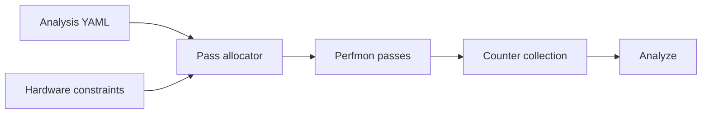

# Single-pass metrics and multi-pass metrics

**JIRA:** AIPROFCOMP-865 (parent AIPROFCOMP-864)

**Scope:** Correct multi-pass ratio errors on the analysis YAML that ships today.

The packing algorithm is in [Metric grouping for single-pass and multi-pass metrics](lld-metrics-grouping-algorithm.md). This document states why the change exists, what it must do, and which decisions it records.

**Related design:**

- [Analysis config YAML redesign](../analysis-config-redesign/hld-analysis-config-redesign.md#layer-details) — A collectable is a single-pass sub-expression of a multi-pass metric. This plan uses that idea on today’s panel YAML.
- [Three-layer analysis config LLD](../analysis-config-redesign/lld-index.md) and [metric library LLD](../analysis-config-redesign/lld-phase-a-metric-library.md) — the migration this plan does not do.

Older planning drafts are on branch `users/feizheng10/aiprofcomp-865-docs-backup`.

---

## System Context

`rocprof-compute profile` replays a kernel once per perfmon pass. Each hardware block in a pass has its own counter limit (`perfmon_config` on `CounterFile` in `src/rocprof_compute_soc/soc_base.py`). A pass can hold GRBM and SQ together, because each counter is charged only to its own block. The pass cannot hold more SQ counters than the SQ limit, even when GRBM still has room.

On gfx1250, `SP_VALU_*` and `SQ_VMEM_*` both charge that SQ block. They do not share a pass. The SP FLOP counters return zero when they do, and free SQ slots do not prevent that. The packer rejects the mix before it treats a PMC set as a single-pass metric set, and again when it places a set and places leftover counters. An extra pass is acceptable.

gfx942, the reference architecture, is one example from `src/utils/mi_gpu_spec.yaml`:

```yaml
- gpu_arch: gfx942
  perfmon_config:
    SQ: 8
    TA: 2
    TD: 2
    TCP: 4
    TCC: 4
    CPC: 2
    CPF: 2
    SPI: 6
    GRBM: 2
    GDS: 4
```

Analysis YAML defines a metric as an expression over PMC counters. A metric's PMC set is the hardware counters that expression reads. The shipping allocator puts each counter in one pass and cannot copy it. A metric whose counters were already placed gets split.



Surrounding pieces, unchanged by this design:

- The counter collector (rocprofiler-sdk) programs whatever each pass file names. This design does not change that collector.
- Panel YAML remains the metric source. A later metric-library migration is a different program.

### What this design does not cover

| Item | Why it is outside |
|------|-------------------|
| One pass for the whole chip | The contract is one pass per metric PMC set, not one pass for every counter on the device. |
| Moving metric definitions out of panel YAML into a separate metric library | This change uses today’s panel YAML; the metric-library migration comes later. |
| Metrics with no profile PMCs | Nothing to pack. On gfx942 that is 34 of 408 YAML rows. |
| Intentional values above 100% (VALU dual-issue) and hardware counter defects | Those are not packing bugs. This design does not add a silent analyze-time cap. |
| General hardware-instance metric framework | Today's TCC channel rules are a short-term solution; generalizing them is out of scope. |

### Shipping layout (gfx942 default profile)

Metric allocation statistics from the offline tool `tools/counter_grouping_inspector.py`:

| Quantity | Value |
|----------|------:|
| Unique hardware PMCs | 274 |
| Perfmon passes | **13** |
| YAML metrics | 408 |
| Metrics with profile PMCs | **374** |
| Already in one pass | **283** |
| Split across passes, but the PMC set fits one pass | **75** |
| PMC set does not fit one pass | **16** |
| No profile PMCs | 34 |

The 75 are metrics the old allocator split that now fit one pass. They are single-pass metrics like the other 283.

### Terms

A **single-pass metric** is a metric whose counters all fit in one pass. Analyze reads all of them from that pass.

A **multi-pass metric** is a metric whose counters can't fit in one pass. It is split into parts that each fit, then recombined.

A **collectable** is a named single-pass formula that metric formulas use as `$name`. A multi-pass metric combines collectables with ordinary operators. Phase 2 below states the rules.

| Term | Example |
|------|---------|
| single-pass metric | `CPC Utilization` |
| multi-pass metric | `VALU FLOPs` (F16/F32/F64 rates) |
| collectable | `$hbm_read_bandwidth`. HBM Bandwidth is `$hbm_read_bandwidth + $hbm_write_bandwidth` |

A PMC set that mixes GRBM with another block still belongs to a single-pass metric when each block has room. None of the 16 multi-pass metrics on gfx942 include GRBM.

### Constraints

- Counter limits are per hardware block, from `perfmon_config`. Copying a counter into a second pass is allowed when two PMC sets cannot share one pass.
- (408 / 374 / 358 / 16 / 34) is the gfx942 reference count. The same rules apply to other architectures.
- After this change, the code has one allocator, single-pass metric packing, and analyze always reads a metric from one pass.

Reported failures that this layout explains include [AIPROFCOMP-265](https://ontrack-internal.amd.com/browse/AIPROFCOMP-265) (CPC), [AIPROFCOMP-90](https://ontrack-internal.amd.com/browse/AIPROFCOMP-90) (L1 bandwidth above 100%), [AIPROFCOMP-268](https://ontrack-internal.amd.com/browse/AIPROFCOMP-268) (cache), [AIPROFCOMP-267](https://ontrack-internal.amd.com/browse/AIPROFCOMP-267) (TA/TD), [AIPROFCOMP-266](https://ontrack-internal.amd.com/browse/AIPROFCOMP-266) (Workgroup Manager utilization), and [ROCM-31864](https://ontrack-internal.amd.com/browse/ROCM-31864) (gfx950 L2-Fabric HBM / remote read traffic).

---

## Problem statement

For \(M = A/B\), `SUM(A)/SUM(B)` on counters merged from different perfmon passes is not the ratio of one kernel execution. The numerator and the denominator can come from different replays. Percent metrics then show averages and maxes that no single execution produced. `CPC Utilization` is the example: with the counters split, the reported average can sit far above 100%.

On gfx942, **75** of the **374** metrics that have profile PMCs are in that state only because the shipping allocator optimizes pass count for the whole counter list. Their PMC sets fit one pass. Another **16** do not fit one pass even after placement that respects each block’s counter limit. Both groups are wrong if analyze evaluates the full expression on merged passes. They are not the same fix.

Packing without reading each metric from one pass is still wrong once a counter is copied into more than one pass: analyze would merge those copies. Reading from one pass without packing leaves those 75 metrics split. Both halves are Phase 1, and they ship together.

---

## Requirements

### Functional

Priority is the order of delivery. Phase 1 handles single-pass metrics. Phase 2 handles only multi-pass metrics.

| ID | Priority | Requirement |
|----|----------|-------------|
| FR-1 | Phase 1 | For every single-pass metric, one perfmon pass holds that metric’s full PMC set. |
| FR-2 | Phase 1 | Analyze reads each single-pass metric expression from the first pass that holds every counter it reads. A ratio is not evaluated on values merged across replays. A metric that no pass holds reads each counter's first-pass value until Phase 2 splits it. |
| FR-3 | Phase 1 | When two PMC sets cannot share a pass, the same counter may be copied into another pass. |
| FR-4 | Phase 1 | A PMC set that mixes blocks (GRBM and SQ, for example) stays part of a single-pass metric when every block it touches still has room. |
| FR-5 | Phase 1 | The 75 metrics the old allocator split are fixed by FR-1 and FR-2. They stay one expression. They are not split into parts. |
| FR-6 | Phase 2 | Each multi-pass metric is split into parts whose counters each fit one pass. Each part is a collectable read from its own pass, and the metric combines the parts with ordinary operators. |
| FR-7 | Phase 2 | A split-weight ratio, \((M_0 C_0 + M_1 C_1)/(C_0 + C_1)\), is not in this change. No shipped metric uses it, so it lands with the first metric that needs it. |
| FR-8 | Phase 2 | A multi-pass metric's `min` and `max` read per-dispatch collectables, so each is the extremum over dispatches of the combined parts. |

### Non-functional

| ID | Requirement |
|----|-------------|
| NFR-1 | The single-pass packer places the gfx942 default profile in **14** passes, against 13 in the shipping layout. The cost is extra replays of some counters, not a new counter set (still 274 PMCs). The other measured layouts, not gates, are gfx908 14, gfx90a 14, gfx950 22, gfx1151 12, and gfx1250 24. |
| NFR-2 | Placing the counters that the 16 multi-pass metrics still need adds **0** passes on gfx942. Those counters are already in the Phase 1 layout. |
| NFR-3 | After this change, the code has one allocator, single-pass metric packing, and analyze reads each single-pass metric and each Phase 2 part from one pass. |
| NFR-4 | No silent analyze-time cap. A value above 100% is intentional or a hardware defect. |

### Guidelines

- The placement steps, including which TCC counters must share a pass, are in the grouping note. This document records the decision those steps implement.
- A split-weight ratio does not repair a metric whose PMC set fits one pass. Packing does. That ratio is not shipped until a metric needs it.

---

## Design

```
408 YAML metrics (gfx942 default)
├── 374 with profile PMCs
│   ├── 358 single-pass metrics   ← Phase 1 (14 passes, each metric read from one pass)
│   └── 16 multi-pass metrics     ← Phase 2, split into parts that each fit one pass
└── 34 with no profile PMCs   ← out of packing scope
```

### Phase 1 — packing, and reading each metric from one pass

**Collection.** Replace the shipping allocator. Place each single-pass metric PMC set into one pass. The grouping note calls that pass a bucket. The normative steps are in the grouping note: prefer a pass that already holds some of the set, and extend it only when every hardware block the new counters touch still has room.

**Analyze.** Analyze keeps one counter table per pass next to the merged counter table, and reads each metric from the first pass table that holds every counter its expression reads. A duration in the expression (`End_Timestamp - Start_Timestamp`) is the duration of that pass. A metric that no pass holds reads the merged table, where a copied counter keeps its first pass's value. The tables and pass selection are in [Reading each metric from one pass](lld-metrics-grouping-algorithm.md#3-reading-each-metric-from-one-pass).

In an ordinary profile the workload runs once per pass, and each pass writes its own result file. `--iteration-multiplexing` runs the workload once and rotates the passes across kernel launches, so each launch collects one pass. The imputer gives every launch each pass's counters from the launch of the same rotation that collected that pass. A pass's counters then come from one launch, and every launch is counted.

`$denom` is replaced at analyze time from `--normal-unit`, before the pass is chosen. `per_kernel` (the default) uses a per-dispatch unit column, and `per_second` uses that pass's duration. Neither adds a hardware counter. `per_wave` uses `SQ_WAVES`, and `per_cycle` uses `GRBM_GUI_ACTIVE`. Packing does not add those counters because an expression contains `$denom`. Kernel-launch fields — grid size, workgroup size, LDS and scratch allocation, and VGPR, AGPR, and SGPR counts — are dispatch-record columns, not perfmon counters, and do not select or reject a pass.

TCC: an L2 channel map can change between replays, so the counters one expression joins share a pass, and every channel of a TCC counter goes into the same pass. Each latency row names its `_LEVEL` counter with its request counter, and table 1805 (L2-Fabric Requests) names read, write, and atomic requests in one row, so the general packing keeps each of them in one pass. Details are in the grouping note.

### Phase 2 — splitting multi-pass metrics into single-pass parts

A multi-pass metric cannot fit one pass. Split it into parts whose counters each fit one pass, and write each part as a collectable: a named formula that metric formulas use as `$name`, like the built-in `$GRBM_GUI_ACTIVE_PER_XCD`. The built-in variables are collectables too. Each arch's collectables are in `analysis_configs/collectables/<arch>_collectables.yaml`; the metric library keeps the same ones in its `collectables.yaml`.

Analyze computes a collectable on the first pass that holds all of its counters. A metric that names counters only through collectables reads each collectable from its own pass, and combines them with the operators every formula uses:

```yaml
value: $hbm_read_bandwidth + $hbm_write_bandwidth
value: SUM($valu_f16_flops + $mfma_f16_flops) / SUM($hbm_read_bytes + $hbm_write_bytes)
```

- A count is written without `SUM`, so it has a value per dispatch, and the metric sums it. A sum or difference of counts from different passes needs nothing else.
- A ratio keeps its numerator and denominator in one collectable, with `SUM` (`100 * SUM(A) / SUM(B)`), so both come from one pass. That collectable is one value for all dispatches.
- A `min` or `max` needs a value per dispatch, so it reads a second collectable without `SUM`, named `<name>_per_dispatch`.
- A collectable never uses `$denom`. The metric divides by it.

Profile gives each collectable its own counter set, so packing keeps its counters in one pass.

gfx942 has **16** multi-pass metrics and **10** unique PMC sets. Some metrics appear in more than one panel and share a set:

| Unique set | Formula |
|------------|---------|
| VALU FLOPs | Sum of the F16, F32 and F64 rates |
| HBM Bandwidth | Sum of the read and write rates. Each rate is `SUM(bytes) / SUM(duration)` from its own pass |
| Performance GFLOPs | Sum of the VALU and MFMA rates |
| IPC Issued | Sum of two issued ratios, each `SUM(instructions) / SUM(cycles)` from its own pass |
| AI HBM/L2/L1/LDS | Summed FLOP counts over summed bytes |
| vL1D hit | `100` minus the read/write and atomic miss rates |
| Read Instructions | Load wavefronts minus store and atomic wavefronts, over `$denom` |

After Phase 2 YAML, the gfx942 gate is **14** passes and no multi-pass metrics. `tools/counter_grouping_inspector.py --arch gfx942` prints both: the pass count, and the metrics that no single pass holds. The 16 metrics then read their counters only through collectables, so they are not counted there. A run before the Phase 2 YAML still reports 16 multi-pass metrics, because those 16 parents are still single expressions.

### Decisions and alternatives

| Decision | Why | Alternative |
|----------|-----|-------------|
| single-pass metric packing replaces the shipping allocator | The shipping pack minimizes passes for all 274 counters, so 75 metrics whose sets fit one pass stay split | The shipping allocator's hand-kept list of a few metric IDs. It visits those IDs first. The greedy pass still visits every metric |
| On gfx1250, `SP_VALU_*` and `SQ_VMEM_*` do not share a pass | Both charge SQ, and the SP FLOP counters return zero when they share a pass. Free SQ slots do not prevent that. The check runs before a set is called a single-pass metric set, and during placement, merge, and leftover fill. An extra pass is acceptable | Treating free SQ slots as enough to share a pass |
| Copy a counter into another pass when two PMC sets cannot share a pass | Keeping each counter in only one pass cannot place all 358 single-pass metric sets, and gfx942 stays at 14 passes | One dedicated pass per metric |
| Reading each metric from one pass ships with packing | A copied counter has several values. Merging them evaluates the ratio on different replays. `CPC Utilization` averages can sit far above 100% | Packing alone, or reading from one pass alone |
| One counter table per pass, chosen per metric | The unchanged expression runs on one pass's table, so analyze does not rewrite expressions or keep per-pass copies of columns | One merged table with a column per pass for each copied counter |
| A metric that no pass holds reads each counter's first-pass value | Phase 2 splits the multi-pass metrics into single-pass parts. What is left is a `$denom` counter on another pass (`per_wave`, `per_cycle`), the gfx950 memory bandwidth panel under `--membw-analysis`, and older profiles | Leaving the metric unset |
| Phase 2 only for the 16 multi-pass metrics | Those sets do not fit one pass after placement. None of them include GRBM | Splitting a metric whose PMC set already fits one pass |
| Parts are collectables that metrics combine with ordinary operators | Collectables reuse the `$name` notation and evaluation of the built-in variables, so no new operator, row type or evaluation path is needed | `COLLECT_SUM` and `COLLECT_RATIO` operators over hidden `_collect` rows |
| Largest-first greedy placement | On gfx942 it gives every single-pass metric a pass that holds all of its counters, in 14 passes. A solver on the allocate path is harder to explain when a metric is split | Using an optimization solver (OR-Tools CP-SAT) to allocate. That solver is no longer on the allocate path |
| Table 1805's read, write, and atomic counters stay one PMC set | Those three request columns are one execution, and the row names all three, so packing keeps them in one pass. gfx942 stays at 14 passes | Giving read, write, and atomic each their own PMC set |

---

## Validation, security and debuggability

### Tests

On gfx942, every single-pass metric gets a pass that holds all of its counters.

| Layer | What it shows | Tied to |
|-------|----------------|---------|
| Unit | Packing (`test_allocator`, `test_counter_file`, `soc_base`), reading each metric from one pass (`test_utils_analysis`, `test_metric_evaluator`, CLI and database analyze), collectables (`test_utils_counter_defs`, `test_evaluation_pipeline`, `test_every_metric_reads_one_pass`) | FR-1, FR-2, FR-6 |
| Offline | After Phase 2 YAML, `tools/counter_grouping_inspector.py --arch gfx942`: **14** passes and no multi-pass metrics. A run before that YAML still reports 16 multi-pass metrics | FR-1, FR-5, NFR-1, NFR-2 |
| End to end | Three workloads — `vcopy`, `nbody` (`mini-nbody`), `mega_kernel` — on gfx908, gfx90a, gfx942, gfx950, and gfx115x, including gfx1151. Not gfx1250. CPX is a host precondition for the gfx942 run. The baseline is a separate run of `rocprofiler-compute-develop` on the same workloads | FR-2, NFR-4, the tickets in System Context |
| Phase 2 only | The 16 multi-pass metrics: each part is a collectable that fits one pass, and the metric combines the parts | FR-6, FR-8 |

Profile the same workloads with this build and with a separate `rocprofiler-compute-develop` build, and analyze each profile to CSV with the build that made it. `tools/generate_metric_health_report.py` compares the two runs. It checks that there are no unexpected negative values and that percents stay in 0–100% except documented exceptions. Re-check the tickets listed under System Context. The report is not part of the packing algorithm.

### Debugging a bad ratio

The failure mode is a wrong ratio, not a crash. Each pass table holds only that pass's counters, so the values an expression used can be read from that table. A metric that no pass holds reads the merged table, where each collectable it names still reads its own pass. `tools/counter_grouping_inspector.py` prints the pass layout and the multi-pass metrics without a GPU. Compare against a `rocprofiler-compute-develop` run to tell a layout change from a change in which pass analyze reads.

### Security

No new privilege, network, or credential surface. Profile still launches the existing counter collector.

---

## Open questions

- Filtered `--block` / `--set` profiles allocate only the counters that were requested. There is no separate acceptance count for those subsets.
- One replay can still be split into time slices. This design does not cover that. Reading each metric from one pass is about which replay the counters come from.
