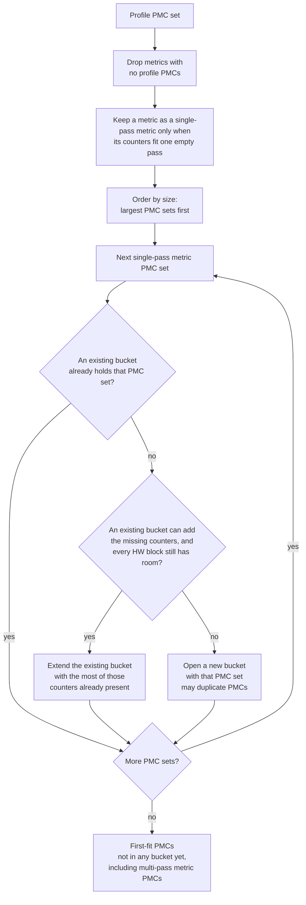

# Metric grouping for single-pass and multi-pass metrics

**Parent:** [High-level design](hld-plan.md)

This note is the collection algorithm for Phase 1 in the high-level design (requirement FR-1), and how analyze reads every counter of a metric from one pass. The rule for combining multi-pass metric parts across passes, and the YAML functions that combine them, stay in the high-level design.

A metric's **PMC set** is the hardware counters its expression reads. For a single-pass metric, they share one perfmon pass. A **bucket** is one perfmon pass. This note uses "bucket" for that pass. A block's counter limit is that block's capacity in `perfmon_config` (`CounterFile` in `src/utils/counters/counter_file.py`). Each hardware block has its own counter limit per pass.

---

## 1. Algorithm

Single-pass metric packing (`allocate_single_pass_metrics`, called from `_allocate_perfmon_counter_files` in `soc_base.py`) replaces the shipping allocator, including its hand-kept list of metrics to keep together.

Why this allocator: the shipping pack minimizes passes for the whole counter list, so metrics whose PMC sets fit one pass stay split. Largest-first gives a large set a bucket before smaller sets fragment the open passes.

1. Build each metric's PMC set from the profiled counters (`metric_counter_sets`). A TCC counter in a formula stands for all of its profiled L2 channels. Metrics with no profile PMCs are dropped. A metric is a single-pass metric when its PMC set fits one empty pass under every block's limit. On gfx1250 that fit also rejects a set that contains both an `SP_VALU_*` counter and an `SQ_VMEM_*` counter, even when the SQ block still has room. Both families charge SQ, and the SP FLOP counters return zero when they share a pass. Every other metric with profile PMCs is a multi-pass metric. The YAML does not mark which is which.
2. Largest-first: place each **single-pass metric** PMC set with the existing-bucket and per-block slot checks in §2. Copy a counter into another pass when two sets cannot share a bucket.
3. First-fit: every counter that is not in a bucket yet, including the counters of multi-pass metrics, goes into the first bucket with room, or into a new bucket. A counter that does not fit an empty bucket stops profiling with an error.

No later step can save a pass. A bucket is opened only when its first counters fit no open bucket, and adding counters never frees a slot, so no two buckets can be merged.

A `*_ACCUM` counter (for example `SQ_INST_LEVEL_VMEM_ACCUM`) costs 2 slots: one for its base counter and one for the register that accumulates it. A base counter collected on its own costs 1, so a base counter and its `*_ACCUM` together cost 3. Each `*_ACCUM` counter has its own accumulating register, so several can share a pass when the SQ block has room.

**Decisions.** The list is in the high-level design: [Decisions and alternatives](hld-plan.md#decisions-and-alternatives).

**Primary packing code:** `src/utils/counters/allocator.py`, `src/utils/counters/counter_file.py`, `soc_base.py`.

---

## 2. Flowchart

A **bucket** is one perfmon pass. This chart is the placement flow: largest-first, then first-fit for the remaining counters. TCC is checked against that block's counter limit. One TCC counter name uses one slot. Copies of that counter on other L2 channels do not use another slot. ACCUM charging happens when a counter is added to a bucket.

**How a single-pass metric PMC set is placed.** Candidates are the unique sets, visited largest first. Equal-size PMC sets are visited in sorted counter-name order; an equal overlap keeps the earliest bucket; leftover counters are taken in sorted name order. For each set the allocator tries buckets already opened before it opens a new one:

1. **Fit an existing bucket.** If a bucket already holds the whole PMC set, leave it. Otherwise extend the opened bucket that already contains the most of those counters, and add only the missing ones.
2. **Fit each hardware block's slot limit.** Extend only when every block the new counters touch still has room (GRBM, SQ, and so on). Each counter is charged to its own block. If any block is full, skip that bucket. On gfx1250, also skip a bucket that would hold both an `SP_VALU_*` counter and an `SQ_VMEM_*` counter. That rejection applies when a set is placed and when leftover counters are added. Open a new bucket only when no existing bucket can hold the set. The same counter may be copied into another pass when two PMC sets cannot share one bucket. An extra pass for that gfx1250 split is acceptable.

Overlap-first keeps the new counters in a pass that already has the rest of the set, so another pass does not replay them unless two PMC sets cannot share a bucket. The per-block check is why a mixed GRBM and SQ set is still one pass: a full SQ budget skips that bucket even when GRBM still has room. None of the 16 multi-pass metrics on gfx942 include GRBM.

### Sample walk-through

Profile PMCs: `A B C D E F`. **3 counters per bucket** (one cap in the toy; a real bucket checks each hardware block's slot limit, as above).

Single-pass metric PMC sets:

- HBM-like = `{A, B}`
- M1 = `{C, D, E}`
- M2 = `{A, F}`
- M3 = `{B, D}`

Visit order: largest PMC sets first (M1, then HBM-like, M2, M3).

1. **M1 = `{C, D, E}`** — open bucket0 = `{C, D, E}`.
2. **HBM-like = `{A, B}`** — open bucket1 = `{A, B}`.
3. **M2 = `{A, F}`** — extend bucket1 → `{A, B, F}`.
4. **M3 = `{B, D}`** — B is in bucket1 and D is in bucket0, and both buckets are full (3 counters each), so open bucket2 = `{B, D}` (B is now in bucket1 and bucket2).
5. **First-fit** — no profile PMC is still unplaced, so the layout does not change.

---

## 3. Reading each metric from one pass

Analyze reads all of a metric's counters from the same pass. Code: `split_counters_by_pass` and `impute_counters_iteration_multiplex` in `utils_analysis.py`, `counter_table_index` in `metric_evaluator.py`, and both analyze entry points: CLI (`eval_metric`) and DB (`calc_dataframe_expressions`).

- **Tables.** Analyze keeps the merged counter table, one row per dispatch, and one counter table per pass on the same rows. A pass table holds the dispatch columns and only the counters and timestamps that pass collected. In the merged table, a counter that several passes collected keeps the first pass's value.
- **Pass names.** A pass is named after its result file without the prefix and suffix: `results_pmc_perf_3.csv.gz` becomes `pmc_perf_3`. Passes are in number order (`pmc_perf_2` before `pmc_perf_10`).
- **Iteration multiplexing.** One run writes one result file, and each launch of a kernel collects one pass in rotation. The imputer tells a launch's pass from the counters it collected. Each pass table copies that pass's counters from the launch of the same rotation that collected it, so every launch is counted and a pass's counters come from one launch.
- **Pass selection.** A metric reads the first pass table that has every column its expression reads, including the columns its built-in variables read. Grid size, workgroup size, LDS and scratch allocation, and register counts are dispatch columns, present in every pass table.
- **Duration.** `End_Timestamp - Start_Timestamp` is the duration of the selected pass.
- **No pass holds the metric.** The metric reads the merged table, so each counter has its first pass's value. That is approximate; Phase 2 splits those metrics into parts that each fit one pass.

---

## 4. TCC counters that must share a pass

An L2 channel map can change between replays, so the counters one expression joins share a pass. A TCC counter is read once per L2 channel. When one channel is in a bucket, every channel of that counter joins the same bucket without using another slot (`LimitedSet.add`).

No other TCC rule is needed. Each latency row names its `_LEVEL` counter with its request counter, and table 1805 (L2-Fabric Requests) names read, write, and atomic requests in one row, so the general packing gives each of those sets a pass that holds all of it. A general way to handle other replicated blocks is **out of scope**.

### Other replicated blocks (out of scope)

Today the replicated block is a TCC channel. TCP, a shader engine, and SDMA come later. TCC is the first block that needs this. A later design would cover:

- Each replica of a block exposes its own counter.
- A metric sums, averages, or otherwise combines the readings from those replicas.
- A metric compares replicas with each other.
- Counters that one expression combines share a pass when the replica map can change between replays.
