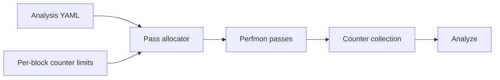

# Single-pass packable and unpackable

**JIRA:** AIPROFCOMP-865 (parent AIPROFCOMP-864)

**Scope:** Correct multi-pass ratio errors on the analysis YAML that ships today.

The packing algorithm is in [Metric grouping (SPP / SPU)](lld-metrics-grouping-algorithm.md). This document states why the change exists, what it must do, and which decisions it locks.

**Related design:**

- [Analysis config YAML redesign](../design/analysis-config-redesign/hld-analysis-config-redesign.md#layer-details) — A collectable is one part of a split metric. Its counters fit in one hardware pass. This plan uses that idea on today’s panel YAML.
- [Three-layer analysis config LLD](../design/analysis-config-redesign/lld-index.md) and [metric library LLD](../design/analysis-config-redesign/lld-phase1-metric-library.md) — the migration this plan does not do.

Older planning drafts are on branch `users/feizheng10/aiprofcomp-865-docs-backup`.

---

## System Context

`rocprof-compute profile` replays a kernel once per perfmon pass. Each hardware block in a pass has its own counter limit (`perfmon_config` on `CounterFile` in `src/rocprof_compute_soc/soc_base.py`). A pass can hold GRBM and SQ together, because each counter is charged only to its own block. The pass cannot hold more SQ counters than the SQ limit, even when GRBM still has room.

Analysis YAML defines a metric as an expression over PMC counters. The shipping allocator packs the whole counter list into as few passes as it can. It does not require one metric’s counters to share a pass. Analyze then evaluates the expression on values merged across those replays.



Surrounding pieces, unchanged by this design:

- The counter collector (rocprofiler-sdk) programs whatever each pass file names. This design does not change that collector.
- Panel YAML remains the metric source. A later metric-library migration is a different program.

### What this design does not cover

| Item | Why it is outside |
|------|-------------------|
| One pass for the whole chip | The contract is one pass per metric PMC set, not one pass for every counter on the device. |
| Metric-library migration (MetricLibrary, Stage 4, an SDK collectables registry) | This change uses today’s panel YAML; the metric-library migration comes later. |
| Metrics with no profile PMCs | Nothing to pack. On gfx942 that is 34 of 408 YAML rows. |
| Intentional values above 100% (VALU dual-issue) and hardware counter defects | Those are not packing bugs. This design does not add a silent analyze-time cap. |
| Single-XCD L2 channel correction, SQG counter omission | Separate from pass placement and expression bind. |
| General hardware-instance metric framework | Today's TCC channel rules are a short-term solution; generalizing them is out of scope. |

### Shipping layout (gfx942 default profile)

Metric allocation statistics from the offline tool `tools/counter_grouping_inspector.py`:

| Quantity | Value |
|----------|------:|
| Unique hardware PMCs | 274 |
| Perfmon passes | **13** |
| YAML metrics | 408 |
| Metrics with profile PMCs | **374** |
| Already in one pass | **283** |
| Split across passes, but the PMC set fits one pass | **75** |
| PMC set does not fit one pass | **16** |
| No profile PMCs | 34 |

The 75 are metrics the old allocator split that now fit one pass. They are SPP like the other 283.

### Terms

A **single-pass packable (SPP)** metric is a metric whose counters fit in one pass and are read from that pass. Collection may also copy one of its counters into other passes. Analyze tells those copies apart by the result-file stem of each pass, such as `pmc_perf_3`: only a counter that appears in more than one pass is suffixed, and when several passes hold the whole set the earliest stem in natural order wins.

A **single-pass unpackable (SPU)** metric is one whose counters cannot fit one empty pass under each block's counter limit. Phase 2 splits it into collectables and recombines them only under the cross-run rule.

A **collectable** is one part of a split metric whose counters fit in one pass.

**Same-pass bind** means analyze reads all of a metric's counters from the same pass.

| Term | Example |
|------|---------|
| SPP | `CPC Utilization` |
| SPU | `VALU FLOPs` (F16/F32/F64 rates) |
| Collectable | `hbm_read_sub` (HBM Bandwidth read part) |
| `WEIGHTED_AVG` | One ratio whose weight was split: \((M_0 C_0 + M_1 C_1)/(C_0 + C_1)\), e.g. `WEIGHTED_AVG(read_ratio_sub, write_ratio_sub)` weighted by `TCC_EA0_RDREQ_sum` and `TCC_EA0_WRREQ_sum` |
| `COLLECT_SUM` / `COLLECT_RATIO` | A sum of collectables, and a ratio of summed collectables. HBM Bandwidth is `COLLECT_SUM(hbm_read_sub, hbm_write_sub)` |

A PMC set that mixes GRBM with another block is still SPP when each block has room. None of the 16 SPU metrics on gfx942 include GRBM.

### Constraints

- Counter limits are per hardware block, from `perfmon_config`. Copying a counter into a second pass is allowed when two PMC sets cannot share one bucket.
- gfx942 is the reference count (408 / 374 / 358 / 16 / 34). Other arches use the same rules; their pass counts are a measurement, not a second design.
- The final tree has one implementation: SPP packing and same-pass bind.

Reported failures that this layout explains include [AIPROFCOMP-265](https://ontrack-internal.amd.com/browse/AIPROFCOMP-265) (CPC), [AIPROFCOMP-90](https://ontrack-internal.amd.com/browse/AIPROFCOMP-90) (L1 bandwidth above 100%), [AIPROFCOMP-268](https://ontrack-internal.amd.com/browse/AIPROFCOMP-268) (cache), [AIPROFCOMP-267](https://ontrack-internal.amd.com/browse/AIPROFCOMP-267) (TA/TD), [AIPROFCOMP-266](https://ontrack-internal.amd.com/browse/AIPROFCOMP-266) (Workgroup Manager utilization), and [ROCM-31864](https://ontrack-internal.amd.com/browse/ROCM-31864) (gfx950 L2-Fabric HBM / remote read traffic).

---

## Problem statement

For \(M = A/B\), `SUM(A)/SUM(B)` on counters merged from different perfmon passes is not the ratio of one kernel execution. The numerator and the denominator can come from different replays. Percent metrics then show averages and maxes that no single execution produced. `CPC Utilization` is the example: with the counters split, the reported average can sit far above 100%.

On gfx942, **75** of the **374** metrics that have profile PMCs are in that state only because the shipping allocator optimizes pass count for the whole counter list. Their PMC sets fit one pass. Another **16** do not fit one pass even after placement that respects each block’s counter limit. Both groups are wrong if analyze evaluates the full expression on merged passes. They are not the same fix.

Packing without same-pass bind is still wrong once a counter is copied into more than one pass: analyze would merge those copies. Bind without packing leaves those 75 metrics split. Both halves are SPP, and they ship together.

---

## Requirements

### Functional

Priority is the order of delivery. Phase 1 is the packable set. Phase 2 is only the unpackable parents.

| ID | Priority | Requirement |
|----|----------|-------------|
| FR-1 | Phase 1 | For every SPP metric, one perfmon pass holds that metric’s full PMC set. |
| FR-2 | Phase 1 | Analyze binds each SPP expression to that pass. A ratio is not evaluated on values merged across replays. If the selected pass does not hold every counter the expression needs, including `SQ_WAVES` and `GRBM_GUI_ACTIVE`, the metric stays unset. There is no bare-column fallback, and no exception that reads those denominators from another pass. |
| FR-3 | Phase 1 | When two PMC sets cannot share a bucket, the same counter may be copied into another pass. |
| FR-4 | Phase 1 | A PMC set that mixes blocks (GRBM and SQ, for example) stays SPP when every block it touches still has room. |
| FR-5 | Phase 1 | The 75 metrics the old allocator split are fixed by FR-1 and FR-2. They are not collectables. |
| FR-6 | Phase 2 | Each SPU parent is split into collectables and recombined at analyze time only under the cross-run rule. Otherwise the parent stays unset. |
| FR-7 | Phase 2 | `WEIGHTED_AVG` is only for a ratio whose weight was split and only when the weight comes from the same pass as its sub-ratio. Sums use `COLLECT_SUM`. A ratio of summed pieces uses `COLLECT_RATIO` only when every divided counter shares a pass. |
| FR-8 | Phase 2 | A null composite `min` / `max` stays unset, so grouping does not pull the parent’s full PMC set back into a pass. A counter-bearing `min`, `max`, or `peak` fails config load. |

### Non-functional

| ID | Requirement |
|----|-------------|
| NFR-1 | The single-pass packer places the gfx942 default profile in **14** passes, against 13 in the shipping layout. The cost is extra replays of some counters, not a new counter set (still 274 PMCs). |
| NFR-2 | SPU residual fill adds **0** passes on gfx942. Counters those 16 parents need are already in the Phase 1 layout. |
| NFR-3 | The final tree is SPP packing and same-pass bind. |
| NFR-4 | No silent analyze-time cap. A value above 100% is intentional or a hardware defect. |

### Guidelines

- The bucket walk, TCC series affinity, and the placement flowchart live in the grouping note. This document records the decision those steps implement.
- `WEIGHTED_AVG` does not repair a metric whose PMC set fits one pass. Packing does.

---

## Design

```
408 YAML metrics (gfx942 default)
├── 374 with profile PMCs
│   ├── 358 SPP    ← Phase 1 (14 passes + same-pass bind)
│   └── 16 SPU     ← Phase 2 collectables
└── 34 with no profile PMCs   ← out of packing scope
```

### Phase 1 — packing and same-pass bind

**Collection.** Replace the shipping allocator. Place each SPP PMC set into one bucket (one perfmon pass). The normative steps are in the grouping note: prefer a bucket that already holds some of the set, and extend it only when every hardware block the new counters touch still has room.

**Analyze.** When a counter is copied across passes, analyze keeps one column per pass, keyed by the result-file stem, and binds each SPP expression to one pass that holds its whole PMC set. If that pass does not hold every counter the expression needs, including `SQ_WAVES` and `GRBM_GUI_ACTIVE`, the metric stays unset. There is no bare-column fallback, and no exception that reads those denominators from another pass. A duration in a bound expression (`End_Timestamp - Start_Timestamp`) is the duration of that expression's pass. Timestamps do not choose the pass. The column naming and pass selection are in the grouping note.

TCC is a short-term note on this phase. An L2 channel map can change between replays, so counters one expression joins share a pass. Panel 1805 binds to the earliest stem that holds read, write, and atomic. It does not bind to the `ATOMIC_LEVEL` pass. Extra `RDREQ` and `WRREQ` copies may remain on LEVEL passes that do not hold `ATOMIC`. gfx942 stays at 14 passes. Details are in the grouping note.

### Phase 2 — collectables for SPU

**Cross-run rule.** Only addition, or scaling by a constant, may combine values from different passes. Subtraction, division, and multiplication require one pass. Otherwise the metric stays unset.

An SPU parent cannot fit one pass. Split it. Each collectable is an ordinary SPP row bound to its own pass. The parent is an analyze-time composite, and it is published only when its operator obeys the cross-run rule.

- `COLLECT_SUM` adds collectables. A positive `COLLECT_SUM` may add across passes. It is valid for absolute counts, bytes, and rates that are only added: VALU FLOPs, HBM bandwidth bytes, IPC issued pieces, Performance GFLOPs. A subtracted `COLLECT_SUM` must share the same bound pass. There is no denominator pass for `COLLECT_SUM`. A piece subtracted from another pass stays unset.
- `WEIGHTED_AVG` rebuilds one ratio whose weights were split: \(M = (M_0 C_0 + M_1 C_1)/(C_0 + C_1)\). Each weight must come from the same pass as its sub-ratio. If that pass does not hold the weight, the parent stays unset.
- `COLLECT_RATIO` divides summed numerator pieces by summed denominator pieces. A quotient whose numerator and denominator come from different passes is not a same-execution ratio. The parent stays unset unless every divided counter shares a pass.

```yaml
value: COLLECT_SUM(hbm_read_sub, hbm_write_sub)
```

```yaml
avg: WEIGHTED_AVG(read_ratio_sub, write_ratio_sub)
_weighted_avg:
  read_ratio_sub:
    weight_counter: TCC_EA0_RDREQ_sum
  write_ratio_sub:
    weight_counter: TCC_EA0_WRREQ_sum
```

Runtime Python generation of composites was considered and is not a runtime path; explicit YAML is the only runtime source of truth.

gfx942 has **16** SPU parents and **10** unique PMC sets (panel mirrors share a set). Each collectable is single-pass. Under the cross-run rule some parents stay unset:

| Unique set | Composite | Result |
|------------|-----------|--------|
| VALU FLOPs | `COLLECT_SUM` F16/F32/F64 rates | Published |
| HBM Bandwidth | `COLLECT_SUM` read/write bytes | Published |
| Performance GFLOPs | `COLLECT_SUM` VALU+MFMA rates | Published |
| IPC Issued | `COLLECT_SUM` two issued slices | Published |
| AI HBM/L2/L1/LDS | `COLLECT_RATIO` FLOP pieces over bytes | Unset unless every divided counter shares a pass. FLOP counts from one pass over bytes from another are not a same-execution ratio |
| vL1D hit | `COLLECT_SUM` non-RW hit + atom correction | Unset unless the subtracted pieces share the same bound pass. A correction subtracted across passes can leave 0–100% |
| Read Instructions | `COLLECT_SUM` load + (−store−atomic) | Unset unless the subtracted pieces share the same bound pass. Load from one pass plus −(store+atomic) from another can go negative |

After Phase 2 YAML, the gfx942 allocator gate is `packable_multi == 0`, passes == **14**, `slot_additional_passes == 0`, and `slot_limit_metrics == 0`. The 16 are `COLLECT_*` composite parents, not hardware slot-limit metrics. A health PR that runs before that Phase 2 YAML may still see `slot_limit_metrics == 16`. Offline check: `tools/eval_single_pass_packable.py --arch gfx942`.

### Decisions and alternatives

| Decision | Why | Alternative |
|----------|-----|-------------|
| SPP packing replaces the shipping allocator | The shipping pack minimizes passes for all 274 counters, so 75 metrics whose sets fit one pass stay split | Priority-list coalesce. It steers a few metric ids and does not cover the rest |
| Copy a counter into another pass when two PMC sets cannot share a bucket | Unique assignment cannot place all 358 SPP sets, and gfx942 stays at 14 passes | One dedicated pass per metric |
| Same-pass bind ships with packing | A copied counter has several values. Merging them evaluates the ratio on different replays. `CPC Utilization` averages can sit far above 100% | Packing alone, or bind alone |
| A failed bind leaves the metric unset | Values merged across passes are the error this design removes | Falling back to merged columns |
| Phase 2 only for the 16 SPU parents | Those sets do not fit one pass after placement. None of them include GRBM | `WEIGHTED_AVG` for metrics whose set fits one pass |
| Cross-run rule: only addition or constant scaling across passes | Subtraction, division, and multiplication of values from different replays do not describe one execution | A new operator that keeps the old number |
| Largest-first greedy placement | It meets the gfx942 gates (`packable_multi == 0`, 14 passes). A solver on the allocate path is harder to explain when a metric is split | CP-SAT as the production allocator (removed from allocate) |
| Panel 1805 stays one packing group | The read, write, and atomic request columns are one execution. Bind uses the earliest stem that holds all three, not the `ATOMIC_LEVEL` pass. gfx942 stays at 14 passes | Splitting 1805 into three packing groups |

---

## Validation, security and debuggability

### Tests

SPP coverage on gfx942 is `packable_multi == 0`. SPU residual fill adds 0 passes.

| Layer | What it shows | Tied to |
|-------|----------------|---------|
| Unit | Packing (`test_counter_grouping_single_pass`, buckets, `soc_base`), same-pass bind (`test_pass_provenance`, DB bind), composites and the cross-run rule (`test_collectable`, `test_weighted_avg*`, `test_collect_ratio`) | FR-1, FR-2, FR-6, FR-7 |
| Offline | After Phase 2 YAML, `tools/eval_single_pass_packable.py --arch gfx942`: `packable_multi == 0`, **14** passes, `slot_additional_passes == 0`, `slot_limit_metrics == 0`. The 16 are `COLLECT_*` composite parents. A health PR before that YAML may still see `slot_limit_metrics == 16` | FR-1, FR-5, NFR-1, NFR-2 |
| End to end | Three workloads — `vcopy`, `nbody` (`mini-nbody`), `mega_kernel` — on gfx908, gfx90a, gfx942, gfx950, and gfx1151. Not gfx115x or gfx1250. CPX is a host precondition for the gfx942 run. The baseline is a separate run of `rocprofiler-compute-develop` on the same workloads | FR-2, NFR-4, the tickets in System Context |
| Phase 2 only | The 16 SPU parents: each collectable is one pass, and a parent is published only when the cross-run rule allows it | FR-6, FR-7, FR-8 |

The health test report compares the two runs' artifact directories. It checks that there are no unexpected negative values and that percents stay in 0–100% except documented exceptions. Re-check the tickets listed under System Context and generate a summary report. The report is not part of the packing algorithm.

### Debugging a bad ratio

The failure mode is a wrong ratio, not a crash. Loaded frames keep one column per pass for a copied counter, so the pass an expression used is visible in the data. A metric that cannot be bound to one pass, or a composite that breaks the cross-run rule, is unset with a warning. `eval_single_pass_packable.py` prints the offline gates without a GPU. Compare against a `rocprofiler-compute-develop` run to tell a layout change from a bind change.

### Security

No new privilege, network, or credential surface. Profile still launches the existing counter collector.

---

## Open questions

- Pass budgets other than gfx942 are not locked. gfx1250 stays an open question: it may need an explicit rule that some blocks never share a bucket (VALU versus VMEM). That constraint is not in this design, and gfx1250 is not a health-runner arch.
- Filtered `--block` / `--set` profiles allocate only the counters that were requested. There is no separate acceptance count for those subsets.
- A null composite `min` / `max` stays unset (FR-8). A counter-bearing `min`, `max`, or `peak` fails config load. A later definition of composite min/max is deferred.
- Iteration multiplexing inside one replay is outside same-pass bind.
