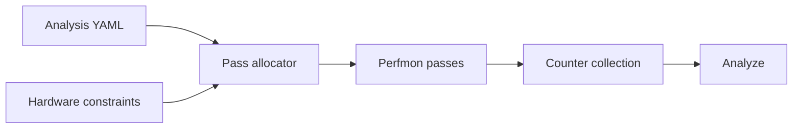

# Single-pass packable and unpackable

**JIRA:** AIPROFCOMP-865 (parent AIPROFCOMP-864)

**Scope:** Correct multi-pass ratio errors on the analysis YAML that ships today.

The packing algorithm is in [Metric grouping (SPP / SPU)](lld-metrics-grouping-algorithm.md). This document states why the change exists, what it must do, and which decisions it records.

**Related design:**

- [Analysis config YAML redesign](../design/analysis-config-redesign/hld-analysis-config-redesign.md#layer-details) — A collectable is one part of a split metric. Its counters fit in one hardware pass. This plan uses that idea on today’s panel YAML.
- [Three-layer analysis config LLD](../design/analysis-config-redesign/lld-index.md) and [metric library LLD](../design/analysis-config-redesign/lld-phase1-metric-library.md) — the migration this plan does not do.

Older planning drafts are on branch `users/feizheng10/aiprofcomp-865-docs-backup`.

---

## System Context

`rocprof-compute profile` replays a kernel once per perfmon pass. Each hardware block in a pass has its own counter limit (`perfmon_config` on `CounterFile` in `src/rocprof_compute_soc/soc_base.py`). A pass can hold GRBM and SQ together, because each counter is charged only to its own block. The pass cannot hold more SQ counters than the SQ limit, even when GRBM still has room.

gfx942, the reference architecture, is one example from `src/utils/mi_gpu_spec.yaml`:

```yaml
- gpu_arch: gfx942
  perfmon_config:
    SQ: 8
    TA: 2
    TD: 2
    TCP: 4
    TCC: 4
    CPC: 2
    CPF: 2
    SPI: 6
    GRBM: 2
    GDS: 4
```

Analysis YAML defines a metric as an expression over PMC counters. A metric's PMC set is the hardware counters that expression reads. The shipping allocator packs the whole counter list into as few passes as it can. It does not require one metric’s counters to share a pass. Analyze then evaluates the expression on values merged across those replays.



Surrounding pieces, unchanged by this design:

- The counter collector (rocprofiler-sdk) programs whatever each pass file names. This design does not change that collector.
- Panel YAML remains the metric source. A later metric-library migration is a different program.

### What this design does not cover

| Item | Why it is outside |
|------|-------------------|
| One pass for the whole chip | The contract is one pass per metric PMC set, not one pass for every counter on the device. |
| Moving metric definitions out of panel YAML into a separate metric library | This change uses today’s panel YAML; the metric-library migration comes later. |
| Metrics with no profile PMCs | Nothing to pack. On gfx942 that is 34 of 408 YAML rows. |
| Intentional values above 100% (VALU dual-issue) and hardware counter defects | Those are not packing bugs. This design does not add a silent analyze-time cap. |
| General hardware-instance metric framework | Today's TCC channel rules are a short-term solution; generalizing them is out of scope. |

### Shipping layout (gfx942 default profile)

Metric allocation statistics from the offline tool `tools/counter_grouping_inspector.py`:

| Quantity | Value |
|----------|------:|
| Unique hardware PMCs | 274 |
| Perfmon passes | **13** |
| YAML metrics | 408 |
| Metrics with profile PMCs | **374** |
| Already in one pass | **283** |
| Split across passes, but the PMC set fits one pass | **75** |
| PMC set does not fit one pass | **16** |
| No profile PMCs | 34 |

The 75 are metrics the old allocator split that now fit one pass. They are SPP like the other 283.

### Terms

A **single-pass packable (SPP)** metric is a metric whose counters fit in one pass and are read from that pass. Collection may also copy one of its counters into other passes. Each pass writes its own result file (`results_pmc_perf_3.csv.gz` for pass `pmc_perf_3`). When a counter appears in more than one pass, analyze keeps one column per pass. When several passes hold the whole set, analyze uses the lowest-numbered one (`pmc_perf_2` before `pmc_perf_10`).

A **single-pass unpackable (SPU)** metric is one whose counters cannot fit one empty pass under each block's counter limit. Phase 2 splits it into parts that each fit one pass, and combines parts from different passes only by addition, or by scaling by a non-negative constant.

`COLLECT_SUM`, `COLLECT_RATIO`, and `WEIGHTED_AVG` are functions Phase 2 adds to panel YAML. A split parent metric uses them to combine its parts. Phase 2 below states the rules.

| Term | Example |
|------|---------|
| SPP | `CPC Utilization` |
| SPU | `VALU FLOPs` (F16/F32/F64 rates) |
| Part of an SPU metric | `hbm_read_sub` (HBM Bandwidth read part). Its counters fit one pass |
| `WEIGHTED_AVG` | One ratio whose weight was split: \((M_0 C_0 + M_1 C_1)/(C_0 + C_1)\), e.g. `WEIGHTED_AVG(read_ratio_sub, write_ratio_sub)` weighted by `TCC_EA0_RDREQ_sum` and `TCC_EA0_WRREQ_sum` |
| `COLLECT_SUM` / `COLLECT_RATIO` | A sum of those parts, and a ratio of summed parts. HBM Bandwidth is `COLLECT_SUM(hbm_read_sub, hbm_write_sub)` |

A PMC set that mixes GRBM with another block is still SPP when each block has room. None of the 16 SPU metrics on gfx942 include GRBM.

### Constraints

- Counter limits are per hardware block, from `perfmon_config`. Copying a counter into a second pass is allowed when two PMC sets cannot share one pass.
- (408 / 374 / 358 / 16 / 34) is the gfx942 reference count. The same rules apply to other architectures.
- After this change, the code has one allocator, SPP packing, and analyze always reads a metric from one pass.

Reported failures that this layout explains include [AIPROFCOMP-265](https://ontrack-internal.amd.com/browse/AIPROFCOMP-265) (CPC), [AIPROFCOMP-90](https://ontrack-internal.amd.com/browse/AIPROFCOMP-90) (L1 bandwidth above 100%), [AIPROFCOMP-268](https://ontrack-internal.amd.com/browse/AIPROFCOMP-268) (cache), [AIPROFCOMP-267](https://ontrack-internal.amd.com/browse/AIPROFCOMP-267) (TA/TD), [AIPROFCOMP-266](https://ontrack-internal.amd.com/browse/AIPROFCOMP-266) (Workgroup Manager utilization), and [ROCM-31864](https://ontrack-internal.amd.com/browse/ROCM-31864) (gfx950 L2-Fabric HBM / remote read traffic).

---

## Problem statement

For \(M = A/B\), `SUM(A)/SUM(B)` on counters merged from different perfmon passes is not the ratio of one kernel execution. The numerator and the denominator can come from different replays. Percent metrics then show averages and maxes that no single execution produced. `CPC Utilization` is the example: with the counters split, the reported average can sit far above 100%.

On gfx942, **75** of the **374** metrics that have profile PMCs are in that state only because the shipping allocator optimizes pass count for the whole counter list. Their PMC sets fit one pass. Another **16** do not fit one pass even after placement that respects each block’s counter limit. Both groups are wrong if analyze evaluates the full expression on merged passes. They are not the same fix.

Packing without reading each metric from one pass is still wrong once a counter is copied into more than one pass: analyze would merge those copies. Reading from one pass without packing leaves those 75 metrics split. Both halves are Phase 1, and they ship together.

---

## Requirements

### Functional

Priority is the order of delivery. Phase 1 is the packable set. Phase 2 is only the unpackable parents.

| ID | Priority | Requirement |
|----|----------|-------------|
| FR-1 | Phase 1 | For every SPP metric, one perfmon pass holds that metric’s full PMC set. |
| FR-2 | Phase 1 | Analyze reads each SPP expression from that pass. A ratio is not evaluated on values merged across replays. If the selected pass does not hold every counter the expression needs, the metric stays unset. `$denom` follows `--normal-unit`: `per_wave` stays unset unless that pass holds `SQ_WAVES`, and `per_cycle` stays unset unless it holds `GRBM_GUI_ACTIVE`. Analyze does not fall back to a value taken from another pass. |
| FR-3 | Phase 1 | When two PMC sets cannot share a pass, the same counter may be copied into another pass. |
| FR-4 | Phase 1 | A PMC set that mixes blocks (GRBM and SQ, for example) stays SPP when every block it touches still has room. |
| FR-5 | Phase 1 | The 75 metrics the old allocator split are fixed by FR-1 and FR-2. They stay one expression. They are not split into parts. |
| FR-6 | Phase 2 | Each SPU parent is split into parts whose counters each fit one pass. Analyze combines those parts only by addition, or by scaling by a non-negative constant. Otherwise the parent stays unset. |
| FR-7 | Phase 2 | `WEIGHTED_AVG` is only for a ratio whose weight was split and only when the weight comes from the same pass as its sub-ratio. Sums use `COLLECT_SUM`. A ratio of summed pieces uses `COLLECT_RATIO` only when every divided counter shares a pass. |
| FR-8 | Phase 2 | An SPU parent leaves its YAML `min` and `max` empty. If they named counters, the allocator would have to place the parent's full PMC set in one pass, which cannot be done. A parent whose `min`, `max`, or `peak` names a counter is rejected when the config loads. |

### Non-functional

| ID | Requirement |
|----|-------------|
| NFR-1 | The single-pass packer places the gfx942 default profile in **14** passes, against 13 in the shipping layout. The cost is extra replays of some counters, not a new counter set (still 274 PMCs). |
| NFR-2 | Placing the counters that the 16 SPU parents still need adds **0** passes on gfx942. Those counters are already in the Phase 1 layout. |
| NFR-3 | After this change, the code has one allocator, SPP packing, and analyze always reads a metric from one pass. |
| NFR-4 | No silent analyze-time cap. A value above 100% is intentional or a hardware defect. |

### Guidelines

- The placement steps, including which TCC counters must share a pass, are in the grouping note. This document records the decision those steps implement.
- `WEIGHTED_AVG` does not repair a metric whose PMC set fits one pass. Packing does.

---

## Design

```
408 YAML metrics (gfx942 default)
├── 374 with profile PMCs
│   ├── 358 SPP    ← Phase 1 (14 passes, each metric read from one pass)
│   └── 16 SPU     ← Phase 2, split into parts that each fit one pass
└── 34 with no profile PMCs   ← out of packing scope
```

### Phase 1 — packing, and reading each metric from one pass

**Collection.** Replace the shipping allocator. Place each SPP PMC set into one pass. The grouping note calls that pass a bucket. The normative steps are in the grouping note: prefer a pass that already holds some of the set, and extend it only when every hardware block the new counters touch still has room.

**Analyze.** When a counter is copied across passes, analyze keeps one column per pass, named from that pass's result file, and reads each SPP expression from one pass that holds its whole PMC set. If that pass does not hold every counter the expression needs, the metric stays unset. Analyze does not fall back to a value taken from another pass. A duration in a bound expression (`End_Timestamp - Start_Timestamp`) is the duration of that expression's pass. Timestamps do not choose the pass. The column naming and pass selection are in the grouping note.

`$denom` is replaced at analyze time from `--normal-unit`, before the pass is chosen. `per_kernel` (the default) uses a per-dispatch unit column, and `per_second` uses that pass's duration. Neither adds a hardware counter. `per_wave` uses `SQ_WAVES`, and `per_cycle` uses `GRBM_GUI_ACTIVE`. Packing does not add those counters because an expression contains `$denom`. `per_wave` and `per_cycle` stay unset unless the selected pass already holds the counter.

TCC needs a short-term extra rule. An L2 channel map can change between replays, so counters one expression joins share a pass. A `_LEVEL` counter adds up the outstanding requests every cycle. Dividing it by the request count gives latency, so each `_LEVEL` counter must share a pass with its request counter. Table 1805 (L2-Fabric Requests), in the L2 Cache per Channel panel, reads read, write, and atomic request counts in one row. Analyze uses the lowest-numbered pass that holds all three. That pass is not chosen because it holds `ATOMIC_LEVEL`. Extra `RDREQ` and `WRREQ` copies may remain on passes that hold a `_LEVEL` counter but not `ATOMIC`. gfx942 stays at 14 passes. Details are in the grouping note.

### Phase 2 — splitting SPU metrics into single-pass parts

Only addition, or scaling by a non-negative constant, may combine values from different passes. Subtraction, division, and multiplication require one pass. Otherwise the metric stays unset.

An SPU parent cannot fit one pass. Split it. Each part is an ordinary SPP row read from its own pass. Analyze computes the parent from its parts, and shows a value only when the parts are combined by addition across passes, or by scaling by a non-negative constant.

- `COLLECT_SUM` adds parts. When every part is added, the parts may come from different passes. That covers absolute counts, bytes, and rates that are only added: VALU FLOPs, HBM bandwidth bytes, IPC issued pieces, Performance GFLOPs. When any part is subtracted, all parts in that sum must come from one pass, or the parent stays unset. The sum is not a ratio, so there is no denominator to take from another pass.
- `WEIGHTED_AVG` rebuilds one ratio whose weights were split: \(M = (M_0 C_0 + M_1 C_1)/(C_0 + C_1)\). Each weight comes from the same pass as its sub-ratio, so \(M_i C_i\) is that pass's absolute piece. Adding those pieces, and adding the weights, may cross passes. The division is of those two sums. If a weight is not on its sub-ratio's pass, the parent stays unset.
- `COLLECT_RATIO` divides summed numerator pieces by summed denominator pieces. A quotient whose numerator and denominator come from different passes is not the ratio of one kernel execution. The parent stays unset unless every divided counter shares a pass.

```yaml
value: COLLECT_SUM(hbm_read_sub, hbm_write_sub)
```

```yaml
avg: WEIGHTED_AVG(read_ratio_sub, write_ratio_sub)
_weighted_avg:
  read_ratio_sub:
    weight_counter: TCC_EA0_RDREQ_sum
  write_ratio_sub:
    weight_counter: TCC_EA0_WRREQ_sum
```

Runtime Python generation of these parents was considered and is not a runtime path; explicit YAML is the only runtime source of truth.

gfx942 has **16** SPU parents and **10** unique PMC sets. Some metrics appear in more than one panel and share a set. Each part is single-pass. Under the rule above, some parents stay unset:

| Unique set | Parent | Result |
|------------|--------|--------|
| VALU FLOPs | `COLLECT_SUM` F16/F32/F64 rates | Shown |
| HBM Bandwidth | `COLLECT_SUM` read/write bytes | Shown |
| Performance GFLOPs | `COLLECT_SUM` VALU+MFMA rates | Shown |
| IPC Issued | `COLLECT_SUM` two issued slices | Shown |
| AI HBM/L2/L1/LDS | `COLLECT_RATIO` FLOP pieces over bytes | Unset unless every divided counter shares a pass. FLOP counts from one pass over bytes from another are not the ratio of one kernel execution |
| vL1D hit | `COLLECT_SUM` non-RW hit + atom correction | Unset unless the subtracted pieces share one pass. A correction subtracted across passes can fall outside 0–100% |
| Read Instructions | `COLLECT_SUM` load + (−store−atomic) | Unset unless the subtracted pieces share one pass. Load from one pass plus −(store+atomic) from another can go negative |

After Phase 2 YAML, the gfx942 allocator gate is `packable_multi == 0`, passes == **14**, `slot_additional_passes == 0`, and `slot_limit_metrics == 0`. `packable_multi` counts SPP counter sets that still have no single pass holding every counter. `slot_additional_passes` counts buckets `fill_slot_limit_into_existing_passes` opens after first-fit; it stays 0 when first-fit already placed those counters. `slot_limit_metrics` counts metrics whose counters do not fit one pass. The 16 parents are then `COLLECT_*` expressions over parts, so they are not counted there. A validation run on code that does not yet have the Phase 2 YAML still reports `slot_limit_metrics == 16`, because those 16 parents are still single expressions. Offline check: `tools/eval_single_pass_packable.py --arch gfx942`.

### Decisions and alternatives

| Decision | Why | Alternative |
|----------|-----|-------------|
| SPP packing replaces the shipping allocator | The shipping pack minimizes passes for all 274 counters, so 75 metrics whose sets fit one pass stay split | The shipping allocator's hand-kept list of metrics to keep together. It covers only a few metric IDs |
| Copy a counter into another pass when two PMC sets cannot share a pass | Keeping each counter in only one pass cannot place all 358 SPP sets, and gfx942 stays at 14 passes | One dedicated pass per metric |
| Reading each metric from one pass ships with packing | A copied counter has several values. Merging them evaluates the ratio on different replays. `CPC Utilization` averages can sit far above 100% | Packing alone, or reading from one pass alone |
| A metric that cannot be read from one pass stays unset | Values merged across passes are the error this design removes | Falling back to columns merged from several passes |
| Phase 2 only for the 16 SPU parents | Those sets do not fit one pass after placement. None of them include GRBM | `WEIGHTED_AVG` for metrics whose set fits one pass |
| Only addition, or scaling by a non-negative constant, may combine values from different passes | Subtraction, division, and multiplication of values from different replays do not describe one execution | A new operator that keeps the old number |
| Largest-first greedy placement | It meets the gfx942 gates (`packable_multi == 0`, 14 passes). A solver on the allocate path is harder to explain when a metric is split | Using an optimization solver (OR-Tools CP-SAT) to allocate. That solver is no longer on the allocate path |
| Table 1805's read, write, and atomic counters stay one PMC set | Those three request columns are one execution. Analyze uses the lowest-numbered pass that holds all three. That pass is not chosen because it holds `ATOMIC_LEVEL`. gfx942 stays at 14 passes | Giving read, write, and atomic each their own PMC set |

---

## Validation, security and debuggability

### Tests

On gfx942, SPP coverage is `packable_multi == 0`. Placing leftover SPU counters adds 0 passes.

| Layer | What it shows | Tied to |
|-------|----------------|---------|
| Unit | Packing (`test_counter_grouping_single_pass`, buckets, `soc_base`), reading each metric from one pass (`test_pass_provenance`, database analyze), SPU parents (`test_collectable`, `test_weighted_avg*`, `test_collect_ratio`) | FR-1, FR-2, FR-6, FR-7 |
| Offline | After Phase 2 YAML, `tools/eval_single_pass_packable.py --arch gfx942`: `packable_multi == 0`, **14** passes, `slot_additional_passes == 0`, `slot_limit_metrics == 0`. Those fields are defined under Design. A run before that YAML still reports `slot_limit_metrics == 16` | FR-1, FR-5, NFR-1, NFR-2 |
| End to end | Three workloads — `vcopy`, `nbody` (`mini-nbody`), `mega_kernel` — on gfx908, gfx90a, gfx942, gfx950, and gfx1151. Not gfx115x or gfx1250. CPX is a host precondition for the gfx942 run. The baseline is a separate run of `rocprofiler-compute-develop` on the same workloads | FR-2, NFR-4, the tickets in System Context |
| Phase 2 only | The 16 SPU parents: each part fits one pass, and a parent is shown only when its parts are combined by addition or by scaling by a non-negative constant | FR-6, FR-7, FR-8 |

A script runs this build and a separate `rocprofiler-compute-develop` checkout on the same workloads. The health test report compares the two runs' artifact directories. It checks that there are no unexpected negative values and that percents stay in 0–100% except documented exceptions. Re-check the tickets listed under System Context and generate a summary report. The report is not part of the packing algorithm.

### Debugging a bad ratio

The failure mode is a wrong ratio, not a crash. Loaded frames keep one column per pass for a copied counter, so the pass an expression used is visible in the data. A metric that cannot be read from one pass, or a parent that is not combined by addition or by scaling by a non-negative constant, is unset with a warning. `eval_single_pass_packable.py` prints the offline gates without a GPU. Compare against a `rocprofiler-compute-develop` run to tell a layout change from a change in which pass analyze reads.

### Security

No new privilege, network, or credential surface. Profile still launches the existing counter collector.

---

## Open questions

- Pass budgets other than gfx942 are not locked. The impact on gfx1250 was evaluated the same way as the other architectures. Hardware testing of gfx1250 comes in a separate pull request.
- Filtered `--block` / `--set` profiles allocate only the counters that were requested. There is no separate acceptance count for those subsets.
- An SPU parent leaves its YAML `min` and `max` empty (FR-8). A parent whose `min`, `max`, or `peak` names a counter is rejected when the config loads. A later definition of min and max for a split parent is deferred.
- One replay can still be split into time slices. This design does not cover that. Reading each metric from one pass is about which replay the counters come from.
