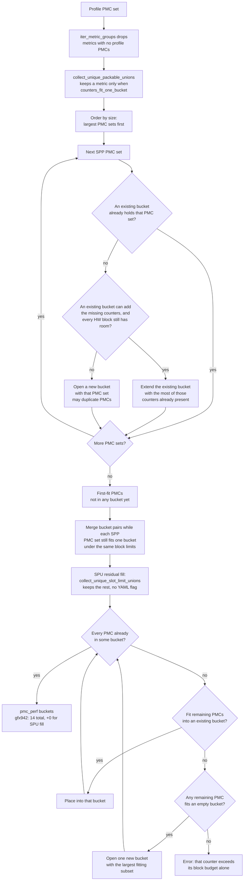
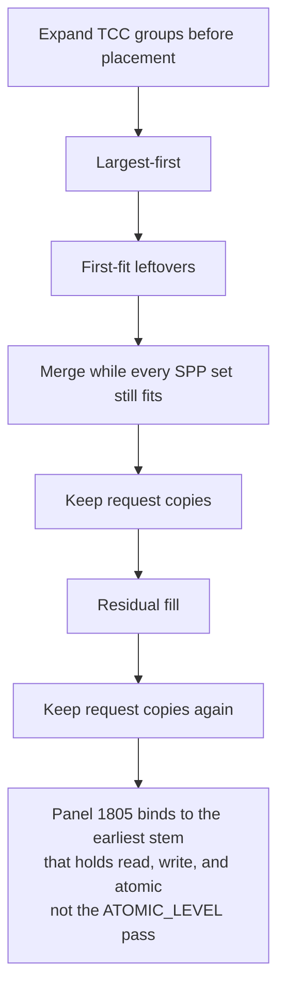

# Metric grouping (SPP / SPU)

**Parent:** [High-level design](hld-plan.md)

This note is the collection algorithm for Phase 1 in the high-level design (requirement FR-1), and the code-level detail of same-pass bind. The cross-run rule and the SPU composite operators stay in the high-level design.

A **PMC set** is the counters of one metric that must share one perfmon pass. A **bucket** is one perfmon pass. A block's counter limit is that block's capacity in `perfmon_config` (`CounterFile` in `soc_base.py`). GRBM and SQ are charged separately.

---

## 1. Algorithm

**Replace** the shipping heuristic and priority coalesce in
`_allocate_perfmon_counter_files`. SPP packing is the only allocator.

Why this allocator: the shipping pack minimizes passes for the whole counter list, so metrics whose PMC sets fit one pass stay split. Largest-first gives a large set a bucket before smaller sets fragment the open passes.

1. Expand TCC groups before placement. `iter_metric_groups` drops metrics with no profile PMCs before the packable split, so those metrics are not **Single-pass unpackable (SPU)** parents. `adjust_candidate_groups` expands a LEVEL series with its request channels. `collect_unique_packable_unions` keeps a metric only when `counters_fit_one_bucket`. `collect_unique_slot_limit_unions` keeps the rest. No YAML flag.
2. Largest-first: place each **Single-pass packable (SPP)** PMC set with the existing-bucket and per-block slot checks in §2 (copy a PMC into another pass when two sets cannot share a bucket).
3. First-fit leftovers: counters that are not in any bucket yet.
4. Merge while every SPP set still fits one bucket under the same block limits.
5. Keep request copies that a multi-column request row still needs in one pass.
6. Run **SPU residual fill** so leftover SPU counters appear somewhere. Try the open buckets, then open one new bucket for the largest subset that fits an empty bucket (+0 extra passes on gfx942). If no remaining counter fits even that empty bucket, residual fill raises `ValueError` and does not drop the counter or keep looping.
7. Keep request copies again, after residual fill.

ACCUM charging happens when a counter is added to a bucket. A `*_ACCUM` counter takes its block slots at that add: two slots alone (`BASE` + `HIGH_RES`), one extra slot when `BASE` is already in the bucket, and no extra slot when `BASE` is added after its `*_ACCUM`. The main flowchart stays the general placement flow. The TCC chart in §4 matches this order and stays out of that flowchart.

**Locked decisions** (from the high-level design):

- The final tree has one allocator. No environment variable is in that tree. Phase 1 and Phase 2 still contain `ROCPROF_COMPUTE_PERFMON_LEGACY_HEURISTIC` and `ROCPROF_COMPUTE_ANALYZE_LEGACY_PASS_MERGE` until cleanup PR #12848 deletes them. Those variables are not a rollback path.
- Do **not** use `WEIGHTED_AVG` for metrics the old allocator split that now fit one pass. Packing covers them.
- Priority policy YAML is not required for the packable guarantee.
- After Phase 2 YAML, the gfx942 allocator gate is `packable_multi == 0`, passes == **14** (the shipping layout was 13), `slot_additional_passes == 0`, and `slot_limit_metrics == 0`. The 16 are `COLLECT_*` composite parents. A health PR before that Phase 2 YAML may still see `slot_limit_metrics == 16`. `packable_multi` counts SPP metrics whose PMC set is not fully inside one bucket. Panel 1805 stays one packing group (§4), so that gate includes it.

**Primary packing code:** `counter_grouping_single_pass.py`, `counter_grouping_buckets.py`, `soc_base.py`.

---

## 2. Flowchart

A **bucket** is one perfmon pass. This chart is the general placement flow: largest-first, first-fit leftovers, merge while every SPP set still fits, then SPU residual fill. Expand-TCC-groups and the two keep-request-copies steps are the §4 chart, not this one. The TCC event-base budget is still this flow's hardware-block check. ACCUM charging happens when a counter is added to a bucket.

**How an SPP PMC set is placed.** Candidates are the unique sets, visited largest first. For each set the allocator tries buckets already opened before it opens a new one:

1. **Fit an existing bucket.** If a bucket already holds the whole PMC set, leave it. Otherwise extend the opened bucket that already contains the most of those counters, and add only the missing ones.
2. **Fit each hardware block's slot limit.** Extend only when every block the new counters touch still has room (GRBM, SQ, and so on). Each counter is charged to its own block. If any block is full, skip that bucket. Open a new bucket only when no existing bucket can hold the set. The same counter may be copied into another pass when two PMC sets cannot share one bucket.

Overlap-first keeps the new counters in a pass that already has the rest of the set, so another pass does not replay them unless two PMC sets cannot share a bucket. The per-block check is why a mixed GRBM and SQ set is still one pass: a full SQ budget skips that bucket even when GRBM still has room. None of the 16 SPU metrics on gfx942 include GRBM.

**How an SPU parent is recognized.** `iter_metric_groups` drops metrics with no profile PMCs before that split, so those metrics are not SPU parents. `collect_unique_packable_unions` keeps a metric only when `counters_fit_one_bucket`. `collect_unique_slot_limit_unions` keeps the rest. No YAML flag.

### Sample walk-through

Profile PMCs: `A B C D E F`. **3 counters per bucket** (one cap in the toy; a real bucket checks each hardware block's slot limit, as above).

SPP PMC sets:

- HBM-like = `{A, B}`
- M1 = `{C, D, E}`
- M2 = `{A, F}`
- M3 = `{B, D}`

Visit order: largest PMC sets first (M1, then HBM-like, M2, M3).

1. **M1 = `{C, D, E}`** — open bucket0 = `{C, D, E}`.
2. **HBM-like = `{A, B}`** — open bucket1 = `{A, B}`.
3. **M2 = `{A, F}`** — extend bucket1 → `{A, B, F}`.
4. **M3 = `{B, D}`** — B and D live in different buckets; cannot merge without breaking M1/M2 → open bucket2 = `{B, D}` (B duplicated in bucket1 and bucket2).
5. **First-fit / merge** — all packable PMCs placed.
6. **SPU residual fill** — if an SPU metric only needs PMCs already in these buckets → +0 passes (gfx942 case). Only missing PMCs open new buckets.

---

## 3. Same-pass bind

Analyze reads all of a metric's counters from the same pass. Code: `src/utils/metrics/pass_provenance.py`, the shadow columns in file I/O, and both analyze entry points — CLI (`eval_metric`) and DB (`calc_expressions` / `bind_expression_dataframe`).

- **Bind key.** `key` in `{counter}@pass:{key}` is the perfmon result-file stem from `_pass_key_from_result_file`: `results_pmc_perf_3.csv.gz` becomes `pmc_perf_3`.
- **Shadow columns.** Only a counter that appears in more than one pass is suffixed (`PassLayout.duplicated` in `process_rocpd_csv`). A counter that appears in one pass keeps its bare name, and that column is the value from that pass.
- **Pass selection.** `select_pass` chooses the pass from the expression's hardware PMC set, including `SQ_WAVES` and `GRBM_GUI_ACTIVE` when the expression needs them. When several passes hold the whole set, the earliest stem in natural order wins (`pmc_perf_2` before `pmc_perf_10`). `select_pass_with_normalization_fallback` does not bind when either denominator is only on another pass.
- **Duration.** `Start_Timestamp` and `End_Timestamp` are read from the selected pass's rows, so `End_Timestamp - Start_Timestamp` is the duration of that expression's pass. Timestamps do not take part in choosing the pass. If the selected pass has no duration, a metric that divides by it stays unset.
- **Failed bind.** If the selected pass does not hold every counter the expression needs, including `SQ_WAVES` and `GRBM_GUI_ACTIVE`, the metric stays unset and warns. There is no bare-column fallback, and no exception that reads those denominators from another pass. A denominator that is on the same pass still evaluates.

---

## 4. TCC series affinity + coverage

The TCC handling here is a **short-term solution**. Those rules live in one module so a later design can replace them. A general hardware-instance framework is **out of scope**. [Instance-aware metrics](#instance-aware-metrics-out-of-scope) records that boundary.

An L2 channel map can change between replays, so the counters one expression joins share a pass. gfx942 is the example, not the only architecture, and the pass count there stays **14**. A selected series keeps every collectable channel. gfx908 and gfx115x use that chip's own L2 banks. They are not an XCD multiple.

Panel 1805 binds to the earliest stem that holds read, write, and atomic (`TCC_EA0_RDREQ`, `TCC_EA0_WRREQ`, `TCC_EA0_ATOMIC`). That bind is not the `ATOMIC_LEVEL` pass. Extra `RDREQ` and `WRREQ` copies may remain on LEVEL passes that do not hold `ATOMIC`. Rows 1806 and 1807 bind to the pass that holds each LEVEL with its request series. Row 1808 binds to the pass that holds `ATOMIC_LEVEL` and `ATOMIC`.

### Instance-aware metrics (out of scope)

Today the replicated block is a TCC channel. TCP, a shader engine, and SDMA come later. TCC is the first consumer. The later framework would cover:

- **Per-instance counters.** Each replica of a block exposes its own counter.
- **Aggregation strategies.** A metric sums, averages, or otherwise combines those readings.
- **Balance metrics.** A balance metric compares instances with each other.
- **Affinity requirements.** Joined counters share a pass when the instance map can change between replays.
