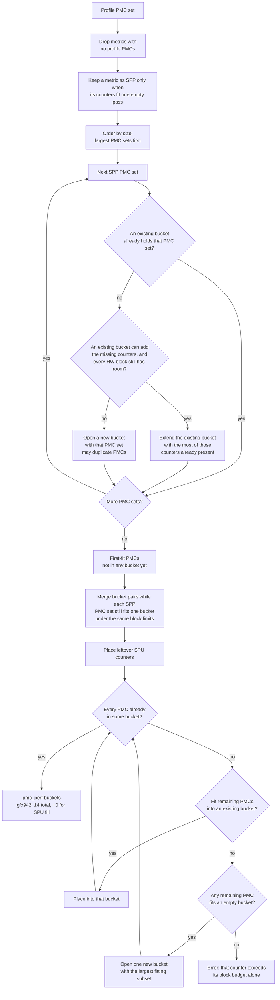
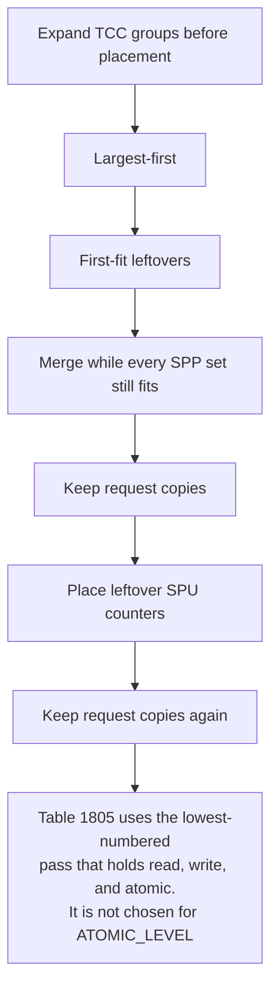

# Metric grouping (SPP / SPU)

**Parent:** [High-level design](hld-plan.md)

This note is the collection algorithm for Phase 1 in the high-level design (requirement FR-1), and how analyze reads every counter of a metric from one pass. The rule for combining SPU parts across passes, and the YAML functions that combine them, stay in the high-level design.

A metric's **PMC set** is the hardware counters its expression reads. For an SPP metric, they share one perfmon pass. A **bucket** is one perfmon pass. This note uses "bucket" for that pass. A block's counter limit is that block's capacity in `perfmon_config` (`CounterFile` in `soc_base.py`). GRBM and SQ are charged separately.

---

## 1. Algorithm

**Replace** the shipping allocator, including its hand-kept list of metrics to keep together, in
`_allocate_perfmon_counter_files`. SPP packing is the only allocator.

Why this allocator: the shipping pack minimizes passes for the whole counter list, so metrics whose PMC sets fit one pass stay split. Largest-first gives a large set a bucket before smaller sets fragment the open passes.

1. Expand TCC groups before placement. Metrics with no profile PMCs are dropped before the SPP/SPU split (`iter_metric_groups`), so they are not SPU parents. Each TCC `_LEVEL` counter is grouped with its request counter (`adjust_candidate_groups`). A `_LEVEL` counter adds up outstanding requests every cycle, and latency divides it by the request count, so the two must share a pass. A metric is SPP when its PMC set fits one empty pass under every block's limit (`collect_unique_packable_unions`, `counters_fit_one_bucket`). Every other metric with profile PMCs is SPU (`collect_unique_slot_limit_unions`). The YAML does not mark which is which.
2. Largest-first: place each **Single-pass packable (SPP)** PMC set with the existing-bucket and per-block slot checks in §2. Copy a counter into another pass when two sets cannot share a bucket.
3. First-fit leftovers: counters that are not in any bucket yet.
4. Merge while every SPP set still fits one bucket under the same block limits.
5. Keep the request-counter copies that table 1805 still needs in one pass. That table's row is read, write, and atomic together.
6. Place leftover SPU counters. Try the open buckets, then open one new bucket for the largest subset that fits an empty bucket (+0 extra passes on gfx942). If no remaining counter fits even that empty bucket, placement raises `ValueError` and does not drop the counter or keep looping.
7. Keep those request-counter copies again, after the leftover SPU counters are placed.

A `*_ACCUM` counter (for example `SQ_INST_LEVEL_VMEM_ACCUM`) uses hardware slots for itself and for its base counter. Charging happens when a counter is added to a bucket: two slots when the `*_ACCUM` counter is added alone (one for the base counter, one for its high-resolution accumulation), one extra slot when the base counter is already in the bucket, and no extra slot when the base counter is added after its `*_ACCUM`. The main flowchart stays the general placement flow. The TCC chart in §4 matches this order and stays out of that flowchart.

**Decisions.** The list is in the high-level design: [Decisions and alternatives](hld-plan.md#decisions-and-alternatives).

**Primary packing code:** `counter_grouping_single_pass.py`, `counter_grouping_buckets.py`, `soc_base.py`.

---

## 2. Flowchart

A **bucket** is one perfmon pass. This chart is the general placement flow: largest-first, first-fit leftovers, merge while every SPP set still fits, then place leftover SPU counters. Expand-TCC-groups and the two keep-request-copies steps are the §4 chart, not this one. TCC is still checked against that block's counter limit in this flow. One TCC counter name uses one slot. Copies of that counter on other L2 channels do not use another slot. ACCUM charging happens when a counter is added to a bucket.

**How an SPP PMC set is placed.** Candidates are the unique sets, visited largest first. Equal-size PMC sets are visited in sorted counter-name order; an equal overlap keeps the earliest bucket; merge tries pairs from the lowest bucket index and applies one only when every SPP set still fits; residual and leftover counters are taken in sorted name order, and an equal-length residual subset keeps the earliest bucket. For each set the allocator tries buckets already opened before it opens a new one:

1. **Fit an existing bucket.** If a bucket already holds the whole PMC set, leave it. Otherwise extend the opened bucket that already contains the most of those counters, and add only the missing ones.
2. **Fit each hardware block's slot limit.** Extend only when every block the new counters touch still has room (GRBM, SQ, and so on). Each counter is charged to its own block. If any block is full, skip that bucket. Open a new bucket only when no existing bucket can hold the set. The same counter may be copied into another pass when two PMC sets cannot share one bucket.

Overlap-first keeps the new counters in a pass that already has the rest of the set, so another pass does not replay them unless two PMC sets cannot share a bucket. The per-block check is why a mixed GRBM and SQ set is still one pass: a full SQ budget skips that bucket even when GRBM still has room. None of the 16 SPU metrics on gfx942 include GRBM.

**How an SPU parent is recognized.** Metrics with no profile PMCs are dropped first (`iter_metric_groups`), so they are not SPU parents. A metric is SPP when its PMC set fits one empty pass (`collect_unique_packable_unions`, `counters_fit_one_bucket`). Every other metric with profile PMCs is SPU (`collect_unique_slot_limit_unions`). The YAML does not mark which is which. Names in the chart are the functions that implement those rules.

### Sample walk-through

Profile PMCs: `A B C D E F`. **3 counters per bucket** (one cap in the toy; a real bucket checks each hardware block's slot limit, as above).

SPP PMC sets:

- HBM-like = `{A, B}`
- M1 = `{C, D, E}`
- M2 = `{A, F}`
- M3 = `{B, D}`

Visit order: largest PMC sets first (M1, then HBM-like, M2, M3).

1. **M1 = `{C, D, E}`** — open bucket0 = `{C, D, E}`.
2. **HBM-like = `{A, B}`** — open bucket1 = `{A, B}`.
3. **M2 = `{A, F}`** — extend bucket1 → `{A, B, F}`.
4. **M3 = `{B, D}`** — B is in bucket1 and D is in bucket0, and both buckets are full (3 counters each), so open bucket2 = `{B, D}` (B is now in bucket1 and bucket2).
5. **First-fit / merge** — all packable PMCs placed.
6. **Leftover SPU counters** — if an SPU metric only needs PMCs already in these buckets → +0 passes (gfx942 case). Only missing PMCs open new buckets.

---

## 3. Reading each metric from one pass

Analyze reads all of a metric's counters from the same pass. Code: `src/utils/metrics/pass_provenance.py`, the per-pass columns in file I/O, and both analyze entry points — CLI (`eval_metric`) and DB (`calc_expressions` / `bind_expression_dataframe`).

- **Which pass.** The name in `{counter}@pass:{key}` is the result file name without its prefix and suffix (`_pass_key_from_result_file`): `results_pmc_perf_3.csv.gz` becomes `pmc_perf_3`.
- **Per-pass columns.** Only a counter that appears in more than one pass is suffixed (`PassLayout.duplicated` in `process_rocpd_csv`). A counter that appears in one pass keeps its bare name, and that column is the value from that pass.
- **Pass selection.** `select_pass` chooses the pass from the expression's hardware PMC set, including `SQ_WAVES` and `GRBM_GUI_ACTIVE` when the expression needs them. When several passes hold the whole set, the lowest-numbered pass wins (`pmc_perf_2` before `pmc_perf_10`). Even the normalization helper (`select_pass_with_normalization_fallback`) leaves the metric unset when `SQ_WAVES` or `GRBM_GUI_ACTIVE` is only on another pass.
- **Duration.** `Start_Timestamp` and `End_Timestamp` are read from the selected pass's rows, so `End_Timestamp - Start_Timestamp` is the duration of that expression's pass. Timestamps do not take part in choosing the pass. If the selected pass has no duration, a metric that divides by it stays unset.
- **Failed read.** If the selected pass does not hold every counter the expression needs, including `SQ_WAVES` and `GRBM_GUI_ACTIVE`, the metric stays unset and warns. Analyze does not fall back to a value taken from another pass. A denominator that is on the same pass still evaluates.

---

## 4. TCC counters that must share a pass

The TCC handling here is a **short-term solution**. Those rules live in one module so a later design can replace them. A general way to handle other replicated blocks is **out of scope**. [Other replicated blocks](#other-replicated-blocks-out-of-scope) records that boundary.

An L2 channel map can change between replays, so the counters one expression joins share a pass. A TCC counter is read once per L2 channel. When one is chosen, every channel of that counter goes in the same pass. gfx942 is the example, not the only architecture, and the pass count there stays **14**. On gfx908 and gfx115x, use that chip's own L2 channel count. Do not multiply it by the number of dies.

A `_LEVEL` counter adds up the outstanding requests every cycle. Dividing it by the request count gives latency, so each `_LEVEL` counter must share a pass with its request counter.

Table 1805 (L2-Fabric Requests) uses the lowest-numbered pass that holds read, write, and atomic (`TCC_EA0_RDREQ`, `TCC_EA0_WRREQ`, `TCC_EA0_ATOMIC`). That pass is not chosen because it holds `ATOMIC_LEVEL`. Extra `RDREQ` and `WRREQ` copies may remain on passes that hold a `_LEVEL` counter but not `ATOMIC`. Table 1806 (L2-Fabric Read Latency) uses the pass that holds `RDREQ_LEVEL` with `RDREQ`. Table 1807 (L2-Fabric Write and Atomic Latency) uses the pass that holds `WRREQ_LEVEL` with `WRREQ`. Table 1808 (L2-Fabric Atomic Latency) uses the pass that holds `ATOMIC_LEVEL` with `ATOMIC`.

### Other replicated blocks (out of scope)

Today the replicated block is a TCC channel. TCP, a shader engine, and SDMA come later. TCC is the first block that needs this. A later design would cover:

- Each replica of a block exposes its own counter.
- A metric sums, averages, or otherwise combines the readings from those replicas.
- A metric compares replicas with each other.
- Counters that one expression combines share a pass when the replica map can change between replays.
