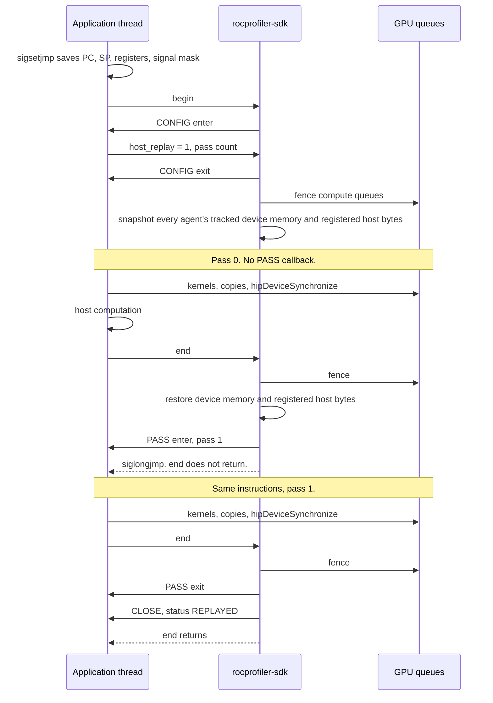

(range-replay-control-flow)=

# Control flow

Host range replay re-enters the application. The SDK does not record AQL packets and write them
back to a queue. One thread owns the range. Another thread's dispatch or device write declines it.

## Passes



`sigsetjmp` is the bookmark. It stores the program counter, the stack pointer, the callee-saved
registers, and the signal mask. `siglongjmp` puts the thread back in that posture. The heap is not
in that photograph, so the SDK restores device memory and the host regions registered with
`rocprofiler_range_replay_host_track_memory` before the jump.

## The stack at the jump

```text
high addresses
  caller of the function that expanded HOST_BEGIN
  that function                                 <-- SP saved in the jmp_buf
    kernels, hipDeviceSynchronize, host math
      rocprofiler_range_replay_end              <-- SP is here
        siglongjmp sets SP back to the saved frame
        end's frame is discarded
        C++ destructors between the mark and end do not run
```

After the last pass, `end` does not jump. It raises CLOSE and returns. The application continues
with the state the last pass produced.

## One pass, inside `end`

```text
finish_pass
  |
  +-- read submit epochs
  +-- fence intercepted compute queues on every GPU agent
  +-- snapshot the owning thread's device-write count
  |
  +-- if pass > 0: PASS exit
  |     a dispatch here advances the epoch and is fenced again
  |     a device write from this thread declines MEMORY_COPY_IN_RANGE
  |
  +-- if a pass remains:
  |     writer locks, in agent order, after the fence
  |     restore entry snapshot and registered host regions
  |     drop the locks
  |     host.pass = next          (before the callback, so it is not still pass 0)
  |     PASS enter
  |     return next to end()
  |     end() siglongjmp(next)
  |
  +-- if this was the last pass:
        re-fence callback dispatches
        count divergence
        return 0
        end() raises CLOSE and returns
```

The writer locks are not held across the fence or across a tool callback. The fence rings a queue
doorbell, and that queue's intercept lock can be held by a submitter that is waiting for the
replay lock. A callback that submitted on this thread would otherwise wait for a lock it already
holds.

The compute-queue fence does not wait for an untracked asynchronous copy. The application
synchronizes those, with `hipDeviceSynchronize` or the equivalent, before begin and before every
`end`.

## What does not happen

```text
begin
  CONFIG
  application runs the range once
end
  no siglongjmp
  no packet rewrite of the AQL ring
  CLOSE status = PACKET_REPLAY_UNSUPPORTED
  return
```

That is the path when the tool leaves `host_replay` unset and the range is otherwise eligible.
`rocprofiler_range_replay_end` does not call the packet executor. An earlier decline, such as
`MULTI_QUEUE` or a foreign thread's dispatch, is what CLOSE reports instead.
Opt-out (`pass_count_cb` left null) is still `NO_PASS_COUNT`.

## Components

```text
application
  ROCPROFILER_RANGE_REPLAY_HOST_BEGIN     sigsetjmp in the caller's frame
  rocprofiler_range_replay_end            siglongjmp while passes remain
        |
        v
range_replay/api.cpp                      begin, end, the jump
range_replay/host_replay.cpp              fence, snapshot, restore, pass number
range_replay/replay_callbacks.cpp         CONFIG, PASS, CLOSE
range_replay/range_state.cpp              one range per thread, decline channel
        |
        +-- hsa/queue_controller.cpp      queue lifetime. sync runs without that lock
        +-- hsa/replay_window.cpp         per-agent replay lock, queue drain
        +-- hsa/queue.cpp                 submit epoch, so a dispatch after the fence is seen
        +-- hsa/async_copy.cpp            device-write decline for another thread
        |
        +-- kernel_replay/memory_snapshot device allocations and module variables
        +-- kernel_replay/local_context   PASS toggles, sticky for the later passes
```
