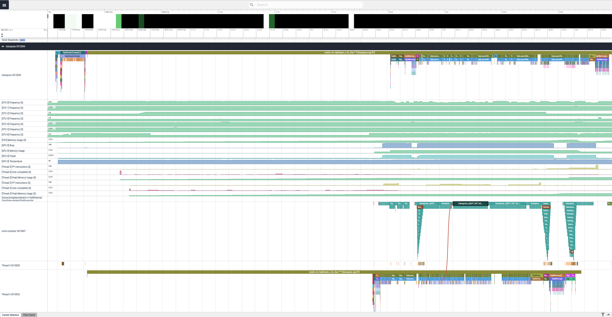
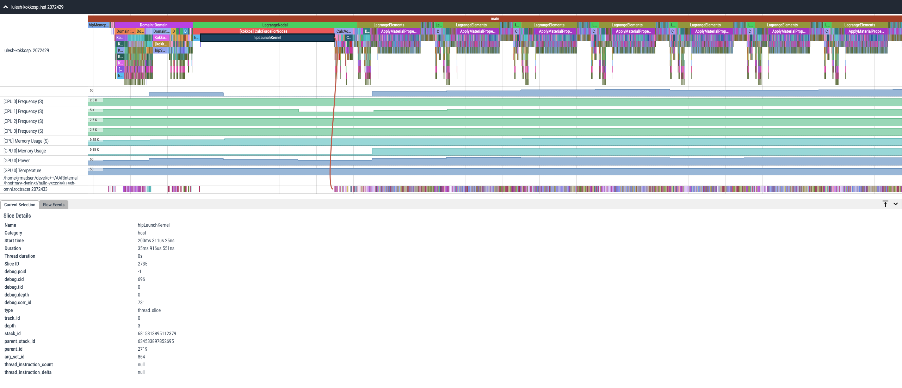
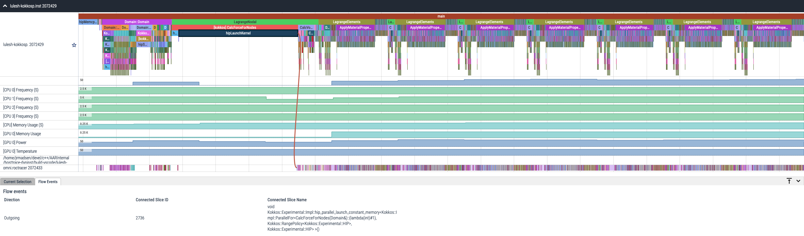
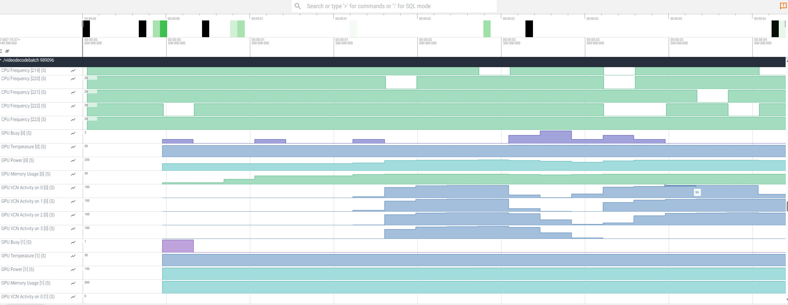

.. meta::
   :description: ROCm Systems Profiler system output documentation and reference
   :keywords: rocprof-sys, rocprofiler-systems, Omnitrace, ROCm, profiler, system output, tracking, visualization, tool, Instinct, accelerator, AMD, rocpd, perfetto, timemory

****************************************************
Understanding the Systems Profiler output
****************************************************

The general output form of `ROCm Systems Profiler <https://github.com/ROCm/rocm-systems/tree/develop/projects/rocprofiler-systems>`_ is
``<OUTPUT_PATH>[/<TIMESTAMP>]/[<PREFIX>]<DATA_NAME>[-<OUTPUT_SUFFIX>].<EXT>``.

For example, starting with the following base configuration:

.. code-block:: shell

   export ROCPROFSYS_OUTPUT_PATH=rocprof-sys-example-output
   export ROCPROFSYS_TIME_OUTPUT=ON
   export ROCPROFSYS_USE_PID=OFF
   export ROCPROFSYS_PROFILE=ON
   export ROCPROFSYS_TRACE=ON

.. code-block:: shell

   $ rocprof-sys-instrument -- ./foo
   ...
   [rocprof-sys] Outputting 'rocprof-sys-example-output/perfetto-trace.pftrace'...

   [rocprof-sys] Outputting 'rocprof-sys-example-output/wall-clock.txt'...
   [rocprof-sys] Outputting 'rocprof-sys-example-output/wall-clock.json'...

If the ``ROCPROFSYS_USE_PID`` option is enabled, then running a non-MPI executable
with a PID of ``63453`` results in the following output:

.. code-block:: shell

   $ export ROCPROFSYS_USE_PID=ON
   $ rocprof-sys-instrument -- ./foo
   ...
   [rocprof-sys] Outputting 'rocprof-sys-example-output/perfetto-trace-63453.pftrace'...

   [rocprof-sys] Outputting 'rocprof-sys-example-output/wall-clock-63453.txt'...
   [rocprof-sys] Outputting 'rocprof-sys-example-output/wall-clock-63453.json'...

If ``ROCPROFSYS_TIME_OUTPUT`` is enabled, then a job that started on January 31, 2022 at 12:30 PM
generates the following:

.. code-block:: shell

   $ export ROCPROFSYS_TIME_OUTPUT=ON
   $ rocprof-sys-instrument -- ./foo
   ...
   [rocprof-sys] Outputting 'rocprof-sys-example-output/2022-01-31_12.30_PM/perfetto-trace-63453.pftrace'...

   [rocprof-sys] Outputting 'rocprof-sys-example-output/2022-01-31_12.30_PM/wall-clock-63453.txt'...
   [rocprof-sys] Outputting 'rocprof-sys-example-output/2022-01-31_12.30_PM/wall-clock-63453.json'...

Incomplete regions
========================================

The ``[incomplete]`` suffix marks regions that never received an end event. When a
profiling session finalizes, some regions may still be open, meaning their begin event
was recorded but no matching end event ever arrived. This commonly happens on worker
threads whose frames (for example, an OMPT parallel region or an internal host runtime
frame) are still active at shutdown. Rather than drop these regions, the profiler closes
them with a synthetic end timestamp and appends an ``[incomplete]`` suffix to the region
name.

Metadata
========================================

ROCm Systems Profiler outputs a ``metadata.json`` file. This metadata file contains
information about the settings, environment variables, output files, and info
about the system and the run, as follows:

* Hardware cache sizes
* Physical CPUs
* Hardware concurrency
* CPU model, frequency, vendor, and features
* Launch date and time
* Memory maps (for example, shared libraries)
* Output files
* Environment variables
* Configuration settings

Metadata JSON Sample
-----------------------------------------------------------------------

.. dropdown:: Sample JSON

   .. code-block:: json
      :linenos:

      {
      "rocprofiler-systems": {
         "metadata": {
            "info": {
            "CPU_MODEL": "AMD Ryzen 5 3600 6-Core Processor",
            "CPU_VENDOR": "AuthenticAMD",
            "HOME": "/home/rocm-dev",
            "LAUNCH_DATE": "01/15/25",
            "LAUNCH_TIME": "16:49",
            "PWD": "/home/rocm-dev/code/rocprofiler-systems",
            "ROCPROFSYS_COMPILER_ID": "GNU",
            "ROCPROFSYS_COMPILER_VERSION": "11.4.0",
            "ROCPROFSYS_GIT_DESCRIBE": "",
            "ROCPROFSYS_GIT_REVISION": "3213dc652728f7ed01b62bf55f6af76c43bfcbdb",
            "ROCPROFSYS_LIBRARY_ARCH": "x86_64-linux-gnu",
            "ROCPROFSYS_ROCM_VERSION": "6.3.1",
            "ROCPROFSYS_SYSTEM_NAME": "Linux",
            "ROCPROFSYS_SYSTEM_PROCESSOR": "x86_64",
            "ROCPROFSYS_SYSTEM_VERSION": "6.8.0-51-generic",
            "ROCPROFSYS_VERSION": "1.0.0",
            "SHELL": "/usr/bin/zsh",
            "TIMEMORY_API": "tim::project::timemory",
            "TIMEMORY_GIT_DESCRIBE": "v3.2.0-703-gba3c6486",
            "TIMEMORY_GIT_REVISION": "ba3c648677b3c6f217abe147ef3198f36239e234",
            "TIMEMORY_VERSION": "4.0.0rc0",
            "USER": "rocm-dev",
            "CPU_FREQUENCY": 1972,
            "CPU_FEATURES": [
               "fpu", "vme", "de", "pse", "tsc", "msr", "pae"
               // ... more features
            ],
            "HW_CONCURRENCY": 12,
            "HW_PHYSICAL_CPU": 6,
            "HW_L1_CACHE_SIZE": 32768,
            "HW_L2_CACHE_SIZE": 524288,
            "HW_L3_CACHE_SIZE": 16777216,
            "ROCPROFSYS_VERSION_MAJOR": 1,
            "ROCPROFSYS_VERSION_MINOR": 0,
            "ROCPROFSYS_VERSION_PATCH": 0,
            "ROCPROFSYS_ROCM_VERSION_MAJOR": 6,
            "ROCPROFSYS_ROCM_VERSION_MINOR": 3,
            "ROCPROFSYS_ROCM_VERSION_PATCH": 1,
            "memory_maps_files": [
               "/opt/rocm-6.3.1/lib/libhsa-amd-aqlprofile64.so.1.0.60301",
               "/opt/rocm-6.3.1/lib/libhsa-runtime64.so.1.14.60301"
               // ... more files
            ],
            "memory_maps": [
               {
                  "cereal_class_version": 0,
                  "load_address": "76005b800000",
                  "last_address": "76005b81b000",
                  "permissions": "r---",
                  "offset": "0",
                  "device": "",
                  "inode": 0,
                  "pathname": "/opt/rocm/lib/libhsa-runtime64.so.1"
               },
               {
                  "load_address": "76005b81b000",
                  "last_address": "76005b93400d",
                  "permissions": "r-x-",
                  "offset": "1b000",
                  "device": "",
                  "inode": 0,
                  "pathname": "/opt/rocm/lib/libhsa-runtime64.so.1"
               }
               // ... more mappings
            ]
            },
            "settings": {
            "cereal_class_version": 2,
            "ROCPROFSYS_OUTPUT_PREFIX": {
               "name": "output_prefix",
               "environ": "ROCPROFSYS_OUTPUT_PREFIX",
               "description": "Explicitly specify a prefix for all output files",
               "count": 1,
               "max_count": -1,
               "cmdline": ["--rocprofiler-systems-output-prefix"],
               "categories": [
                  "filename", "io", "librocprof-sys", "native", "rocprofsys"
               ],
               "data_type": "string",
               "initial": "parallel-overhead-binary-rewrite/",
               "value": "parallel-overhead-binary-rewrite/",
               "updated": "config",
               "enabled": true
            },
            // Additional settings can be added here
            "command_line": [
               "/home/rocm-dev/code/rocprofiler-systems/build/ubuntu/22.04/parallel-overhead.inst",
               "--", "10", "12", "1000"
            ],
            "environment": [
               // Environment variables go here
            ]
            },
            "environment": [
            {
               "key": "LD_LIBRARY_PATH",
               "value": "/home/rocm-dev/code/rocprofiler-systems/build/ubuntu/22.04/lib:/opt/rocm/lib"
            },
            {
               "key": "LIBRARY_PATH",
               "value": ""
            }
            // ... more environment variables
            ],
            "output": {
            "json": [
               {
                  "key": "wall_clock",
                  "value": [
                  "/home/rocm-dev/code/rocprofiler-systems/build/ubuntu/22.04/rocprof-sys-tests-output/parallel-overhead-binary-rewrite/wall_clock.json"
                  ]
               }
            ],
            "protobuf": [
               {
                  "key": "perfetto",
                  "value": [
                  "/home/rocm-dev/code/rocprofiler-systems/build/ubuntu/22.04/rocprof-sys-tests-output/parallel-overhead-binary-rewrite/perfetto-trace.pftrace"
                  ]
               }
            ],
            "text": [
               {
                  "key": "wall_clock",
                  "value": [
                  "/home/rocm-dev/code/rocprofiler-systems/build/ubuntu/22.04/rocprof-sys-tests-output/parallel-overhead-binary-rewrite/wall_clock.txt"
                  ]
               }
            ]
            }
         }
      }
      }

Configuring the ROCm Systems Profiler output
============================================

ROCm Systems Profiler includes a core set of options for controlling the format
and contents of the output files. For additional information, see the guide on
:doc:`configuring runtime options <./configuring-runtime-options>`.

Core configuration settings
-----------------------------------

.. csv-table::
   :header: "Setting", "Value", "Description"
   :widths: 30, 30, 100

   "``ROCPROFSYS_OUTPUT_PATH``", "Any valid path", "Path to folder where output files should be placed"
   "``ROCPROFSYS_OUTPUT_PREFIX``", "String", "Useful for multiple runs with different arguments. See the next section on output prefix keys."
   "``ROCPROFSYS_OUTPUT_FILE``", "Any valid filepath", "Specific location for the Perfetto output file"
   "``ROCPROFSYS_TIME_OUTPUT``", "Boolean", "Place all output in a timestamped folder, timestamp format controlled via ``ROCPROFSYS_TIME_FORMAT``"
   "``ROCPROFSYS_TIME_FORMAT``", "String", "See ``strftime`` man pages for valid identifiers"
   "``ROCPROFSYS_USE_PID``", "Boolean", "Append either the PID or the MPI rank to all output files (before the extension)"

Output prefix keys
^^^^^^^^^^^^^^^^^^^^^^^^^^^^^^^^^^^^^^^^^^^^^^^^^^^^^^^^^^^^^^^^^^^^

Output prefix keys have many uses but are most helpful when dealing with multiple
profiling runs or large MPI jobs.
They are included in ROCm Systems Profiler because they were introduced into Timemory
for `compile-time-perf <https://github.com/jrmadsen/compile-time-perf>`_.
They are needed to create different output files for a generic wrapper around
compilation commands while still
overwriting the output from the last time a file was compiled.

When doing scaling studies and specifying options via the command line,
the recommended process is to
use a common ``ROCPROFSYS_OUTPUT_PATH``, disable ``ROCPROFSYS_TIME_OUTPUT``,
set ``ROCPROFSYS_OUTPUT_PREFIX="%argt%-"``, and let ROCm Systems Profiler cleanly organize the output.

.. csv-table::
   :header: "String", "Encoding"
   :widths: 20, 120

   "``%argv%``", "Entire command-line condensed into a single string"
   "``%argt%``", "Similar to ``%argv%`` except basename of first command line argument"
   "``%args%``", "All command line arguments condensed into a single string"
   "``%tag%``", "Basename of first command line argument"
   "``%arg<N>%``", "Command line argument at position ``<N>`` (zero indexed), e.g. ``%arg0%`` for first argument"
   "``%argv_hash%``", "MD5 sum of ``%argv%``"
   "``%argt_hash%``", "MD5 sum if ``%argt%``"
   "``%args_hash%``", "MD5 sum of ``%args%``"
   "``%tag_hash%``", "MD5 sum of ``%tag%``"
   "``%arg<N>_hash%``", "MD5 sum of ``%arg<N>%``"
   "``%pid%``", "Process identifier (i.e. ``getpid()``)"
   "``%ppid%``", "Parent process identifier (i.e. ``getppid()``)"
   "``%pgid%``", "Process group identifier (i.e. ``getpgid(getpid())``)"
   "``%psid%``", "Process session identifier  (i.e. ``getsid(getpid())``)"
   "``%psize%``", "Number of sibling process (from reading ``/proc/<PPID>/tasks/<PPID>/children``)"
   "``%job%``", "Value of ``SLURM_JOB_ID`` environment variable if exists, else ``0``"
   "``%rank%``", "Value of ``SLURM_PROCID`` environment variable if exists, else ``MPI_Comm_rank`` (or ``0`` non-mpi)"
   "``%size%``", "``MPI_Comm_size`` or ``1`` if non-mpi"
   "``%nid%``", "``%rank%`` if possible, otherwise ``%pid%``"
   "``%launch_time%``", "Launch date and time (uses ``ROCPROFSYS_TIME_FORMAT``)"
   "``%env{NAME}%``", "Value of environment variable ``NAME`` (i.e. ``getenv(NAME)``)"
   "``%cfg{NAME}%``", "Value of configuration variable ``NAME`` (e.g. ``%cfg{ROCPROFSYS_SAMPLING_FREQ}%`` would resolve to sampling frequency)"
   "``$env{NAME}``", "Alternative syntax to ``%env{NAME}%``"
   "``$cfg{NAME}``", "Alternative syntax to ``%cfg{NAME}%``"
   "``%m``", "Shorthand for ``%argt_hash%``"
   "``%p``", "Shorthand for ``%pid%``"
   "``%j``", "Shorthand for ``%job%``"
   "``%r``", "Shorthand for ``%rank%``"
   "``%s``", "Shorthand for ``%size%``"

.. note::

   In any output prefix key which contains a ``/`` character, the ``/`` characters
   are replaced with ``_`` and any leading underscores are stripped. For example,
   an ``%arg0%`` of ``/usr/bin/foo`` translates to ``usr_bin_foo``. Additionally, any ``%arg<N>%`` keys which
   do not have a command line argument at position ``<N>`` are ignored.

.. _rocprof_sys_rocpd_output:

ROCm Profiling Data (rocpd) output
=========================================

The ROCm Profiling Data (or ``rocpd``) database is now the default output format for the ROCm Systems Profiler.
It outputs a SQLite3 database containing all profiling data.
ROCProfiler-SDK version 1.0.0 or later is required (introduced in ROCm 7.0.0).

You can view and analyze the generated ``rocpd`` files in `ROCm Optiq <https://rocm.docs.amd.com/projects/roc-optiq/en/latest/>`_ tool.

Features
--------------

The features of ``rocpd`` output format are:

* **Comprehensive Data Model**: Consolidates all profiling artifacts including execution traces, performance counters, hardware metrics, and contextual metadata within a single SQLite3 database file (`.db` extension).

* **Standards-Compliant Access**: Supports querying through industry-standard SQL interfaces including command-line tools (``sqlite3`` CLI), programming language bindings (Python ``sqlite3`` module, C/C++ SQLite API), and database management applications.

* **Advanced Analytics Integration**: Facilitates sophisticated post-processing workflows through custom analytical scripts, automated reporting systems, and integration with third-party visualization and analysis frameworks that provide SQLite3 connectivity.

Generating rocpd output
-------------------------

The rocpd format is now enabled by default. Simply run the profiler without specifying an output format:

.. code-block:: shell

   rocprof-sys-sample -- ./your_application

To explicitly request other formats (e.g. Perfetto), use ``--output-format``:

.. code-block:: shell

   rocprof-sys-sample --output-format proto -- ./your_application

The ``--output-format`` argument is authoritative and only the listed format(s) are produced.
Tokens are space- or comma-separated, so you can request multiple formats at once.
For example, to emit both a Perfetto trace and a ``rocpd`` database, use
``--output-format proto rocpd``. This argument cannot be combined with
``--trace``, ``--profile``, ``--flat-profile``, or ``--profile-format`` on the same command line.

See :doc:`configuring runtime options <./configuring-runtime-options>` for additional
details on setting up the profiling configuration options.

Converting rocpd to alternative formats
------------------------------------------

ROCm provides a Python module to convert the ``rocpd`` database to alternative
output formats for specialized analysis and visualization workflows. For example,
(Open Trace Format 2) OTF2, Perfetto Protocol Buffers (PFTrace), and
Comma-Separated Values (CSV) tables.

See :doc:`Using rocpd output format <rocprofiler-sdk:how-to/using-rocpd-output-format>` in ROCProfiler-SDK documentation,
for additional information on these conversion tools.

Native Perfetto output
========================================

Use the ``ROCPROFSYS_OUTPUT_FILE`` to specify a specific location. If this is an
absolute path, then all ``ROCPROFSYS_OUTPUT_PATH`` and similar
settings are ignored. Visit `ui.perfetto.dev <https://ui.perfetto.dev>`_ and open
this file.

.. important::
   If you are using a version of ROCm prior to ROCm 6.3.1 and are experiencing problems viewing your
   trace in the latest version of [Perfetto](http://ui.perfetto.dev), then try using
   [Perfetto UI v46.0](https://ui.perfetto.dev/v46.0-35b3d9845/#!/).

**Figure 1:** Visualization of a performance graph in Perfetto

**Figure 2:** Visualization of ROCm data in Perfetto

**Figure 3:** Visualization of ROCm flow data in Perfetto

**Figure 4:** Visualization of ROCm GPU metrics in Perfetto

.. note::
   **Crossing regions may not visualize correctly.** Perfetto renders each thread as a
   single track that uses a last-in-first-out (LIFO) stack-based nesting model. As a result,
   a region that *begins* inside one region and *ends* inside a different one (a "crossing" region)
   will not be visualized correctly:

   .. code-block:: text

      time ──────────────────────────────────────────────▶

      frames:   [ frame_A ──────────]   [ frame_B ──────────]
      region:              [ region X ───────────────]
                           ^begin (inside A)     ^end (inside B)

      region X starts while frame_A is on the stack but ends after frame_A
      has already been popped and frame_B has been pushed. It is neither
      nested in frame_A nor in frame_B, so perfetto cannot place it faithfully
      relative to its neighbors.

   This behavior is observed with OpenMP (OMPT) events when profiling an application built
   with the LLVM OpenMP runtime in ``runtime-instrument`` mode. In that mode the LLVM OpenMP runtime
   internals (``__kmp_*`` frames) are themselves instrumented and frequently straddle the begin/end
   of an OMPT region, producing the crossing pattern shown above.

   To avoid this issue, prefer generating a ``rocpd`` output file and viewing it with ROCm Optiq.

Timemory output
========================================

Use ``rocprof-sys-avail --components --filename`` to view the base filename for each component, as follows

.. code-block:: shell

   $ rocprof-sys-avail wall_clock -C -f
   |---------------------------------|---------------|------------------------|
   |            COMPONENT            |   AVAILABLE   |        FILENAME        |
   |---------------------------------|---------------|------------------------|
   | wall_clock                      |     true      | wall_clock             |
   | sampling_wall_clock             |     true      | sampling_wall_clock    |
   |---------------------------------|---------------|------------------------|

The ``ROCPROFSYS_COLLAPSE_THREADS`` and ``ROCPROFSYS_COLLAPSE_PROCESSES`` settings are
only valid when full `MPI support is enabled <../install/install.html#mpi-support-within-rocprof-sys>`_.
When they are set, Timemory combines the per-thread and per-rank data (respectively) of
identical call stacks. The ``wall_clock`` report honors ``ROCPROFSYS_COLLAPSE_THREADS``
without MPI support and ignores ``ROCPROFSYS_COLLAPSE_PROCESSES``.

The ``ROCPROFSYS_FLAT_PROFILE`` setting removes all call stack hierarchy.
Using ``ROCPROFSYS_FLAT_PROFILE=ON`` in combination
with ``ROCPROFSYS_COLLAPSE_THREADS=ON`` is a useful configuration for identifying
min/max measurements regardless of the calling context.
The ``ROCPROFSYS_TIMELINE_PROFILE`` setting (with ``ROCPROFSYS_FLAT_PROFILE=OFF``) effectively
generates similar data to that found
in Perfetto. Enabling timeline and flat profiling effectively generates
similar data to ``strace``. However, while Timemory generally
requires significantly less memory than Perfetto, this is not the case in timeline
mode, so use this setting with caution.

Timemory text output
-----------------------------------------------------------------------

Timemory text output files are meant for human consumption (while JSON formats are for analysis),
so some fields such as the ``LABEL`` might be truncated for readability.
The truncation settings be changed through the ``ROCPROFSYS_MAX_WIDTH`` setting.

.. note::

   The generation of text output is configurable via ``ROCPROFSYS_TEXT_OUTPUT``.

.. _text-output-example-label:

Timemory text output example
^^^^^^^^^^^^^^^^^^^^^^^^^^^^^^^^^^^^^^^^^^^^^^^^^^^^^^^^^^^^^^^^^^^^

The following example is the ``wall_clock`` report, which rocprof-sys generates from the
trace cache. The ``N`` field in ``|N>>>`` numbers the threads in the order of their thread
IDs. Each thread created by the application starts its own tree with a ``start_thread`` row,
and GPU kernels and memory copies are nested under the API call that launched them. With
``ROCPROFSYS_COLLAPSE_THREADS=ON`` all threads share one tree and the labels have no ``N``.
The MPI rank is part of the file name, not of the label. ``ROCPROFSYS_TIMING_UNITS`` takes
the same names as for the other Timemory components, and the report prints the unit with
the name of its ``std::chrono`` literal: ``ns``, ``us``, ``ms``, ``cs``, ``ds``, ``s`` (the
default), ``min`` or ``h``.

For the other Timemory components, the ``N`` field is the thread ID. If MPI support is enabled,
this becomes ``|M|N>>>`` where ``M`` is the rank.
If ``ROCPROFSYS_COLLAPSE_THREADS=ON`` and ``ROCPROFSYS_COLLAPSE_PROCESSES=ON`` are configured,
neither the ``M`` nor the ``N`` are present unless the
component explicitly sets type traits. Type traits specify that the data is only
relevant per-thread or per-process, such as the ``thread_cpu_clock`` clock component.

.. code-block:: shell

   |--------------------------------------------------------------------------------------------------------------------------------------------------------------|
   |                                                           REAL-CLOCK TIMER (I.E. WALL-CLOCK TIMER)                                                           |
   |--------------------------------------------------------------------------------------------------------------------------------------------------------------|
   |                 LABEL                 | COUNT  | DEPTH  |   METRIC   | UNITS  |    SUM    |   MEAN    |    MIN    |    MAX    |   VAR    | STDDEV   | % SELF |
   |---------------------------------------|--------|--------|------------|--------|-----------|-----------|-----------|-----------|----------|----------|--------|
   | |0>>> openmp-cg.inst                  |      1 |      0 | wall_clock | s      | 14.635682 | 14.635682 | 14.635682 | 14.635682 | 0.000000 | 0.000000 |   12.7 |
   | |0>>> |_omp_parallel                  |      1 |      1 | wall_clock | s      | 12.775091 | 12.775091 | 12.775091 | 12.775091 | 0.000000 | 0.000000 |    0.0 |
   | |0>>>   |_pthread_create              |      1 |      2 | wall_clock | s      |  0.007865 |  0.007865 |  0.007865 |  0.007865 | 0.000000 | 0.000000 |  100.0 |
   | |0>>>   |_omp_implicit_task           |      1 |      2 | wall_clock | s      | 12.767035 | 12.767035 | 12.767035 | 12.767035 | 0.000000 | 0.000000 |    0.0 |
   | |0>>>     |_main.omp_outlined_debug__ |      1 |      3 | wall_clock | s      | 12.766973 | 12.766973 | 12.766973 | 12.766973 | 0.000000 | 0.000000 |    0.5 |
   | |0>>>       |_omp_work                |   6891 |      4 | wall_clock | s      | 12.580184 |  0.001826 |  0.000004 |  0.010112 | 0.000013 | 0.003654 |  100.0 |
   | |0>>>         |_omp_dispatch          |   5410 |      5 | wall_clock | s      |  0.000000 |  0.000000 |  0.000000 |  0.000000 | 0.000000 | 0.000000 |  100.0 |
   | |0>>>       |_omp_sync_region         |   6939 |      4 | wall_clock | s      |  0.125058 |  0.000018 |  0.000012 |  0.000607 | 0.000000 | 0.000019 |   49.7 |
   | |0>>>         |_omp_sync_region_wait  |   6939 |      5 | wall_clock | s      |  0.062949 |  0.000009 |  0.000004 |  0.000596 | 0.000000 | 0.000019 |  100.0 |
   | |0>>>       |_omp_masked              |    151 |      4 | wall_clock | s      |  0.000865 |  0.000006 |  0.000003 |  0.000012 | 0.000000 | 0.000002 |  100.0 |
   | |0>>>     |_omp_sync_region           |      1 |      3 | wall_clock | s      |  0.000013 |  0.000013 |  0.000013 |  0.000013 | 0.000000 | 0.000000 |   63.1 |
   | |0>>>       |_omp_sync_region_wait    |      1 |      4 | wall_clock | s      |  0.000005 |  0.000005 |  0.000005 |  0.000005 | 0.000000 | 0.000000 |  100.0 |
   | |1>>> omp_thread_begin                |      1 |      0 | wall_clock | s      |  0.000000 |  0.000000 |  0.000000 |  0.000000 | 0.000000 | 0.000000 |  100.0 |
   | |1>>> start_thread                    |      1 |      0 | wall_clock | s      | 12.767081 | 12.767081 | 12.767081 | 12.767081 | 0.000000 | 0.000000 |    0.0 |
   | |1>>> |_main.omp_outlined_debug__     |      1 |      1 | wall_clock | s      | 12.766964 | 12.766964 | 12.766964 | 12.766964 | 0.000000 | 0.000000 |    0.5 |
   | |1>>>   |_omp_work                    |   6891 |      2 | wall_clock | s      | 12.603233 |  0.001829 |  0.000004 |  0.010106 | 0.000013 | 0.003661 |  100.0 |
   | |1>>>     |_omp_dispatch              |   5410 |      3 | wall_clock | s      |  0.000000 |  0.000000 |  0.000000 |  0.000000 | 0.000000 | 0.000000 |  100.0 |
   | |1>>>   |_omp_sync_region             |   6939 |      2 | wall_clock | s      |  0.105485 |  0.000015 |  0.000012 |  0.000397 | 0.000000 | 0.000011 |   63.1 |
   | |1>>>     |_omp_sync_region_wait      |   6939 |      3 | wall_clock | s      |  0.038975 |  0.000006 |  0.000004 |  0.000384 | 0.000000 | 0.000011 |  100.0 |
   |--------------------------------------------------------------------------------------------------------------------------------------------------------------|

Timemory JSON output
-------------------------------------------------------------------------

Timemory represents the data within the JSON output in two forms:
a flat structure and a hierarchical structure.
The flat JSON data represents the data similar to the text files, where the hierarchical information
is represented by the indentation of the ``prefix`` field and the ``depth`` field.
The hierarchical JSON contains additional information with respect
to inclusive and exclusive values. However,
its structure must be processed using recursion. This section of the JSON output supports analysis
by `hatchet <https://github.com/hatchet/hatchet>`_.
All the data entries for the flat structure are in a single JSON array. It is easier to
write a simple Python script for post-processing using this format than with the hierarchical structure.

.. note::

   The generation of flat JSON output is configurable via ``ROCPROFSYS_JSON_OUTPUT``.
   The generation of hierarchical JSON data is configurable via ``ROCPROFSYS_TREE_OUTPUT``.
   The ``wall_clock`` JSON contains only the flat structure.

Timemory JSON output sample
^^^^^^^^^^^^^^^^^^^^^^^^^^^^^^^^^^^^^^^^^^^^^^^^^^^^^^^^^^^^^^^^^^^^

The following ``wall_clock.json`` comes from the ``trace-time-window`` example. Its flat data
starts at ``["rocprofiler-systems"]["wall_clock"]["ranks"]``. To access the name (or prefix)
of the nth entry, use ``["rocprofiler-systems"]["wall_clock"]["ranks"][0]["graph"][<N>]["prefix"]``.

The JSON of the other Timemory components uses the same flat layout under
``["timemory"][<component>]["ranks"]``, and its hierarchical data starts at
``["timemory"][<component>]["graph"]``. When full MPI support is enabled, the per-rank data
in flat layout is represented as an entry in the ``ranks`` array. In the hierarchical data
structure, the per-rank data is represented as an entry in the ``mpi`` array. However,
``graph`` is used in lieu of ``mpi`` when full MPI support is enabled.
In the hierarchical layout, all data for the process is a child of a dummy
root node, which has the name ``unknown-hash=0``.

.. code-block:: json

   {
      "rocprofiler-systems": {
         "wall_clock": {
            "concurrency": 1,
            "description": "Real-clock timer (i.e. wall-clock timer)",
            "mpi_size": 1,
            "num_ranks": 1,
            "process_count": 1,
            "ranks": [
               {
                  "graph": [
                     {
                        "depth": 0,
                        "entry": {
                           "accum": 2573993124,
                           "laps": 1,
                           "repr_data": 2.573993124,
                           "repr_display": 2.573993124,
                           "value": 2573993124
                        },
                        "prefix": "|0>>> trace-time-window.inst",
                        "stats": {
                           "count": 1,
                           "max": 2.573993124,
                           "mean": 2.573993124,
                           "min": 2.573993124,
                           "sqr": 6.625440602399278,
                           "stddev": 0.0,
                           "sum": 2.573993124
                        }
                     },
                     {
                        "depth": 1,
                        "entry": {
                           "accum": 500471368,
                           "laps": 1,
                           "repr_data": 0.500471368,
                           "repr_display": 0.500471368,
                           "value": 500471368
                        },
                        "prefix": "|0>>> |_outer_a",
                        "stats": {
                           "count": 1,
                           "max": 0.500471368,
                           "mean": 0.500471368,
                           "min": 0.500471368,
                           "sqr": 0.25047159018779147,
                           "stddev": 0.0,
                           "sum": 0.500471368
                        }
                     },
                     {
                        "..." : "... etc. ..."
                     }
                  ],
                  "graph_size": 4,
                  "rank": 0
               }
            ],
            "thread_count": 1,
            "thread_scope_only": false,
            "type": "wall_clock",
            "unit_repr": "s",
            "unit_value": 1000000000,
            "upcxx_size": 1
         }
      }
   }

Timemory JSON output Python post-processing example
^^^^^^^^^^^^^^^^^^^^^^^^^^^^^^^^^^^^^^^^^^^^^^^^^^^^^^^^^^^^^^^^^^^^

.. code-block:: python

   #!/usr/bin/env python3

   import sys
   import json

   def read_json(inp):
      with open(inp, "r") as f:
         return json.load(f)

   def find_max(data):
      """Find the max for any function called multiple times"""
      max_entry = None
      for itr in data:
         if itr["entry"]["laps"] == 1:
               continue
         if max_entry is None:
               max_entry = itr
         else:
               if itr["stats"]["mean"] > max_entry["stats"]["mean"]:
                  max_entry = itr
      return max_entry

   def strip_name(name):
      """Return everything after |_ if it exists"""
      idx = name.index("|_")
      return name if idx is None else name[(idx + 2) :]

   if __name__ == "__main__":

      input_data = [[x, read_json(x)] for x in sys.argv[1:]]

      for file, data in input_data:
         # wall_clock.json is under "rocprofiler-systems", other components under "timemory"
         root = data.get("rocprofiler-systems", data.get("timemory", {}))
         for metric, metric_data in root.items():

               print(f"[{file}] Found metric: {metric}")

               for n, itr in enumerate(metric_data["ranks"]):

                  max_entry = find_max(itr["graph"])
                  print(
                     "[{}] Maximum value: '{}' at depth {} was called {}x :: {:.3f} {} (mean = {:.3e} {})".format(
                           file,
                           strip_name(max_entry["prefix"]),
                           max_entry["depth"],
                           max_entry["entry"]["laps"],
                           max_entry["entry"]["repr_data"],
                           metric_data["unit_repr"],
                           max_entry["stats"]["mean"],
                           metric_data["unit_repr"],
                     )
                  )

The result of applying this script to the corresponding JSON output from the :ref:`text-output-example-label`
section is as follows:

.. code-block:: shell

   [openmp-cg.inst-wall_clock.json] Found metric: wall_clock
   [openmp-cg.inst-wall_clock.json] Maximum value: 'omp_work' at depth 2 was called 6891x :: 12.603 s (mean = 1.829e-03 s)
