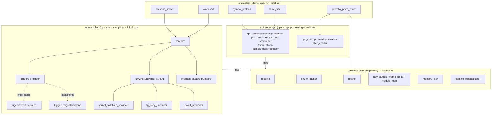
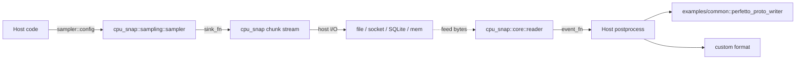
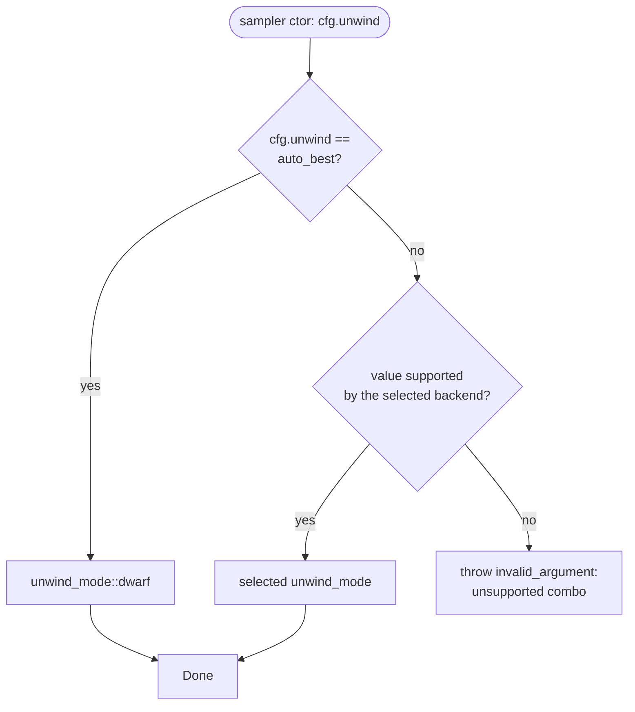

# cpu-snap

CPU profiling library suite for Linux. Three components published as
one CMake package:

- **core**: shared wire format (chunked byte-stream container,
  perf_event_open ring management, readers + writers). No `libdw`.
- **sampling**: per-thread CPU callstack sampler. Streams callchain
  snapshots through core with trie + temporal compression. C++20;
  links `libdw` for DWARF unwinding.
- **processing**: offline, post-capture processing over already-captured
  data - symbol resolution (`cpu_snap::processing::symbols`) and timeline shaping
  (`cpu_snap::processing::timeline`). No `libdw`.

Consumers pick what they need via CMake components:
`find_package(cpu_snap REQUIRED COMPONENTS sampling processing)`.

## Architecture



`core` owns everything common to the recorder and the reader: kernel
ring drain, 1 MB chunk framing, the offline push-parser, and all wire
record/type definitions. `sampling` is capture: the neutral `sampler`
owns one `i_trigger` - either `triggers::perf::backend`
(perf_event_open + mmap rings, preferred) or `triggers::signal::backend`
(POSIX timers + signal handler, privilege-free, no
`perf_event_paranoid` required) - selected at construction via
`config.backend` (default `automatic`: perf, falling back to signal when
`perf_event_open` is refused; `sampler::selected_backend()` reports the choice); unwinding is a closed `unwind::unwinder` variant
of `kernel_callchain_unwinder`, `fp_copy_unwinder`, and
`dwarf_unwinder`, and `sampling` is the only component that links
`libdw`. `processing` is offline shaping over already-captured data:
`cpu_snap::processing::symbols` resolves addresses to module/function/file:line,
and `cpu_snap::processing::timeline` turns per-tid sample vectors into
`emitted_slice` streams; both namespaces are compiled into the single
`cpu_snap::processing` library since neither needs `libdw` nor runs at
capture time. `examples/` holds demo-only glue (not installed) such as
the Perfetto trace writer that sits on top of `processing`.

The sampler emits through the `sink_fn` boundary, decoded by
`cpu_snap::core::reader`. The wire format is the only contract between
the recorder side and the offline reader side; both can live in
different processes (or even on different hosts) with no shared state.

There is no PMC (performance-monitoring-counter) support and no LBR
call-stack unwind mode in this library; a prior LBR implementation is
preserved on the `archive/lbr-implementation` branch.

## Components

| Component | Target | Purpose |
|---|---|---|
| `core`       | `cpu_snap::core`   | Shared wire format: chunk framer, kernel ring drain, wire records/types, reader, sample_reconstructor. No `libdw` dependency. |
| `sampling`   | `cpu_snap::sampling` | Per-thread callstack sampler: `triggers::perf`/`triggers::signal` capture backends, `unwind::unwinder` (kernel callchain / frame-pointer / DWARF). The only component that links `libdw`. |
| `processing` | `cpu_snap::processing` | Offline processing of already-captured samples: `cpu_snap::processing::symbols` (proc_maps, symbolizer, frame filters, sample postprocessor) and `cpu_snap::processing::timeline` (slice_emitter). No `libdw`. |
| umbrella   | `cpu_snap::all` | Interface target that links every enabled component. |

Components are independently selectable at configure time:

```bash
cmake -B build -DCPU_SNAP_BUILD_SAMPLING=OFF     # cpu_snap core only; no libdw needed
```

## Library usage



The sampler shares the cpu_snap chunked byte-stream format with the
rest of the library, so a single `cpu_snap::core::reader` decodes it.
The library never opens an fd: the host owns persistence via the
`sink_fn` callback.

## Quickstart

```bash
mkdir build && cd build && cmake .. && make -j
```

Bundled callstack demo (captures via `core::memory_sink`, decodes with
`core::sample_reconstructor`):
```bash
./examples/multi_thread_sample_demo /tmp/demo.pftrace
# open /tmp/demo.pftrace in https://ui.perfetto.dev/
```

Compare perf and signal backends side-by-side (signal needs no `perf_event_paranoid` privilege):
```bash
./examples/backend_comparison_demo /tmp
# writes backend_cmp_perf.pftrace + backend_cmp_signal.pftrace
# prints comparison table: samples / lost / duration_ms per backend
```

Streaming demo with a host-owned sink (4-thread workload, one pftrace with
callstack slices):
```bash
cat /proc/sys/kernel/perf_event_paranoid    # need <= 2
./examples/multi_thread_callstack_demo /tmp/cs_combined.pftrace
# open /tmp/cs_combined.pftrace in https://ui.perfetto.dev/
```

`LD_PRELOAD` autoload sampler against any binary:
```bash
LD_PRELOAD=$PWD/libcallstack_autoload.so \
  CALLSTACK_TRACE=/tmp/myapp.pftrace \
  /path/to/your_binary
```

See [`examples/README.md`](examples/README.md) for the full
{mode, component} matrix, per-demo summary, and notes on which
matrix cells are intentionally empty.

### Keep it in memory (`core::memory_sink`)

Every capture streams through a host-supplied sink; there is no
in-RAM fallback. For "keep the capture in memory and analyze it
in this process after `stop()`" use cases (the old default
behavior), pair the library-provided `core::memory_sink` (bounded,
stop-when-full) with `core::sample_reconstructor` (decodes the
captured bytes back into per-tid `raw_sample` vectors):

```cpp
#include "cpu_snap/sampling/sampler.hpp"
#include "cpu_snap/core/memory_sink.hpp"
#include "cpu_snap/core/sample_reconstructor.hpp"

cpu_snap::core::memory_sink sink(
    cpu_snap::core::memory_sink::config{ .max_bytes = 256 * 1024 * 1024 });

cpu_snap::sampling::sampler s(cpu_snap::sampling::sampler::config{
    .perf      = { .sample_freq_hz = 1000, .callchain_depth = 32 },
    .threads   = { .watch_new_threads = false },
    .streaming = { .sink = std::ref(sink) },
});
s.start();
do_workload();
s.stop();

cpu_snap::core::sample_reconstructor reconstructor;
reconstructor.feed(sink.bytes());
for (const auto& [tid, samples] : reconstructor.samples()) {
    // raw_sample{tid, timestamp_ns, ip, frames}
}
```

`memory_sink` drops later chunks (not older ones) once `max_bytes` is
reached, so the retained bytes stay a contiguous, decodable prefix;
`dropped_chunks()` / `dropped_bytes()` report how much was lost. Choose
`max_bytes` for your workload; the sink is bounded by the host, not the
library.

### Stream to a custom sink (file, socket, ...)

```cpp
#include "cpu_snap/sampling/sampler.hpp"
#include "cpu_snap/core/reader.hpp"
#include "cpu_snap/core/records.hpp"

#include <array>
#include <fstream>
#include <span>
#include <variant>

std::ofstream out("/tmp/run.csnp", std::ios::binary);

cpu_snap::sampling::sampler s(cpu_snap::sampling::sampler::config{
    .perf      = { .sample_freq_hz = 5000, .callchain_depth = 32 },
    .streaming = {
        .sink         = [&](std::span<const std::byte> bytes) {
            out.write(reinterpret_cast<const char*>(bytes.data()),
                      static_cast<std::streamsize>(bytes.size()));
        },
        .process_name = "myapp",
    },
});
s.start();
do_heavy_workload();
s.stop();          // flushes final chunk + EOF record
out.close();

// later (separate process, or same):
cpu_snap::core::reader r;
r.on_event([&](const cpu_snap::core::record_variant& rec) {
    if (auto* smp = std::get_if<cpu_snap::core::sample_record>(&rec)) {
        auto frames = r.resolve_stack(smp->leaf_node_id);
        // frames is innermost-first vector<std::uint64_t>
    }
});
std::ifstream in("/tmp/run.csnp", std::ios::binary);
std::array<char, 64 * 1024> buf;
while (in.read(buf.data(), buf.size()) || in.gcount() > 0) {
    r.feed({reinterpret_cast<const std::byte*>(buf.data()),
            static_cast<std::size_t>(in.gcount())});
}
```

`.csnp` is the conventional on-disk extension for the framed container
written by the streaming sink.

A full walking-through-the-flow narrative lives in
"Library usage (detailed)" below.

## Filter out library frames

For application-only flamegraphs that strip libc / libstdc++ / libdl /
vDSO noise: `sample_postprocessor_config` has a `drop_library_frames` bool
knob (it is allowed to own a `proc_maps` internally, since it lives in
`cpu_snap::processing::symbols`); `cpu_snap::processing::timeline::slice_emitter_config` instead
takes a ready-made `library_frame_filter` callback, since `timeline` does
not link `cpu_snap::processing::symbols` or `core::proc_maps` itself:

```cpp
cpu_snap::processing::symbols::sample_postprocessor_config pcfg;
pcfg.drop_library_frames = true;     // keep only main-exe frames
cpu_snap::processing::symbols::sample_postprocessor proc(std::move(pcfg));

cpu_snap::processing::symbols::proc_maps maps;   // caller-owned; must outlive the filter's use
cpu_snap::processing::timeline::slice_emitter_config scfg;
scfg.library_frame_filter = cpu_snap::processing::symbols::make_main_exe_only_filter(maps);
cpu_snap::processing::timeline::slice_emitter emitter(std::move(scfg));
```

`make_main_exe_only_filter(maps)` builds a predicate that keeps frames in
the main executable + anonymous mappings (JIT regions), drops everything
in a shared library; the postprocessor applies the same predicate
internally when `drop_library_frames` is true.

For finer control, use the free builders directly with the existing
`frame_predicate` config field (postprocessor) or `library_frame_filter`
(slice_emitter):

```cpp
#include "cpu_snap/processing/symbols/frame_filters.hpp"

cpu_snap::processing::symbols::proc_maps maps;
pcfg.frame_predicate = cpu_snap::processing::symbols::make_library_exclude_filter(
    maps, {"libc.so", "libstdc++.so", "libdl.so"});
```

`cpu_snap::processing::symbols::main_executable_path()` returns the main exe path
(readlink /proc/self/exe).

The bundled demo accepts an env var to toggle the filter without
rebuilding:

```bash
CALLSTACK_DROP_LIBRARY_FRAMES=1 ./build/examples/multi_thread_sample_demo /tmp/demo.pftrace
```

Sample effect on the demo workload: ~7200 library frames stripped
across 2400 samples (3 libc/dl frames per sample on average).

## Public API surface

| Header | Component | Exposes |
|---|---|---|
| `cpu_snap/sampling/sampler.hpp` | sampling | `sampler`, `sampler::config`, `raw_sample` |
| `cpu_snap/processing/symbols/sample_postprocessor.hpp` | sampling | `sample_postprocessor`, `sample_postprocessor_config`, `processed_sample`, `processed_frame`, `coalesce_frames_by_name` |
| `cpu_snap/sampling/sampler_capabilities.hpp` | sampling | `sampler_capabilities`, `probe_sampler_capabilities` |
| `cpu_snap/processing/timeline/slice_emitter.hpp` | timeline | `slice_emitter`, `slice_emitter_config`, `emitted_slice` (timeline shaping) |
| `cpu_snap/sampling/unwind_mode.hpp` | sampling | `unwind_mode` enum |
| `cpu_snap/sampling/unwind/dwarf_unwinder.hpp` | sampling | DWARF unwinder used by `sampler` (libdw / libdwfl wrapper) |
| `cpu_snap/processing/symbols/symbolizer.hpp` | sampling | `symbolizer` (batched addr2line) |
| `cpu_snap/processing/symbols/frame_filters.hpp` | sampling | `make_main_exe_only_filter`, `make_library_exclude_filter` |
| `cpu_snap/sampling/frame_trie.hpp` | sampling | Flyweight `frame_trie` (parent_id + ip) |
| `cpu_snap/sampling/streaming_pipeline.hpp` | sampling | L2-L5 streaming pipeline implementation |
| `cpu_snap/sampling/temporal_diff_filter.hpp` | sampling | per-tid temporal divergence filter |
| `cpu_snap/core/reader.hpp` | core | `reader`, `reader_counters` |
| `cpu_snap/core/records.hpp` | core | `record_variant`, all record body types, `file_header`, `chunk_header` |
| `cpu_snap/core/types.hpp` | core | `sink_fn`, `event_fn` |
| `cpu_snap/core/chunk_framer.hpp` | core | `chunk_framer` (1 MiB chunks) |
| `cpu_snap/sampling/dl_module_watcher.hpp` | core | `dl_module_watcher` (dl_iterate_phdr) |
| `cpu_snap/sampling/flat_tid_map.hpp` | core | per-tid utility map |
| `cpu_snap/processing/symbols/proc_maps.hpp` | core | `proc_maps` parser |
| `cpu_snap/sampling/thread_comm.hpp` | core | tid -> comm name lookup |

## Unwind mode selection



`auto_best` is the recommended default: it resolves to `unwind_mode::dwarf` on
both backends, which is correct for any binary. `frame_pointer` is an explicit
opt-in on both backends and is the cheaper choice when the target keeps frame
pointers; it misses frames in binaries built without `-fno-omit-frame-pointer`. DWARF mode uses libdwfl to walk
arbitrary binaries and works with any sink (memory or streaming).

There is no LBR call-stack unwind mode: AMD CPUs (this project's target) have
LBR branch-history hardware but no LBR call-stack mode, so `auto_best` cannot
resolve to it. A prior LBR implementation is preserved on the
`archive/lbr-implementation` branch.

### Why DWARF is the default fallback

- Modern Linux distros (Ubuntu, Fedora, Arch glibc) ship binaries
  built WITHOUT frame pointers (gcc default since GCC 4.6, worth
  ~1-3% perf on hot paths).
- Without FP, the kernel's callchain walker hits the first non-FP
  frame and bails. You see a stack of depth 1.
- DWARF mode fixes that: the kernel grabs raw bytes from the user
  stack + a register snapshot (`PERF_SAMPLE_STACK_USER` +
  `PERF_SAMPLE_REGS_USER`), and the user-space sampler walks the
  snapshot using CFI tables embedded in the `.eh_frame` /
  `.debug_frame` sections of the binary.
- That is what `dwarf_unwinder` does, via libdwfl (part of elfutils,
  hence the `libdw` PUBLIC dependency on `cpu_snap::sampling`).

### How it works internally

Pipeline per sample:

1. Kernel takes the sample IRQ; captures user-mode registers + N
   bytes of user stack (`config.perf.dwarf_stack_bytes`, default
   32 KiB, max 65528). The per-tid ring (`perf.kernel_pages_per_tid`,
   0 = automatic) is sized to hold at least 8 such samples; an explicit
   ring smaller than one sample is rejected at construction.
2. `perf_event_open` delivers the `(regs, stack_bytes)` tuple to the
   sampler's worker thread.
3. `dwarf_unwinder` hands them to libdwfl.
4. libdwfl uses a cached `dl_iterate_phdr` snapshot to find the
   binary owning the leaf IP, opens its CFI tables (`.eh_frame` /
   `.debug_frame`), and walks frame by frame using the CFI rules
   ("at IP X in function Y, the previous frame's RBP is at offset Z
   relative to the current RSP").
5. Returns a flat vector of IPs (innermost first).

Cost: ~5-50 us per stack depending on depth and binary complexity.
Streaming mode keeps the sampled thread's per-IRQ overhead near
zero by deferring the walk to the worker thread.

## perf ring buffer

Every attached tid gets one `perf_event_open` fd and one mmap ring.
The mmap region is `(N+1)` pages: page 0 is `perf_event_mmap_page`
(metadata), pages 1..N are the circular data ring.

```
mmap region
├── page 0  perf_event_mmap_page  ← metadata (head / tail pointers)
└── pages 1..N  data ring         ← kernel writes sample records here
```

**Head and tail:**

```
         kernel writes ──►  head
         ┌──────────────────────────────────────────────┐
         │  consumed  │  unread records  │     free      │
         └──────────────────────────────────────────────┘
                      ↑                  ↑
                     tail               head
         userspace advances ──►  tail
```

- **`data_head`** — kernel owns it. Advances after writing each sample record.
- **`data_tail`** — userspace owns it. Advances after reading and decoding each record.
- Unread bytes = `head - tail`. When this reaches the ring size the kernel starts dropping samples and emits `PERF_RECORD_LOST`.
- Both counters are monotonically increasing byte counts (never reset). Ring position = `count & (ring_size - 1)`, which is cheap because ring size is always a power of 2.

**Atomics contract:**

- Kernel stores `data_head` with a **release** barrier — all record bytes are visible before the head update.
- Userspace loads `data_head` with an **acquire** barrier — sees the full record before decoding it.
- Userspace stores `data_tail` with a **release** barrier — tells the kernel those bytes are free to overwrite.

**Ring-wrap splice:** A record can straddle the ring boundary (start near the end, body wrapping to offset 0). `perf_ring::drain()` detects this and copies both halves into a scratch buffer so the decoder always sees a contiguous linear record.

The worker thread calls `drain()` after `epoll_wait` signals data is ready, or on a 10 ms timeout to flush any lingering records.

### When to skip DWARF

| Situation | Pick |
|---|---|
| You can rebuild with `-fno-omit-frame-pointer` | `frame_pointer` - ~10x cheaper unwind, no libdw dep |
| Production binaries you can't rebuild, mixed-depth stacks | `dwarf` |

`config.perf.unwind = unwind_mode::auto_best` (the default) resolves at
sampler construction to `dwarf` on both backends; `frame_pointer` is opt-in. The
effective configuration is logged once at sampler construction when a logger is set.

### What the binary must contain: unwinding vs symbolization

Two different things both get called "DWARF" - don't confuse them:

| Section | Used for | Survives `strip`? | Gives names? |
|---|---|---|---|
| `.eh_frame` / `.debug_frame` (CFI) | Stack unwinding (libdwfl in `dwarf` mode, or the signal backend) | `.eh_frame`: yes (needed for C++ exceptions). `.debug_frame`: no | No |
| `.debug_info` / `.debug_line` (DWARF debug info, `-g`) | Function names, file:line, inline chains | No | Yes |

What the symbolizer can recover depends on what the ELF actually contains:

| Binary contains | Function names | file:line | Inline frames |
|---|---|---|---|
| `.dynsym` only (stripped shared lib) | Exported functions only - internal functions cannot be named by any symbolizer | No | No |
| `.symtab` (not stripped, no `-g`) | All functions, including `static` | No | No |
| DWARF debug info (`-g`) | All | Yes | Yes |
| DWARF line tables only (GCC `-g1`, Clang `-gline-tables-only`) | All | Yes | Yes (see note) |
| Stripped, but separate debug info found via `.gnu_debuglink`, `/usr/lib/debug/.build-id/xx/yyyy.debug` (distro `-dbg`/`-dbgsym` packages), or debuginfod | All | Yes | Yes |
| Stripped, no debug info anywhere | Exported names only | No | No |

Example: a stripped vendor runtime library typically has only
`.dynsym`, so expect exported names and nothing else.

**Practical guidance:**

- The call stack itself (which frames were called) never needs debug
  info - `.eh_frame` (for the DWARF path) or frame pointers (for the
  `frame_pointer` unwinder) is enough on its own. Frame pointers only
  exist if the code was actually built with
  `-fno-omit-frame-pointer`: most `-O2` release builds, and many
  vendor-supplied libraries, omit them, and the `frame_pointer`
  unwinder simply stops at such a frame. The `.eh_frame`/DWARF path
  does not depend on frame pointers being present.
- Names need a symbol table (`.symtab` or `.dynsym`).
- Lines and inline frames need DWARF debug info - GCC `-g1` and
  Clang `-gline-tables-only` both keep inlined call sites, not just
  full `-g`. Note: the current symbolizer shells out to GNU
  `addr2line`, which labels inlined frames from Clang
  `-gline-tables-only` binaries with the caller's name (the lines are
  still correct); `llvm-symbolizer` names them correctly.
- Separate debug files must be matched to the exact binary they came
  from. The only reliable way is a GNU build-id (link with
  `-Wl,--build-id`); binaries without a build-id can only be matched
  by path, which is fragile across rebuilds/deploys.
- For code you profile, keep `.symtab` (don't fully strip) or ship
  split debug info alongside a build-id. `-g1` gets you file:line at a
  small size cost if you can afford it.
- Symbolization runs an `addr2line` subprocess today (current
  master), which reads `.symtab`/`.dynsym`/DWARF and follows
  `.gnu_debuglink` and build-id debug directories the same way `gdb`
  does.

**Limits no debug info can fix:**

- Tail calls: the caller's frame is gone by the time you sample: it
  was replaced by the callee's, not just missing a name.
- JIT / anonymous executable code has no backing ELF file at all, so
  there is nothing to symbolize against; this needs a `perf` map file,
  which isn't supported yet.
- Inlined functions only show up as separate frames when DWARF debug
  info is present and `inline_frames` is enabled.

## Library usage (detailed)

End-to-end pipeline: the sampler streams encoded chunks through a
mandatory host-supplied sink; decode with `core::sample_reconstructor`
(the common case: bounded in-memory capture, analyzed in this
process) or with `cpu_snap::core::reader` directly (custom sink:
file, socket, another process/host); then symbolize and emit a
Perfetto trace.

### Pipeline overview


### Step 1 - Configure the sampler with a sink

```cpp
#include "cpu_snap/sampling/sampler.hpp"
#include "cpu_snap/processing/symbols/symbolizer.hpp"
#include "cpu_snap/core/memory_sink.hpp"
#include "cpu_snap/core/sample_reconstructor.hpp"
// Demo helper for .pftrace output; for production use, write your own consumer.
#include "perfetto_proto_writer.hpp"   // from examples/common/

cpu_snap::core::memory_sink sink(
    cpu_snap::core::memory_sink::config{ .max_bytes = 256 * 1024 * 1024 });

cpu_snap::sampling::sampler rec(cpu_snap::sampling::sampler::config{
    .perf      = { .sample_freq_hz       = 1000,
                   .callchain_depth      = 128,
                   .unwind               = cpu_snap::sampling::unwind_mode::auto_best },
    .threads   = { .watch_new_threads    = true },
    .streaming = { .sink = std::ref(sink), .process_name = "myapp" },
});
```

Key knobs:

- `perf.sample_freq_hz` - sampling rate per tid. 1 kHz is a good
  starting point; bench numbers below scale linearly up to ~5 kHz.
- `perf.kernel_pages_per_tid` - ring pages per thread (power of two).
  Leave at 0 to size it from the snapshot: 8 pages for frame-pointer
  mode, enough for 8 samples in DWARF mode.
- `perf.callchain_depth` - max frames per sample. 32 covers typical
  app stacks without ballooning per-sample size.
- `threads.watch_new_threads` - if `true`, any thread created after
  `start()` is auto-attached. If `false`, only threads alive at
  `start()` are sampled.
- `streaming.sink` is mandatory (construction throws
  `cpu_snap::config_error` if left unset). Use `core::memory_sink` for
  a bounded in-memory capture (shown above), or any `sink_fn` (file,
  socket, ...) for a custom destination - see "Stream to a custom
  sink" in Quickstart. The other `streaming.*` fields tune the
  pipeline (chunk size, maps-snapshot cadence, checkpoint cadence,
  trie cap, embedded process label) - defaults are sensible. The full
  field table lives in "Streaming pipeline / Config additions" below.

The sink callback contract (applies to any `sink_fn`, including the
one `memory_sink::operator()` implements internally):

- It runs on the sampler's internal worker thread, not the main
  thread. Treat it as a hot path - do not log, lock, or block.
- It MUST NOT throw. Exceptions are swallowed inside the worker and
  surface only as bumped `streaming_internal_errors()`. See
  "Streaming pipeline / Sink threading contract" for the full
  non-reentrancy rules.
- Its captures MUST outlive `rec.stop()`. `stop()` flushes a final
  chunk and an `EOF` record through the same callback (the sink
  local must be declared before the sampler, so it is destroyed
  after).

Inspect what the kernel + CPU actually support (probed at construction):

```cpp
const auto& caps = rec.caps();
// caps.frame_pointer, caps.precise_ip, caps.ibs_op
const auto mode = rec.resolved_unwind_mode();
```

### Step 2 - Run the workload

```cpp
rec.start();
do_my_workload();              // sampler ticks in the background
rec.stop();
```

Bytes flow through the sink continuously during the workload, not
just at `stop()`. `stop()` drains the kernel ring one last time and
emits an `EOF` record as the final chunk so a reader sees a clean
stream terminator. `pause()` / `resume()` are available and
idempotent if you want to gate the window.

### Step 3 - Decode the byte stream

Recommended, for a `memory_sink` capture:

```cpp
cpu_snap::core::sample_reconstructor reconstructor;
reconstructor.feed(sink.bytes());
const auto& per_tid = reconstructor.samples();
// std::unordered_map<pid_t, std::vector<raw_sample>>, time-sorted per tid
```

`sample_reconstructor` also exposes `modules()` (the `core::module_map`
built from `MAPS_INIT`/`MAPS_DELTA` records) and `counters()` (the
underlying reader's stream-health counters).

Each `raw_sample` carries:

```cpp
struct raw_sample {
    pid_t         tid;
    std::uint64_t timestamp_ns;
    std::uint64_t ip;                              // innermost IP
    std::vector<std::uint64_t> frames;             // innermost-first
};
```

For a custom sink (file, socket, ...), decode with
`cpu_snap::core::reader` directly - this is what
`sample_reconstructor` does internally:

```cpp
cpu_snap::core::reader reader;
std::unordered_map<pid_t, std::vector<cpu_snap::core::raw_sample>> per_tid;

reader.on_event([&](const cpu_snap::core::record_variant& var) {
    auto* smp = std::get_if<cpu_snap::core::sample_record>(&var);
    if(!smp || smp->leaf_node_id == 0) return;

    const auto ips = reader.resolve_stack(smp->leaf_node_id);
    if(ips.empty()) return;     // leaf unknown (new_node arrived in a skipped/partial chunk)

    cpu_snap::core::raw_sample rs{};
    rs.tid          = static_cast<pid_t>(smp->tid);
    rs.timestamp_ns = smp->timestamp_ns;
    rs.ip           = ips.front();
    rs.frames.assign(ips.begin(), ips.end());
    per_tid[rs.tid].push_back(rs);
});

reader.feed(buffered_bytes);   // e.g. from a file read in a chunk
```

The reader buffers partial chunks internally, so `feed()` can take
bytes in any granularity (single byte, full file, network packet).
`feed()` is `noexcept`. Decode any time after the bytes are
captured - same process, another process, another host.

Record types that arrive at `on_event`:

| Record | Use it for |
|---|---|
| `sample_record`     | One callstack sample. Carries `tid`, `timestamp_ns`, `leaf_node_id`. Pass `leaf_node_id` to `reader.resolve_stack(...)` to materialize the innermost-first IPs. |
| `new_node_record`   | Trie node insertion. The reader tracks the trie internally; user code rarely needs to handle this. |
| `lost_record`       | Kernel `PERF_RECORD_LOST`. Surface as a quality canary. |
| `maps_init_record`  | Initial `dl_iterate_phdr` snapshot. Used for offline symbolization. |
| `maps_delta_record` | dlopen / dlclose delta after `maps_init_record`. |
| `checkpoint_record` | Periodic full state (per-tid leaf id + counters). Lets a reader resync after a chunk gap. |
| `eof_record`        | End-of-stream sentinel. Safe to stop feeding once seen. |

For the full set of reader counters
(`bytes_fed`, `records_emitted`, `parse_errors`, `gap_count`, `last_seen_seq`)
and the `is_fatal()` semantics on bad file-header magic /
unsupported major version, see "Streaming pipeline / Reader" below.

### Step 4 - Preload symbols (one batch)

```cpp
cpu_snap::processing::symbols::symbolizer sym(
    cpu_snap::processing::symbols::symbolizer_config{
        .include_binary_name = true,
    });

std::unordered_set<std::uint64_t> seen;
for(const auto& [tid, samples] : per_tid)
{
    for(const auto& s : samples)
    {
        if(s.ip != 0) seen.insert(s.ip);
        for(std::uint32_t i = 0; i < s.frames.size(); ++i)
            if(s.frames[i] != 0) seen.insert(s.frames[i]);
    }
}
sym.preload(std::vector<std::uint64_t>(seen.begin(), seen.end()));
```

**Critical.** Call `sym.preload(...)` once with the full unique-IP
set before any `sym.resolve(ip)`. The symbolizer groups IPs by
backing binary and spawns one `addr2line` per binary. Calling
`sym.resolve(ip)` cold per IP forces one `addr2line` invocation per
IP, which dominates wall time on any non-trivial trace.

`sym.resolve_inline(ip)` returns the full inline-call chain
(innermost first) for the same IP; `sym.resolve(ip)` keeps returning
the outermost name (back of the chain). See "Optional: inline-frame
expansion" below.

### Step 5 - Write Perfetto trace

```cpp
cs_examples::perfetto::perfetto_proto_writer writer(out_path);
writer.set_process(::getpid(), "myapp");
writer.set_symbol_resolver([&sym](std::uint64_t ip) -> std::string {
    auto label = sym.resolve(ip);
    if(!label.empty()) return std::string(label);
    std::array<char, 40> hex{};
    std::snprintf(hex.data(), hex.size(), "0x%lx",
                  static_cast<unsigned long>(ip));
    return std::string(hex.data());
});

for(const auto& [tid, samples] : per_tid)
{
    writer.add_thread(static_cast<int>(tid), "main");
    std::vector<cpu_snap::core::raw_sample> sorted(samples.begin(),
                                                        samples.end());
    std::sort(sorted.begin(), sorted.end(),
              [](const auto& a, const auto& b) {
                  return a.timestamp_ns < b.timestamp_ns;
              });
    writer.write_thread_slices<cpu_snap::core::raw_sample>(
        static_cast<int>(tid),
        std::span<const cpu_snap::core::raw_sample>(sorted));
}
writer.finalize();
```

The per-tid sort matters: `write_thread_slices` assumes monotonic
`timestamp_ns`. `sample_reconstructor` already returns time-sorted
vectors; the sort above only matters if you built `per_tid` some
other way. Without it, slices overlap or get dropped in Perfetto's
UI. `finalize()` flushes the file - do not skip it.

### Optional: postprocess + frame coalescing

For larger pipelines the library also ships
`cpu_snap::processing::symbols::sample_postprocessor` (resolver + frame
predicate + sample predicate) and
`cpu_snap::processing::symbols::coalesce_frames_by_name` (rewrites every IP
that resolves to the same function name to one canonical IP, so the
writer emits one continuous slice per function instead of hundreds
of short ones). Both are offline-only; the sampler is untouched.
See `examples/multi_thread_sample_demo.cpp` for a worked
example.

### Optional: inline-frame expansion

Optimizers (`-O2` is the default for the examples) inline small
helpers, collapsing the stack at sample time so the kernel walks a
single physical frame even when the source-level call chain is
several functions deep. The symbolizer can surface that chain back:

- `symbolizer_config::inline_frames` (default `false`) toggles the
  feature. With the default the symbolizer behaves exactly as before
  (single outer frame per IP) so existing callers see no change. Set
  the flag to `true` to opt in to multi-frame chains.
- `symbolizer::resolve_inline(ip)` returns the inline chain
  (innermost first) for a preloaded IP. With `inline_frames=true` the
  full chain is read from DWARF debug info via `addr2line -i`; with
  `inline_frames=false` the returned vector is a single-element
  outer-frame fallback matching `resolve(ip)`.
- `symbolizer::resolve(ip)` keeps its outer-name-only contract; it
  returns the back of the chain regardless of the toggle.
- `perfetto_proto_writer::set_inline_resolver(...)` opts the writer
  in to multi-frame expansion: each sample IP becomes N nested slice
  events instead of one, with the outermost (non-inlined) caller at
  the top and the innermost inlined leaf at the bottom of the flame.
  Pair it with `inline_frames=true` on the symbolizer to actually
  surface a multi-entry chain.

See `examples/inline_frames_demo.cpp` for the end-to-end
pattern. It constructs the symbolizer with `inline_frames=true`
explicitly and prints a quick health-check of observed inline-chain
depth.

### Choosing a sink

| Concern | `core::memory_sink` | custom sink (file / socket / ...) |
|---|---|---|
| Memory cap during run | Bounded by `max_bytes`, chosen by you; drops later chunks once full | Constant working set in the library; the host's own storage grows as it sees fit |
| Long workloads (minutes+) | Fine as long as `max_bytes` covers the run | Designed for soak (`bench_streaming` validates 1-hour @ 5 kHz x 256 thr) |
| Off-host analysis | No - bytes stay in this process | Native: sink to socket -> remote reader |
| Code complexity | Lower (`sample_reconstructor` returns a ready map) | Higher (reader `on_event` + trie + multiple record types), but full control |

Both go through the identical wire format and the same
`sampler`/streaming-pipeline cost; the choice is purely about where
the bytes end up. Full host-facing contract for the streaming path
(config-additions table, threading + non-reentrancy, reader counters,
fatal-error semantics) lives in "Streaming pipeline" below; the
on-disk byte layout lives in "Wire format summary"; soak-test overhead
numbers are reported by `bench_streaming` (see "Overhead").

### Reference implementation

`examples/single_thread_callstack_demo.cpp`,
`examples/multi_thread_sample_demo.cpp` (adds
`sample_postprocessor` + frame coalescing),
`examples/inline_frames_demo.cpp` (inline-frame expansion via
`set_inline_resolver`), and `examples/backend_comparison_demo.cpp`
(runs both capture backends against the same workload) all walk this
pipeline end-to-end via `core::memory_sink` + `core::sample_reconstructor`.
`examples/multi_thread_callstack_demo.cpp` shows the same
pipeline for a multi-thread workload, decoded the same way.

## Streaming pipeline

The Architecture diagram above shows the per-component layout; this
section covers the host-facing contract.

### When to use a custom sink instead of `core::memory_sink`

- Long sessions (minutes to hours) where a bounded in-memory capture
  isn't big enough, or isn't the point.
- Heavy sample rates (>1 kHz per thread on dozens or hundreds of threads)
  destined for durable storage.
- Custom sinks: file, socket, SQLite, shared memory, in-memory ring -
  the library never touches an fd, the host owns persistence.
- Online consumption via a separate `cpu_snap::core::reader` (same process or out
  of process; identical wire format).

### Config additions

These fields are part of `sampler::config`. `sink` is mandatory
(construction throws `cpu_snap::config_error` if unset); the rest are
tuning knobs with sensible defaults.

| Field | Default | Meaning |
|---|---|---|
| `sink` | empty (mandatory) | Host byte sink; every sample flows through it. Use `core::memory_sink` for a bounded in-memory capture, or any other `sink_fn` for a custom destination. |
| `chunk_bytes` | 1 MB | Target chunk size before sink emit. Smaller = lower latency per chunk + more framing overhead. |
| `maps_poll_interval` | 65536 samples | How often `dl_module_watcher` polls `dl_iterate_phdr` for dlopen/dlclose. |
| `checkpoint_interval` | 65536 samples | Cadence for `CHECKPOINT` records (per-tid leaf id + counters; allows mid-stream reader resync). |
| `trie_max_nodes` | 4194304 (2^22) | Ceiling on `frame_trie` size; 0 = uncapped. A sample whose stack would exceed it is dropped and reported as LOST. |
| `process_name` | `/proc/self/comm` | String embedded in the 64-byte `file_header`. |

### Sink threading contract

- Called from the collector worker thread.
- Calls are serialized; the sink is never reentrant.
- The `span<const byte>` is valid only inside the call; copy out if the
  host needs it longer.
- The sink MUST NOT block long: blocking the worker stalls all sampling
  for the whole process and risks `PERF_RECORD_LOST` from kernel ring
  overflow. If the host needs heavy persistence work, buffer the bytes
  into a SPSC queue and drain on a dedicated writer thread.
- A sink throwing does NOT propagate to user code: the worker swallows
  the exception. In streaming mode, watch `streaming_internal_errors()`
  for swallowed sink/pipeline failures; `lost_samples()` only counts
  kernel-side ring overflow (`PERF_RECORD_LOST`).

### Reader

```cpp
cpu_snap::core::reader r;
r.on_event([&](const cpu_snap::core::record_variant& v) {
    std::visit([&](auto&& rec) {
        using T = std::decay_t<decltype(rec)>;
        if constexpr (std::is_same_v<T, cpu_snap::core::sample_record>) {
            auto frames = r.resolve_stack(rec.leaf_node_id);
            // frames is innermost-first vector<u64>
        }
        // ...new_node_record, checkpoint_record, maps_init_record,
        //    maps_delta_record, lost_record, eof_record
    }, v);
});

r.feed({bytes_ptr, bytes_len});         // call as many times as needed

const auto& c = r.counters();
// c.bytes_fed, c.records_emitted, c.parse_errors, c.gap_count, c.last_seen_seq
```

`reader.feed()` is `noexcept` and accepts any byte slicing — partial
records are buffered across calls. Unknown record types bump
`parse_errors` and stop walking the current chunk. `is_fatal()` returns
true after a permanently unrecoverable framing error (bad file-header
magic or unsupported major version), at which point further feeds emit
nothing.

`resolve_stack(leaf_id)` returns innermost-first frames matching
`raw_sample::frames` order. An empty result means the leaf
was declared in a chunk whose body was not yet fully received.

## Wire format summary

The library writes typed records framed into chunks of approximately
`chunk_bytes` (1 MB default). Each chunk carries a 16-byte header
followed by body records aligned to 4 bytes (records never span chunks).
After trie warm-up, every callstack sample is 24 wire bytes: 8-byte
record header + 16-byte `sample_record` body. New trie nodes cost an
additional 16 bytes once each, lazily, right before the first
referencing sample.

| Record | Code | Body |
|---|---|---|
| `NEW_NODE`   | 0x01 | 16 B: u32 node_id, u32 parent_id, u64 ip |
| `SAMPLE`     | 0x02 | 16 B: u64 timestamp_ns, u32 tid, u32 leaf_node_id |
| `CHECKPOINT` | 0x03 | var: u64 wall_ns, u32 n_tids, u32 _, {u32 tid, u32 leaf_id, u64 samples, u64 lost}[n_tids] |
| `MAPS_INIT`  | 0x04 | var: u64 wall_ns, u32 n_modules, u32 _, module[n_modules] |
| `MAPS_DELTA` | 0x05 | var: u64 wall_ns, u8 op (0=add, 1=remove), u8 _[3], u32 _, module[1] |
| `LOST`       | 0x06 | 16 B: u64 wall_ns, u32 tid (0=aggregate), u32 lost_count_delta |
| `EOF`        | 0x07 | 16 B: u64 wall_ns, u64 total_samples_emitted |

`module` sub-record: u64 base_va, u64 size, u64 file_offset,
u32 build_id_len, u32 path_len, u8 build_id[], u8 path[], pad to 4 B.

Stream prefix (first 64 bytes): `file_header` = magic `CSNP`,
version_major u16, version_minor u16, start_unix_ns u64, pid u64,
chunk_bytes u32, flags u32, process_name char[32]. Flags bit 0 reserved
(unused by current writers), bit 1 = frame-pointer stack, bit 2 =
DWARF-unwound stack.

Full byte layout (struct definitions + `static_assert` on sizes) lives
in `cpu_snap/records.hpp`; this table is a reference summary only.

Forward compatibility:
- Bump `version_minor` for additive record types (codes 0x08..0xFF
  reserved) or new fields appended after existing ones. Old readers
  skip unknown records via `body_size`.
- Bump `version_major` for breaking changes. Readers reject unknown
  majors via `is_fatal()`.

## Install and find_package

The project ships a CMake package config. Library only - the host
embeds it and owns persistence.

### Install

```bash
cmake --preset default
cmake --build build -j
sudo cmake --install build --prefix /usr/local
```

### Consume

```cmake
find_package(cpu_snap REQUIRED)                             # everything
find_package(cpu_snap REQUIRED COMPONENTS sampling)         # just sampling
target_link_libraries(myapp PRIVATE cpu_snap::sampling)
# OR umbrella that links everything enabled at build time
target_link_libraries(myapp PRIVATE cpu_snap::all)
```

Installed targets:

- `cpu_snap::core`   - `libcore.a` (shared core)
- `cpu_snap::sampling` - `libsampling.a` (depends on cpu_snap + libdw)
- `cpu_snap::all` - umbrella interface that links every enabled component

```cpp
#include "cpu_snap/sampling/sampler.hpp"
#include "cpu_snap/core/reader.hpp"
#include "cpu_snap/core/records.hpp"
#include "cpu_snap/core/types.hpp"
```

### System dependencies

`libdw` is only required by `cpu_snap::sampling`. Consumers that
import only `cpu_snap::core` do not need libdw.

| Distro | Package (sampling only) |
|---|---|
| Debian / Ubuntu | `libdw-dev` |
| Fedora / RHEL   | `elfutils-devel` |
| Arch            | `libelf` (provides libdw) |

`find_package(cpu_snap)` re-declares the dependency through its package
config whenever `sampling` is in the requested component set: the
config locates `libdw` via `find_path` / `find_library`, exposes it as
the `LibDw::LibDw` IMPORTED INTERFACE target, and the exported
`cpu_snap::sampling` target links against it. Consumers never need to
call `find_package(libdw)` or pass `-ldw` themselves.

## Capability probe

`probe_sampler_capabilities()` opens throw-away `perf_event_open`
events to detect what the running kernel + CPU accept:

| Field             | Meaning                                                                 |
|-------------------|-------------------------------------------------------------------------|
| `frame_pointer`   | Always true. `PERF_SAMPLE_CALLCHAIN` works on any Linux.                |
| `precise_ip`      | `attr.precise_ip = 1` accepted (Intel PEBS / AMD IBS-Op).               |
| `ibs_op`          | `/sys/devices/ibs_op/type` present (AMD IBS-Op PMU available).          |

See "Unwind mode selection" above for how these capabilities feed into
`auto_best` resolution.

## Sampling any program: `cpu-snap-run`

`cpu-snap-run` runs a command with the autoload library preloaded and writes one
Perfetto trace per process (the program and every child it starts); a process
with no samples writes nothing. It is built with the examples and works for any
dynamically linked program, not only ROCm tools.

```
cpu-snap-run [options] -- <command> [args...]

cpu-snap-run -- ./my_app --its-flag
cpu-snap-run --backend signal --freq 2000 -o /tmp/run.%p.pftrace -- python3 script.py
cpu-snap-run --filter-stdlib -- rocprof-sys-run -- ./transpose
```

| Option | Default | Meaning |
|---|---|---|
| `-f, --freq=HZ` | `1000` | sample frequency per thread |
| `-b, --backend=auto\|perf\|signal` | `auto` | `auto` uses perf when permitted, else signal; explicit `perf` fails if refused; `signal` needs no privileges |
| `-u, --unwind=dwarf\|fp\|auto` | `dwarf` | `fp` fails on binaries built without frame pointers |
| `--stack-bytes=N` | `32768` | user-stack snapshot per sample for DWARF unwinding |
| `--pages=N` | derived | perf ring pages per thread (power of two); derived from the snapshot size |
| `--depth=N` | `256` | maximum frames per sample |
| `-o, --output=PATH` | `cpu-snap.%e.%p.pftrace` | `%p` = pid, `%e` = process name |
| `--no-merge` | merge | one slice stack per sample instead of merging consecutive samples |
| `--filter-stdlib` | off | drop C++ standard library frames |
| `--no-children` | children sampled | sample only the program itself |
| `--preload=PATH` | built library | sampler library (also `CPU_SNAP_PRELOAD`) |

Limits: no statically linked or setuid programs and no program that clears
`LD_PRELOAD`; a trace is written only when the process exits normally;
`--backend perf` needs `perf_event_paranoid <= 1` (the default `auto` falls back to signal). The target is exec'd by
`cpu-snap-run` itself, so it keeps its pid, exit code and signals. A launcher
that starts the real program as a child (for example `rocprof-sys-run`)
produces a trace for the child and nothing for the launcher.

## Autoload (`LD_PRELOAD`) example

`libcallstack_autoload.so` carries `__attribute__((constructor))` /
`__attribute__((destructor))` hooks. Sampler starts before `main()`,
capturing into a `core::memory_sink`; the trace is decoded (via
`core::sample_reconstructor`) and written after `main()` returns.
`cpu-snap-run` sets the variables below from its options.

| Variable                    | Default                              | Meaning                                |
|-----------------------------|--------------------------------------|----------------------------------------|
| `CALLSTACK_TRACE`            | `/tmp/callstack_autoload.pftrace`     | Output trace path; `%p` = pid, `%e` = process name |
| `CALLSTACK_FREQ_HZ`          | `200`                                | Sample frequency                       |
| `CALLSTACK_DEPTH`            | `256`                                | Max stored frames per sample           |
| `CALLSTACK_PAGES`            | `0` (automatic)                      | Kernel ring pages per tid (power of 2) |
| `CALLSTACK_BACKEND`          | `auto`                               | `auto`, `perf` or `signal`             |
| `CALLSTACK_UNWIND`           | `auto`                               | `auto`, `fp` or `dwarf`                |
| `CALLSTACK_STACK_BYTES`      | `32768`                              | DWARF user-stack snapshot per sample   |
| `CALLSTACK_MERGE`            | `1`                                  | `0` = one slice stack per sample       |
| `CALLSTACK_FILTER_STDLIB`    | `0`                                  | `1` = drop C++ standard library frames |
| `CALLSTACK_ONLY_PID`         | unset                                | Only this pid samples itself           |
| `CALLSTACK_MEMORY_SINK_MB`   | `512`                                | Bound on the in-memory capture buffer  |
| `CALLSTACK_RESCAN_MS`        | `100`                                | Period for picking up new threads      |
| `CALLSTACK_PROCESS_NAME`     | `/proc/self/comm`                    | Process label in Perfetto trace        |

## Symbol format

Output format: `function(args) [binary]`

Examples:
```
leaf_compute(double, unsigned long) [sample_target]
__libc_start_call_main [libc.so.6]
main [sample_target]
```

`(anonymous namespace)::` segments and `[clone .constprop.N]` /
`[clone .isra.N]` clone tags are stripped. Argument lists are kept.
`addr2line -fCe` is called once per binary (batched), not per IP.
Mappings come from `/proc/self/maps`, translated to the ELF virtual
address via the PT_LOAD headers.

For binaries without `.debug_info` (e.g. stripped shared libraries),
an address that falls outside every sized ELF symbol is never reported
as the nearest exported symbol; it is shown as `<binary>+0x<vaddr>`
instead.

## Overhead

### Recording-path overhead (`bench_overhead`)

Methodology: deterministic compute workload on a single pinned core
with the recorder attached at varying sample frequencies. Only the
workload loop is timed; sampler `start()` is called BEFORE the timer
starts, `stop()` is called AFTER it stops. No post-processing included.

Hardware: AMD Ryzen 9 9950X3D (Zen 5), Linux 6.17, target pinned to
core 2 with `taskset -c 2`, no postprocess. 10 runs, 4 warmups per
freq.

| sample freq | wall (ms)     | overhead   | samples captured |
|-------------|---------------|------------|------------------|
| 0 (off)     | 131.7 +/- 0.86| baseline   | 0                |
| 99 Hz       | 131.1 +/- 0.39| < noise    | 12               |
| 200 Hz      | 130.3 +/- 0.05| < noise    | 26               |
| 500 Hz      | 130.4 +/- 0.20| < noise    | 65               |
| 1 kHz       | 130.8 +/- 0.29| < noise    | 130              |
| 2 kHz       | 131.0 +/- 0.13| < noise    | 261              |
| 5 kHz       | 131.2 +/- 0.19| < noise    | 655              |
| 10 kHz      | 131.8 +/- 0.21| +0.07 %    | 1316             |
| 25 kHz      | 134.2 +/- 0.20| +1.84 %    | 3345             |
| 50 kHz      | 138.4 +/- 0.91| +5.08 %    | 6879             |

Below 10 kHz the recorder is invisible (within noise). Above 10 kHz
overhead scales linearly at ~0.9 us per sample, entirely in the
kernel (IRQ entry/exit + callchain walk + ring write).

This sweep predates the mandatory-sink change (`bench_overhead` used
to run with no sink at all); a spot-check comparing the old no-sink
path against the current `core::memory_sink` path at 10 kHz (8 runs,
3 warmups, same hardware) found the difference within measurement
noise (perf backend: 0.01% -> 1.26% overhead; signal backend: 1.82% ->
2.50%) - consistent with the trie-encode cost being small relative to
the per-sample kernel/decode cost the table above already captures.

Reproduce:
```bash
taskset -c 2 ./bench_overhead --runs=10 --warmup=4 \
    --freqs=0,99,200,500,1000,5000,10000,25000,50000
```

### Streaming path (`bench_streaming`)

Heavy-scale workload + sampler + streaming pipeline + null sink (sink
discards bytes; framer + trie + diff + maps still run).

| config                                 | overhead | lost | samples / sec | wire bytes |
|----------------------------------------|----------|------|---------------|------------|
| 5 kHz x 256 threads x 30 s, null sink  | -0.20%   | 0    | 158k          | 91 MB      |

A workload-overhead delta inside noise (the +/- band straddles zero)
on 256 threads at 5 kHz with the full pipeline running is the headline
number. Lost samples == 0 means the worker kept up.

Reproduce:
```bash
./bench_streaming --duration=30 --threads=256 --null-sink
```

#### About the 500 MB / 1 hr file-size target

The 30 s smoke run wrote 91 MB. Linearly extrapolating to one hour
gives ~11 GB, which appears to blow past the 500 MB target. It does
not, in practice, because **warm-up dominates the 30 s byte count**.
Every never-before-seen stack emits a `NEW_NODE` record (16-byte body +
8-byte header = 24 wire bytes) on top of the 24-byte `SAMPLE` record.
In the first seconds of a fresh process every sample is a NEW_NODE +
SAMPLE pair (~48 B). Once the trie covers the working set, the trie
hit rate climbs toward 1.0 and the steady-state bytes-per-sample drops
toward the floor of ~24 B (SAMPLE only). 30 s is far too short to
amortise warm-up on a 256-thread workload; a one-hour soak would hit
that asymptote and project well under 500 MB.

The full soak is gated behind an env var to keep CI fast:
```bash
SAMPLING_BENCH_FULL=1 ./bench_streaming --threads=256 --duration=3600
```

## Tests

```bash
cd build && ctest --output-on-failure
```

Tests across the two component suites (`tests/core/`,
`tests/sampling/`) plus a mixed-component coverage
test. Highlights:

| Suite | Component | What it covers |
|---|---|---|
| `test_records` | cpu_snap | record body sizes + variant tag mapping (all 7 record types) |
| `test_frame_trie` | sampling | trie intern + grow + cap behavior |
| `test_temporal_diff_filter` | sampling | divergent-frame emission + tid isolation |
| `test_chunk_framer` | cpu_snap | chunk boundary + per-record framing |
| `test_dl_module_watcher` | cpu_snap | dl_iterate_phdr poll + add/remove deltas |
| `test_streaming_pipeline` | sampling | end-to-end pipeline on synthetic samples |
| `test_reader` | cpu_snap | feed-any-slicing, chunk_seq gap detection, fatal magic |
| `test_sampler_streaming` | sampling | live integration with `sink` |
| `test_streaming_perfetto_equivalence` | sampling | two streaming captures of the same workload land within statistical tolerance of each other (sample count band, IP overlap) |
| `test_dwarf_unwinder` | sampling | libdwfl real-walk recovers multi-frame stacks |
| `test_stress_streaming` | sampling | fork + dlopen + forced ring overflow + abort mid-write |
| `bench_streaming_smoke` | bench | smoke that `bench_streaming` parses args + runs short |
| `install_smoke` | packaging | configure -> install -> external consumer build (uses `cmake/sample-consumer/`) |

One test is intentionally skipped: `stress_streaming.ring_overflow_increments_lost_counter`
GTEST_SKIPs when the kernel does not actually overflow the ring under
the synthetic load (varies by kernel version and scheduling).

Most internal-component tests (`test_chunk_framer`, `test_frame_trie`,
`test_reader`, etc.) feed synthetic input and need no `perf_event_paranoid`
privileges; only `test_sampler*` and
`test_stress*` GTEST_SKIP when `perf_event_paranoid > 1`.

### Code coverage

```bash
cmake --preset coverage
cmake --build build-coverage -j --target coverage
# Summary on stdout; HTML at build-coverage/coverage_html/index.html
```

Requires `gcovr` (preferred) or `lcov + genhtml`:
- Debian/Ubuntu: `apt install gcovr` (or `lcov`)
- Fedora/RHEL: `dnf install gcovr` (or `lcov`)

The `coverage` target wipes prior `.gcda` data, runs the full ctest
suite under the instrumented binaries, prints a per-file summary on
stdout (lines / functions / branches), and writes a clickable HTML
report at `build-coverage/coverage_html/index.html`. The report is
filtered to component headers and sources; tests, benches, examples,
and system headers are excluded.

Coverage is mutually exclusive with sanitizers - the runtime
instrumentation collides and produces nonsense numbers when combined.
A configure-time guard rejects `CPU_SNAP_COVERAGE=ON` with a non-`none`
`CPU_SNAP_SANITIZER`. Use `cmake --preset default` for plain builds
and `cmake --preset coverage` separately.

### Microbench

`bench_decode` measures pure userspace decoder throughput by feeding
synthetic `PERF_RECORD_SAMPLE` byte streams to the parser (no kernel
involvement):

| callchain depth | ns / record | records / sec |
|-----------------|-------------|---------------|
| 2               | 10.0        | 100 M         |
| 8               | 12.0        | 83 M          |
| 32              | 20.1        | 50 M          |

Decoder cost is 50-90x smaller than per-sample kernel cost.
`bench_streaming` is the streaming-mode counterpart documented above.

## Build options

| Option | Default | Purpose |
|---|---|---|
| `CPU_SNAP_BUILD_CORE`   | `ON`   | Shared core (forced ON if any other component is ON) |
| `CPU_SNAP_BUILD_SAMPLING` | `ON`   | Callstack sampler component |
| `CPU_SNAP_BUILD_PROCESSING` | `ON`   | Symbol resolution + timeline shaping component |
| `CPU_SNAP_BUILD_EXAMPLES` | `ON`   | `examples/*` targets |
| `CPU_SNAP_BUILD_TESTS`    | `ON`   | `tests/*` gtest targets |
| `CPU_SNAP_BUILD_BENCH`    | `ON`   | `bench/*` benchmarks |
| `CPU_SNAP_INSTALL`        | `ON`   | install rules + package config |
| `CPU_SNAP_SANITIZER`      | `none` | `none` / `asan` / `tsan` / `ubsan` / `asan+ubsan` |
| `CPU_SNAP_COVERAGE`       | `OFF`  | gcov/clang-coverage instrumentation |

### CMake presets (`CMakePresets.json`)

```bash
cmake --preset asan     && cmake --build build-asan && ctest --preset asan
cmake --preset tsan     && cmake --build build-tsan && ctest --preset tsan
cmake --preset ubsan    && cmake --build build-ubsan
cmake --preset debug
cmake --preset default
cmake --preset coverage && cmake --build build-coverage --target coverage
```

`tsan` is the relevant one for validating the worker-thread vs
main-thread access pattern of the recorder.

Convenience targets:
- `make format`         - run `clang-format -i` on all sources
- `make format-check`   - dry-run; non-zero if anything is unformatted
- `make tidy`           - run `clang-tidy` against `compile_commands.json`
- `make run_autoload_demo` - run the bundled target under `LD_PRELOAD`

`.clang-format` and `.clang-tidy` are taken verbatim from the
rocprofiler-systems project.

## perf_event_paranoid

The default `automatic` backend probes `perf_event_open` and falls back to
`signal` when it is refused. The `perf` backend uses `perf_event_open` and
needs `perf_event_paranoid <= 2` (or `CAP_PERFMON`). The sampling
`signal` backend uses POSIX timers + a signal handler and works with
any `perf_event_paranoid` value — no privileges required. Check:
```bash
cat /proc/sys/kernel/perf_event_paranoid
```
Lower temporarily:
```bash
sudo sysctl kernel.perf_event_paranoid=1
```

## Directory layout

```
cpu_snap/
├── src/cpu_snap/                          headers and sources side by side; include root = src/
│   ├── core/                              wire format component (namespace cpu_snap::core)
│   │   ├── chunk_framer.hpp              1 MB chunks
│   │   ├── records.hpp                   wire record types + framing structs
│   │   ├── types.hpp                     sink_fn + event_fn aliases
│   │   ├── reader.hpp / reader.cpp       push-based streaming reader
│   │   ├── raw_sample.hpp                POD per-sample record
│   │   ├── frame_limits.hpp              callchain depth default and bound
│   │   ├── module_map.hpp / .cpp         address -> module lookup
│   │   ├── memory_sink.hpp               bounded in-memory sink_fn implementation
│   │   ├── sample_reconstructor.hpp / .cpp  rebuilds raw_sample from wire records
│   │   └── CMakeLists.txt
│   ├── sampling/                          sampling component (links libdw)
│   │   ├── sampler.hpp / .cpp             online recorder + config
│   │   ├── sampler_capabilities.hpp       precise_ip / IBS probes
│   │   ├── unwind_mode.hpp                enum (auto_best / fp / dwarf)
│   │   ├── streaming_pipeline.hpp / .cpp  trie-diff encoder + sink pipeline
│   │   ├── temporal_diff_filter.hpp       per-tid running stack diff
│   │   ├── frame_trie.hpp                 Flyweight; raw-IP keyed
│   │   ├── flat_tid_map.hpp               per-tid utility map
│   │   ├── perf_ring.hpp                  perf_event_open mmap ring RAII owner
│   │   ├── dl_module_watcher.hpp / .cpp   dl_iterate_phdr poll
│   │   ├── thread_comm.hpp                tid -> comm lookup
│   │   ├── time.hpp                       monotonic clock helpers
│   │   ├── triggers/
│   │   │   ├── i_trigger.hpp              strategy interface for capture mechanism
│   │   │   ├── perf/backend.hpp / .cpp    perf_event_open capture backend (default)
│   │   │   ├── perf/kernel_drain.hpp      per-tid perf fd + mmap ring + decoder
│   │   │   ├── perf/ring_sizing.hpp       ring pages / wakeup derived from the snapshot size
│   │   │   ├── perf/open_error.hpp        actionable perf_event_open error text
│   │   │   ├── signal/backend.hpp / .cpp  POSIX timer + signal backend (privilege-free)
│   │   │   ├── signal/ring_table.hpp      tid -> snapshot ring table read by the handler
│   │   │   └── signal/snapshot.hpp        async-signal-safe SPSC snapshot ring
│   │   ├── unwind/                        namespace cpu_snap::sampling::unwind
│   │   │   ├── machine_snapshot.hpp       capture_kind + Unwinder concept
│   │   │   ├── kernel_callchain_unwinder.hpp  passthrough for kernel-walked chains
│   │   │   ├── fp_copy_unwinder.hpp / .cpp    frame-pointer walk over a copied stack
│   │   │   ├── dwarf_unwinder.hpp / .cpp      libdwfl RAII facade
│   │   │   ├── perf_regs.hpp              perf register mask / slot constants
│   │   │   └── unwinder.hpp               closed unwinder variant
│   │   └── CMakeLists.txt
│   └── processing/                        offline processing component (no libdw)
│       ├── symbols/                       namespace cpu_snap::processing::symbols
│       │   ├── proc_maps.hpp              /proc/self/maps parser
│       │   ├── elf_symbols.hpp            ELF .symtab/.dynsym reader
│       │   ├── symbolizer.hpp             addr2line-backed resolver + cache
│       │   ├── frame_filters.hpp          library-exclude / main-exe-only predicates
│       │   └── sample_postprocessor.hpp   offline symbolize + filter pipeline
│       ├── timeline/                      namespace cpu_snap::processing::timeline
│       │   ├── slice_emitter.hpp / .cpp   raw_sample[] -> emitted_slice stream
│       └── CMakeLists.txt
├── tools/
│   └── cpu_snap_run/                    cpu-snap-run: run any program under the sampler
│       ├── launch_plan.hpp              argv -> environment + command (pure, unit tested)
│       └── main.cpp                     sets LD_PRELOAD + CALLSTACK_*, then execvp
├── examples/
│   ├── common/                          shared demo-only helpers, not installed
│   │   ├── perfetto_proto_writer.hpp    .pftrace writer
│   │   ├── backend_select.hpp           CLI backend selection helper
│   │   ├── workload.hpp                 synthetic CPU workload generator
│   │   ├── name_filter.hpp              --exclude-lib CLI helper
│   │   ├── symbol_preload.hpp           preload IPs into a symbolizer cache
│   │   └── CMakeLists.txt               perfetto_writer_demo INTERFACE target
│   ├── single_thread_callstack_demo.cpp smallest sampler usage, single thread
│   ├── multi_thread_sample_demo.cpp     multi-thread callstack demo
│   ├── multi_thread_callstack_demo.cpp  streaming callstack -> one pftrace
│   ├── backend_comparison_demo.cpp      run perf vs signal backend side-by-side
│   ├── inline_frames_demo.cpp           inline-frame expansion demo
│   ├── deep_chain_callstack_demo.cpp    self vs inclusive time by depth
│   ├── hip_matmul_demo.cpp              opt-in HIP demo
│   ├── autoload/                        LD_PRELOAD library + sample target
│   └── CMakeLists.txt
├── bench/
│   ├── bench_overhead.cpp               wall + cputime + PMU sweep (memory_sink)
│   ├── bench_decode.cpp                 pure decoder microbench
│   ├── bench_streaming.cpp              streaming-mode heavy-scale bench
│   └── CMakeLists.txt
├── tests/
│   ├── core/                            core component tests
│   ├── sampling/                        sampling component tests + perfetto-equivalence
│   ├── processing/                      processing component tests (symbols + timeline)
│   ├── integration/                     multi-component tests (core + sampling + processing)
│   ├── test_coverage_extras.cpp         mixed-component coverage targeting
│   ├── fixtures/                        captured byte fixtures
│   └── CMakeLists.txt
├── cmake/
│   └── cpu_snapConfig.cmake.in          find_package(cpu_snap) config template
├── .clang-format / .clang-tidy          from rocprofiler-systems
├── CMakeLists.txt
└── CMakePresets.json
```

## Fork safety

The recorder registers a `pthread_atfork(child)` handler that detaches
the (gone) worker thread, closes inherited fds, unmaps inherited
rings, and tears down the streaming pipeline in every child process.
Subsequent `exec()` will not inherit live perf events from the parent.
Covered by `stress_streaming` fork tests.

## Known limitations

- Stripped binaries without separate debug info: internal (non-exported)
  function names cannot be recovered by any symbolizer - see
  "What the binary must contain: unwinding vs symbolization".
- aarch64 not supported. Per-arch register masks + libdwfl
  arch-specific callbacks are deferred.
- Output formats: pftrace only via the existing `slice_emitter` +
  `perfetto_proto_writer`. rocpd, pprof, and folded-stack writers are
  deferred. Any consumer of `cpu_snap::core::reader::on_event` can add another
  format without library changes.
- Frame-pointer walking misses frames in code built without
  `-fno-omit-frame-pointer`. DWARF mode fixes it entirely.
- File-size projection from short bench runs over-estimates the
  steady-state byte rate because warm-up `NEW_NODE` traffic dominates
  the first seconds. Use `SAMPLING_BENCH_FULL=1` for the real soak.
- Sampler worker thread has no explicit CPU affinity; if scheduler
  lands it on the SMT sibling of the target it can cause a few percent
  extra overhead through shared L1/L2 contention.

---

Standalone library suite. `find_package(cpu_snap)` is the only
supported integration path. Source vendoring is not recommended.
