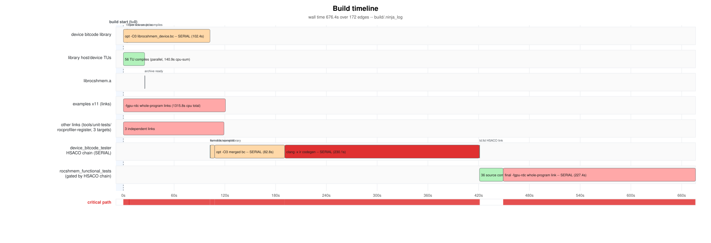
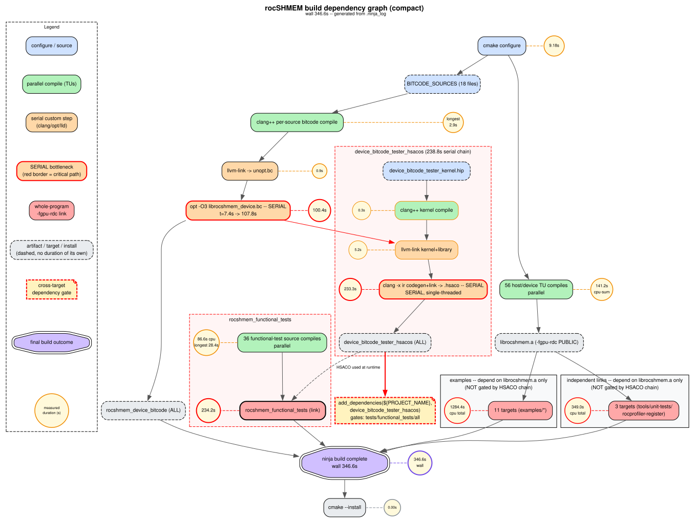

.. meta::
  :description: rocSHMEM analysis, profiling, and deadlock debugging tooling.
  :keywords: rocSHMEM, ROCm, debugging, deadlock, rocgdb, register pressure, occupancy, LTO, profiling

.. _rocshmem-analysis-tools:

--------------------------------
Analysis and debugging tools
--------------------------------

rocSHMEM ships two sets of developer scripts alongside the library. They are
not installed with the library; run them from a source checkout.

* ``scripts/analysis`` - commit-vs-commit comparison of compiler codegen:
  per-kernel GPU resource usage and LTO inlining decisions.
* ``scripts/debug`` - deadlock diagnosis for a running (or hung) rocSHMEM
  application, built on ``rocgdb``.

Runtime statistics and tracing
------------------------------

Before reaching for the scripts, two in-library facilities are often enough:

* **Statistics counters.** Build with ``-DPROFILE=ON`` and call
  ``rocshmem_dump_stats()`` to print the runtime's internal counters.
  ``rocshmem_reset_stats()`` clears only the counters its backend supports — it
  does not clear user-created host contexts, so it cannot be relied on to
  exclude all warm-up activity. See :ref:`rocshmem-api-init`.
* **Tracing with rocprofiler-sdk.** With the default
  ``-DUSE_ROCPROFILER_REGISTER=ON``, rocSHMEM's host-stream APIs are visible to
  tools such as ``rocprofv3``. See the "Profiling and tracing support" section
  of :doc:`Build from source <./build>`.
* **Verbose logging.** ``ROCSHMEM_DEBUG_LEVEL`` controls log verbosity at
  runtime. The ``api`` and ``trace`` levels additionally require a build with
  ``-DBUILD_DEBUG_TRACE_HOST=ON`` or ``-DBUILD_DEBUG_TRACE_DEVICE=ON``. See
  :ref:`rocshmem-api-env-variables`.

Build-time analysis
--------------------

``scripts/analysis/build_time_report.py`` is the single entry point for *where an
all_backends build spends its time*. One run against a finished build's
``build/`` directory:

.. code-block:: bash

  python3 scripts/analysis/build_time_report.py --build-dir build

parses ``.ninja_log`` once and produces everything that previously needed
three separate scripts, plus the dependency graphs that used to be
hand-maintained:

* a per-component time budget and slowest-individual-edges table (text, to
  stdout)
* a ``-ftime-trace`` phase/template-instantiation summary (text, to stdout),
  if the build was configured with ``-DROCSHMEM_BUILD_TIME_TRACE=ON`` — skipped
  with a note otherwise
* a Gantt-style ``build-timeline.svg``, showing the real parallel overlap
  between build phases instead of a flat per-component total
* ``build-dependency-graph.dot`` / ``build-dependency-graph-compact.dot``,
  rendered to ``.svg`` (and ``.png`` with ``--png``) if Graphviz's ``dot`` is
  on ``PATH``
* a single ``build-time-analysis.md`` report stitching all of the above
  together (``--no-report`` to skip; ``--report PATH`` to change where it's
  written)

It recognizes rocSHMEM's device-bitcode / ``device_bitcode_tester`` HSACO
build shape specifically — the serial ``opt``/``clang -x ir`` codegen chain
that gates ``rocshmem_functional_tests`` — and renders it as its own lane in
the timeline alongside the parallel compile/link phases. It also detects,
straight from ``build.ninja``, which target that chain's
``add_dependencies(${PROJECT_NAME}, device_bitcode_tester_hsacos)`` actually
gates (so the graph and report stay correct even if that wiring moves) and
whether ``examples``/``rocshmem_unit_tests`` exist in this configuration at
all (commonly absent when no external MPI was found) — grayed out in the
graph rather than reported with stale numbers when they're missing.

        compile/link phases overlapping the serial device-bitcode and
        HSACO-tester chains.

        through the device-bitcode library, the HSACO tester chain, and
        every downstream link target, with measured durations attached.

Both use a solid node border for a timed build action (a small circle beside
it carries the measured duration) and a dashed border for an
artifact/target/install rule with no duration of its own. The full-detail
graph is also available as a download:
:download:`build-dependency-graph.dot <images/diagrams/build-dependency-graph.dot>`.

These are a point-in-time snapshot (durations will drift build-to-build);
re-run ``build_time_report.py`` against a fresh ``build/`` directory rather than
trusting the checked-in files for anything but relative scale.

``build_time_report.py`` needs ``build/build_timing.log`` only for the
configure/install stage split in its "Summary" section (everything else
comes from ``.ninja_log``/``build.ninja``/``-ftime-trace`` JSON directly).
That file isn't produced by a plain ``scripts/build_configs/all_backends``
invocation — run the build through ``scripts/analysis/timed_build.sh``
instead to get it, with no change to ``all_backends``/``_common.sh``
themselves:

.. code-block:: bash

  mkdir build && cd build
  ../scripts/analysis/timed_build.sh -DROCSHMEM_BUILD_TIME_TRACE=ON -DGPU_TARGETS=gfx950

Codegen regression analysis
---------------------------

Both comparison scripts build each commit under test in its own isolated
``git worktree`` under ``/tmp``, so your working tree - including uncommitted
changes - is never touched. Each runs the same pipeline: build, extract
compiler remarks, convert to CSV, diff, and emit a self-contained interactive
HTML dashboard plus PNG charts.

Prerequisites
^^^^^^^^^^^^^

* The project must be a git repository.
* A ROCm ``clang++``/``hipcc`` toolchain with the AMDGPU backend.
* ``python3``.
* ``PyYAML``, for ``lto_inline_remarks_compare.sh`` only.
* ``matplotlib``, optional; PNG chart generation is skipped with a warning if
  it is missing.
* ``llvm-cxxfilt`` or ``c++filt`` on ``PATH``, used to demangle kernel names.

Resource usage
^^^^^^^^^^^^^^

``scripts/analysis/resource_usage_compare.sh`` reports per-kernel VGPR, SGPR,
AGPR, scratch, LDS, and occupancy from
``-Rpass-analysis=kernel-resource-usage`` remarks. Use it to answer whether a
change increased register pressure or dropped occupancy for a given kernel.

.. code-block:: bash

  # Compare two commits
  ./scripts/analysis/resource_usage_compare.sh \
    --commit1 HEAD~1 --commit2 HEAD \
    --gpu-target gfx950 --build-config all_backends

  # Compare a GitHub PR against its merge-base
  ./scripts/analysis/resource_usage_compare.sh --pr 42 --build-config all_backends

  # Compare two build configurations of different commits
  ./scripts/analysis/resource_usage_compare.sh \
    --commit1 923767a9 --commit1-extra-args "-DUSE_SDMA=1" \
    --commit2 41b678fa --commit2-extra-args "-DUSE_TDM=1"

Results are written to
``<parent-of-project>/resource-usage/<gpu>-<config>-<sha1>-vs-<sha2>/``.

LTO inlining decisions
^^^^^^^^^^^^^^^^^^^^^^

``scripts/analysis/lto_inline_remarks_compare.sh`` reports the whole-program
AMDGPU LTO inliner's optimization-record remarks. Use it to answer whether a
change flipped an inlining decision.

.. code-block:: bash

  ./scripts/analysis/lto_inline_remarks_compare.sh \
    --commit1 HEAD~1 --commit2 HEAD --build-config ipc_single

Results are written to
``<parent-of-project>/lto-inline-remarks/<gpu>-<config>-<sha1>[-vs-<sha2>]/``.

Common options
^^^^^^^^^^^^^^

.. list-table::
    :header-rows: 1
    :widths: 32,14,54

    * - **Option**
      - **Default**
      - **Description**

    * - ``--commit1 REF``
      - ``HEAD``
      - First commit or branch to measure.

    * - ``--commit2 REF``
      - none
      - Second commit to diff against ``commit1``. Omit for a single-commit
        snapshot.

    * - ``--pr NUM``
      - none
      - Fetch GitHub PR ``NUM`` and diff it against its merge-base.
        ``resource_usage_compare.sh`` only.

    * - ``--base-branch NAME``
      - ``origin/develop``
      - Base branch used to resolve the ``--pr`` merge-base.

    * - ``--gpu-target ARCH``
      - ``gfx950``
      - GPU architecture to build and measure.

    * - ``--build-config CFG``
      - ``all_backends``
      - Named build script under ``scripts/build_configs/``.

    * - ``--config-path PATH``
      - none
      - Direct path to an executable build script. Takes precedence over
        ``--build-config``.

    * - ``--commit1-extra-args ARGS``
      - none
      - Extra arguments appended to the build-config invocation for
        ``commit1`` only. ``--commit2-extra-args`` does the same for
        ``commit2``.

    * - ``--force-rebuild``
      - off
      - Rebuild even if a cached build exists for this commit.

    * - ``--top N``
      - ``50`` / ``20``
      - Rows shown per chart. Defaults to ``50`` for resource usage and ``20``
        for LTO remarks.

    * - ``--output-dir DIR``
      - see above
      - Where to write the report.

.. note::

  The Python helpers under ``scripts/analysis`` carry no rocSHMEM-specific
  logic. To use these tools in another CMake project, copy the whole
  ``scripts/analysis/`` directory next to that project's top-level
  ``CMakeLists.txt`` and point the scripts at your own build wrapper with
  ``--config-path``. See ``scripts/analysis/README.md`` for the full
  description.

Deadlock analysis
-----------------

``scripts/debug`` diagnoses a hung rocSHMEM application by coalescing GPU
wavefront backtraces, identifying the rocSHMEM API entry points the waves are
stuck in, and grouping identical patterns across ranks.

.. list-table::
    :header-rows: 1
    :widths: 40,60

    * - **Script**
      - **Purpose**

    * - ``rocgdb_deadlock_analysis.py``
      - rocgdb Python script: coalesces GPU wavefront backtraces, identifies
        rocSHMEM API entry points, and prints deadlock hints.

    * - ``attach_deadlock_analysis.sh``
      - Finds every running instance of an executable on the local node,
        attaches to each, saves per-process output, and prints a compact
        summary.

    * - ``mpiexec_deadlock_analysis.sh``
      - Deploys ``attach_deadlock_analysis.sh`` to every node through
        ``mpiexec``, then runs the cross-rank coalescer.

    * - ``cross_rank_deadlock_analysis.py``
      - Reads the per-rank output files, groups identical backtrace patterns
        across ranks, and highlights the patterns that are uncommon among
        ranks - usually where the deadlock is.

Prerequisites: ``rocgdb`` on ``PATH`` (override with the ``ROCGDB``
environment variable) and the ``timeout`` command.

.. code-block:: bash

  # 1. Start your (deadlocked) application
  mpirun -np 4 ./my_rocshmem_app &

  # 2. Attach to all local instances, analyze, and save output
  ./scripts/debug/attach_deadlock_analysis.sh my_rocshmem_app

Per-process output is written to
``./rocshmem_deadlock_analysis_<timestamp>/pe<PE_RANK>_pid_<PID>.txt``, and a
compact summary is printed to stdout. The PE rank is read from the process's
``OMPI_COMM_WORLD_RANK``; it is reported as ``unknown`` for non-MPI processes.

Use ``--cull`` to suppress wave groups that are merely sitting in a GPU barrier
or grid sync, which is usually noise rather than the deadlock itself:

.. code-block:: bash

  ./scripts/debug/attach_deadlock_analysis.sh my_rocshmem_app --cull

.. note::

  Build rocSHMEM and the application with ``-DCMAKE_BUILD_TYPE=RelWithDebInfo``
  before using these scripts. A ``Release`` build shows only the outermost
  non-inlined API frame, not the internal wait loops where the deadlock is
  visible. Consider also building with ``-DUSE_FUNC_CALL=ON`` so that rocSHMEM
  frames are not inlined away. See ``scripts/debug/README.md`` for the full
  description.
